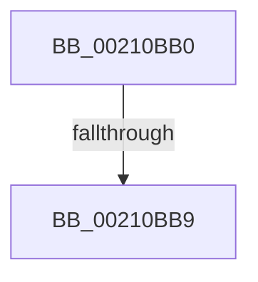

# KiAbThreadRemoveBoostsSlow

- RVA: `0x00210BB0`–`0x00210BCA` (길이 `26` bytes)
- VA: `0x0000000140210BB0`
- 실행 섹션: `.text`
- PDB 이름 있음: `예`; PDB Function 태그: `아니요`
- unwind 정보 RVA: `0x0005DD64`
- 디코드: `9`개 명령, `26/26` bytes 표시
- 미해석 바이트: `0` (있으면 어셈블리에 `.byte`로 보존)

> 이 문서는 커널 이미지의 기계어와 PDB 기호를 분석해 생성했습니다. 4번과 5번은 함수 원형과 자료형을 바이너리 사용 방식에서 추정한 C 해석이며 원본 소스 복구 결과는 아닙니다.

## 1. Dependencies

- 직접 호출 지점: **0**; 고유 호출 대상: **0**
- 직접 호출자로 확인된 함수: **5**
- RIP 상대 이미지 참조: **0**

### Outgoing calls
- 직접 디코드된 call 명령이 없습니다.

### Direct callers
- [sub_002102C8](Unknown_function_002102C8.md) at `0x002102D1`
- [KiAbThreadRemoveBoosts](KiAbThreadRemoveBoosts_function_00210F20.md) at `0x00210F2C`
- [KiAbConvertWaiterToOwnerEntry](KiAbConvertWaiterToOwnerEntry_function_00219430.md) at `0x00219ABB`
- [KiAbEntryFreeAndEnableInterrupts](../26/KiAbEntryFreeAndEnableInterrupts_function_002622D0.md) at `0x002623AE`
- [KiAbCrossThreadRelease](../41/KiAbCrossThreadRelease_function_004167C8.md) at `0x00416802`

### Static image references
- 디코드된 RIP-relative 메모리 참조가 없습니다.

## 2. Other-region calls and transfers

- 다른 실행 섹션으로 향하는 call: **0**
- call이 아닌 외부 분기/꼬리 이동: **1**
  - `0x00210BB3` → [sub_00210BCA + 0x249](Unknown_function_00210BCA.md) (`tail-transfer`)

## 3. Assembly (complete function range)

```asm
00210BB0  45 85 C0                        test r8d, r8d
00210BB3  0F 84 5A 02 00 00               je 0x140210e13
00210BB9  48 89 54 24 10                  mov qword ptr [rsp + 0x10], rdx
00210BBE  53                              push rbx
00210BBF  55                              push rbp
00210BC0  57                              push rdi
00210BC1  41 55                           push r13
00210BC3  48 83 EC 68                     sub rsp, 0x68
00210BC7  49 8B D8                        mov rbx, r8
```

## 4. C-style interpretation (structured pseudocode)

```c
void __fastcall KiAbThreadRemoveBoostsSlow(__int64 a1, __int64 a2, __int64 a3)
{
    __int64 v_rsp;
    unsigned __int64 v_stack_p10;

    v_stack_p10 = a2;
    v_rsp = (v_rsp) - (104);
    return;
}
```

## 5. (Beta) C Style

```c
void KiAbThreadRemoveBoostsSlow(int64_t Arg1, int64_t Arg2, int64_t Arg3)
{
    int64_t local_rsp;
    uint64_t v_stack_p10;

    v_stack_p10 = Arg2;
    local_rsp = (local_rsp) - (104);
    return;
}
```

## 6. Execution-region graph

[열기: 2D/3D 그래프와 함수 탐색 컨트롤 패널](../../../control-panel.html?section=text&rva=0x00210BB0&view=graph)

- 2D 그래프는 위에서 아래로 흐르고, 3D 그래프는 빈 공간을 드래그해 회전합니다. Shift+드래그는 이동, 휠은 확대·축소, 함수 노드 선택은 대상 보고서 이동입니다.

### Static fallback


