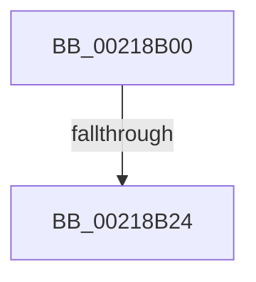

# KiAddThreadToPrcbQueue

- RVA: `0x00218B00`–`0x00218B2B` (길이 `43` bytes)
- VA: `0x0000000140218B00`
- 실행 섹션: `.text`
- PDB 이름 있음: `예`; PDB Function 태그: `예`
- unwind 정보 RVA: `0x0005EB48`
- 디코드: `12`개 명령, `43/43` bytes 표시
- 미해석 바이트: `0` (있으면 어셈블리에 `.byte`로 보존)

> 이 문서는 커널 이미지의 기계어와 PDB 기호를 분석해 생성했습니다. 4번과 5번은 함수 원형과 자료형을 바이너리 사용 방식에서 추정한 C 해석이며 원본 소스 복구 결과는 아닙니다.

## 1. Dependencies

- 직접 호출 지점: **0**; 고유 호출 대상: **0**
- 직접 호출자로 확인된 함수: **4**
- RIP 상대 이미지 참조: **0**

### Outgoing calls
- 직접 디코드된 call 명령이 없습니다.

### Direct callers
- [KiDeferGroupSchedulingPreemption](../20/KiDeferGroupSchedulingPreemption_function_0020076C.md) at `0x00200BA5`
- [KiMoveScbThreadsToNewReadylist](../30/KiMoveScbThreadsToNewReadylist_function_003099AC.md) at `0x00309B3A`
- [KiGroupSchedulingGenerationEnd](../30/KiGroupSchedulingGenerationEnd_function_0030A9B4.md) at `0x0030AF62`
- [KiRemoveThreadFromSchedulingGroup](../35/KiRemoveThreadFromSchedulingGroup_function_00356514.md) at `0x003566FB`

### Static image references
- 디코드된 RIP-relative 메모리 참조가 없습니다.

## 2. Other-region calls and transfers

- 다른 실행 섹션으로 향하는 call: **0**
- call이 아닌 외부 분기/꼬리 이동: **1**
  - `0x00218B1E` → [sub_00218E69](Unknown_function_00218E69.md) (`tail-transfer`)

## 3. Assembly (complete function range)

```asm
00218B00  40 55                           push rbp
00218B02  57                              push rdi
00218B03  41 54                           push r12
00218B05  41 57                           push r15
00218B07  48 83 EC 38                     sub rsp, 0x38
00218B0B  F7 42 78 00 00 40 00            test dword ptr [rdx + 0x78], 0x400000
00218B12  45 8B E1                        mov r12d, r9d
00218B15  4D 63 F8                        movsxd r15, r8d
00218B18  48 8B FA                        mov rdi, rdx
00218B1B  48 8B E9                        mov rbp, rcx
00218B1E  0F 85 45 03 00 00               jne 0x140218e69
00218B24  F7 42 78 00 00 40 00            test dword ptr [rdx + 0x78], 0x400000
```

## 4. C-style interpretation (structured pseudocode)

```c
void __fastcall KiAddThreadToPrcbQueue(__int64 a1, __int64 a2, int a3, int a4)
{
    __int64 v_rsp;

    v_rsp = (v_rsp) - (56);
    return;
}
```

## 5. (Beta) C Style

```c
void KiAddThreadToPrcbQueue(int64_t Arg1, void *Arg2, int32_t Arg3, int32_t Arg4)
{
    uint8_t *arg2 = (uint8_t *)Arg2;

    int64_t local_rsp;

    local_rsp = (local_rsp) - (56);
    return;
}
```

### 관측된 메모리 오프셋

구조체 형식이 확인되지 않은 접근은 인자 기준의 오프셋으로만 기록했습니다.

| 기준 인자 | 오프셋 표현 | 폭 (bit) | 접근 |
|---|---:|---:|---|
| `Arg2` | `+ 0x78` | `32` | `R` |

## 6. Execution-region graph

[열기: 2D/3D 그래프와 함수 탐색 컨트롤 패널](../../../control-panel.html?section=text&rva=0x00218B00&view=graph)

- 2D 그래프는 위에서 아래로 흐르고, 3D 그래프는 빈 공간을 드래그해 회전합니다. Shift+드래그는 이동, 휠은 확대·축소, 함수 노드 선택은 대상 보고서 이동입니다.

### Static fallback


