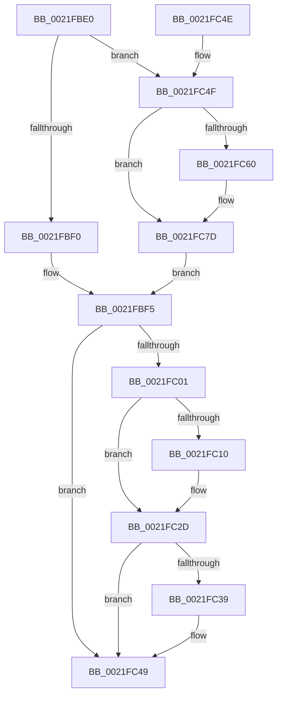

# KiAdjustRealtimePriorityFloor

- RVA: `0x0021FBE0`–`0x0021FC9C` (길이 `188` bytes)
- VA: `0x000000014021FBE0`
- 실행 섹션: `.text`
- PDB 이름 있음: `예`; PDB Function 태그: `아니요`
- unwind 정보 RVA: `0x0005F284`
- 디코드: `45`개 명령, `188/188` bytes 표시
- 미해석 바이트: `0` (있으면 어셈블리에 `.byte`로 보존)

> 이 문서는 커널 이미지의 기계어와 PDB 기호를 분석해 생성했습니다. 4번과 5번은 함수 원형과 자료형을 바이너리 사용 방식에서 추정한 C 해석이며 원본 소스 복구 결과는 아닙니다.

## 1. Dependencies

- 직접 호출 지점: **2**; 고유 호출 대상: **1**
- 직접 호출자로 확인된 함수: **5**
- RIP 상대 이미지 참조: **0**

### Outgoing calls
- `0x0021FC27` → [KeBugCheckEx](../4F/KeBugCheckEx_function_004FD660.md) (function, `0x004FD660`)
- `0x0021FC77` → [KeBugCheckEx](../4F/KeBugCheckEx_function_004FD660.md) (function, `0x004FD660`)

### Direct callers
- [KiWakePriQueueWaiter](KiWakePriQueueWaiter_function_0021F720.md) at `0x0021F84F`
- [KeSetPriorityThread](../2C/KeSetPriorityThread_function_002C76E0.md) at `0x002C77F6`
- [KeSetActualBasePriorityThread](../3C/KeSetActualBasePriorityThread_function_003C4370.md) at `0x003C4471`
- [KeRemovePriQueue](../3C/KeRemovePriQueue_function_003C5090.md) at `0x003C5555`
- [KeSetBasePriorityThread](../3C/KeSetBasePriorityThread_function_003C6EB0.md) at `0x003C6FFB`

### Static image references
- 디코드된 RIP-relative 메모리 참조가 없습니다.

## 2. Other-region calls and transfers

- 다른 실행 섹션으로 향하는 call: **0**
- 별도 외부 분기/꼬리 이동을 확인하지 못했습니다.

## 3. Assembly (complete function range)

```asm
0021FBE0  48 83 EC 38                     sub rsp, 0x38
0021FBE4  4C 63 89 04 04 00 00            movsxd r9, dword ptr [rcx + 0x404]
0021FBEB  83 FA 10                        cmp edx, 0x10
0021FBEE  7D 5F                           jge 0x14021fc4f
0021FBF0  BA 20 00 00 00                  mov edx, 0x20
0021FBF5  89 91 04 04 00 00               mov dword ptr [rcx + 0x404], edx
0021FBFB  41 83 F9 20                     cmp r9d, 0x20
0021FBFF  74 48                           je 0x14021fc49
0021FC01  41 8A 84 09 38 03 00 00         mov al, byte ptr [r9 + rcx + 0x338]
0021FC09  49 8B D1                        mov rdx, r9
0021FC0C  84 C0                           test al, al
0021FC0E  75 1D                           jne 0x14021fc2d
0021FC10  48 83 64 24 20 00               and qword ptr [rsp + 0x20], 0
0021FC16  4C 8B C2                        mov r8, rdx
0021FC19  48 8B D1                        mov rdx, rcx
0021FC1C  41 B9 02 00 00 00               mov r9d, 2
0021FC22  B9 57 01 00 00                  mov ecx, 0x157
0021FC27  E8 34 DA 2D 00                  call 0x1404fd660
0021FC2C  CC                              int3
0021FC2D  2C 01                           sub al, 1
0021FC2F  41 88 84 09 38 03 00 00         mov byte ptr [r9 + rcx + 0x338], al
0021FC37  75 10                           jne 0x14021fc49
0021FC39  8B 81 58 03 00 00               mov eax, dword ptr [rcx + 0x358]
0021FC3F  44 0F BB C8                     btc eax, r9d
0021FC43  89 81 58 03 00 00               mov dword ptr [rcx + 0x358], eax
0021FC49  48 83 C4 38                     add rsp, 0x38
0021FC4D  C3                              ret
0021FC4E  CC                              int3
0021FC4F  48 63 C2                        movsxd rax, edx
0021FC52  44 8A 84 08 38 03 00 00         mov r8b, byte ptr [rax + rcx + 0x338]
0021FC5A  41 80 F8 FF                     cmp r8b, 0xff
0021FC5E  75 1D                           jne 0x14021fc7d
0021FC60  48 83 64 24 20 00               and qword ptr [rsp + 0x20], 0
0021FC66  48 8B D1                        mov rdx, rcx
0021FC69  B9 57 01 00 00                  mov ecx, 0x157
0021FC6E  41 B9 01 00 00 00               mov r9d, 1
0021FC74  4C 8B C0                        mov r8, rax
0021FC77  E8 E4 D9 2D 00                  call 0x1404fd660
0021FC7C  CC                              int3
0021FC7D  41 FE C0                        inc r8b
0021FC80  44 88 84 08 38 03 00 00         mov byte ptr [rax + rcx + 0x338], r8b
0021FC88  8B 81 58 03 00 00               mov eax, dword ptr [rcx + 0x358]
0021FC8E  0F AB D0                        bts eax, edx
0021FC91  89 81 58 03 00 00               mov dword ptr [rcx + 0x358], eax
0021FC97  E9 59 FF FF FF                  jmp 0x14021fbf5
```

## 4. C-style interpretation (structured pseudocode)

```c
__int64 __fastcall KiAdjustRealtimePriorityFloor(__int64 a1, int a2)
{
    __int64 result;
    __int64 v_rsp;
    unsigned __int64 v_stack_m18;
    unsigned __int64 v_stack_p20;

    v_rsp = (v_rsp) - (56);
    if (a2 >= 16) goto loc_0021FC4F;
loc_0021FBF5:
    *(unsigned int *)(a1 + 1028) = 32;
    if (((unsigned int)((int)(*(unsigned int *)(a1 + 1028)))) == 32) goto loc_0021FC49;
    result = *(unsigned __int8 *)((int)(*(unsigned int *)(a1 + 1028)) + a1 * 1 + 824);
    if ((unsigned __int8)(*(unsigned __int8 *)((int)(*(unsigned int *)(a1 + 1028)) + a1 * 1 + 824)) == 0) {
        a3 = (int)(*(unsigned int *)(a1 + 1028));
        a2 = a1;
        a4 = 2;
        a1 = 343;
        result = KeBugCheckEx(a1, a2, a3, a4);
    }
    result = (unsigned __int8)((result) - (1));
    *(unsigned __int8 *)(a4 + a1 * 1 + 824) = (unsigned __int8)(result);
    if (!(condition_is_not_equal)) {
        result = *(unsigned int *)(a1 + 856);
        *(unsigned int *)(a1 + 856) = (unsigned int)(result);
    }
    v_rsp = (v_rsp) + (56);
    return result;
loc_0021FC4F:
    result = (int)(a2);
    if (((unsigned __int8)(*(unsigned __int8 *)((int)(a2) + a1 * 1 + 824))) == 255) {
        a2 = a1;
        a1 = 343;
        a4 = 1;
        a3 = (int)(a2);
        result = KeBugCheckEx(a1, a2, a3, a4);
    }
    a3 = (unsigned __int8)((a3) + 1);
    *(unsigned __int8 *)(result + a1 * 1 + 824) = (unsigned __int8)(a3);
    *(unsigned int *)(a1 + 856) = (unsigned int)((unsigned int)(*(unsigned int *)(a1 + 856)));
    goto loc_0021FBF5;
}
```

## 5. (Beta) C Style

```c
int64_t KiAdjustRealtimePriorityFloor(void *Arg1, int32_t Arg2)
{
    uint8_t *arg1 = (uint8_t *)Arg1;

    int64_t result;
    int64_t local_rsp;
    uint64_t v_stack_m18;
    uint64_t v_stack_p20;

    local_rsp = (local_rsp) - (56);
    if (Arg2 >= 16) goto loc_0021FC4F;
loc_0021FBF5:
    *(uint32_t *)(arg1 + 0x404) = 32;
    if (((uint32_t)((int32_t)(*(uint32_t *)(arg1 + 0x404)))) == 32) goto loc_0021FC49;
    result = *(uint8_t *)((int32_t)(*(uint32_t *)(arg1 + 0x404)) + arg1 * 1 + 0x338);
    if ((uint8_t)(*(uint8_t *)((int32_t)(*(uint32_t *)(arg1 + 0x404)) + arg1 * 1 + 0x338)) == 0) {
        a3 = (int32_t)(*(uint32_t *)(arg1 + 0x404));
        Arg2 = Arg1;
        a4 = 2;
        Arg1 = 343;
        result = KeBugCheckEx(Arg1, Arg2, a3, a4);
    }
    result = (uint8_t)((result) - (1));
    *(uint8_t *)(a4 + arg1 * 1 + 0x338) = (uint8_t)(result);
    if (!(condition_is_not_equal)) {
        result = *(uint32_t *)(arg1 + 0x358);
        *(uint32_t *)(arg1 + 0x358) = (uint32_t)(result);
    }
    local_rsp = (local_rsp) + (56);
    return result;
loc_0021FC4F:
    result = (int32_t)(Arg2);
    if (((uint8_t)(*(uint8_t *)((int32_t)(Arg2) + arg1 * 1 + 0x338))) == 255) {
        Arg2 = Arg1;
        Arg1 = 343;
        a4 = 1;
        a3 = (int32_t)(Arg2);
        result = KeBugCheckEx(Arg1, Arg2, a3, a4);
    }
    a3 = (uint8_t)((a3) + 1);
    *(uint8_t *)(result + arg1 * 1 + 0x338) = (uint8_t)(a3);
    *(uint32_t *)(arg1 + 0x358) = (uint32_t)((uint32_t)(*(uint32_t *)(arg1 + 0x358)));
    goto loc_0021FBF5;
}
```

### 관측된 메모리 오프셋

구조체 형식이 확인되지 않은 접근은 인자 기준의 오프셋으로만 기록했습니다.

| 기준 인자 | 오프셋 표현 | 폭 (bit) | 접근 |
|---|---:|---:|---|
| `Arg1` | `+ 0x404` | `32` | `R` |

## 6. Execution-region graph

[열기: 2D/3D 그래프와 함수 탐색 컨트롤 패널](../../../control-panel.html?section=text&rva=0x0021FBE0&view=graph)

- 2D 그래프는 위에서 아래로 흐르고, 3D 그래프는 빈 공간을 드래그해 회전합니다. Shift+드래그는 이동, 휠은 확대·축소, 함수 노드 선택은 대상 보고서 이동입니다.

### Static fallback


