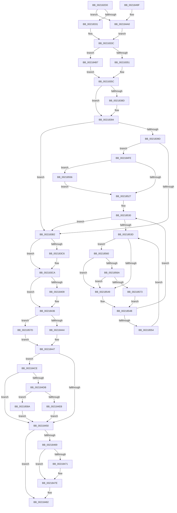

# KiAttachProcess

- RVA: `0x002182D0`–`0x00218595` (길이 `709` bytes)
- VA: `0x00000001402182D0`
- 실행 섹션: `.text`
- PDB 이름 있음: `예`; PDB Function 태그: `아니요`
- unwind 정보 RVA: `0x0005E984`
- 디코드: `169`개 명령, `709/709` bytes 표시
- 미해석 바이트: `0` (있으면 어셈블리에 `.byte`로 보존)

> 이 문서는 커널 이미지의 기계어와 PDB 기호를 분석해 생성했습니다. 4번과 5번은 함수 원형과 자료형을 바이너리 사용 방식에서 추정한 C 해석이며 원본 소스 복구 결과는 아닙니다.

## 1. Dependencies

- 직접 호출 지점: **7**; 고유 호출 대상: **7**
- 직접 호출자로 확인된 함수: **1**
- RIP 상대 이미지 참조: **5**

### Outgoing calls
- `0x00218431` → [KiSetAddressPolicy](KiSetAddressPolicy_function_002178A0.md) (function, `0x002178A0`)
- `0x00218479` → [KiLowerIrqlProcessIrqlFlags](../4F/KiLowerIrqlProcessIrqlFlags_function_004F5698.md) (function, `0x004F5698`)
- `0x0021850C` → [KiInSwapSingleProcess](../35/KiInSwapSingleProcess_function_00355474.md) (function, `0x00355474`)
- `0x00218559` → [KiRaiseIrqlProcessIrqlFlags](../4F/KiRaiseIrqlProcessIrqlFlags_function_004F56FC.md) (function, `0x004F56FC`)
- `0x0021856A` → [KiCheckVpBackingLongSpinWaitHypercall](../30/KiCheckVpBackingLongSpinWaitHypercall_function_0030F490.md) (function, `0x0030F490`)
- `0x00218576` → [HvlNotifyLongSpinWait](../30/HvlNotifyLongSpinWait_function_0030F460.md) (function, `0x0030F460`)
- `0x00218580` → [HvlSwitchVirtualAddressSpace](../3C/HvlSwitchVirtualAddressSpace_function_003C7C60.md) (function, `0x003C7C60`)

### Direct callers
- [KeAttachProcess](../48/KeAttachProcess_function_00486540.md) at `0x004865B6`

### Static image references
- `0x002183FC` → RVA `0x01201840` (`CFGRO`; read)
- `0x00218436` → RVA `0x00FC6AB8` (`ALMOSTRO`; read)
- `0x00218469` → RVA `0x00FC6D20` (`ALMOSTRO`; read)
- `0x002184CE` → RVA `0x00FC6A87` (`ALMOSTRO`; read)
- `0x00218540` → RVA `0x00FC52AC` (`ALMOSTRO`; reference)

## 2. Other-region calls and transfers

- 다른 실행 섹션으로 향하는 call: **0**
- 별도 외부 분기/꼬리 이동을 확인하지 못했습니다.

## 3. Assembly (complete function range)

```asm
002182D0  48 89 5C 24 08                  mov qword ptr [rsp + 8], rbx
002182D5  48 89 6C 24 10                  mov qword ptr [rsp + 0x10], rbp
002182DA  48 89 74 24 18                  mov qword ptr [rsp + 0x18], rsi
002182DF  57                              push rdi
002182E0  41 54                           push r12
002182E2  41 55                           push r13
002182E4  41 56                           push r14
002182E6  41 57                           push r15
002182E8  48 83 EC 20                     sub rsp, 0x20
002182EC  48 8B 7C 24 70                  mov rdi, qword ptr [rsp + 0x70]
002182F1  4C 8D 91 98 00 00 00            lea r10, [rcx + 0x98]
002182F8  49 8B 42 20                     mov rax, qword ptr [r10 + 0x20]
002182FC  48 8B D9                        mov rbx, rcx
002182FF  41 8B E9                        mov ebp, r9d
00218302  45 0F B6 F0                     movzx r14d, r8b
00218306  48 8B F2                        mov rsi, rdx
00218309  48 89 47 20                     mov qword ptr [rdi + 0x20], rax
0021830D  41 0F B6 42 28                  movzx eax, byte ptr [r10 + 0x28]
00218312  88 47 28                        mov byte ptr [rdi + 0x28], al
00218315  41 0F B6 42 29                  movzx eax, byte ptr [r10 + 0x29]
0021831A  88 47 29                        mov byte ptr [rdi + 0x29], al
0021831D  41 0F B6 42 2A                  movzx eax, byte ptr [r10 + 0x2a]
00218322  88 47 2A                        mov byte ptr [rdi + 0x2a], al
00218325  49 8B 0A                        mov rcx, qword ptr [r10]
00218328  49 3B CA                        cmp rcx, r10
0021832B  0F 85 6F 01 00 00               jne 0x1402184a0
00218331  48 89 7F 08                     mov qword ptr [rdi + 8], rdi
00218335  48 89 3F                        mov qword ptr [rdi], rdi
00218338  C6 47 29 00                     mov byte ptr [rdi + 0x29], 0
0021833C  49 8B 52 10                     mov rdx, qword ptr [r10 + 0x10]
00218340  49 8D 42 10                     lea rax, [r10 + 0x10]
00218344  48 3B D0                        cmp rdx, rax
00218347  48 8D 47 10                     lea rax, [rdi + 0x10]
0021834B  0F 85 66 01 00 00               jne 0x1402184b7
00218351  48 89 40 08                     mov qword ptr [rax + 8], rax
00218355  48 89 00                        mov qword ptr [rax], rax
00218358  C6 47 2A 00                     mov byte ptr [rdi + 0x2a], 0
0021835C  4D 89 52 08                     mov qword ptr [r10 + 8], r10
00218360  48 8D 83 A8 00 00 00            lea rax, [rbx + 0xa8]
00218367  4D 89 12                        mov qword ptr [r10], r10
0021836A  48 89 40 08                     mov qword ptr [rax + 8], rax
0021836E  48 89 00                        mov qword ptr [rax], rax
00218371  48 8D 83 58 02 00 00            lea rax, [rbx + 0x258]
00218378  66 C7 83 C0 00 00 00 00 00      mov word ptr [rbx + 0xc0], 0
00218381  C6 83 C2 00 00 00 00            mov byte ptr [rbx + 0xc2], 0
00218388  48 3B F8                        cmp rdi, rax
0021838B  75 07                           jne 0x140218394
0021838D  C6 83 4A 02 00 00 01            mov byte ptr [rbx + 0x24a], 1
00218394  45 33 E4                        xor r12d, r12d
00218397  40 F6 C5 01                     test bpl, 1
0021839B  75 15                           jne 0x1402183b2
0021839D  B8 08 00 00 00                  mov eax, 8
002183A2  F0 0F C1 86 08 01 00 00         lock xadd dword ptr [rsi + 0x108], eax
002183AA  A8 07                           test al, 7
002183AC  0F 85 4C 01 00 00               jne 0x1402184fe
002183B2  81 4B 74 00 08 00 00            or dword ptr [rbx + 0x74], 0x800
002183B9  90                              nop
002183BA  48 89 B3 B8 00 00 00            mov qword ptr [rbx + 0xb8], rsi
002183C1  83 E5 02                        and ebp, 2
002183C4  75 04                           jne 0x1402183ca
002183C6  4C 89 63 40                     mov qword ptr [rbx + 0x40], r12
002183CA  65 48 8B 0C 25 20 00 00 00      mov rcx, qword ptr gs:[0x20]
002183D3  4C 8B 6F 20                     mov r13, qword ptr [rdi + 0x20]
002183D7  0F B6 81 D0 00 00 00            movzx eax, byte ptr [rcx + 0xd0]
002183DE  44 0F B6 A1 D1 00 00 00         movzx r12d, byte ptr [rcx + 0xd1]
002183E6  4C 8D 3C C5 00 00 00 00         lea r15, [rax*8]
002183EE  48 8B 86 80 00 00 00            mov rax, qword ptr [rsi + 0x80]
002183F5  F0 4E 0F AB 64 38 08            lock bts qword ptr [rax + r15 + 8], r12
002183FC  80 3D 3D 94 FE 00 00            cmp byte ptr [rip + 0xfe943d], 0
00218403  48 8B 7E 28                     mov rdi, qword ptr [rsi + 0x28]
00218407  74 2D                           je 0x140218436
00218409  48 B9 00 00 00 00 00 00 00 80   movabs rcx, 0x8000000000000000
00218413  48 8B C7                        mov rax, rdi
00218416  48 0B C1                        or rax, rcx
00218419  40 F6 C7 02                     test dil, 2
0021841D  48 0F 44 C7                     cmove rax, rdi
00218421  65 48 89 04 25 00 B0 00 00      mov qword ptr gs:[0xb000], rax
0021842A  0F B6 8E 60 01 00 00            movzx ecx, byte ptr [rsi + 0x160]
00218431  E8 6A F4 FF FF                  call 0x1402178a0
00218436  8B 05 7C E6 DA 00               mov eax, dword ptr [rip + 0xdae67c]
0021843C  A8 01                           test al, 1
0021843E  0F 85 39 01 00 00               jne 0x14021857d
00218444  0F 22 DF                        mov cr3, rdi
00218447  80 3D F2 93 FE 00 00            cmp byte ptr [rip + 0xfe93f2], 0
0021844E  75 7E                           jne 0x1402184ce
00218450  49 8B 85 80 00 00 00            mov rax, qword ptr [r13 + 0x80]
00218457  F0 4E 0F B3 64 38 08            lock btr qword ptr [rax + r15 + 8], r12
0021845E  81 63 74 FF F7 FF FF            and dword ptr [rbx + 0x74], 0xfffff7ff
00218465  85 ED                           test ebp, ebp
00218467  75 19                           jne 0x140218482
00218469  39 2D B1 E8 DA 00               cmp dword ptr [rip + 0xdae8b1], ebp
0021846F  74 0D                           je 0x14021847e
00218471  44 0F 20 C1                     mov rcx, cr8
00218475  41 0F B6 D6                     movzx edx, r14b
00218479  E8 1A D2 2D 00                  call 0x1404f5698
0021847E  45 0F 22 C6                     mov cr8, r14
00218482  48 8B 5C 24 50                  mov rbx, qword ptr [rsp + 0x50]
00218487  48 8B 6C 24 58                  mov rbp, qword ptr [rsp + 0x58]
0021848C  48 8B 74 24 60                  mov rsi, qword ptr [rsp + 0x60]
00218491  48 83 C4 20                     add rsp, 0x20
00218495  41 5F                           pop r15
00218497  41 5E                           pop r14
00218499  41 5D                           pop r13
0021849B  41 5C                           pop r12
0021849D  5F                              pop rdi
0021849E  C3                              ret
0021849F  CC                              int3
002184A0  49 8B 42 08                     mov rax, qword ptr [r10 + 8]
002184A4  48 89 0F                        mov qword ptr [rdi], rcx
002184A7  48 89 47 08                     mov qword ptr [rdi + 8], rax
002184AB  48 89 79 08                     mov qword ptr [rcx + 8], rdi
002184AF  48 89 38                        mov qword ptr [rax], rdi
002184B2  E9 85 FE FF FF                  jmp 0x14021833c
002184B7  49 8B 4A 18                     mov rcx, qword ptr [r10 + 0x18]
002184BB  48 89 10                        mov qword ptr [rax], rdx
002184BE  48 89 4F 18                     mov qword ptr [rdi + 0x18], rcx
002184C2  48 89 42 08                     mov qword ptr [rdx + 8], rax
002184C6  48 89 01                        mov qword ptr [rcx], rax
002184C9  E9 8E FE FF FF                  jmp 0x14021835c
002184CE  80 3D B2 E5 DA 00 00            cmp byte ptr [rip + 0xdae5b2], 0
002184D5  0F 85 75 FF FF FF               jne 0x140218450
002184DB  0F 20 E1                        mov rcx, cr4
002184DE  48 F7 C1 80 00 02 00            test rcx, 0x20080
002184E5  0F 84 9F 00 00 00               je 0x14021858a
002184EB  48 8B C1                        mov rax, rcx
002184EE  48 0F BA F8 07                  btc rax, 7
002184F3  0F 22 E0                        mov cr4, rax
002184F6  0F 22 E1                        mov cr4, rcx
002184F9  E9 52 FF FF FF                  jmp 0x140218450
002184FE  45 0F B6 C6                     movzx r8d, r14b
00218502  4C 89 63 40                     mov qword ptr [rbx + 0x40], r12
00218506  48 8B D6                        mov rdx, rsi
00218509  48 8B CB                        mov rcx, rbx
0021850C  E8 63 CF 13 00                  call 0x140355474
00218511  44 0F 20 C1                     mov rcx, cr8
00218515  B8 02 00 00 00                  mov eax, 2
0021851A  44 0F 22 C0                     mov cr8, rax
0021851E  44 39 25 FB E7 DA 00            cmp dword ptr [rip + 0xdae7fb], r12d
00218525  75 2F                           jne 0x140218556
00218527  45 8B FC                        mov r15d, r12d
0021852A  66 0F 1F 44 00 00               nop word ptr [rax + rax]
00218530  F0 48 0F BA 6B 40 00            lock bts qword ptr [rbx + 0x40], 0
00218537  0F 83 75 FE FF FF               jae 0x1402183b2
0021853D  41 FF C7                        inc r15d
00218540  44 85 3D 65 CD DA 00            test dword ptr [rip + 0xdacd65], r15d
00218547  74 17                           je 0x140218560
00218549  F3 90                           pause
0021854B  48 8B 43 40                     mov rax, qword ptr [rbx + 0x40]
0021854F  48 85 C0                        test rax, rax
00218552  74 DC                           je 0x140218530
00218554  EB E7                           jmp 0x14021853d
00218556  0F B6 D0                        movzx edx, al
00218559  E8 9E D1 2D 00                  call 0x1404f56fc
0021855E  EB C7                           jmp 0x140218527
00218560  8B 05 52 E5 DA 00               mov eax, dword ptr [rip + 0xdae552]
00218566  A8 40                           test al, 0x40
00218568  74 DF                           je 0x140218549
0021856A  E8 21 6F 0F 00                  call 0x14030f490
0021856F  84 C0                           test al, al
00218571  74 D6                           je 0x140218549
00218573  41 8B CF                        mov ecx, r15d
00218576  E8 E5 6E 0F 00                  call 0x14030f460
0021857B  EB CE                           jmp 0x14021854b
0021857D  48 8B CF                        mov rcx, rdi
00218580  E8 DB F6 1A 00                  call 0x1403c7c60
00218585  E9 BD FE FF FF                  jmp 0x140218447
0021858A  0F 20 D8                        mov rax, cr3
0021858D  0F 22 D8                        mov cr3, rax
00218590  E9 BB FE FF FF                  jmp 0x140218450
```

## 4. C-style interpretation (structured pseudocode)

```c
__int64 __fastcall KiAttachProcess(__int64 a1, __int64 a2, unsigned __int8 a3, int a4, __int64 a5)
{
    __int64 result;
    __int64 v_r12;
    __int64 v_r15;
    __int64 v_rbp;
    __int64 v_rsp;
    unsigned __int64 v_stack_p10;
    unsigned __int64 v_stack_p18;
    unsigned __int64 v_stack_p8;

    v_stack_p8 = v_rbx;
    v_stack_p10 = v_rbp;
    v_stack_p18 = v_rsi;
    v_rsp = (v_rsp) - (32);
    *(unsigned __int64 *)(a5 + 32) = *(unsigned __int64 *)(a1 + 152 + 32);
    *(unsigned __int8 *)(a5 + 40) = (unsigned __int8)(*(unsigned __int8 *)(a1 + 152 + 40));
    *(unsigned __int8 *)(a5 + 41) = (unsigned __int8)(*(unsigned __int8 *)(a1 + 152 + 41));
    *(unsigned __int8 *)(a5 + 42) = (unsigned __int8)(*(unsigned __int8 *)(a1 + 152 + 42));
    if ((*(unsigned __int64 *)(a1 + 152)) != (a1 + 152)) goto loc_002184A0;
    *(unsigned __int64 *)(a5 + 8) = a5;
    *(unsigned __int64 *)(a5) = a5;
    *(unsigned __int8 *)(a5 + 41) = 0;
loc_0021833C:
    if ((*(unsigned __int64 *)(a1 + 152 + 16)) != (a1 + 152 + 16)) goto loc_002184B7;
    *(unsigned __int64 *)(a5 + 16 + 8) = a5 + 16;
    *(unsigned __int64 *)(a5 + 16) = a5 + 16;
    *(unsigned __int8 *)(a5 + 42) = 0;
loc_0021835C:
    *(unsigned __int64 *)(a1 + 152 + 8) = a1 + 152;
    *(unsigned __int64 *)(a1 + 152) = a1 + 152;
    *(unsigned __int64 *)(a1 + 168 + 8) = a1 + 168;
    *(unsigned __int64 *)(a1 + 168) = a1 + 168;
    *(unsigned __int16 *)(a1 + 192) = 0;
    *(unsigned __int8 *)(a1 + 194) = 0;
    if (a5 == (a1 + 600)) {
        *(unsigned __int8 *)(a1 + 586) = 1;
    }
    v_r12 = 0;
    if ((((unsigned __int8)((unsigned int)(a4))) & (1)) != 0) goto loc_002183B2;
    if (((8) & (7)) != 0) goto loc_002184FE;
loc_002183B2:
    *(unsigned __int64 *)(a1 + 184) = a2;
    v_rbp = (unsigned int)(((unsigned int)(a4)) & (2));
    if (!(condition_is_not_equal)) {
        *(unsigned __int64 *)(a1 + 64) = 0;
    }
    result = *(unsigned __int64 *)(a2 + 128);
    if ((*(unsigned __int8 *)(v_rip + 16684093)) != 0) {
        result = *(unsigned __int64 *)(a2 + 40);
        result = (result) | (*(unsigned __int64 *)(gs_base + (0 + 32)));
        if ((((unsigned __int8)(*(unsigned __int64 *)(a2 + 40))) & (2)) == 0) { result = *(unsigned __int64 *)(a2 + 40); }
        *(unsigned __int64 *)(gs_base + (0 + 45056)) = result;
        a1 = *(unsigned __int8 *)(a2 + 352);
        result = KiSetAddressPolicy(a1, *(unsigned __int64 *)(a1 + 152 + 16), a3, a4);
    }
    if ((((unsigned __int8)((unsigned int)(*(unsigned int *)(v_rip + 14345852)))) & (1)) != 0) goto loc_0021857D;
loc_00218447:
    if ((*(unsigned __int8 *)(v_rip + 16684018)) != 0) goto loc_002184CE;
loc_00218450:
    if ((unsigned int)(v_rbp) != 0) goto loc_00218482;
    result = *(unsigned __int64 *)(*(unsigned __int64 *)(a5 + 32) + 128);
    if ((*(unsigned int *)(v_rip + 14346417)) != ((unsigned int)(v_rbp))) {
        a1 = v_cr8;
        a2 = a3;
        result = KiLowerIrqlProcessIrqlFlags(a1, a2, a3, a4);
    }
loc_00218482:
    v_rsp = (v_rsp) + (32);
    return result;
loc_002184A0:
    *(unsigned __int64 *)(*(unsigned __int64 *)(a2 + 40)) = a1;
    *(unsigned __int64 *)(*(unsigned __int64 *)(a2 + 40) + 8) = *(unsigned __int64 *)(a1 + 152 + 8);
    *(unsigned __int64 *)(a1 + 8) = *(unsigned __int64 *)(a2 + 40);
    *(unsigned __int64 *)(*(unsigned __int64 *)(a1 + 152 + 8)) = *(unsigned __int64 *)(a2 + 40);
    goto loc_0021833C;
loc_002184B7:
    *(unsigned __int64 *)(*(unsigned __int64 *)(a1 + 152 + 8)) = a2;
    *(unsigned __int64 *)(*(unsigned __int64 *)(a2 + 40) + 24) = *(unsigned __int64 *)(a1 + 152 + 24);
    *(unsigned __int64 *)(a2 + 8) = *(unsigned __int64 *)(a1 + 152 + 8);
    *(unsigned __int64 *)(*(unsigned __int64 *)(a1 + 152 + 24)) = *(unsigned __int64 *)(a1 + 152 + 8);
    goto loc_0021835C;
loc_002184CE:
    if ((*(unsigned __int8 *)(v_rip + 14345650)) != 0) goto loc_00218450;
    if (((v_cr4) & (0x20080ULL)) == 0) goto loc_0021858A;
    goto loc_00218450;
loc_002184FE:
    *(unsigned __int64 *)(v_stack_p8 + 64) = *(unsigned __int8 *)(*(unsigned __int64 *)(gs_base + (0 + 32)) + 209);
    result = KiInSwapSingleProcess(v_stack_p8, v_stack_p18, a3, a4);
    if ((*(unsigned int *)(v_rip + 14346235)) != ((unsigned int)(*(unsigned __int8 *)(*(unsigned __int64 *)(gs_base + (0 + 32)) + 209)))) goto loc_00218556;
loc_00218527:
loc_00218530:
    if ((*(unsigned int *)(v_rip + 14346235)) >= ((unsigned int)(*(unsigned __int8 *)(*(unsigned __int64 *)(gs_base + (0 + 32)) + 209)))) goto loc_002183B2;
loc_0021853D:
    v_r15 = (unsigned int)(((unsigned int)((unsigned int)(*(unsigned __int8 *)(*(unsigned __int64 *)(gs_base + (0 + 32)) + 209)))) + 1);
    if (((*(unsigned int *)(v_rip + 14339429)) & ((unsigned int)(v_r15))) == 0) goto loc_00218560;
loc_00218549:
loc_0021854B:
    if (*(unsigned __int64 *)(v_stack_p8 + 64) == 0) goto loc_00218530;
    goto loc_0021853D;
loc_00218556:
    result = KiRaiseIrqlProcessIrqlFlags(a3, (unsigned __int8)(*(unsigned __int64 *)(v_stack_p8 + 64)), a3, a4);
    goto loc_00218527;
loc_00218560:
    if ((((unsigned __int8)((unsigned int)(*(unsigned int *)(v_rip + 14345554)))) & (64)) == 0) goto loc_00218549;
    result = KiCheckVpBackingLongSpinWaitHypercall(a3, (unsigned __int8)(*(unsigned __int64 *)(v_stack_p8 + 64)), a3, a4);
    if ((unsigned __int8)(result) == 0) goto loc_00218549;
    result = HvlNotifyLongSpinWait((unsigned int)((unsigned int)(v_r15)), (unsigned __int8)(*(unsigned __int64 *)(v_stack_p8 + 64)), a3, a4);
    goto loc_0021854B;
loc_0021857D:
    result = HvlSwitchVirtualAddressSpace(*(unsigned __int64 *)(a2 + 40), (unsigned __int8)(*(unsigned __int64 *)(v_stack_p8 + 64)), a3, a4);
    goto loc_00218447;
loc_0021858A:
    goto loc_00218450;
}
```

## 5. (Beta) C Style

```c
int64_t KiAttachProcess(void *Arg1, void *Arg2, uint8_t Arg3, int32_t Arg4, void *Arg5)
{
    uint8_t *arg1 = (uint8_t *)Arg1;
    uint8_t *arg2 = (uint8_t *)Arg2;
    uint8_t *arg5 = (uint8_t *)Arg5;

    int64_t result;
    int64_t local_r12;
    int64_t local_r15;
    int64_t local_rbp;
    int64_t local_rsp;
    uint64_t v_stack_p10;
    uint64_t v_stack_p18;
    uint64_t v_stack_p8;

    v_stack_p8 = local_rbx;
    v_stack_p10 = local_rbp;
    v_stack_p18 = local_rsi;
    local_rsp = (local_rsp) - (32);
    *(uint64_t *)(arg5 + 0x20) = *(uint64_t *)(arg1 + 0x98 + 0x20);
    *(uint8_t *)(arg5 + 0x28) = (uint8_t)(*(uint8_t *)(arg1 + 0x98 + 0x28));
    *(uint8_t *)(arg5 + 0x29) = (uint8_t)(*(uint8_t *)(arg1 + 0x98 + 0x29));
    *(uint8_t *)(arg5 + 0x2A) = (uint8_t)(*(uint8_t *)(arg1 + 0x98 + 0x2A));
    if ((*(uint64_t *)(arg1 + 0x98)) != (Arg1 + 152)) goto loc_002184A0;
    *(void **)(arg5 + 0x8) = Arg5;
    *(void **)(arg5) = Arg5;
    *(uint8_t *)(arg5 + 0x29) = 0;
loc_0021833C:
    if ((*(uint64_t *)(arg1 + 0x98 + 0x10)) != (Arg1 + 152 + 16)) goto loc_002184B7;
    *(void **)(arg5 + 0x10 + 0x8) = Arg5 + 16;
    *(void **)(arg5 + 0x10) = Arg5 + 16;
    *(uint8_t *)(arg5 + 0x2A) = 0;
loc_0021835C:
    *(void **)(arg1 + 0x98 + 0x8) = Arg1 + 152;
    *(void **)(arg1 + 0x98) = Arg1 + 152;
    *(void **)(arg1 + 0xA8 + 0x8) = Arg1 + 168;
    *(void **)(arg1 + 0xA8) = Arg1 + 168;
    *(uint16_t *)(arg1 + 0xC0) = 0;
    *(uint8_t *)(arg1 + 0xC2) = 0;
    if (Arg5 == (Arg1 + 600)) {
        *(uint8_t *)(arg1 + 0x24A) = 1;
    }
    local_r12 = 0;
    if ((((uint8_t)((uint32_t)(Arg4))) & (1)) != 0) goto loc_002183B2;
    if (((8) & (7)) != 0) goto loc_002184FE;
loc_002183B2:
    *(void **)(arg1 + 0xB8) = Arg2;
    local_rbp = (uint32_t)(((uint32_t)(Arg4)) & (2));
    if (!(condition_is_not_equal)) {
        *(uint64_t *)(arg1 + 0x40) = 0;
    }
    result = *(uint64_t *)(arg2 + 0x80);
    if ((*(uint8_t *)(v_rip + 0xFE943D)) != 0) {
        result = *(uint64_t *)(arg2 + 0x28);
        result = (result) | (*(uint64_t *)(gs_base + (0 + 0x20)));
        if ((((uint8_t)(*(uint64_t *)(arg2 + 0x28))) & (2)) == 0) { result = *(uint64_t *)(arg2 + 0x28); }
        *(uint64_t *)(gs_base + (0 + 0xB000)) = result;
        Arg1 = *(uint8_t *)(arg2 + 0x160);
        result = KiSetAddressPolicy(Arg1, *(uint64_t *)(arg1 + 0x98 + 0x10), Arg3, Arg4);
    }
    if ((((uint8_t)((uint32_t)(*(uint32_t *)(v_rip + 0xDAE67C)))) & (1)) != 0) goto loc_0021857D;
loc_00218447:
    if ((*(uint8_t *)(v_rip + 0xFE93F2)) != 0) goto loc_002184CE;
loc_00218450:
    if ((uint32_t)(local_rbp) != 0) goto loc_00218482;
    result = *(uint64_t *)(*(uint64_t *)(arg5 + 0x20) + 0x80);
    if ((*(uint32_t *)(v_rip + 0xDAE8B1)) != ((uint32_t)(local_rbp))) {
        Arg1 = v_cr8;
        Arg2 = Arg3;
        result = KiLowerIrqlProcessIrqlFlags(Arg1, Arg2, Arg3, Arg4);
    }
loc_00218482:
    local_rsp = (local_rsp) + (32);
    return result;
loc_002184A0:
    *(void **)(*(uint64_t *)(arg2 + 0x28)) = Arg1;
    *(uint64_t *)(*(uint64_t *)(arg2 + 0x28) + 0x8) = *(uint64_t *)(arg1 + 0x98 + 0x8);
    *(uint64_t *)(arg1 + 0x8) = *(uint64_t *)(arg2 + 0x28);
    *(uint64_t *)(*(uint64_t *)(arg1 + 0x98 + 0x8)) = *(uint64_t *)(arg2 + 0x28);
    goto loc_0021833C;
loc_002184B7:
    *(void **)(*(uint64_t *)(arg1 + 0x98 + 0x8)) = Arg2;
    *(uint64_t *)(*(uint64_t *)(arg2 + 0x28) + 0x18) = *(uint64_t *)(arg1 + 0x98 + 0x18);
    *(uint64_t *)(arg2 + 0x8) = *(uint64_t *)(arg1 + 0x98 + 0x8);
    *(uint64_t *)(*(uint64_t *)(arg1 + 0x98 + 0x18)) = *(uint64_t *)(arg1 + 0x98 + 0x8);
    goto loc_0021835C;
loc_002184CE:
    if ((*(uint8_t *)(v_rip + 0xDAE5B2)) != 0) goto loc_00218450;
    if (((v_cr4) & (0x20080ULL)) == 0) goto loc_0021858A;
    goto loc_00218450;
loc_002184FE:
    *(uint64_t *)(v_stack_p8 + 0x40) = *(uint8_t *)(*(uint64_t *)(gs_base + (0 + 0x20)) + 0xD1);
    result = KiInSwapSingleProcess(v_stack_p8, v_stack_p18, Arg3, Arg4);
    if ((*(uint32_t *)(v_rip + 0xDAE7FB)) != ((uint32_t)(*(uint8_t *)(*(uint64_t *)(gs_base + (0 + 0x20)) + 0xD1)))) goto loc_00218556;
loc_00218527:
loc_00218530:
    if ((*(uint32_t *)(v_rip + 0xDAE7FB)) >= ((uint32_t)(*(uint8_t *)(*(uint64_t *)(gs_base + (0 + 0x20)) + 0xD1)))) goto loc_002183B2;
loc_0021853D:
    local_r15 = (uint32_t)(((uint32_t)((uint32_t)(*(uint8_t *)(*(uint64_t *)(gs_base + (0 + 0x20)) + 0xD1)))) + 1);
    if (((*(uint32_t *)(v_rip + 0xDACD65)) & ((uint32_t)(local_r15))) == 0) goto loc_00218560;
loc_00218549:
loc_0021854B:
    if (*(uint64_t *)(v_stack_p8 + 0x40) == 0) goto loc_00218530;
    goto loc_0021853D;
loc_00218556:
    result = KiRaiseIrqlProcessIrqlFlags(Arg3, (uint8_t)(*(uint64_t *)(v_stack_p8 + 0x40)), Arg3, Arg4);
    goto loc_00218527;
loc_00218560:
    if ((((uint8_t)((uint32_t)(*(uint32_t *)(v_rip + 0xDAE552)))) & (64)) == 0) goto loc_00218549;
    result = KiCheckVpBackingLongSpinWaitHypercall(Arg3, (uint8_t)(*(uint64_t *)(v_stack_p8 + 0x40)), Arg3, Arg4);
    if ((uint8_t)(result) == 0) goto loc_00218549;
    result = HvlNotifyLongSpinWait((uint32_t)((uint32_t)(local_r15)), (uint8_t)(*(uint64_t *)(v_stack_p8 + 0x40)), Arg3, Arg4);
    goto loc_0021854B;
loc_0021857D:
    result = HvlSwitchVirtualAddressSpace(*(uint64_t *)(arg2 + 0x28), (uint8_t)(*(uint64_t *)(v_stack_p8 + 0x40)), Arg3, Arg4);
    goto loc_00218447;
loc_0021858A:
    goto loc_00218450;
}
```

### 관측된 메모리 오프셋

구조체 형식이 확인되지 않은 접근은 인자 기준의 오프셋으로만 기록했습니다.

| 기준 인자 | 오프셋 표현 | 폭 (bit) | 접근 |
|---|---:|---:|---|
| `Arg1` | `+ 0x0` | `64` | `R` |
| `Arg1` | `+ 0x0` | `64` | `W` |
| `Arg1` | `+ 0x8` | `64` | `R` |
| `Arg1` | `+ 0x8` | `64` | `W` |
| `Arg1` | `+ 0x10` | `64` | `R` |
| `Arg1` | `+ 0x18` | `64` | `R` |
| `Arg1` | `+ 0x20` | `64` | `R` |
| `Arg1` | `+ 0x28` | `8` | `R` |
| `Arg1` | `+ 0x29` | `8` | `R` |
| `Arg1` | `+ 0x2A` | `8` | `R` |
| `Arg1` | `+ 0x40` | `64` | `R` |
| `Arg1` | `+ 0x40` | `64` | `R/W` |
| `Arg1` | `+ 0x40` | `64` | `W` |
| `Arg1` | `+ 0x74` | `32` | `R/W` |
| `Arg1` | `+ 0x98` | `64` | `R` |
| `Arg1` | `+ 0xA8` | `64` | `R` |
| `Arg1` | `+ 0xB8` | `64` | `W` |
| `Arg1` | `+ 0xC0` | `16` | `W` |
| `Arg1` | `+ 0xC2` | `8` | `W` |
| `Arg1` | `+ 0x24A` | `8` | `W` |
| `Arg1` | `+ 0x258` | `64` | `R` |
| `Arg2` | `+ 0x28` | `64` | `R` |
| `Arg2` | `+ 0x80` | `64` | `R` |
| `Arg2` | `+ 0x108` | `32` | `R/W` |
| `Arg2` | `+ 0x160` | `8` | `R` |
| `Arg5` | `+ 0x0` | `64` | `W` |
| `Arg5` | `+ 0x8` | `64` | `W` |
| `Arg5` | `+ 0x10` | `64` | `R` |
| `Arg5` | `+ 0x18` | `64` | `W` |
| `Arg5` | `+ 0x20` | `64` | `W` |
| `Arg5` | `+ 0x28` | `8` | `W` |
| `Arg5` | `+ 0x29` | `8` | `W` |

추가 오프셋 1개는 표에서 생략했습니다.

## 6. Execution-region graph

[열기: 2D/3D 그래프와 함수 탐색 컨트롤 패널](../../../control-panel.html?section=text&rva=0x002182D0&view=graph)

- 2D 그래프는 위에서 아래로 흐르고, 3D 그래프는 빈 공간을 드래그해 회전합니다. Shift+드래그는 이동, 휠은 확대·축소, 함수 노드 선택은 대상 보고서 이동입니다.

### Static fallback


