# KiComputeGroupSchedulingRank

- RVA: `0x0021EB84`–`0x0021EDC7` (길이 `579` bytes)
- VA: `0x000000014021EB84`
- 실행 섹션: `.text`
- PDB 이름 있음: `예`; PDB Function 태그: `아니요`
- unwind 정보 RVA: `0x0005F0D4`
- 디코드: `143`개 명령, `579/579` bytes 표시
- 미해석 바이트: `0` (있으면 어셈블리에 `.byte`로 보존)

> 이 문서는 커널 이미지의 기계어와 PDB 기호를 분석해 생성했습니다. 4번과 5번은 함수 원형과 자료형을 바이너리 사용 방식에서 추정한 C 해석이며 원본 소스 복구 결과는 아닙니다.

## 1. Dependencies

- 직접 호출 지점: **8**; 고유 호출 대상: **8**
- 직접 호출자로 확인된 함수: **2**
- RIP 상대 이미지 참조: **5**

### Outgoing calls
- `0x0021ECCE` → [KiCheckForEffectivePriorityChange](../46/KiCheckForEffectivePriorityChange_function_0046DD94.md) (function, `0x0046DD94`)
- `0x0021ECF3` → [KiResortScbQueue](../20/KiResortScbQueue_function_002024CC.md) (function, `0x002024CC`)
- `0x0021ED14` → [KeInterlockedSetProcessorAffinityEx](../35/KeInterlockedSetProcessorAffinityEx_function_00352560.md) (function, `0x00352560`)
- `0x0021ED48` → [KiSetClockTimerDeadlineNoWake](../4B/KiSetClockTimerDeadlineNoWake_function_004B3DA4.md) (function, `0x004B3DA4`)
- `0x0021ED5C` → [KiLowerIrqlProcessIrqlFlags](../4F/KiLowerIrqlProcessIrqlFlags_function_004F5698.md) (function, `0x004F5698`)
- `0x0021ED6F` → [KiRaiseIrqlProcessIrqlFlags](../4F/KiRaiseIrqlProcessIrqlFlags_function_004F56FC.md) (function, `0x004F56FC`)
- `0x0021ED9F` → [KeInsertQueueDpc](../20/KeInsertQueueDpc_function_00207C50.md) (function, `0x00207C50`)
- `0x0021EDBD` → [KiRemoveSchedulingGroupQueue](../20/KiRemoveSchedulingGroupQueue_function_00202638.md) (function, `0x00202638`)

### Direct callers
- [KiQueueReadyThread](KiQueueReadyThread_function_0021C7B0.md) at `0x0021C862`
- [KiGroupSchedulingQuantumEnd](../30/KiGroupSchedulingQuantumEnd_function_0030B220.md) at `0x0030B464`

### Static image references
- `0x0021EC90` → RVA `0x00FC54D0` (`ALMOSTRO`; read)
- `0x0021ECB4` → RVA `0x00FC52D0` (`ALMOSTRO`; read)
- `0x0021ED0D` → RVA `0x00E0AFD0` (`.data`; read)
- `0x0021ED19` → RVA `0x00FC6A85` (`ALMOSTRO`; read)
- `0x0021ED3A` → RVA `0x00FC6D20` (`ALMOSTRO`; read)

## 2. Other-region calls and transfers

- 다른 실행 섹션으로 향하는 call: **0**
- 별도 외부 분기/꼬리 이동을 확인하지 못했습니다.

## 3. Assembly (complete function range)

```asm
0021EB84  48 89 5C 24 08                  mov qword ptr [rsp + 8], rbx
0021EB89  48 89 6C 24 10                  mov qword ptr [rsp + 0x10], rbp
0021EB8E  48 89 74 24 18                  mov qword ptr [rsp + 0x18], rsi
0021EB93  57                              push rdi
0021EB94  48 83 EC 20                     sub rsp, 0x20
0021EB98  41 0F B7 41 70                  movzx eax, word ptr [r9 + 0x70]
0021EB9D  48 8B FA                        mov rdi, rdx
0021EBA0  32 D2                           xor dl, dl
0021EBA2  49 8B D9                        mov rbx, r9
0021EBA5  48 8B F1                        mov rsi, rcx
0021EBA8  44 0F B7 C0                     movzx r8d, ax
0021EBAC  A8 10                           test al, 0x10
0021EBAE  74 51                           je 0x14021ec01
0021EBB0  BD 04 00 00 00                  mov ebp, 4
0021EBB5  41 F6 C0 24                     test r8b, 0x24
0021EBB9  0F 84 96 00 00 00               je 0x14021ec55
0021EBBF  32 C0                           xor al, al
0021EBC1  41 F6 C0 20                     test r8b, 0x20
0021EBC5  0F 84 0D 01 00 00               je 0x14021ecd8
0021EBCB  41 F6 C0 10                     test r8b, 0x10
0021EBCF  0F 84 9D 00 00 00               je 0x14021ec72
0021EBD5  0F B7 43 70                     movzx eax, word ptr [rbx + 0x70]
0021EBD9  A8 01                           test al, 1
0021EBDB  0F 85 01 01 00 00               jne 0x14021ece2
0021EBE1  40 84 6B 70                     test byte ptr [rbx + 0x70], bpl
0021EBE5  0F 85 12 01 00 00               jne 0x14021ecfd
0021EBEB  48 8B 5C 24 30                  mov rbx, qword ptr [rsp + 0x30]
0021EBF0  48 8B 6C 24 38                  mov rbp, qword ptr [rsp + 0x38]
0021EBF5  48 8B 74 24 40                  mov rsi, qword ptr [rsp + 0x40]
0021EBFA  48 83 C4 20                     add rsp, 0x20
0021EBFE  5F                              pop rdi
0021EBFF  C3                              ret
0021EC00  CC                              int3
0021EC01  A8 02                           test al, 2
0021EC03  75 AB                           jne 0x14021ebb0
0021EC05  49 8B 01                        mov rax, qword ptr [r9]
0021EC08  49 8B 49 28                     mov rcx, qword ptr [r9 + 0x28]
0021EC0C  48 2B C8                        sub rcx, rax
0021EC0F  49 89 41 28                     mov qword ptr [r9 + 0x28], rax
0021EC13  48 8B E9                        mov rbp, rcx
0021EC16  F0 48 0F C1 6E 30               lock xadd qword ptr [rsi + 0x30], rbp
0021EC1C  48 03 E9                        add rbp, rcx
0021EC1F  48 83 7E 20 00                  cmp qword ptr [rsi + 0x20], 0
0021EC24  0F 8F 4C 01 00 00               jg 0x14021ed76
0021EC2A  44 0F B7 43 70                  movzx r8d, word ptr [rbx + 0x70]
0021EC2F  48 85 ED                        test rbp, rbp
0021EC32  0F 9E C2                        setle dl
0021EC35  45 84 C0                        test r8b, r8b
0021EC38  0F 88 6B 01 00 00               js 0x14021eda9
0021EC3E  84 D2                           test dl, dl
0021EC40  0F 84 6A FF FF FF               je 0x14021ebb0
0021EC46  66 41 83 C8 02                  or r8w, 2
0021EC4B  66 44 89 43 70                  mov word ptr [rbx + 0x70], r8w
0021EC50  E9 5B FF FF FF                  jmp 0x14021ebb0
0021EC55  48 8B 43 08                     mov rax, qword ptr [rbx + 8]
0021EC59  48 39 03                        cmp qword ptr [rbx], rax
0021EC5C  0F 82 5D FF FF FF               jb 0x14021ebbf
0021EC62  66 44 0B C5                     or r8w, bp
0021EC66  B0 01                           mov al, 1
0021EC68  66 44 89 43 70                  mov word ptr [rbx + 0x70], r8w
0021EC6D  E9 4F FF FF FF                  jmp 0x14021ebc1
0021EC72  84 D2                           test dl, dl
0021EC74  0F 84 5B FF FF FF               je 0x14021ebd5
0021EC7A  48 8B 43 20                     mov rax, qword ptr [rbx + 0x20]
0021EC7E  66 44 0B C5                     or r8w, bp
0021EC82  33 D2                           xor edx, edx
0021EC84  66 44 89 43 70                  mov word ptr [rbx + 0x70], r8w
0021EC89  44 8B 46 08                     mov r8d, dword ptr [rsi + 8]
0021EC8D  41 8B C8                        mov ecx, r8d
0021EC90  48 0F AF 0D 38 68 DA 00         imul rcx, qword ptr [rip + 0xda6838]
0021EC98  48 C1 E9 07                     shr rcx, 7
0021EC9C  48 F7 F1                        div rcx
0021EC9F  8D 48 01                        lea ecx, [rax + 1]
0021ECA2  48 8B 83 80 00 00 00            mov rax, qword ptr [rbx + 0x80]
0021ECA9  89 4B 7C                        mov dword ptr [rbx + 0x7c], ecx
0021ECAC  48 85 C0                        test rax, rax
0021ECAF  74 03                           je 0x14021ecb4
0021ECB1  F0 01 08                        lock add dword ptr [rax], ecx
0021ECB4  4C 0F AF 05 14 66 DA 00         imul r8, qword ptr [rip + 0xda6614]
0021ECBC  48 8B CF                        mov rcx, rdi
0021ECBF  49 C1 E8 07                     shr r8, 7
0021ECC3  4C 03 43 08                     add r8, qword ptr [rbx + 8]
0021ECC7  4C 89 43 18                     mov qword ptr [rbx + 0x18], r8
0021ECCB  4C 8B C3                        mov r8, rbx
0021ECCE  E8 C1 F0 24 00                  call 0x14046dd94
0021ECD3  E9 FD FE FF FF                  jmp 0x14021ebd5
0021ECD8  84 C0                           test al, al
0021ECDA  0F 84 EB FE FF FF               je 0x14021ebcb
0021ECE0  EB 98                           jmp 0x14021ec7a
0021ECE2  41 B0 01                        mov r8b, 1
0021ECE5  48 8B D3                        mov rdx, rbx
0021ECE8  48 8B CF                        mov rcx, rdi
0021ECEB  A8 02                           test al, 2
0021ECED  0F 85 CA 00 00 00               jne 0x14021edbd
0021ECF3  E8 D4 37 FE FF                  call 0x1402024cc
0021ECF8  E9 E4 FE FF FF                  jmp 0x14021ebe1
0021ECFD  80 BF 59 86 00 00 00            cmp byte ptr [rdi + 0x8659], 0
0021ED04  0F 85 E1 FE FF FF               jne 0x14021ebeb
0021ED0A  8B 57 24                        mov edx, dword ptr [rdi + 0x24]
0021ED0D  48 8D 0D BC C2 BE 00            lea rcx, [rip + 0xbec2bc]
0021ED14  E8 47 38 13 00                  call 0x140352560
0021ED19  80 3D 65 7D DA 00 00            cmp byte ptr [rip + 0xda7d65], 0
0021ED20  C6 87 59 86 00 00 01            mov byte ptr [rdi + 0x8659], 1
0021ED27  0F 84 BE FE FF FF               je 0x14021ebeb
0021ED2D  44 0F 20 C3                     mov rbx, cr8
0021ED31  BA 0F 00 00 00                  mov edx, 0xf
0021ED36  44 0F 22 C2                     mov cr8, rdx
0021ED3A  83 3D DF 7F DA 00 00            cmp dword ptr [rip + 0xda7fdf], 0
0021ED41  75 2A                           jne 0x14021ed6d
0021ED43  8B D5                           mov edx, ebp
0021ED45  48 8B CF                        mov rcx, rdi
0021ED48  E8 57 50 29 00                  call 0x1404b3da4
0021ED4D  83 3D CC 7F DA 00 00            cmp dword ptr [rip + 0xda7fcc], 0
0021ED54  74 0B                           je 0x14021ed61
0021ED56  44 0F 20 C1                     mov rcx, cr8
0021ED5A  8A D3                           mov dl, bl
0021ED5C  E8 37 69 2D 00                  call 0x1404f5698
0021ED61  0F B6 C3                        movzx eax, bl
0021ED64  44 0F 22 C0                     mov cr8, rax
0021ED68  E9 7E FE FF FF                  jmp 0x14021ebeb
0021ED6D  8A CB                           mov cl, bl
0021ED6F  E8 88 69 2D 00                  call 0x1404f56fc
0021ED74  EB CD                           jmp 0x14021ed43
0021ED76  48 8B C1                        mov rax, rcx
0021ED79  F0 48 0F C1 46 20               lock xadd qword ptr [rsi + 0x20], rax
0021ED7F  48 03 C1                        add rax, rcx
0021ED82  48 85 C0                        test rax, rax
0021ED85  0F 8F 9F FE FF FF               jg 0x14021ec2a
0021ED8B  33 C9                           xor ecx, ecx
0021ED8D  48 87 4E 48                     xchg qword ptr [rsi + 0x48], rcx
0021ED91  48 85 C9                        test rcx, rcx
0021ED94  0F 84 90 FE FF FF               je 0x14021ec2a
0021ED9A  45 33 C0                        xor r8d, r8d
0021ED9D  33 D2                           xor edx, edx
0021ED9F  E8 AC 8E FE FF                  call 0x140207c50
0021EDA4  E9 81 FE FF FF                  jmp 0x14021ec2a
0021EDA9  48 8B 43 10                     mov rax, qword ptr [rbx + 0x10]
0021EDAD  48 39 03                        cmp qword ptr [rbx], rax
0021EDB0  0F 86 88 FE FF FF               jbe 0x14021ec3e
0021EDB6  B2 01                           mov dl, 1
0021EDB8  E9 89 FE FF FF                  jmp 0x14021ec46
0021EDBD  E8 76 38 FE FF                  call 0x140202638
0021EDC2  E9 1A FE FF FF                  jmp 0x14021ebe1
```

## 4. C-style interpretation (structured pseudocode)

```c
__int64 __fastcall KiComputeGroupSchedulingRank(__int64 a1, __int64 a2, __int64 a3, __int64 a4)
{
    __int64 result;
    __int64 v_rbp;
    __int64 v_rsp;
    unsigned __int64 v_stack_p10;
    unsigned __int64 v_stack_p18;
    unsigned __int64 v_stack_p8;

    v_stack_p8 = v_rbx;
    v_stack_p10 = v_rbp;
    v_stack_p18 = v_rsi;
    v_rsp = (v_rsp) - (32);
    a2 = 0;
    if ((((unsigned __int8)(*(unsigned __int16 *)(a4 + 112))) & (16)) == 0) goto loc_0021EC01;
loc_0021EBB0:
    if ((((unsigned __int8)((unsigned __int16)(*(unsigned __int16 *)(a4 + 112)))) & (36)) == 0) goto loc_0021EC55;
loc_0021EBBF:
    result = 0;
loc_0021EBC1:
    if ((((unsigned __int8)((unsigned __int16)(*(unsigned __int16 *)(a4 + 112)))) & (32)) == 0) goto loc_0021ECD8;
loc_0021EBCB:
    if ((((unsigned __int8)((unsigned __int16)(*(unsigned __int16 *)(a4 + 112)))) & (16)) == 0) goto loc_0021EC72;
loc_0021EBD5:
    if ((((unsigned __int8)(*(unsigned __int16 *)(a4 + 112))) & (1)) != 0) goto loc_0021ECE2;
loc_0021EBE1:
    if (((*(unsigned __int8 *)(a4 + 112)) & (4)) != 0) goto loc_0021ECFD;
loc_0021EBEB:
    v_rsp = (v_rsp) + (32);
    return *(unsigned __int16 *)(a4 + 112);
loc_0021EC01:
    if ((((unsigned __int8)(*(unsigned __int16 *)(a4 + 112))) & (2)) != 0) goto loc_0021EBB0;
    a1 = (*(unsigned __int64 *)(a4 + 40)) - (*(unsigned __int64 *)(a4));
    *(unsigned __int64 *)(a4 + 40) = *(unsigned __int64 *)(a4);
    v_rbp = (a1) + (a1);
    if ((*(unsigned __int64 *)(v_stack_p18 + 32)) > 0) goto loc_0021ED76;
loc_0021EC2A:
    a2 = (condition_is_less_or_equal) ? 1 : 0;
    if (sign_flag) goto loc_0021EDA9;
loc_0021EC3E:
    if ((unsigned __int8)(a2) == 0) goto loc_0021EBB0;
loc_0021EC46:
    a3 = (unsigned __int16)((*(unsigned __int16 *)(v_stack_p8 + 112)) | (2));
    *(unsigned __int16 *)(v_stack_p8 + 112) = (unsigned __int16)(a3);
    goto loc_0021EBB0;
loc_0021EC55:
    if ((*(unsigned __int64 *)(v_stack_p8)) < (*(unsigned __int64 *)(v_stack_p8 + 8))) goto loc_0021EBBF;
    a3 = (unsigned __int16)((a3) | ((unsigned __int16)(v_rbp)));
    *(unsigned __int16 *)(v_stack_p8 + 112) = (unsigned __int16)(a3);
    goto loc_0021EBC1;
loc_0021EC72:
    if ((unsigned __int8)(a2) == 0) goto loc_0021EBD5;
loc_0021EC7A:
    a3 = (unsigned __int16)((a3) | ((unsigned __int16)(v_rbp)));
    a2 = 0;
    *(unsigned __int16 *)(v_stack_p8 + 112) = (unsigned __int16)(a3);
    a1 = ((unsigned int)((unsigned int)((unsigned int)(*(unsigned int *)(v_stack_p18 + 8))))) * (*(unsigned __int64 *)(v_rip + 14313528));
    a1 = (a1) >> (7);
    *(unsigned int *)(v_stack_p8 + 124) = (unsigned int)(*(unsigned __int64 *)(v_stack_p8 + 32) + 1);
    if (*(unsigned __int64 *)(v_stack_p8 + 128) != 0) {
    }
    a3 = ((unsigned int)(*(unsigned int *)(v_stack_p18 + 8))) * (*(unsigned __int64 *)(v_rip + 14312980));
    a3 = (a3) >> (7);
    a3 = (a3) + (*(unsigned __int64 *)(v_stack_p8 + 8));
    *(unsigned __int64 *)(v_stack_p8 + 24) = a3;
    result = KiCheckForEffectivePriorityChange(0, a2, v_stack_p8, a4);
    goto loc_0021EBD5;
loc_0021ECD8:
    if ((unsigned __int8)(result) == 0) goto loc_0021EBCB;
    goto loc_0021EC7A;
loc_0021ECE2:
    if ((((unsigned __int8)(result)) & (2)) != 0) goto loc_0021EDBD;
    result = KiResortScbQueue(0, v_stack_p8, 1, a4);
    goto loc_0021EBE1;
loc_0021ECFD:
    if ((*(unsigned __int8 *)(a2 + 34393)) != 0) goto loc_0021EBEB;
    result = KeInterlockedSetProcessorAffinityEx(v_rip + 12501692, (unsigned int)(*(unsigned int *)(a2 + 36)), 1, a4);
    *(unsigned __int8 *)(a2 + 34393) = 1;
    if ((*(unsigned __int8 *)(v_rip + 14318949)) == 0) goto loc_0021EBEB;
    if ((*(unsigned int *)(v_rip + 14319583)) != 0) goto loc_0021ED6D;
loc_0021ED43:
    result = KiSetClockTimerDeadlineNoWake(0, (unsigned int)((unsigned int)(v_rbp)), 1, a4);
    if ((*(unsigned int *)(v_rip + 14319564)) != 0) {
        a1 = 15;
        a2 = (unsigned __int8)(v_cr8);
        result = KiLowerIrqlProcessIrqlFlags(a1, a2, 1, a4);
    }
    goto loc_0021EBEB;
loc_0021ED6D:
    result = KiRaiseIrqlProcessIrqlFlags((unsigned __int8)(v_cr8), a2, 1, a4);
    goto loc_0021ED43;
loc_0021ED76:
    result = ((unsigned __int8)(v_cr8)) + ((unsigned __int8)(v_cr8));
    if (condition_is_greater) goto loc_0021EC2A;
    a1 = 0;
    if (0 == 0) goto loc_0021EC2A;
    a3 = 0;
    a2 = 0;
    result = KeInsertQueueDpc(a1, a2, a3, a4);
    goto loc_0021EC2A;
loc_0021EDA9:
    if ((*(unsigned __int64 *)(v_cr8)) <= (*(unsigned __int64 *)(v_cr8 + 16))) goto loc_0021EC3E;
    goto loc_0021EC46;
loc_0021EDBD:
    result = KiRemoveSchedulingGroupQueue(a1, 1, a3, a4);
    goto loc_0021EBE1;
}
```

## 5. (Beta) C Style

```c
int64_t KiComputeGroupSchedulingRank(void *Arg1, void *Arg2, int64_t Arg3, void *Arg4)
{
    uint8_t *arg1 = (uint8_t *)Arg1;
    uint8_t *arg2 = (uint8_t *)Arg2;
    uint8_t *arg4 = (uint8_t *)Arg4;

    int64_t result;
    int64_t local_rbp;
    int64_t local_rsp;
    uint64_t v_stack_p10;
    uint64_t v_stack_p18;
    uint64_t v_stack_p8;

    v_stack_p8 = local_rbx;
    v_stack_p10 = local_rbp;
    v_stack_p18 = local_rsi;
    local_rsp = (local_rsp) - (32);
    Arg2 = 0;
    if ((((uint8_t)(*(uint16_t *)(arg4 + 0x70))) & (16)) == 0) goto loc_0021EC01;
loc_0021EBB0:
    if ((((uint8_t)((uint16_t)(*(uint16_t *)(arg4 + 0x70)))) & (36)) == 0) goto loc_0021EC55;
loc_0021EBBF:
    result = 0;
loc_0021EBC1:
    if ((((uint8_t)((uint16_t)(*(uint16_t *)(arg4 + 0x70)))) & (32)) == 0) goto loc_0021ECD8;
loc_0021EBCB:
    if ((((uint8_t)((uint16_t)(*(uint16_t *)(arg4 + 0x70)))) & (16)) == 0) goto loc_0021EC72;
loc_0021EBD5:
    if ((((uint8_t)(*(uint16_t *)(arg4 + 0x70))) & (1)) != 0) goto loc_0021ECE2;
loc_0021EBE1:
    if (((*(uint8_t *)(arg4 + 0x70)) & (4)) != 0) goto loc_0021ECFD;
loc_0021EBEB:
    local_rsp = (local_rsp) + (32);
    return *(uint16_t *)(arg4 + 0x70);
loc_0021EC01:
    if ((((uint8_t)(*(uint16_t *)(arg4 + 0x70))) & (2)) != 0) goto loc_0021EBB0;
    Arg1 = (*(uint64_t *)(arg4 + 0x28)) - (*(uint64_t *)(arg4));
    *(uint64_t *)(arg4 + 0x28) = *(uint64_t *)(arg4);
    local_rbp = (Arg1) + (Arg1);
    if ((*(uint64_t *)(v_stack_p18 + 0x20)) > 0) goto loc_0021ED76;
loc_0021EC2A:
    Arg2 = (condition_is_less_or_equal) ? 1 : 0;
    if (sign_flag) goto loc_0021EDA9;
loc_0021EC3E:
    if ((uint8_t)(Arg2) == 0) goto loc_0021EBB0;
loc_0021EC46:
    Arg3 = (uint16_t)((*(uint16_t *)(v_stack_p8 + 0x70)) | (2));
    *(uint16_t *)(v_stack_p8 + 0x70) = (uint16_t)(Arg3);
    goto loc_0021EBB0;
loc_0021EC55:
    if ((*(uint64_t *)(v_stack_p8)) < (*(uint64_t *)(v_stack_p8 + 0x8))) goto loc_0021EBBF;
    Arg3 = (uint16_t)((Arg3) | ((uint16_t)(local_rbp)));
    *(uint16_t *)(v_stack_p8 + 0x70) = (uint16_t)(Arg3);
    goto loc_0021EBC1;
loc_0021EC72:
    if ((uint8_t)(Arg2) == 0) goto loc_0021EBD5;
loc_0021EC7A:
    Arg3 = (uint16_t)((Arg3) | ((uint16_t)(local_rbp)));
    Arg2 = 0;
    *(uint16_t *)(v_stack_p8 + 0x70) = (uint16_t)(Arg3);
    Arg1 = ((uint32_t)((uint32_t)((uint32_t)(*(uint32_t *)(v_stack_p18 + 0x8))))) * (*(uint64_t *)(v_rip + 0xDA6838));
    Arg1 = (Arg1) >> (7);
    *(uint32_t *)(v_stack_p8 + 0x7C) = (uint32_t)(*(uint64_t *)(v_stack_p8 + 0x20) + 1);
    if (*(uint64_t *)(v_stack_p8 + 0x80) != 0) {
    }
    Arg3 = ((uint32_t)(*(uint32_t *)(v_stack_p18 + 0x8))) * (*(uint64_t *)(v_rip + 0xDA6614));
    Arg3 = (Arg3) >> (7);
    Arg3 = (Arg3) + (*(uint64_t *)(v_stack_p8 + 0x8));
    *(uint64_t *)(v_stack_p8 + 0x18) = Arg3;
    result = KiCheckForEffectivePriorityChange(0, Arg2, v_stack_p8, Arg4);
    goto loc_0021EBD5;
loc_0021ECD8:
    if ((uint8_t)(result) == 0) goto loc_0021EBCB;
    goto loc_0021EC7A;
loc_0021ECE2:
    if ((((uint8_t)(result)) & (2)) != 0) goto loc_0021EDBD;
    result = KiResortScbQueue(0, v_stack_p8, 1, Arg4);
    goto loc_0021EBE1;
loc_0021ECFD:
    if ((*(uint8_t *)(arg2 + 0x8659)) != 0) goto loc_0021EBEB;
    result = KeInterlockedSetProcessorAffinityEx(v_rip + 12501692, (uint32_t)(*(uint32_t *)(arg2 + 0x24)), 1, Arg4);
    *(uint8_t *)(arg2 + 0x8659) = 1;
    if ((*(uint8_t *)(v_rip + 0xDA7D65)) == 0) goto loc_0021EBEB;
    if ((*(uint32_t *)(v_rip + 0xDA7FDF)) != 0) goto loc_0021ED6D;
loc_0021ED43:
    result = KiSetClockTimerDeadlineNoWake(0, (uint32_t)((uint32_t)(local_rbp)), 1, Arg4);
    if ((*(uint32_t *)(v_rip + 0xDA7FCC)) != 0) {
        Arg1 = 15;
        Arg2 = (uint8_t)(v_cr8);
        result = KiLowerIrqlProcessIrqlFlags(Arg1, Arg2, 1, Arg4);
    }
    goto loc_0021EBEB;
loc_0021ED6D:
    result = KiRaiseIrqlProcessIrqlFlags((uint8_t)(v_cr8), Arg2, 1, Arg4);
    goto loc_0021ED43;
loc_0021ED76:
    result = ((uint8_t)(v_cr8)) + ((uint8_t)(v_cr8));
    if (condition_is_greater) goto loc_0021EC2A;
    Arg1 = 0;
    if (0 == 0) goto loc_0021EC2A;
    Arg3 = 0;
    Arg2 = 0;
    result = KeInsertQueueDpc(Arg1, Arg2, Arg3, Arg4);
    goto loc_0021EC2A;
loc_0021EDA9:
    if ((*(uint64_t *)(v_cr8)) <= (*(uint64_t *)(v_cr8 + 0x10))) goto loc_0021EC3E;
    goto loc_0021EC46;
loc_0021EDBD:
    result = KiRemoveSchedulingGroupQueue(Arg1, 1, Arg3, Arg4);
    goto loc_0021EBE1;
}
```

### 관측된 메모리 오프셋

구조체 형식이 확인되지 않은 접근은 인자 기준의 오프셋으로만 기록했습니다.

| 기준 인자 | 오프셋 표현 | 폭 (bit) | 접근 |
|---|---:|---:|---|
| `Arg1` | `+ 0x8` | `32` | `R` |
| `Arg1` | `+ 0x20` | `64` | `R` |
| `Arg1` | `+ 0x20` | `64` | `R/W` |
| `Arg1` | `+ 0x30` | `64` | `R/W` |
| `Arg1` | `+ 0x48` | `64` | `R/W` |
| `Arg2` | `+ 0x24` | `32` | `R` |
| `Arg2` | `+ 0x8659` | `8` | `R` |
| `Arg2` | `+ 0x8659` | `8` | `W` |
| `Arg4` | `+ 0x0` | `64` | `R` |
| `Arg4` | `+ 0x8` | `64` | `R` |
| `Arg4` | `+ 0x10` | `64` | `R` |
| `Arg4` | `+ 0x18` | `64` | `W` |
| `Arg4` | `+ 0x20` | `64` | `R` |
| `Arg4` | `+ 0x28` | `64` | `R` |
| `Arg4` | `+ 0x28` | `64` | `W` |
| `Arg4` | `+ 0x70` | `8` | `R` |
| `Arg4` | `+ 0x70` | `16` | `R` |
| `Arg4` | `+ 0x70` | `16` | `W` |
| `Arg4` | `+ 0x7C` | `32` | `W` |
| `Arg4` | `+ 0x80` | `64` | `R` |

## 6. Execution-region graph

[열기: 2D/3D 그래프와 함수 탐색 컨트롤 패널](../../../control-panel.html?section=text&rva=0x0021EB84&view=graph)

- 2D 그래프는 위에서 아래로 흐르고, 3D 그래프는 빈 공간을 드래그해 회전합니다. Shift+드래그는 이동, 휠은 확대·축소, 함수 노드 선택은 대상 보고서 이동입니다.

### Static fallback

```mermaid
flowchart TD
  bb_0021EB84[BB_0021EB84]
  bb_0021EBB0[BB_0021EBB0]
  bb_0021EBBF[BB_0021EBBF]
  bb_0021EBC1[BB_0021EBC1]
  bb_0021EBCB[BB_0021EBCB]
  bb_0021EBD5[BB_0021EBD5]
  bb_0021EBE1[BB_0021EBE1]
  bb_0021EBEB[BB_0021EBEB]
  bb_0021EC00[BB_0021EC00]
  bb_0021EC01[BB_0021EC01]
  bb_0021EC05[BB_0021EC05]
  bb_0021EC2A[BB_0021EC2A]
  bb_0021EC3E[BB_0021EC3E]
  bb_0021EC46[BB_0021EC46]
  bb_0021EC55[BB_0021EC55]
  bb_0021EC62[BB_0021EC62]
  bb_0021EC72[BB_0021EC72]
  bb_0021EC7A[BB_0021EC7A]
  bb_0021ECB1[BB_0021ECB1]
  bb_0021ECB4[BB_0021ECB4]
  bb_0021ECD8[BB_0021ECD8]
  bb_0021ECE0[BB_0021ECE0]
  bb_0021ECE2[BB_0021ECE2]
  bb_0021ECF3[BB_0021ECF3]
  bb_0021ECFD[BB_0021ECFD]
  bb_0021ED0A[BB_0021ED0A]
  bb_0021ED2D[BB_0021ED2D]
  bb_0021ED43[BB_0021ED43]
  bb_0021ED56[BB_0021ED56]
  bb_0021ED61[BB_0021ED61]
  bb_0021ED6D[BB_0021ED6D]
  bb_0021ED76[BB_0021ED76]
  bb_0021ED8B[BB_0021ED8B]
  bb_0021ED9A[BB_0021ED9A]
  bb_0021EDA9[BB_0021EDA9]
  bb_0021EDB6[BB_0021EDB6]
  bb_0021EDBD[BB_0021EDBD]
  bb_0021EB84 -->|branch| bb_0021EC01
  bb_0021EB84 -->|fallthrough| bb_0021EBB0
  bb_0021EBB0 -->|branch| bb_0021EC55
  bb_0021EBB0 -->|fallthrough| bb_0021EBBF
  bb_0021EBBF -->|flow| bb_0021EBC1
  bb_0021EBC1 -->|branch| bb_0021ECD8
  bb_0021EBC1 -->|fallthrough| bb_0021EBCB
  bb_0021EBCB -->|branch| bb_0021EC72
  bb_0021EBCB -->|fallthrough| bb_0021EBD5
  bb_0021EBD5 -->|branch| bb_0021ECE2
  bb_0021EBD5 -->|fallthrough| bb_0021EBE1
  bb_0021EBE1 -->|branch| bb_0021ECFD
  bb_0021EBE1 -->|fallthrough| bb_0021EBEB
  bb_0021EC00 -->|flow| bb_0021EC01
  bb_0021EC01 -->|branch| bb_0021EBB0
  bb_0021EC01 -->|fallthrough| bb_0021EC05
  bb_0021EC05 -->|branch| bb_0021ED76
  bb_0021EC05 -->|fallthrough| bb_0021EC2A
  bb_0021EC2A -->|branch| bb_0021EDA9
  bb_0021EC2A -->|fallthrough| bb_0021EC3E
  bb_0021EC3E -->|branch| bb_0021EBB0
  bb_0021EC3E -->|fallthrough| bb_0021EC46
  bb_0021EC46 -->|branch| bb_0021EBB0
  bb_0021EC55 -->|branch| bb_0021EBBF
  bb_0021EC55 -->|fallthrough| bb_0021EC62
  bb_0021EC62 -->|branch| bb_0021EBC1
  bb_0021EC72 -->|branch| bb_0021EBD5
  bb_0021EC72 -->|fallthrough| bb_0021EC7A
  bb_0021EC7A -->|branch| bb_0021ECB4
  bb_0021EC7A -->|fallthrough| bb_0021ECB1
  bb_0021ECB1 -->|flow| bb_0021ECB4
  bb_0021ECB4 -->|branch| bb_0021EBD5
  bb_0021ECD8 -->|branch| bb_0021EBCB
  bb_0021ECD8 -->|fallthrough| bb_0021ECE0
  bb_0021ECE0 -->|branch| bb_0021EC7A
  bb_0021ECE2 -->|branch| bb_0021EDBD
  bb_0021ECE2 -->|fallthrough| bb_0021ECF3
  bb_0021ECF3 -->|branch| bb_0021EBE1
  bb_0021ECFD -->|branch| bb_0021EBEB
  bb_0021ECFD -->|fallthrough| bb_0021ED0A
  bb_0021ED0A -->|branch| bb_0021EBEB
  bb_0021ED0A -->|fallthrough| bb_0021ED2D
  bb_0021ED2D -->|branch| bb_0021ED6D
  bb_0021ED2D -->|fallthrough| bb_0021ED43
  bb_0021ED43 -->|branch| bb_0021ED61
  bb_0021ED43 -->|fallthrough| bb_0021ED56
  bb_0021ED56 -->|flow| bb_0021ED61
  bb_0021ED61 -->|branch| bb_0021EBEB
  bb_0021ED6D -->|branch| bb_0021ED43
  bb_0021ED76 -->|branch| bb_0021EC2A
  bb_0021ED76 -->|fallthrough| bb_0021ED8B
  bb_0021ED8B -->|branch| bb_0021EC2A
  bb_0021ED8B -->|fallthrough| bb_0021ED9A
  bb_0021ED9A -->|branch| bb_0021EC2A
  bb_0021EDA9 -->|branch| bb_0021EC3E
  bb_0021EDA9 -->|fallthrough| bb_0021EDB6
  bb_0021EDB6 -->|branch| bb_0021EC46
  bb_0021EDBD -->|branch| bb_0021EBE1
```


