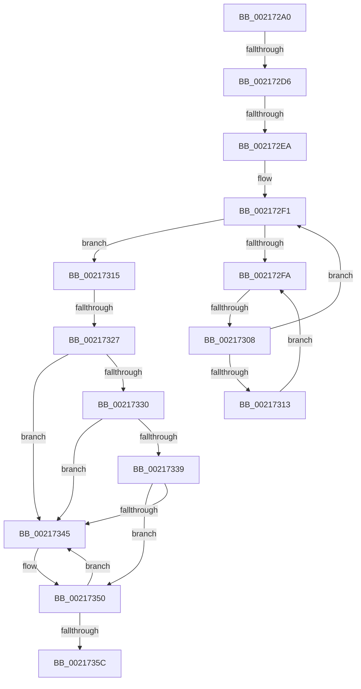

# KiDetachProcess

- RVA: `0x002172A0`–`0x0021736A` (길이 `202` bytes)
- VA: `0x00000001402172A0`
- 실행 섹션: `.text`
- PDB 이름 있음: `예`; PDB Function 태그: `아니요`
- unwind 정보 RVA: `0x0005E584`
- 디코드: `49`개 명령, `202/202` bytes 표시
- 미해석 바이트: `0` (있으면 어셈블리에 `.byte`로 보존)

> 이 문서는 커널 이미지의 기계어와 PDB 기호를 분석해 생성했습니다. 4번과 5번은 함수 원형과 자료형을 바이너리 사용 방식에서 추정한 C 해석이며 원본 소스 복구 결과는 아닙니다.

## 1. Dependencies

- 직접 호출 지점: **1**; 고유 호출 대상: **1**
- 직접 호출자로 확인된 함수: **5**
- RIP 상대 이미지 참조: **2**

### Outgoing calls
- `0x0021734A` → [KeBugCheck](../4F/KeBugCheck_function_004FD640.md) (function, `0x004FD640`)

### Direct callers
- [sub_0021825C](Unknown_function_0021825C.md) at `0x0021825C`
- [sub_00218A99](Unknown_function_00218A99.md) at `0x00218A9B`
- [sub_0028F375](../28/Unknown_function_0028F375.md) at `0x0028F37A`
- [sub_003C7BE2](../3C/Unknown_function_003C7BE2.md) at `0x003C7BE7`
- [KeDetachProcess](../49/KeDetachProcess_function_00495420.md) at `0x0049543F`

### Static image references
- `0x002172DE` → RVA `0x00FC6D20` (`ALMOSTRO`; read)
- `0x002172FC` → RVA `0x00FC52AC` (`ALMOSTRO`; reference)

## 2. Other-region calls and transfers

- 다른 실행 섹션으로 향하는 call: **0**
- call이 아닌 외부 분기/꼬리 이동: **4**
  - `0x002172D0` → [sub_0021778D](Unknown_function_0021778D.md) (`tail-transfer`)
  - `0x002172E4` → [sub_002175E7](Unknown_function_002175E7.md) (`tail-transfer`)
  - `0x00217302` → [sub_002175E7 + 0x11](Unknown_function_002175E7.md) (`tail-transfer`)
  - `0x00217321` → [sub_002177B0](Unknown_function_002177B0.md) (`tail-transfer`)

## 3. Assembly (complete function range)

```asm
002172A0  48 89 5C 24 20                  mov qword ptr [rsp + 0x20], rbx
002172A5  56                              push rsi
002172A6  57                              push rdi
002172A7  41 54                           push r12
002172A9  41 55                           push r13
002172AB  41 56                           push r14
002172AD  48 83 EC 40                     sub rsp, 0x40
002172B1  65 48 8B 1C 25 88 01 00 00      mov rbx, qword ptr gs:[0x188]
002172BA  8B F2                           mov esi, edx
002172BC  B8 02 00 00 00                  mov eax, 2
002172C1  44 8B E2                        mov r12d, edx
002172C4  4C 8B F1                        mov r14, rcx
002172C7  4C 8B AB B8 00 00 00            mov r13, qword ptr [rbx + 0xb8]
002172CE  23 F0                           and esi, eax
002172D0  0F 85 B7 04 00 00               jne 0x14021778d
002172D6  44 0F 20 C7                     mov rdi, cr8
002172DA  44 0F 22 C0                     mov cr8, rax
002172DE  39 35 3C FA DA 00               cmp dword ptr [rip + 0xdafa3c], esi
002172E4  0F 85 FD 02 00 00               jne 0x1402175e7
002172EA  40 88 7C 24 78                  mov byte ptr [rsp + 0x78], dil
002172EF  33 FF                           xor edi, edi
002172F1  F0 48 0F BA 6B 40 00            lock bts qword ptr [rbx + 0x40], 0
002172F8  73 1B                           jae 0x140217315
002172FA  FF C7                           inc edi
002172FC  85 3D AA DF DA 00               test dword ptr [rip + 0xdadfaa], edi
00217302  0F 84 F0 02 00 00               je 0x1402175f8
00217308  F3 90                           pause
0021730A  48 8B 43 40                     mov rax, qword ptr [rbx + 0x40]
0021730E  48 85 C0                        test rax, rax
00217311  74 DE                           je 0x1402172f1
00217313  EB E5                           jmp 0x1402172fa
00217315  0F B6 54 24 78                  movzx edx, byte ptr [rsp + 0x78]
0021731A  80 BB C1 00 00 00 00            cmp byte ptr [rbx + 0xc1], 0
00217321  0F 85 89 04 00 00               jne 0x1402177b0
00217327  80 BB 4A 02 00 00 00            cmp byte ptr [rbx + 0x24a], 0
0021732E  74 15                           je 0x140217345
00217330  F6 83 C0 00 00 00 01            test byte ptr [rbx + 0xc0], 1
00217337  75 0C                           jne 0x140217345
00217339  48 8D BB 98 00 00 00            lea rdi, [rbx + 0x98]
00217340  48 39 3F                        cmp qword ptr [rdi], rdi
00217343  74 0B                           je 0x140217350
00217345  B9 06 00 00 00                  mov ecx, 6
0021734A  E8 F1 62 2E 00                  call 0x1404fd640
0021734F  CC                              int3
00217350  48 8D 83 A8 00 00 00            lea rax, [rbx + 0xa8]
00217357  48 39 00                        cmp qword ptr [rax], rax
0021735A  75 E9                           jne 0x140217345
0021735C  81 4B 74 00 08 00 00            or dword ptr [rbx + 0x74], 0x800
00217363  48 8D 8B 58 02 00 00            lea rcx, [rbx + 0x258]
```

## 4. C-style interpretation (structured pseudocode)

```c
__int64 __fastcall KiDetachProcess(__int64 a1, int a2)
{
    __int64 result;
    __int64 v_rdi;
    __int64 v_rsi;
    __int64 v_rsp;
    unsigned __int8 v_stack_p10;
    unsigned __int64 v_stack_p20;

    v_stack_p20 = v_rbx;
    v_rsp = (v_rsp) - (64);
    v_rsi = (unsigned int)(((unsigned int)(a2)) & (2));
    v_stack_p10 = (unsigned __int8)(v_cr8);
    v_rdi = 0;
loc_002172F1:
    if (condition_is_above_or_equal) goto loc_00217315;
loc_002172FA:
    v_rdi = (unsigned int)((v_rdi) + 1);
    if (*(unsigned __int64 *)(*(unsigned __int64 *)(gs_base + (0 + 392)) + 64) == 0) goto loc_002172F1;
    goto loc_002172FA;
loc_00217315:
    if ((*(unsigned __int8 *)(*(unsigned __int64 *)(gs_base + (0 + 392)) + 586)) == 0) goto loc_00217345;
    if (((*(unsigned __int8 *)(*(unsigned __int64 *)(gs_base + (0 + 392)) + 192)) & (1)) != 0) goto loc_00217345;
    result = *(unsigned __int64 *)(*(unsigned __int64 *)(gs_base + (0 + 392)) + 64);
    if ((*(unsigned __int64 *)(*(unsigned __int64 *)(gs_base + (0 + 392)) + 152)) != (*(unsigned __int64 *)(gs_base + (0 + 392)) + 152)) {
        a1 = 6;
        result = KeBugCheck(a1, v_stack_p10, a3, a4);
    }
    if ((*(unsigned __int64 *)(*(unsigned __int64 *)(gs_base + (0 + 392)) + 168)) != (*(unsigned __int64 *)(gs_base + (0 + 392)) + 168)) goto loc_00217345;
    return *(unsigned __int64 *)(gs_base + (0 + 392)) + 168;
}
```

## 5. (Beta) C Style

```c
int64_t KiDetachProcess(int64_t Arg1, int32_t Arg2)
{
    int64_t result;
    int64_t local_rdi;
    int64_t local_rsi;
    int64_t local_rsp;
    uint8_t v_stack_p10;
    uint64_t v_stack_p20;

    v_stack_p20 = local_rbx;
    local_rsp = (local_rsp) - (64);
    local_rsi = (uint32_t)(((uint32_t)(Arg2)) & (2));
    v_stack_p10 = (uint8_t)(v_cr8);
    local_rdi = 0;
loc_002172F1:
    if (condition_is_above_or_equal) goto loc_00217315;
loc_002172FA:
    local_rdi = (uint32_t)((local_rdi) + 1);
    if (*(uint64_t *)(*(uint64_t *)(gs_base + (0 + 0x188)) + 0x40) == 0) goto loc_002172F1;
    goto loc_002172FA;
loc_00217315:
    if ((*(uint8_t *)(*(uint64_t *)(gs_base + (0 + 0x188)) + 0x24A)) == 0) goto loc_00217345;
    if (((*(uint8_t *)(*(uint64_t *)(gs_base + (0 + 0x188)) + 0xC0)) & (1)) != 0) goto loc_00217345;
    result = *(uint64_t *)(*(uint64_t *)(gs_base + (0 + 0x188)) + 0x40);
    if ((*(uint64_t *)(*(uint64_t *)(gs_base + (0 + 0x188)) + 0x98)) != (*(uint64_t *)(gs_base + (0 + 0x188)) + 152)) {
        Arg1 = 6;
        result = KeBugCheck(Arg1, v_stack_p10, a3, a4);
    }
    if ((*(uint64_t *)(*(uint64_t *)(gs_base + (0 + 0x188)) + 0xA8)) != (*(uint64_t *)(gs_base + (0 + 0x188)) + 168)) goto loc_00217345;
    return *(uint64_t *)(gs_base + (0 + 0x188)) + 168;
}
```

## 6. Execution-region graph

[열기: 2D/3D 그래프와 함수 탐색 컨트롤 패널](../../../control-panel.html?section=text&rva=0x002172A0&view=graph)

- 2D 그래프는 위에서 아래로 흐르고, 3D 그래프는 빈 공간을 드래그해 회전합니다. Shift+드래그는 이동, 휠은 확대·축소, 함수 노드 선택은 대상 보고서 이동입니다.

### Static fallback


