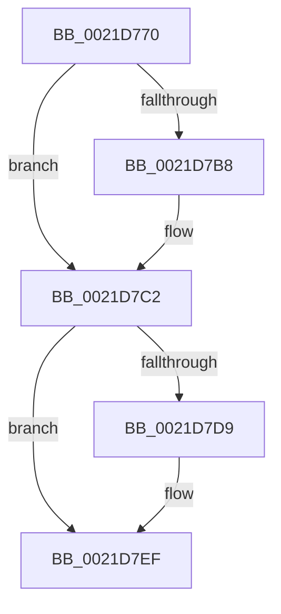

# KiDirectSwitchThread

- RVA: `0x0021D770`–`0x0021D7F8` (길이 `136` bytes)
- VA: `0x000000014021D770`
- 실행 섹션: `.text`
- PDB 이름 있음: `예`; PDB Function 태그: `예`
- unwind 정보 RVA: `0x0005F090`
- 디코드: `36`개 명령, `136/136` bytes 표시
- 미해석 바이트: `0` (있으면 어셈블리에 `.byte`로 보존)

> 이 문서는 커널 이미지의 기계어와 PDB 기호를 분석해 생성했습니다. 4번과 5번은 함수 원형과 자료형을 바이너리 사용 방식에서 추정한 C 해석이며 원본 소스 복구 결과는 아닙니다.

## 1. Dependencies

- 직접 호출 지점: **1**; 고유 호출 대상: **1**
- 직접 호출자로 확인된 함수: **1**
- RIP 상대 이미지 참조: **1**

### Outgoing calls
- `0x0021D7EA` → [EtwTraceReadyThread](../25/EtwTraceReadyThread_function_00251F70.md) (function, `0x00251F70`)

### Direct callers
- [sub_00251DA5](../25/Unknown_function_00251DA5.md) at `0x00251DFA`

### Static image references
- `0x0021D7C2` → RVA `0x00FC6B04` (`ALMOSTRO`; read)

## 2. Other-region calls and transfers

- 다른 실행 섹션으로 향하는 call: **0**
- 별도 외부 분기/꼬리 이동을 확인하지 못했습니다.

## 3. Assembly (complete function range)

```asm
0021D770  89 54 24 10                     mov dword ptr [rsp + 0x10], edx
0021D774  48 89 4C 24 08                  mov qword ptr [rsp + 8], rcx
0021D779  55                              push rbp
0021D77A  53                              push rbx
0021D77B  56                              push rsi
0021D77C  57                              push rdi
0021D77D  41 54                           push r12
0021D77F  41 56                           push r14
0021D781  41 57                           push r15
0021D783  48 8D 6C 24 D9                  lea rbp, [rsp - 0x27]
0021D788  48 81 EC C0 00 00 00            sub rsp, 0xc0
0021D78F  4C 8B 89 08 2D 00 00            mov r9, qword ptr [rcx + 0x2d08]
0021D796  45 33 FF                        xor r15d, r15d
0021D799  4C 89 7D AF                     mov qword ptr [rbp - 0x51], r15
0021D79D  BF FF FF FF FF                  mov edi, 0xffffffff
0021D7A2  4C 89 7D C7                     mov qword ptr [rbp - 0x39], r15
0021D7A6  45 0F B6 E0                     movzx r12d, r8b
0021D7AA  89 7D BB                        mov dword ptr [rbp - 0x45], edi
0021D7AD  48 8B F1                        mov rsi, rcx
0021D7B0  89 7D B7                        mov dword ptr [rbp - 0x49], edi
0021D7B3  4D 85 C9                        test r9, r9
0021D7B6  74 0A                           je 0x14021d7c2
0021D7B8  49 8B 01                        mov rax, qword ptr [r9]
0021D7BB  48 89 81 08 2D 00 00            mov qword ptr [rcx + 0x2d08], rax
0021D7C2  F7 05 38 93 DA 00 00 02 00 00   test dword ptr [rip + 0xda9338], 0x200
0021D7CC  49 8D 99 28 FF FF FF            lea rbx, [r9 - 0xd8]
0021D7D3  48 89 5D 97                     mov qword ptr [rbp - 0x69], rbx
0021D7D7  74 16                           je 0x14021d7ef
0021D7D9  41 B9 01 00 00 00               mov r9d, 1
0021D7DF  44 0F B6 C2                     movzx r8d, dl
0021D7E3  41 0F B6 D1                     movzx edx, r9b
0021D7E7  48 8B CB                        mov rcx, rbx
0021D7EA  E8 81 47 03 00                  call 0x140251f70
0021D7EF  4C 8B 76 08                     mov r14, qword ptr [rsi + 8]
0021D7F3  33 D2                           xor edx, edx
0021D7F5  49 8B CE                        mov rcx, r14
```

## 4. C-style interpretation (structured pseudocode)

```c
__int64 __fastcall KiDirectSwitchThread(__int64 a1, int a2, unsigned __int8 a3)
{
    __int64 result;
    __int64 v_r15;
    __int64 v_rsp;
    unsigned __int64 v_stack_m5F;
    unsigned __int64 v_stack_m98;
    unsigned int v_stack_mA4;
    unsigned int v_stack_mA8;
    unsigned __int64 v_stack_mB0;
    unsigned __int64 v_stack_mC8;
    unsigned int v_stack_p10;
    unsigned __int64 v_stack_p8;

    v_stack_p10 = a2;
    v_stack_p8 = a1;
    v_rsp = (v_rsp) - (192);
    v_r15 = 0;
    v_stack_mB0 = 0;
    v_stack_m98 = 0;
    v_stack_mA4 = (unsigned int)((unsigned int)(0xFFFFFFFFULL));
    v_stack_mA8 = (unsigned int)((unsigned int)(0xFFFFFFFFULL));
    if (*(unsigned __int64 *)(a1 + 11528) != 0) {
        result = *(unsigned __int64 *)(*(unsigned __int64 *)(a1 + 11528));
        *(unsigned __int64 *)(a1 + 11528) = result;
    }
    v_stack_mC8 = *(unsigned __int64 *)(a1 + 11528) - 216;
    if (((*(unsigned int *)(v_rip + 14324536)) & (512)) != 0) {
        a4 = 1;
        a3 = (unsigned __int8)(a2);
        a2 = (unsigned __int8)(a4);
        a1 = *(unsigned __int64 *)(a1 + 11528) - 216;
        result = EtwTraceReadyThread(a1, a2, a3, a4);
    }
    a2 = 0;
    return result;
}
```

## 5. (Beta) C Style

```c
int64_t KiDirectSwitchThread(void *Arg1, int32_t Arg2, uint8_t Arg3)
{
    uint8_t *arg1 = (uint8_t *)Arg1;

    int64_t result;
    int64_t local_r15;
    int64_t local_rsp;
    uint64_t v_stack_m5F;
    uint64_t v_stack_m98;
    uint32_t v_stack_mA4;
    uint32_t v_stack_mA8;
    uint64_t v_stack_mB0;
    uint64_t v_stack_mC8;
    uint32_t v_stack_p10;
    uint64_t v_stack_p8;

    v_stack_p10 = Arg2;
    v_stack_p8 = Arg1;
    local_rsp = (local_rsp) - (192);
    local_r15 = 0;
    v_stack_mB0 = 0;
    v_stack_m98 = 0;
    v_stack_mA4 = (uint32_t)((uint32_t)(0xFFFFFFFFULL));
    v_stack_mA8 = (uint32_t)((uint32_t)(0xFFFFFFFFULL));
    if (*(uint64_t *)(arg1 + 0x2D08) != 0) {
        result = *(uint64_t *)(*(uint64_t *)(arg1 + 0x2D08));
        *(uint64_t *)(arg1 + 0x2D08) = result;
    }
    v_stack_mC8 = *(uint64_t *)(arg1 + 0x2D08) - 216;
    if (((*(uint32_t *)(v_rip + 0xDA9338)) & (512)) != 0) {
        a4 = 1;
        Arg3 = (uint8_t)(Arg2);
        Arg2 = (uint8_t)(a4);
        Arg1 = *(uint64_t *)(arg1 + 0x2D08) - 216;
        result = EtwTraceReadyThread(Arg1, Arg2, Arg3, a4);
    }
    Arg2 = 0;
    return result;
}
```

### 관측된 메모리 오프셋

구조체 형식이 확인되지 않은 접근은 인자 기준의 오프셋으로만 기록했습니다.

| 기준 인자 | 오프셋 표현 | 폭 (bit) | 접근 |
|---|---:|---:|---|
| `Arg1` | `+ 0x8` | `64` | `R` |
| `Arg1` | `+ 0x2D08` | `64` | `R` |
| `Arg1` | `+ 0x2D08` | `64` | `W` |

## 6. Execution-region graph

[열기: 2D/3D 그래프와 함수 탐색 컨트롤 패널](../../../control-panel.html?section=text&rva=0x0021D770&view=graph)

- 2D 그래프는 위에서 아래로 흐르고, 3D 그래프는 빈 공간을 드래그해 회전합니다. Shift+드래그는 이동, 휠은 확대·축소, 함수 노드 선택은 대상 보고서 이동입니다.

### Static fallback


