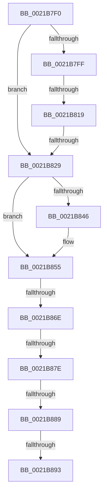

# KiDispatchInterrupt

- RVA: `0x0021B7F0`–`0x0021B896` (길이 `166` bytes)
- VA: `0x000000014021B7F0`
- 실행 섹션: `.text`
- PDB 이름 있음: `예`; PDB Function 태그: `아니요`
- unwind 정보 RVA: `0x0005ED38`
- 디코드: `34`개 명령, `166/166` bytes 표시
- 미해석 바이트: `0` (있으면 어셈블리에 `.byte`로 보존)

> 이 문서는 커널 이미지의 기계어와 PDB 기호를 분석해 생성했습니다. 4번과 5번은 함수 원형과 자료형을 바이너리 사용 방식에서 추정한 C 해석이며 원본 소스 복구 결과는 아닙니다.

## 1. Dependencies

- 직접 호출 지점: **1**; 고유 호출 대상: **1**
- 직접 호출자로 확인된 함수: **2**
- RIP 상대 이미지 참조: **1**

### Outgoing calls
- `0x0021B850` → [KiSwapStacksAndRetireDpcList](../6B/KiSwapStacksAndRetireDpcList_function_006B9700.md) (function, `0x006B9700`)

### Direct callers
- [KiDpcInterrupt](../6B/KiDpcInterrupt_function_006B87C0.md) at `0x006B8B5A`
- [KiDpcInterruptBypass](../6B/KiDpcInterruptBypass_function_006B8EE0.md) at `0x006B8EF6`

### Static image references
- `0x0021B819` → RVA `0x00FC74C8` (`ALMOSTRO`; read)

## 2. Other-region calls and transfers

- 다른 실행 섹션으로 향하는 call: **0**
- call이 아닌 외부 분기/꼬리 이동: **6**
  - `0x0021B813` → [sub_0021B9AC + 0x18](Unknown_function_0021B9AC.md) (`tail-transfer`)
  - `0x0021B823` → [sub_0021B9AC + 0x8C](Unknown_function_0021B9AC.md) (`tail-transfer`)
  - `0x0021B868` → [sub_0021B9AC + 0x64](Unknown_function_0021B9AC.md) (`tail-transfer`)
  - `0x0021B878` → [sub_0021B9AC](Unknown_function_0021B9AC.md) (`tail-transfer`)
  - `0x0021B883` → [sub_0021B9AC + 0xC](Unknown_function_0021B9AC.md) (`tail-transfer`)
  - `0x0021B88D` → [sub_0021B9AC + 0x50](Unknown_function_0021B9AC.md) (`tail-transfer`)

## 3. Assembly (complete function range)

```asm
0021B7F0  48 89 5C 24 18                  mov qword ptr [rsp + 0x18], rbx
0021B7F5  56                              push rsi
0021B7F6  48 83 EC 20                     sub rsp, 0x20
0021B7FA  48 85 D2                        test rdx, rdx
0021B7FD  74 2A                           je 0x14021b829
0021B7FF  44 0F B7 82 70 01 00 00         movzx r8d, word ptr [rdx + 0x170]
0021B807  48 8B 82 68 01 00 00            mov rax, qword ptr [rdx + 0x168]
0021B80E  66 41 83 F8 33                  cmp r8w, 0x33
0021B813  0F 85 AB 01 00 00               jne 0x14021b9c4
0021B819  4C 8B 05 A8 BC DA 00            mov r8, qword ptr [rip + 0xdabca8]
0021B820  49 3B C0                        cmp rax, r8
0021B823  0F 87 0F 02 00 00               ja 0x14021ba38
0021B829  FA                              cli
0021B82A  65 48 8B 1C 25 20 00 00 00      mov rbx, qword ptr gs:[0x20]
0021B833  48 8B 73 08                     mov rsi, qword ptr [rbx + 8]
0021B837  88 8E 86 01 00 00               mov byte ptr [rsi + 0x186], cl
0021B83D  F6 83 BC 38 00 00 BF            test byte ptr [rbx + 0x38bc], 0xbf
0021B844  74 0F                           je 0x14021b855
0021B846  48 8B 93 A0 38 00 00            mov rdx, qword ptr [rbx + 0x38a0]
0021B84D  48 8B CB                        mov rcx, rbx
0021B850  E8 AB DE 49 00                  call 0x1406b9700
0021B855  65 48 8B 0C 25 20 00 00 00      mov rcx, qword ptr gs:[0x20]
0021B85E  4C 8B 81 B8 8E 00 00            mov r8, qword ptr [rcx + 0x8eb8]
0021B865  4D 85 C0                        test r8, r8
0021B868  0F 85 A2 01 00 00               jne 0x14021ba10
0021B86E  FB                              sti
0021B86F  0F B6 83 B9 38 00 00            movzx eax, byte ptr [rbx + 0x38b9]
0021B876  84 C0                           test al, al
0021B878  0F 85 2E 01 00 00               jne 0x14021b9ac
0021B87E  48 83 7B 10 00                  cmp qword ptr [rbx + 0x10], 0
0021B883  0F 84 2F 01 00 00               je 0x14021b9b8
0021B889  F6 46 02 04                     test byte ptr [rsi + 2], 4
0021B88D  0F 85 69 01 00 00               jne 0x14021b9fc
0021B893  48 8B D6                        mov rdx, rsi
```

## 4. C-style interpretation (structured pseudocode)

```c
__int64 __fastcall KiDispatchInterrupt(unsigned __int8 a1, __int64 a2)
{
    __int64 result;
    __int64 v_rsp;
    unsigned __int64 v_stack_p18;

    v_stack_p18 = v_rbx;
    v_rsp = (v_rsp) - (32);
    if (a2 == 0) goto loc_0021B829;
loc_0021B829:
    *(unsigned __int8 *)(*(unsigned __int64 *)(*(unsigned __int64 *)(gs_base + (0 + 32)) + 8) + 390) = a1;
    result = *(unsigned __int64 *)(a2 + 360);
    if (((*(unsigned __int8 *)(*(unsigned __int64 *)(gs_base + (0 + 32)) + 14524)) & (191)) != 0) {
        a2 = *(unsigned __int64 *)(*(unsigned __int64 *)(gs_base + (0 + 32)) + 14496);
        a1 = *(unsigned __int64 *)(gs_base + (0 + 32));
        result = KiSwapStacksAndRetireDpcList(a1, a2, *(unsigned __int64 *)(v_rip + 14335144), a4);
    }
    return *(unsigned __int8 *)(*(unsigned __int64 *)(gs_base + (0 + 32)) + 14521);
}
```

## 5. (Beta) C Style

```c
int64_t KiDispatchInterrupt(uint8_t Arg1, int64_t Arg2)
{
    int64_t result;
    int64_t local_rsp;
    uint64_t v_stack_p18;

    v_stack_p18 = local_rbx;
    local_rsp = (local_rsp) - (32);
    if (Arg2 == 0) goto loc_0021B829;
loc_0021B829:
    *(uint8_t *)(*(uint64_t *)(*(uint64_t *)(gs_base + (0 + 0x20)) + 0x8) + 0x186) = Arg1;
    result = *(uint64_t *)(Arg2 + 0x168);
    if (((*(uint8_t *)(*(uint64_t *)(gs_base + (0 + 0x20)) + 0x38BC)) & (191)) != 0) {
        Arg2 = *(uint64_t *)(*(uint64_t *)(gs_base + (0 + 0x20)) + 0x38A0);
        Arg1 = *(uint64_t *)(gs_base + (0 + 0x20));
        result = KiSwapStacksAndRetireDpcList(Arg1, Arg2, *(uint64_t *)(v_rip + 0xDABCA8), a4);
    }
    return *(uint8_t *)(*(uint64_t *)(gs_base + (0 + 0x20)) + 0x38B9);
}
```

## 6. Execution-region graph

[열기: 2D/3D 그래프와 함수 탐색 컨트롤 패널](../../../control-panel.html?section=text&rva=0x0021B7F0&view=graph)

- 2D 그래프는 위에서 아래로 흐르고, 3D 그래프는 빈 공간을 드래그해 회전합니다. Shift+드래그는 이동, 휠은 확대·축소, 함수 노드 선택은 대상 보고서 이동입니다.

### Static fallback


