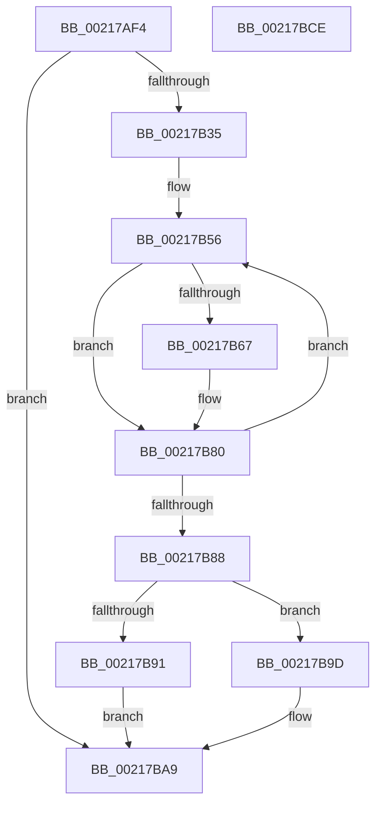

# KiHaltOnAddressWakeEntireList

- RVA: `0x00217AF4`–`0x00217BCF` (길이 `219` bytes)
- VA: `0x0000000140217AF4`
- 실행 섹션: `.text`
- PDB 이름 있음: `예`; PDB Function 태그: `아니요`
- unwind 정보 RVA: `0x0005E6D0`
- 디코드: `53`개 명령, `219/219` bytes 표시
- 미해석 바이트: `0` (있으면 어셈블리에 `.byte`로 보존)

> 이 문서는 커널 이미지의 기계어와 PDB 기호를 분석해 생성했습니다. 4번과 5번은 함수 원형과 자료형을 바이너리 사용 방식에서 추정한 C 해석이며 원본 소스 복구 결과는 아닙니다.

## 1. Dependencies

- 직접 호출 지점: **6**; 고유 호출 대상: **5**
- 직접 호출자로 확인된 함수: **21**
- RIP 상대 이미지 참조: **2**

### Outgoing calls
- `0x00217B2A` → [memset](../6C/memset_function_006C6C40.md) (function, `0x006C6C40`)
- `0x00217B51` → [memset](../6C/memset_function_006C6C40.md) (function, `0x006C6C40`)
- `0x00217B7B` → [KeAddGroupAffinityEx](../25/KeAddGroupAffinityEx_function_0025B6C0.md) (function, `0x0025B6C0`)
- `0x00217B96` → [HvlWakeVirtualProcessors](../58/HvlWakeVirtualProcessors_function_0058AA80.md) (function, `0x0058AA80`)
- `0x00217BA4` → [HalRequestIpi](../2D/HalRequestIpi_function_002D1720.md) (function, `0x002D1720`)
- `0x00217BB4` → [_security_check_cookie](../6A/_security_check_cookie_function_006AC640.md) (function, `0x006AC640`)

### Direct callers
- [ExpAcquireResourceSharedLite](ExpAcquireResourceSharedLite_function_00212040.md) at `0x00212220`
- [ExpAcquireResourceSharedLite](ExpAcquireResourceSharedLite_function_00212040.md) at `0x002125F9`
- [sub_00214E58](Unknown_function_00214E58.md) at `0x00214F97`
- [sub_00216F9F](Unknown_function_00216F9F.md) at `0x0021702E`
- [sub_002171C2](Unknown_function_002171C2.md) at `0x00217223`
- [sub_0025D903](../25/Unknown_function_0025D903.md) at `0x0025DBE2`
- [sub_0025D903](../25/Unknown_function_0025D903.md) at `0x0025DF9F`
- [sub_0025FB5C](../25/Unknown_function_0025FB5C.md) at `0x0025FD26`
- [sub_0025FB5C](../25/Unknown_function_0025FB5C.md) at `0x002600DB`
- [sub_00260366](../26/Unknown_function_00260366.md) at `0x00260860`
- [sub_00261DFE](../26/Unknown_function_00261DFE.md) at `0x00261EC7`
- [IopDecrementDeviceObjectRef](../27/IopDecrementDeviceObjectRef_function_00270970.md) at `0x00270A75`
- [sub_0027256E](../27/Unknown_function_0027256E.md) at `0x002725CF`
- [sub_00273F95](../27/Unknown_function_00273F95.md) at `0x00274162`
- [sub_00273F95](../27/Unknown_function_00273F95.md) at `0x0027452B`
- [sub_0027475D](../27/Unknown_function_0027475D.md) at `0x00274948`
- [sub_0027475D](../27/Unknown_function_0027475D.md) at `0x00274C9D`
- [MiDeleteVaDirect](../27/MiDeleteVaDirect_function_00277560.md) at `0x002783DC`
- [MiReleaseFaultState](../27/MiReleaseFaultState_function_0027D290.md) at `0x0027D513`
- [sub_0027D95C](../27/Unknown_function_0027D95C.md) at `0x0027DA8E`
- [MiLockLowestValidPageTableEx](../28/MiLockLowestValidPageTableEx_function_00280D10.md) at `0x002812CD`
- [sub_00342D39](../34/Unknown_function_00342D39.md) at `0x00342D60`
- [NtWaitForWorkViaWorkerFactory](../39/NtWaitForWorkViaWorkerFactory_function_00394270.md) at `0x00394AB9`
- [IopCheckDeviceAndDriver](../3F/IopCheckDeviceAndDriver_function_003FCBE0.md) at `0x003FCCF9`
- [sub_0040EACB](../40/Unknown_function_0040EACB.md) at `0x0040EBA2`
- [KiWakeAddressAll](../45/KiWakeAddressAll_function_0045B334.md) at `0x0045B359`

### Static image references
- `0x00217B06` → RVA `0x00E0A740` (`.data`; read)
- `0x00217B88` → RVA `0x00FC6ADD` (`ALMOSTRO`; read)

## 2. Other-region calls and transfers

- 다른 실행 섹션으로 향하는 call: **0**
- 별도 외부 분기/꼬리 이동을 확인하지 못했습니다.

## 3. Assembly (complete function range)

```asm
00217AF4  48 89 5C 24 08                  mov qword ptr [rsp + 8], rbx
00217AF9  48 89 74 24 18                  mov qword ptr [rsp + 0x18], rsi
00217AFE  57                              push rdi
00217AFF  48 81 EC 40 01 00 00            sub rsp, 0x140
00217B06  48 8B 05 33 2C BF 00            mov rax, qword ptr [rip + 0xbf2c33]
00217B0D  48 33 C4                        xor rax, rsp
00217B10  48 89 84 24 30 01 00 00         mov qword ptr [rsp + 0x130], rax
00217B18  48 8B DA                        mov rbx, rdx
00217B1B  48 8D 4C 24 28                  lea rcx, [rsp + 0x28]
00217B20  BF 00 01 00 00                  mov edi, 0x100
00217B25  33 D2                           xor edx, edx
00217B27  44 8B C7                        mov r8d, edi
00217B2A  E8 11 F1 4A 00                  call 0x1406c6c40
00217B2F  48 83 E3 FC                     and rbx, 0xfffffffffffffffc
00217B33  74 74                           je 0x140217ba9
00217B35  83 64 24 24 00                  and dword ptr [rsp + 0x24], 0
00217B3A  48 8D 4C 24 28                  lea rcx, [rsp + 0x28]
00217B3F  44 8B C7                        mov r8d, edi
00217B42  C7 44 24 20 01 00 20 00         mov dword ptr [rsp + 0x20], 0x200001
00217B4A  33 D2                           xor edx, edx
00217B4C  BE 01 00 00 00                  mov esi, 1
00217B51  E8 EA F0 4A 00                  call 0x1406c6c40
00217B56  4C 8B 43 08                     mov r8, qword ptr [rbx + 8]
00217B5A  8B C6                           mov eax, esi
00217B5C  48 8B 7B 10                     mov rdi, qword ptr [rbx + 0x10]
00217B60  87 43 18                        xchg dword ptr [rbx + 0x18], eax
00217B63  85 C0                           test eax, eax
00217B65  75 19                           jne 0x140217b80
00217B67  41 0F B6 90 D0 00 00 00         movzx edx, byte ptr [r8 + 0xd0]
00217B6F  48 8D 4C 24 20                  lea rcx, [rsp + 0x20]
00217B74  4D 8B 80 C8 00 00 00            mov r8, qword ptr [r8 + 0xc8]
00217B7B  E8 40 3B 04 00                  call 0x14025b6c0
00217B80  48 8B DF                        mov rbx, rdi
00217B83  48 85 FF                        test rdi, rdi
00217B86  75 CE                           jne 0x140217b56
00217B88  F6 05 4E EF DA 00 04            test byte ptr [rip + 0xdaef4e], 4
00217B8F  74 0C                           je 0x140217b9d
00217B91  48 8D 4C 24 20                  lea rcx, [rsp + 0x20]
00217B96  E8 E5 2E 37 00                  call 0x14058aa80
00217B9B  EB 0C                           jmp 0x140217ba9
00217B9D  48 8D 54 24 20                  lea rdx, [rsp + 0x20]
00217BA2  33 C9                           xor ecx, ecx
00217BA4  E8 77 9B 0B 00                  call 0x1402d1720
00217BA9  48 8B 8C 24 30 01 00 00         mov rcx, qword ptr [rsp + 0x130]
00217BB1  48 33 CC                        xor rcx, rsp
00217BB4  E8 87 4A 49 00                  call 0x1406ac640
00217BB9  4C 8D 9C 24 40 01 00 00         lea r11, [rsp + 0x140]
00217BC1  49 8B 5B 10                     mov rbx, qword ptr [r11 + 0x10]
00217BC5  49 8B 73 20                     mov rsi, qword ptr [r11 + 0x20]
00217BC9  49 8B E3                        mov rsp, r11
00217BCC  5F                              pop rdi
00217BCD  C3                              ret
00217BCE  CC                              int3
```

## 4. C-style interpretation (structured pseudocode)

```c
__int64 __fastcall KiHaltOnAddressWakeEntireList(__int64 a1, __int64 a2)
{
    __int64 result;
    __int64 v_rbx;
    __int64 v_rsp;
    unsigned __int64 v_stack_m120;
    unsigned int v_stack_m124;
    unsigned int v_stack_m128;
    unsigned __int64 v_stack_m18;
    unsigned __int64 v_stack_m8;
    unsigned __int64 v_stack_p18;
    unsigned __int64 v_stack_p8;

    v_stack_p8 = v_rbx;
    v_stack_p18 = v_rsi;
    v_rsp = (v_rsp) - (320);
    result = (*(unsigned __int64 *)(v_rip + 12528691)) ^ (v_rsp);
    v_stack_m18 = result;
    a2 = 0;
    result = memset(v_stack_m120, a2, 256, a4);
    v_rbx = (a2) & (-4);
    if (condition_is_equal) goto loc_00217BA9;
    v_stack_m128 = 0x200001ULL;
    a2 = 0;
    result = memset(v_stack_m120, a2, 256, a4);
loc_00217B56:
    result = 1;
    if (1 == 0) {
        a2 = *(unsigned __int8 *)(*(unsigned __int64 *)(v_rbx + 8) + 208);
        a1 = v_stack_m128;
        a3 = *(unsigned __int64 *)(*(unsigned __int64 *)(v_rbx + 8) + 200);
        result = KeAddGroupAffinityEx(a1, a2, a3, a4);
    }
    if (*(unsigned __int64 *)(v_rbx + 16) != 0) goto loc_00217B56;
    if (((*(unsigned __int8 *)(v_rip + 14348110)) & (4)) == 0) goto loc_00217B9D;
    result = HvlWakeVirtualProcessors(v_stack_m128, a2, a3, a4);
    goto loc_00217BA9;
loc_00217B9D:
    a1 = 0;
    result = HalRequestIpi(a1, v_stack_m128, a3, a4);
loc_00217BA9:
    a1 = (v_stack_m18) ^ (v_rsp);
    result = _security_check_cookie(a1, v_stack_m128, a3, a4);
    return result;
}
```

## 5. (Beta) C Style

```c
int64_t KiHaltOnAddressWakeEntireList(int64_t Arg1, int64_t Arg2)
{
    int64_t result;
    int64_t local_rbx;
    int64_t local_rsp;
    uint64_t v_stack_m120;
    uint32_t v_stack_m124;
    uint32_t v_stack_m128;
    uint64_t v_stack_m18;
    uint64_t v_stack_m8;
    uint64_t v_stack_p18;
    uint64_t v_stack_p8;

    v_stack_p8 = local_rbx;
    v_stack_p18 = local_rsi;
    local_rsp = (local_rsp) - (320);
    result = (*(uint64_t *)(v_rip + 0xBF2C33)) ^ (local_rsp);
    v_stack_m18 = result;
    Arg2 = 0;
    result = memset(v_stack_m120, Arg2, 256, a4);
    local_rbx = (Arg2) & (-4);
    if (condition_is_equal) goto loc_00217BA9;
    v_stack_m128 = 0x200001ULL;
    Arg2 = 0;
    result = memset(v_stack_m120, Arg2, 256, a4);
loc_00217B56:
    result = 1;
    if (1 == 0) {
        Arg2 = *(uint8_t *)(*(uint64_t *)(local_rbx + 0x8) + 0xD0);
        Arg1 = v_stack_m128;
        a3 = *(uint64_t *)(*(uint64_t *)(local_rbx + 0x8) + 0xC8);
        result = KeAddGroupAffinityEx(Arg1, Arg2, a3, a4);
    }
    if (*(uint64_t *)(local_rbx + 0x10) != 0) goto loc_00217B56;
    if (((*(uint8_t *)(v_rip + 0xDAEF4E)) & (4)) == 0) goto loc_00217B9D;
    result = HvlWakeVirtualProcessors(v_stack_m128, Arg2, a3, a4);
    goto loc_00217BA9;
loc_00217B9D:
    Arg1 = 0;
    result = HalRequestIpi(Arg1, v_stack_m128, a3, a4);
loc_00217BA9:
    Arg1 = (v_stack_m18) ^ (local_rsp);
    result = _security_check_cookie(Arg1, v_stack_m128, a3, a4);
    return result;
}
```

## 6. Execution-region graph

[열기: 2D/3D 그래프와 함수 탐색 컨트롤 패널](../../../control-panel.html?section=text&rva=0x00217AF4&view=graph)

- 2D 그래프는 위에서 아래로 흐르고, 3D 그래프는 빈 공간을 드래그해 회전합니다. Shift+드래그는 이동, 휠은 확대·축소, 함수 노드 선택은 대상 보고서 이동입니다.

### Static fallback


