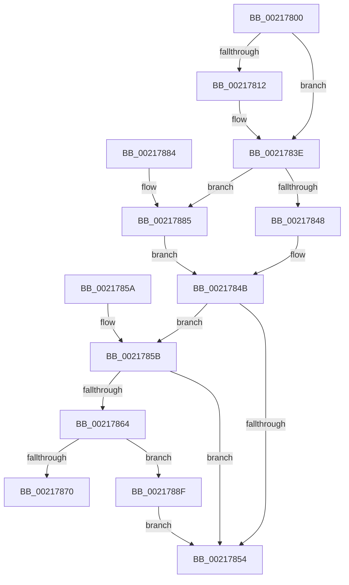

# KiLoadDirectoryTableBase

- RVA: `0x00217800`–`0x00217897` (길이 `151` bytes)
- VA: `0x0000000140217800`
- 실행 섹션: `.text`
- PDB 이름 있음: `예`; PDB Function 태그: `아니요`
- unwind 정보 RVA: `0x0005E688`
- 디코드: `42`개 명령, `151/151` bytes 표시
- 미해석 바이트: `0` (있으면 어셈블리에 `.byte`로 보존)

> 이 문서는 커널 이미지의 기계어와 PDB 기호를 분석해 생성했습니다. 4번과 5번은 함수 원형과 자료형을 바이너리 사용 방식에서 추정한 C 해석이며 원본 소스 복구 결과는 아닙니다.

## 1. Dependencies

- 직접 호출 지점: **2**; 고유 호출 대상: **2**
- 직접 호출자로 확인된 함수: **1**
- RIP 상대 이미지 참조: **3**

### Outgoing calls
- `0x00217839` → [KiSetAddressPolicy](KiSetAddressPolicy_function_002178A0.md) (function, `0x002178A0`)
- `0x00217888` → [HvlSwitchVirtualAddressSpace](../3C/HvlSwitchVirtualAddressSpace_function_003C7C60.md) (function, `0x003C7C60`)

### Direct callers
- [KiSwapDirectoryTableBaseTarget](../22/KiSwapDirectoryTableBaseTarget_function_00227FF0.md) at `0x0022816B`

### Static image references
- `0x00217806` → RVA `0x01201840` (`CFGRO`; read)
- `0x0021783E` → RVA `0x00FC6AB8` (`ALMOSTRO`; read)
- `0x0021785B` → RVA `0x00FC6A87` (`ALMOSTRO`; read)

## 2. Other-region calls and transfers

- 다른 실행 섹션으로 향하는 call: **0**
- 별도 외부 분기/꼬리 이동을 확인하지 못했습니다.

## 3. Assembly (complete function range)

```asm
00217800  40 53                           push rbx
00217802  48 83 EC 20                     sub rsp, 0x20
00217806  80 3D 33 A0 FE 00 00            cmp byte ptr [rip + 0xfea033], 0
0021780D  48 8B DA                        mov rbx, rdx
00217810  74 2C                           je 0x14021783e
00217812  49 B8 00 00 00 00 00 00 00 80   movabs r8, 0x8000000000000000
0021781C  48 8B C2                        mov rax, rdx
0021781F  49 0B C0                        or rax, r8
00217822  F6 C3 02                        test bl, 2
00217825  48 0F 44 C2                     cmove rax, rdx
00217829  65 48 89 04 25 00 B0 00 00      mov qword ptr gs:[0xb000], rax
00217832  0F B6 89 60 01 00 00            movzx ecx, byte ptr [rcx + 0x160]
00217839  E8 62 00 00 00                  call 0x1402178a0
0021783E  8B 05 74 F2 DA 00               mov eax, dword ptr [rip + 0xdaf274]
00217844  A8 01                           test al, 1
00217846  75 3D                           jne 0x140217885
00217848  0F 22 DB                        mov cr3, rbx
0021784B  80 3D EE 9F FE 00 00            cmp byte ptr [rip + 0xfe9fee], 0
00217852  75 07                           jne 0x14021785b
00217854  48 83 C4 20                     add rsp, 0x20
00217858  5B                              pop rbx
00217859  C3                              ret
0021785A  CC                              int3
0021785B  80 3D 25 F2 DA 00 00            cmp byte ptr [rip + 0xdaf225], 0
00217862  75 F0                           jne 0x140217854
00217864  0F 20 E1                        mov rcx, cr4
00217867  48 F7 C1 80 00 02 00            test rcx, 0x20080
0021786E  74 1F                           je 0x14021788f
00217870  48 8B C1                        mov rax, rcx
00217873  48 0F BA F8 07                  btc rax, 7
00217878  0F 22 E0                        mov cr4, rax
0021787B  0F 22 E1                        mov cr4, rcx
0021787E  48 83 C4 20                     add rsp, 0x20
00217882  5B                              pop rbx
00217883  C3                              ret
00217884  CC                              int3
00217885  48 8B CB                        mov rcx, rbx
00217888  E8 D3 03 1B 00                  call 0x1403c7c60
0021788D  EB BC                           jmp 0x14021784b
0021788F  0F 20 D8                        mov rax, cr3
00217892  0F 22 D8                        mov cr3, rax
00217895  EB BD                           jmp 0x140217854
```

## 4. C-style interpretation (structured pseudocode)

```c
__int64 __fastcall KiLoadDirectoryTableBase(__int64 a1, __int64 a2)
{
    __int64 result;
    __int64 v_rsp;

    v_rsp = (v_rsp) - (32);
    if ((*(unsigned __int8 *)(v_rip + 16687155)) != 0) {
        result = a2;
        result = (result) | (a3);
        if ((((unsigned __int8)(a2)) & (2)) == 0) { result = a2; }
        *(unsigned __int64 *)(gs_base + (0 + 45056)) = result;
        a1 = *(unsigned __int8 *)(a1 + 352);
        result = KiSetAddressPolicy(a1, a2, a3, a4);
    }
    if ((((unsigned __int8)((unsigned int)(*(unsigned int *)(v_rip + 14348916)))) & (1)) != 0) goto loc_00217885;
loc_0021784B:
    if ((*(unsigned __int8 *)(v_rip + 16687086)) != 0) goto loc_0021785B;
loc_00217854:
    v_rsp = (v_rsp) + (32);
    return (unsigned int)(*(unsigned int *)(v_rip + 14348916));
loc_0021785B:
    if ((*(unsigned __int8 *)(v_rip + 14348837)) != 0) goto loc_00217854;
    if (((v_cr4) & (0x20080ULL)) == 0) goto loc_0021788F;
    v_rsp = (v_rsp) + (32);
    return v_cr4;
loc_00217885:
    result = HvlSwitchVirtualAddressSpace(a2, a2, a3, a4);
    goto loc_0021784B;
loc_0021788F:
    goto loc_00217854;
}
```

## 5. (Beta) C Style

```c
int64_t KiLoadDirectoryTableBase(void *Arg1, int64_t Arg2)
{
    uint8_t *arg1 = (uint8_t *)Arg1;

    int64_t result;
    int64_t local_rsp;

    local_rsp = (local_rsp) - (32);
    if ((*(uint8_t *)(v_rip + 0xFEA033)) != 0) {
        result = Arg2;
        result = (result) | (a3);
        if ((((uint8_t)(Arg2)) & (2)) == 0) { result = Arg2; }
        *(uint64_t *)(gs_base + (0 + 0xB000)) = result;
        Arg1 = *(uint8_t *)(arg1 + 0x160);
        result = KiSetAddressPolicy(Arg1, Arg2, a3, a4);
    }
    if ((((uint8_t)((uint32_t)(*(uint32_t *)(v_rip + 0xDAF274)))) & (1)) != 0) goto loc_00217885;
loc_0021784B:
    if ((*(uint8_t *)(v_rip + 0xFE9FEE)) != 0) goto loc_0021785B;
loc_00217854:
    local_rsp = (local_rsp) + (32);
    return (uint32_t)(*(uint32_t *)(v_rip + 0xDAF274));
loc_0021785B:
    if ((*(uint8_t *)(v_rip + 0xDAF225)) != 0) goto loc_00217854;
    if (((v_cr4) & (0x20080ULL)) == 0) goto loc_0021788F;
    local_rsp = (local_rsp) + (32);
    return v_cr4;
loc_00217885:
    result = HvlSwitchVirtualAddressSpace(Arg2, Arg2, a3, a4);
    goto loc_0021784B;
loc_0021788F:
    goto loc_00217854;
}
```

### 관측된 메모리 오프셋

구조체 형식이 확인되지 않은 접근은 인자 기준의 오프셋으로만 기록했습니다.

| 기준 인자 | 오프셋 표현 | 폭 (bit) | 접근 |
|---|---:|---:|---|
| `Arg1` | `+ 0x160` | `8` | `R` |

## 6. Execution-region graph

[열기: 2D/3D 그래프와 함수 탐색 컨트롤 패널](../../../control-panel.html?section=text&rva=0x00217800&view=graph)

- 2D 그래프는 위에서 아래로 흐르고, 3D 그래프는 빈 공간을 드래그해 회전합니다. Shift+드래그는 이동, 휠은 확대·축소, 함수 노드 선택은 대상 보고서 이동입니다.

### Static fallback


