# KiNormalPriorityReadyScan

- RVA: `0x0021B400`–`0x0021B777` (길이 `887` bytes)
- VA: `0x000000014021B400`
- 실행 섹션: `.text`
- PDB 이름 있음: `예`; PDB Function 태그: `아니요`
- unwind 정보 RVA: `0x0005ED1C`
- 디코드: `209`개 명령, `887/887` bytes 표시
- 미해석 바이트: `0` (있으면 어셈블리에 `.byte`로 보존)

> 이 문서는 커널 이미지의 기계어와 PDB 기호를 분석해 생성했습니다. 4번과 5번은 함수 원형과 자료형을 바이너리 사용 방식에서 추정한 C 해석이며 원본 소스 복구 결과는 아닙니다.

## 1. Dependencies

- 직접 호출 지점: **15**; 고유 호출 대상: **13**
- 직접 호출자로 확인된 함수: **1**
- RIP 상대 이미지 참조: **9**

### Outgoing calls
- `0x0021B41D` → [KiShouldScanSharedReadyQueue](../46/KiShouldScanSharedReadyQueue_function_00468B50.md) (function, `0x00468B50`)
- `0x0021B43C` → [KiScanSharedReadyThreads](../46/KiScanSharedReadyThreads_function_0046F120.md) (function, `0x0046F120`)
- `0x0021B444` → [KiShouldScanLocalReadyQueue](../47/KiShouldScanLocalReadyQueue_function_00473F90.md) (function, `0x00473F90`)
- `0x0021B458` → [KiAcquirePrcbLocksForIsolationUnit](../30/KiAcquirePrcbLocksForIsolationUnit_function_0030ED60.md) (function, `0x0030ED60`)
- `0x0021B5B8` → [KiReleasePrcbLocksForIsolationUnit](../39/KiReleasePrcbLocksForIsolationUnit_function_00399C50.md) (function, `0x00399C50`)
- `0x0021B5DB` → [KiReleasePrcbLocksForIsolationUnit](../39/KiReleasePrcbLocksForIsolationUnit_function_00399C50.md) (function, `0x00399C50`)
- `0x0021B65A` → [KiDeferredReadyThread](../39/KiDeferredReadyThread_function_00398640.md) (function, `0x00398640`)
- `0x0021B66F` → [KiAcquirePrcbLocksForIsolationUnit](../30/KiAcquirePrcbLocksForIsolationUnit_function_0030ED60.md) (function, `0x0030ED60`)
- `0x0021B693` → [KiCheckVpBackingLongSpinWaitHypercall](../30/KiCheckVpBackingLongSpinWaitHypercall_function_0030F490.md) (function, `0x0030F490`)
- `0x0021B6A2` → [HvlNotifyLongSpinWait](../30/HvlNotifyLongSpinWait_function_0030F460.md) (function, `0x0030F460`)
- `0x0021B6B1` → [KiReadGuestSchedulerAssistPriority](../30/KiReadGuestSchedulerAssistPriority_function_00304BE4.md) (function, `0x00304BE4`)
- `0x0021B6CD` → [KiRemoveThreadFromReadyQueue](../20/KiRemoveThreadFromReadyQueue_function_002016C8.md) (function, `0x002016C8`)
- `0x0021B6DA` → [KiInsertDeferredReadyList](../20/KiInsertDeferredReadyList_function_00201310.md) (function, `0x00201310`)
- `0x0021B73B` → [KiSetPriorityBoost](../39/KiSetPriorityBoost_function_00398A40.md) (function, `0x00398A40`)
- `0x0021B758` → [EtwTraceAntiStarvationBoost](../64/EtwTraceAntiStarvationBoost_function_0064F568.md) (function, `0x0064F568`)

### Direct callers
- [KiRetireDpcList](KiRetireDpcList_function_0021A0B0.md) at `0x0021A4F2`

### Static image references
- `0x0021B475` → RVA `0x00FC511C` (`ALMOSTRO`; read)
- `0x0021B491` → RVA `0x00FC508C` (`ALMOSTRO`; read)
- `0x0021B49F` → RVA `0x00FC509C` (`ALMOSTRO`; read)
- `0x0021B4A5` → RVA `0x00FC5098` (`ALMOSTRO`; read)
- `0x0021B4B4` → RVA `0x00FC50CC` (`ALMOSTRO`; read)
- `0x0021B5A7` → RVA `0x00FC50C8` (`ALMOSTRO`; read)
- `0x0021B613` → RVA `0x00FC52AC` (`ALMOSTRO`; reference)
- `0x0021B689` → RVA `0x00FC6AB8` (`ALMOSTRO`; read)
- `0x0021B745` → RVA `0x00FC6B08` (`ALMOSTRO`; read)

## 2. Other-region calls and transfers

- 다른 실행 섹션으로 향하는 call: **0**
- 별도 외부 분기/꼬리 이동을 확인하지 못했습니다.

## 3. Assembly (complete function range)

```asm
0021B400  48 89 5C 24 08                  mov qword ptr [rsp + 8], rbx
0021B405  55                              push rbp
0021B406  56                              push rsi
0021B407  57                              push rdi
0021B408  41 54                           push r12
0021B40A  41 55                           push r13
0021B40C  41 56                           push r14
0021B40E  41 57                           push r15
0021B410  48 83 EC 60                     sub rsp, 0x60
0021B414  48 83 64 24 40 00               and qword ptr [rsp + 0x40], 0
0021B41A  48 8B D9                        mov rbx, rcx
0021B41D  E8 2E D7 24 00                  call 0x140468b50
0021B422  BE 00 03 00 00                  mov esi, 0x300
0021B427  85 C0                           test eax, eax
0021B429  74 16                           je 0x14021b441
0021B42B  48 8B 91 48 8E 00 00            mov rdx, qword ptr [rcx + 0x8e48]
0021B432  8B 42 08                        mov eax, dword ptr [rdx + 8]
0021B435  85 C6                           test esi, eax
0021B437  74 08                           je 0x14021b441
0021B439  41 B0 01                        mov r8b, 1
0021B43C  E8 DF 3C 25 00                  call 0x14046f120
0021B441  48 8B CB                        mov rcx, rbx
0021B444  E8 47 8B 25 00                  call 0x140473f90
0021B449  85 C0                           test eax, eax
0021B44B  0F 84 6C 01 00 00               je 0x14021b5bd
0021B451  4C 8D 44 24 40                  lea r8, [rsp + 0x40]
0021B456  33 D2                           xor edx, edx
0021B458  E8 03 39 0F 00                  call 0x14030ed60
0021B45D  8B BB D8 83 00 00               mov edi, dword ptr [rbx + 0x83d8]
0021B463  49 B8 20 03 00 00 80 F7 FF FF   movabs r8, 0xfffff78000000320
0021B46D  23 FE                           and edi, esi
0021B46F  0F 84 2F 01 00 00               je 0x14021b5a4
0021B475  8B 05 A1 9C DA 00               mov eax, dword ptr [rip + 0xda9ca1]
0021B47B  48 8D 93 40 84 00 00            lea rdx, [rbx + 0x8440]
0021B482  8B 8B E4 83 00 00               mov ecx, dword ptr [rbx + 0x83e4]
0021B488  0F 57 C0                        xorps xmm0, xmm0
0021B48B  48 83 64 24 48 00               and qword ptr [rsp + 0x48], 0
0021B491  44 8B 25 F4 9B DA 00            mov r12d, dword ptr [rip + 0xda9bf4]
0021B498  89 84 24 B8 00 00 00            mov dword ptr [rsp + 0xb8], eax
0021B49F  8B 05 F7 9B DA 00               mov eax, dword ptr [rip + 0xda9bf7]
0021B4A5  0F AF 05 EC 9B DA 00            imul eax, dword ptr [rip + 0xda9bec]
0021B4AC  0F 11 44 24 50                  movups xmmword ptr [rsp + 0x50], xmm0
0021B4B1  41 8B 28                        mov ebp, dword ptr [r8]
0021B4B4  2B 2D 12 9C DA 00               sub ebp, dword ptr [rip + 0xda9c12]
0021B4BA  89 4C 24 38                     mov dword ptr [rsp + 0x38], ecx
0021B4BE  89 44 24 3C                     mov dword ptr [rsp + 0x3c], eax
0021B4C2  44 89 A4 24 A8 00 00 00         mov dword ptr [rsp + 0xa8], r12d
0021B4CA  89 AC 24 B0 00 00 00            mov dword ptr [rsp + 0xb0], ebp
0021B4D1  D3 CF                           ror edi, cl
0021B4D3  0F BC C7                        bsf eax, edi
0021B4D6  0F BB C7                        btc edi, eax
0021B4D9  89 44 24 30                     mov dword ptr [rsp + 0x30], eax
0021B4DD  89 7C 24 34                     mov dword ptr [rsp + 0x34], edi
0021B4E1  8B BC 24 A8 00 00 00            mov edi, dword ptr [rsp + 0xa8]
0021B4E8  44 8D 3C 08                     lea r15d, [rax + rcx]
0021B4EC  41 83 E7 1F                     and r15d, 0x1f
0021B4F0  45 8B E7                        mov r12d, r15d
0021B4F3  49 C1 E4 04                     shl r12, 4
0021B4F7  4C 03 E2                        add r12, rdx
0021B4FA  4D 8B 34 24                     mov r14, qword ptr [r12]
0021B4FE  49 8D B6 28 FF FF FF            lea rsi, [r14 - 0xd8]
0021B505  32 C9                           xor cl, cl
0021B507  F7 46 78 00 00 40 00            test dword ptr [rsi + 0x78], 0x400000
0021B50E  4D 8B EE                        mov r13, r14
0021B511  4D 8B 36                        mov r14, qword ptr [r14]
0021B514  0F 85 92 01 00 00               jne 0x14021b6ac
0021B51A  2B AE B4 01 00 00               sub ebp, dword ptr [rsi + 0x1b4]
0021B520  85 ED                           test ebp, ebp
0021B522  0F 8F 9C 01 00 00               jg 0x14021b6c4
0021B528  84 C9                           test cl, cl
0021B52A  0F 85 94 01 00 00               jne 0x14021b6c4
0021B530  44 8B AC 24 B8 00 00 00         mov r13d, dword ptr [rsp + 0xb8]
0021B538  41 FF CD                        dec r13d
0021B53B  44 89 AC 24 B8 00 00 00         mov dword ptr [rsp + 0xb8], r13d
0021B543  4D 3B F4                        cmp r14, r12
0021B546  74 10                           je 0x14021b558
0021B548  85 FF                           test edi, edi
0021B54A  74 0C                           je 0x14021b558
0021B54C  8B AC 24 B0 00 00 00            mov ebp, dword ptr [rsp + 0xb0]
0021B553  45 85 ED                        test r13d, r13d
0021B556  75 A6                           jne 0x14021b4fe
0021B558  89 BC 24 A8 00 00 00            mov dword ptr [rsp + 0xa8], edi
0021B55F  8B 7C 24 34                     mov edi, dword ptr [rsp + 0x34]
0021B563  44 8B A4 24 A8 00 00 00         mov r12d, dword ptr [rsp + 0xa8]
0021B56B  85 FF                           test edi, edi
0021B56D  0F 85 7B 01 00 00               jne 0x14021b6ee
0021B573  48 8B 74 24 48                  mov rsi, qword ptr [rsp + 0x48]
0021B578  48 85 F6                        test rsi, rsi
0021B57B  75 59                           jne 0x14021b5d6
0021B57D  45 85 ED                        test r13d, r13d
0021B580  0F 84 DC 01 00 00               je 0x14021b762
0021B586  45 85 E4                        test r12d, r12d
0021B589  0F 84 D3 01 00 00               je 0x14021b762
0021B58F  B8 08 00 00 00                  mov eax, 8
0021B594  89 83 E4 83 00 00               mov dword ptr [rbx + 0x83e4], eax
0021B59A  49 B8 20 03 00 00 80 F7 FF FF   movabs r8, 0xfffff78000000320
0021B5A4  41 8B 08                        mov ecx, dword ptr [r8]
0021B5A7  03 0D 1B 9B DA 00               add ecx, dword ptr [rip + 0xda9b1b]
0021B5AD  89 8B E8 83 00 00               mov dword ptr [rbx + 0x83e8], ecx
0021B5B3  48 8D 4C 24 40                  lea rcx, [rsp + 0x40]
0021B5B8  E8 93 E6 17 00                  call 0x140399c50
0021B5BD  48 8B 9C 24 A0 00 00 00         mov rbx, qword ptr [rsp + 0xa0]
0021B5C5  48 83 C4 60                     add rsp, 0x60
0021B5C9  41 5F                           pop r15
0021B5CB  41 5E                           pop r14
0021B5CD  41 5D                           pop r13
0021B5CF  41 5C                           pop r12
0021B5D1  5F                              pop rdi
0021B5D2  5E                              pop rsi
0021B5D3  5D                              pop rbp
0021B5D4  C3                              ret
0021B5D5  CC                              int3
0021B5D6  48 8D 4C 24 40                  lea rcx, [rsp + 0x40]
0021B5DB  E8 70 E6 17 00                  call 0x140399c50
0021B5E0  44 8B A4 24 B0 00 00 00         mov r12d, dword ptr [rsp + 0xb0]
0021B5E8  44 8B 6C 24 3C                  mov r13d, dword ptr [rsp + 0x3c]
0021B5ED  48 8D BE 28 FF FF FF            lea rdi, [rsi - 0xd8]
0021B5F4  45 32 F6                        xor r14b, r14b
0021B5F7  48 8B 4F 48                     mov rcx, qword ptr [rdi + 0x48]
0021B5FB  33 ED                           xor ebp, ebp
0021B5FD  48 8B 36                        mov rsi, qword ptr [rsi]
0021B600  48 89 8C 24 B0 00 00 00         mov qword ptr [rsp + 0xb0], rcx
0021B608  F0 48 0F BA 6F 40 00            lock bts qword ptr [rdi + 0x40], 0
0021B60F  73 17                           jae 0x14021b628
0021B611  FF C5                           inc ebp
0021B613  85 2D 93 9C DA 00               test dword ptr [rip + 0xda9c93], ebp
0021B619  74 6E                           je 0x14021b689
0021B61B  F3 90                           pause
0021B61D  48 8B 47 40                     mov rax, qword ptr [rdi + 0x40]
0021B621  48 85 C0                        test rax, rax
0021B624  74 E2                           je 0x14021b608
0021B626  EB E9                           jmp 0x14021b611
0021B628  0F BE AF C3 00 00 00            movsx ebp, byte ptr [rdi + 0xc3]
0021B62F  41 8B C4                        mov eax, r12d
0021B632  2B 87 B4 01 00 00               sub eax, dword ptr [rdi + 0x1b4]
0021B638  85 C0                           test eax, eax
0021B63A  0F 8F D7 00 00 00               jg 0x14021b717
0021B640  48 C7 47 40 00 00 00 00         mov qword ptr [rdi + 0x40], 0
0021B648  45 84 F6                        test r14b, r14b
0021B64B  0F 85 F4 00 00 00               jne 0x14021b745
0021B651  45 33 C0                        xor r8d, r8d
0021B654  48 8B D7                        mov rdx, rdi
0021B657  48 8B CB                        mov rcx, rbx
0021B65A  E8 E1 CF 17 00                  call 0x140398640
0021B65F  48 85 F6                        test rsi, rsi
0021B662  75 89                           jne 0x14021b5ed
0021B664  4C 8D 44 24 40                  lea r8, [rsp + 0x40]
0021B669  48 8B CB                        mov rcx, rbx
0021B66C  8D 56 01                        lea edx, [rsi + 1]
0021B66F  E8 EC 36 0F 00                  call 0x14030ed60
0021B674  44 8B A4 24 A8 00 00 00         mov r12d, dword ptr [rsp + 0xa8]
0021B67C  44 8B AC 24 B8 00 00 00         mov r13d, dword ptr [rsp + 0xb8]
0021B684  E9 F4 FE FF FF                  jmp 0x14021b57d
0021B689  8B 05 29 B4 DA 00               mov eax, dword ptr [rip + 0xdab429]
0021B68F  A8 40                           test al, 0x40
0021B691  74 88                           je 0x14021b61b
0021B693  E8 F8 3D 0F 00                  call 0x14030f490
0021B698  84 C0                           test al, al
0021B69A  0F 84 7B FF FF FF               je 0x14021b61b
0021B6A0  8B CD                           mov ecx, ebp
0021B6A2  E8 B9 3D 0F 00                  call 0x14030f460
0021B6A7  E9 71 FF FF FF                  jmp 0x14021b61d
0021B6AC  33 D2                           xor edx, edx
0021B6AE  48 8B CE                        mov rcx, rsi
0021B6B1  E8 2E 95 0E 00                  call 0x140304be4
0021B6B6  3B 86 00 04 00 00               cmp eax, dword ptr [rsi + 0x400]
0021B6BC  0F 95 C1                        setne cl
0021B6BF  E9 56 FE FF FF                  jmp 0x14021b51a
0021B6C4  45 8B C7                        mov r8d, r15d
0021B6C7  49 8B D5                        mov rdx, r13
0021B6CA  48 8B CB                        mov rcx, rbx
0021B6CD  E8 F6 5F FE FF                  call 0x1402016c8
0021B6D2  48 8B D6                        mov rdx, rsi
0021B6D5  48 8D 4C 24 48                  lea rcx, [rsp + 0x48]
0021B6DA  E8 31 5C FE FF                  call 0x140201310
0021B6DF  85 ED                           test ebp, ebp
0021B6E1  0F 8E 49 FE FF FF               jle 0x14021b530
0021B6E7  FF CF                           dec edi
0021B6E9  E9 42 FE FF FF                  jmp 0x14021b530
0021B6EE  45 85 E4                        test r12d, r12d
0021B6F1  0F 84 7C FE FF FF               je 0x14021b573
0021B6F7  8B 4C 24 38                     mov ecx, dword ptr [rsp + 0x38]
0021B6FB  48 8D 93 40 84 00 00            lea rdx, [rbx + 0x8440]
0021B702  8B AC 24 B0 00 00 00            mov ebp, dword ptr [rsp + 0xb0]
0021B709  45 85 ED                        test r13d, r13d
0021B70C  0F 85 C1 FD FF FF               jne 0x14021b4d3
0021B712  E9 5C FE FF FF                  jmp 0x14021b573
0021B717  83 FD 0B                        cmp ebp, 0xb
0021B71A  0F 8D 20 FF FF FF               jge 0x14021b640
0021B720  4C 8B 8C 24 B0 00 00 00         mov r9, qword ptr [rsp + 0xb0]
0021B728  41 B8 0B 00 00 00               mov r8d, 0xb
0021B72E  48 8B D7                        mov rdx, rdi
0021B731  44 89 6C 24 20                  mov dword ptr [rsp + 0x20], r13d
0021B736  33 C9                           xor ecx, ecx
0021B738  41 B6 01                        mov r14b, 1
0021B73B  E8 00 D3 17 00                  call 0x140398a40
0021B740  E9 FB FE FF FF                  jmp 0x14021b640
0021B745  8B 05 BD B3 DA 00               mov eax, dword ptr [rip + 0xdab3bd]
0021B74B  A8 01                           test al, 1
0021B74D  0F 84 FE FE FF FF               je 0x14021b651
0021B753  8B D5                           mov edx, ebp
0021B755  48 8B CF                        mov rcx, rdi
0021B758  E8 0B 3E 43 00                  call 0x14064f568
0021B75D  E9 EF FE FF FF                  jmp 0x14021b651
0021B762  41 FF C7                        inc r15d
0021B765  B8 08 00 00 00                  mov eax, 8
0021B76A  41 83 FF 09                     cmp r15d, 9
0021B76E  41 0F 46 C7                     cmovbe eax, r15d
0021B772  E9 1D FE FF FF                  jmp 0x14021b594
```

## 4. C-style interpretation (structured pseudocode)

```c
__int64 __fastcall KiNormalPriorityReadyScan(__int64 a1)
{
    __int64 result;
    __int64 v_r12;
    __int64 v_r13;
    __int64 v_r14;
    __int64 v_r15;
    __int64 v_rbp;
    __int64 v_rdi;
    __int64 v_rsp;
    unsigned __int64 v_stack_m48;
    unsigned __int64 v_stack_m50;
    unsigned __int64 v_stack_m58;
    unsigned int v_stack_m5C;
    unsigned int v_stack_m60;
    unsigned int v_stack_m64;
    unsigned int v_stack_m68;
    unsigned int v_stack_p10;
    unsigned int v_stack_p18;
    unsigned int v_stack_p20;
    unsigned int v_stack_p38;
    unsigned int v_stack_p3C;
    unsigned __int64 v_stack_p40;
    unsigned __int64 v_stack_p48;
    unsigned __int64 v_stack_p8;
    unsigned int v_stack_pA8;
    unsigned int v_stack_pB0;
    unsigned int v_stack_pB8;

    v_stack_p8 = v_rbx;
    v_rsp = (v_rsp) - (96);
    result = KiShouldScanSharedReadyQueue(a1, a2, a3, a4);
    if ((unsigned int)(result) == 0) goto loc_0021B441;
    result = (unsigned int)(*(unsigned int *)(*(unsigned __int64 *)(a1 + 36424) + 8));
    if (((768) & ((unsigned int)((unsigned int)(*(unsigned int *)(*(unsigned __int64 *)(a1 + 36424) + 8))))) != 0) {
        a3 = 1;
        result = KiScanSharedReadyThreads(a1, *(unsigned __int64 *)(a1 + 36424), a3, a4);
    }
    result = KiShouldScanLocalReadyQueue(a1, *(unsigned __int64 *)(a1 + 36424), a3, a4);
    if ((unsigned int)(result) == 0) goto loc_0021B5BD;
    a2 = 0;
    result = KiAcquirePrcbLocksForIsolationUnit(a1, a2, v_stack_m58, a4);
    v_rdi = (unsigned int)(((unsigned int)(*(unsigned int *)(a1 + 33752))) & (768));
    if (condition_is_equal) goto loc_0021B5A4;
    v_stack_p20 = (unsigned int)((unsigned int)(*(unsigned int *)(v_rip + 14326945)));
    result = (unsigned int)(((unsigned int)(*(unsigned int *)(v_rip + 14326775))) * (*(unsigned int *)(v_rip + 14326764)));
    v_stack_m48 = v_xmm0;
    v_rbp = (unsigned int)(((unsigned int)(*(unsigned int *)(v_stack_m58))) - (*(unsigned int *)(v_rip + 14326802)));
    v_stack_m60 = (unsigned int)((unsigned int)(*(unsigned int *)(a1 + 33764)));
    v_stack_m5C = (unsigned int)(result);
    v_stack_p10 = (unsigned int)((unsigned int)(*(unsigned int *)(v_rip + 14326772)));
    v_stack_p18 = (unsigned int)(v_rbp);
loc_0021B4D3:
    v_stack_m68 = (unsigned int)(result);
    v_stack_m64 = (unsigned int)(v_rdi);
    v_r15 = (unsigned int)((result + (unsigned int)(*(unsigned int *)(a1 + 33764)) * 1) & (31));
    v_r12 = ((unsigned int)((unsigned int)(v_r15))) << (4);
    v_r12 = (v_r12) + (a1 + 33856);
loc_0021B4FE:
    a1 = 0;
    if (((*(unsigned int *)(*(unsigned __int64 *)(v_r12) - 216 + 120)) & (0x400000ULL)) != 0) goto loc_0021B6AC;
loc_0021B51A:
    v_rbp = (unsigned int)((v_rbp) - (*(unsigned int *)(*(unsigned __int64 *)(v_r12) - 216 + 436)));
    if (condition_is_greater) goto loc_0021B6C4;
    if (0 != 0) goto loc_0021B6C4;
loc_0021B530:
    v_r13 = (unsigned int)(((unsigned int)(v_stack_p20)) - 1);
    v_stack_p20 = (unsigned int)(v_r13);
    if ((*(unsigned __int64 *)(*(unsigned __int64 *)(v_r12))) == v_r12) goto loc_0021B558;
    if ((unsigned int)((unsigned int)(v_stack_p10)) == 0) goto loc_0021B558;
    if ((unsigned int)(v_r13) != 0) goto loc_0021B4FE;
loc_0021B558:
    v_stack_p10 = (unsigned int)((unsigned int)(v_stack_p10));
    if ((unsigned int)((unsigned int)(v_stack_m64)) != 0) goto loc_0021B6EE;
loc_0021B573:
    if (v_stack_m50 != 0) goto loc_0021B5D6;
loc_0021B57D:
    if ((unsigned int)(v_r13) == 0) goto loc_0021B762;
    if ((unsigned int)((unsigned int)(v_stack_p10)) == 0) goto loc_0021B762;
loc_0021B594:
    *(unsigned int *)(a1 + 33764) = 8;
loc_0021B5A4:
    a1 = (unsigned int)(((unsigned int)(*(unsigned int *)(v_stack_m58))) + (*(unsigned int *)(v_rip + 14326555)));
    *(unsigned int *)(a1 + 33768) = (unsigned int)(a1);
    result = KiReleasePrcbLocksForIsolationUnit(v_stack_m58, a1 + 33856, v_stack_m58, a4);
loc_0021B5BD:
    v_rsp = (v_rsp) + (96);
    return result;
loc_0021B5D6:
    result = KiReleasePrcbLocksForIsolationUnit(v_stack_p40, a1 + 33856, v_stack_m58, a4);
loc_0021B5ED:
    v_r14 = 0;
    v_rbp = 0;
    v_stack_pB0 = *(unsigned __int64 *)(v_stack_m50 - 216 + 72);
loc_0021B608:
    if (condition_is_above_or_equal) goto loc_0021B628;
loc_0021B611:
    v_rbp = (unsigned int)((v_rbp) + 1);
    if (((*(unsigned int *)(v_rip + 14326931)) & ((unsigned int)(v_rbp))) == 0) goto loc_0021B689;
loc_0021B61B:
loc_0021B61D:
    if (*(unsigned __int64 *)(v_stack_m50 - 216 + 64) == 0) goto loc_0021B608;
    goto loc_0021B611;
loc_0021B628:
    result = (unsigned int)(((unsigned int)((unsigned int)((unsigned int)(v_stack_pB0)))) - (*(unsigned int *)(v_stack_m50 - 216 + 436)));
    if (condition_is_greater) goto loc_0021B717;
loc_0021B640:
    *(unsigned __int64 *)(v_stack_m50 - 216 + 64) = 0;
    if (0 != 0) goto loc_0021B745;
loc_0021B651:
    a3 = 0;
    result = KiDeferredReadyThread(v_stack_p8, v_stack_m50 - 216, a3, a4);
    if (*(unsigned __int64 *)(v_stack_m50) != 0) goto loc_0021B5ED;
    result = KiAcquirePrcbLocksForIsolationUnit(v_stack_p8, *(unsigned __int64 *)(v_stack_m50) + 1, v_stack_p40, a4);
    goto loc_0021B57D;
loc_0021B689:
    if ((((unsigned __int8)((unsigned int)(*(unsigned int *)(v_rip + 14332969)))) & (64)) == 0) goto loc_0021B61B;
    result = KiCheckVpBackingLongSpinWaitHypercall(v_stack_p8, *(unsigned __int64 *)(v_stack_m50) + 1, v_stack_p40, a4);
    if ((unsigned __int8)(result) == 0) goto loc_0021B61B;
    result = HvlNotifyLongSpinWait((unsigned int)((unsigned int)((__int8)(*(unsigned __int8 *)(v_stack_m50 - 216 + 195)))), *(unsigned __int64 *)(v_stack_m50) + 1, v_stack_p40, a4);
    goto loc_0021B61D;
loc_0021B6AC:
    a2 = 0;
    result = KiReadGuestSchedulerAssistPriority(*(unsigned __int64 *)(v_stack_m50), a2, v_stack_p40, a4);
    a1 = (((unsigned int)(result)) != (*(unsigned int *)(*(unsigned __int64 *)(v_stack_m50) + 1024))) ? 1 : 0;
    goto loc_0021B51A;
loc_0021B6C4:
    result = KiRemoveThreadFromReadyQueue(v_stack_p8, (unsigned int)(v_stack_pB8), (unsigned int)((unsigned int)(v_r15)), a4);
    result = KiInsertDeferredReadyList(v_stack_p48, *(unsigned __int64 *)(v_stack_m50), (unsigned int)((unsigned int)(v_r15)), a4);
    if (condition_is_less_or_equal) goto loc_0021B530;
    v_rdi = (unsigned int)((v_stack_m50 - 216) - 1);
    goto loc_0021B530;
loc_0021B6EE:
    if ((unsigned int)((unsigned int)(v_stack_pA8)) == 0) goto loc_0021B573;
    if ((unsigned int)((unsigned int)(v_stack_pB8)) != 0) goto loc_0021B4D3;
    goto loc_0021B573;
loc_0021B717:
    if (((unsigned int)((unsigned int)(v_stack_pB0))) >= 11) goto loc_0021B640;
    v_stack_p20 = (unsigned int)((unsigned int)(v_stack_pB8));
    a1 = 0;
    result = KiSetPriorityBoost(a1, v_rdi, 11, v_stack_pB0);
    goto loc_0021B640;
loc_0021B745:
    if ((((unsigned __int8)((unsigned int)(*(unsigned int *)(v_rip + 14332861)))) & (1)) == 0) goto loc_0021B651;
    result = EtwTraceAntiStarvationBoost(v_rdi, (unsigned int)((unsigned int)((unsigned int)(v_stack_pB0))), 11, v_stack_pB0);
    goto loc_0021B651;
loc_0021B762:
    v_r15 = (unsigned int)((v_r15) + 1);
    result = 8;
    if (((unsigned int)(v_r15)) <= 9) { result = (unsigned int)(v_r15); }
    goto loc_0021B594;
}
```

## 5. (Beta) C Style

```c
int64_t KiNormalPriorityReadyScan(void *Arg1)
{
    uint8_t *arg1 = (uint8_t *)Arg1;

    int64_t result;
    int64_t local_r12;
    int64_t local_r13;
    int64_t local_r14;
    int64_t local_r15;
    int64_t local_rbp;
    int64_t local_rdi;
    int64_t local_rsp;
    uint64_t v_stack_m48;
    uint64_t v_stack_m50;
    uint64_t v_stack_m58;
    uint32_t v_stack_m5C;
    uint32_t v_stack_m60;
    uint32_t v_stack_m64;
    uint32_t v_stack_m68;
    uint32_t v_stack_p10;
    uint32_t v_stack_p18;
    uint32_t v_stack_p20;
    uint32_t v_stack_p38;
    uint32_t v_stack_p3C;
    uint64_t v_stack_p40;
    uint64_t v_stack_p48;
    uint64_t v_stack_p8;
    uint32_t v_stack_pA8;
    uint32_t v_stack_pB0;
    uint32_t v_stack_pB8;

    v_stack_p8 = local_rbx;
    local_rsp = (local_rsp) - (96);
    result = KiShouldScanSharedReadyQueue(Arg1, a2, a3, a4);
    if ((uint32_t)(result) == 0) goto loc_0021B441;
    result = (uint32_t)(*(uint32_t *)(*(uint64_t *)(arg1 + 0x8E48) + 0x8));
    if (((768) & ((uint32_t)((uint32_t)(*(uint32_t *)(*(uint64_t *)(arg1 + 0x8E48) + 0x8))))) != 0) {
        a3 = 1;
        result = KiScanSharedReadyThreads(Arg1, *(uint64_t *)(arg1 + 0x8E48), a3, a4);
    }
    result = KiShouldScanLocalReadyQueue(Arg1, *(uint64_t *)(arg1 + 0x8E48), a3, a4);
    if ((uint32_t)(result) == 0) goto loc_0021B5BD;
    a2 = 0;
    result = KiAcquirePrcbLocksForIsolationUnit(Arg1, a2, v_stack_m58, a4);
    local_rdi = (uint32_t)(((uint32_t)(*(uint32_t *)(arg1 + 0x83D8))) & (768));
    if (condition_is_equal) goto loc_0021B5A4;
    v_stack_p20 = (uint32_t)((uint32_t)(*(uint32_t *)(v_rip + 0xDA9CA1)));
    result = (uint32_t)(((uint32_t)(*(uint32_t *)(v_rip + 0xDA9BF7))) * (*(uint32_t *)(v_rip + 0xDA9BEC)));
    v_stack_m48 = v_xmm0;
    local_rbp = (uint32_t)(((uint32_t)(*(uint32_t *)(v_stack_m58))) - (*(uint32_t *)(v_rip + 0xDA9C12)));
    v_stack_m60 = (uint32_t)((uint32_t)(*(uint32_t *)(arg1 + 0x83E4)));
    v_stack_m5C = (uint32_t)(result);
    v_stack_p10 = (uint32_t)((uint32_t)(*(uint32_t *)(v_rip + 0xDA9BF4)));
    v_stack_p18 = (uint32_t)(local_rbp);
loc_0021B4D3:
    v_stack_m68 = (uint32_t)(result);
    v_stack_m64 = (uint32_t)(local_rdi);
    local_r15 = (uint32_t)((result + (uint32_t)(*(uint32_t *)(arg1 + 0x83E4)) * 1) & (31));
    local_r12 = ((uint32_t)((uint32_t)(local_r15))) << (4);
    local_r12 = (local_r12) + (Arg1 + 33856);
loc_0021B4FE:
    Arg1 = 0;
    if (((*(uint32_t *)(*(uint64_t *)(local_r12) - 0xD8 + 0x78)) & (0x400000ULL)) != 0) goto loc_0021B6AC;
loc_0021B51A:
    local_rbp = (uint32_t)((local_rbp) - (*(uint32_t *)(*(uint64_t *)(local_r12) - 0xD8 + 0x1B4)));
    if (condition_is_greater) goto loc_0021B6C4;
    if (0 != 0) goto loc_0021B6C4;
loc_0021B530:
    local_r13 = (uint32_t)(((uint32_t)(v_stack_p20)) - 1);
    v_stack_p20 = (uint32_t)(local_r13);
    if ((*(uint64_t *)(*(uint64_t *)(local_r12))) == local_r12) goto loc_0021B558;
    if ((uint32_t)((uint32_t)(v_stack_p10)) == 0) goto loc_0021B558;
    if ((uint32_t)(local_r13) != 0) goto loc_0021B4FE;
loc_0021B558:
    v_stack_p10 = (uint32_t)((uint32_t)(v_stack_p10));
    if ((uint32_t)((uint32_t)(v_stack_m64)) != 0) goto loc_0021B6EE;
loc_0021B573:
    if (v_stack_m50 != 0) goto loc_0021B5D6;
loc_0021B57D:
    if ((uint32_t)(local_r13) == 0) goto loc_0021B762;
    if ((uint32_t)((uint32_t)(v_stack_p10)) == 0) goto loc_0021B762;
loc_0021B594:
    *(uint32_t *)(arg1 + 0x83E4) = 8;
loc_0021B5A4:
    Arg1 = (uint32_t)(((uint32_t)(*(uint32_t *)(v_stack_m58))) + (*(uint32_t *)(v_rip + 0xDA9B1B)));
    *(uint32_t *)(arg1 + 0x83E8) = (uint32_t)(Arg1);
    result = KiReleasePrcbLocksForIsolationUnit(v_stack_m58, Arg1 + 33856, v_stack_m58, a4);
loc_0021B5BD:
    local_rsp = (local_rsp) + (96);
    return result;
loc_0021B5D6:
    result = KiReleasePrcbLocksForIsolationUnit(v_stack_p40, Arg1 + 33856, v_stack_m58, a4);
loc_0021B5ED:
    local_r14 = 0;
    local_rbp = 0;
    v_stack_pB0 = *(uint64_t *)(v_stack_m50 - 0xD8 + 0x48);
loc_0021B608:
    if (condition_is_above_or_equal) goto loc_0021B628;
loc_0021B611:
    local_rbp = (uint32_t)((local_rbp) + 1);
    if (((*(uint32_t *)(v_rip + 0xDA9C93)) & ((uint32_t)(local_rbp))) == 0) goto loc_0021B689;
loc_0021B61B:
loc_0021B61D:
    if (*(uint64_t *)(v_stack_m50 - 0xD8 + 0x40) == 0) goto loc_0021B608;
    goto loc_0021B611;
loc_0021B628:
    result = (uint32_t)(((uint32_t)((uint32_t)((uint32_t)(v_stack_pB0)))) - (*(uint32_t *)(v_stack_m50 - 0xD8 + 0x1B4)));
    if (condition_is_greater) goto loc_0021B717;
loc_0021B640:
    *(uint64_t *)(v_stack_m50 - 0xD8 + 0x40) = 0;
    if (0 != 0) goto loc_0021B745;
loc_0021B651:
    a3 = 0;
    result = KiDeferredReadyThread(v_stack_p8, v_stack_m50 - 216, a3, a4);
    if (*(uint64_t *)(v_stack_m50) != 0) goto loc_0021B5ED;
    result = KiAcquirePrcbLocksForIsolationUnit(v_stack_p8, *(uint64_t *)(v_stack_m50) + 1, v_stack_p40, a4);
    goto loc_0021B57D;
loc_0021B689:
    if ((((uint8_t)((uint32_t)(*(uint32_t *)(v_rip + 0xDAB429)))) & (64)) == 0) goto loc_0021B61B;
    result = KiCheckVpBackingLongSpinWaitHypercall(v_stack_p8, *(uint64_t *)(v_stack_m50) + 1, v_stack_p40, a4);
    if ((uint8_t)(result) == 0) goto loc_0021B61B;
    result = HvlNotifyLongSpinWait((uint32_t)((uint32_t)((int8_t)(*(uint8_t *)(v_stack_m50 - 0xD8 + 0xC3)))), *(uint64_t *)(v_stack_m50) + 1, v_stack_p40, a4);
    goto loc_0021B61D;
loc_0021B6AC:
    a2 = 0;
    result = KiReadGuestSchedulerAssistPriority(*(uint64_t *)(v_stack_m50), a2, v_stack_p40, a4);
    Arg1 = (((uint32_t)(result)) != (*(uint32_t *)(*(uint64_t *)(v_stack_m50) + 0x400))) ? 1 : 0;
    goto loc_0021B51A;
loc_0021B6C4:
    result = KiRemoveThreadFromReadyQueue(v_stack_p8, (uint32_t)(v_stack_pB8), (uint32_t)((uint32_t)(local_r15)), a4);
    result = KiInsertDeferredReadyList(v_stack_p48, *(uint64_t *)(v_stack_m50), (uint32_t)((uint32_t)(local_r15)), a4);
    if (condition_is_less_or_equal) goto loc_0021B530;
    local_rdi = (uint32_t)((v_stack_m50 - 216) - 1);
    goto loc_0021B530;
loc_0021B6EE:
    if ((uint32_t)((uint32_t)(v_stack_pA8)) == 0) goto loc_0021B573;
    if ((uint32_t)((uint32_t)(v_stack_pB8)) != 0) goto loc_0021B4D3;
    goto loc_0021B573;
loc_0021B717:
    if (((uint32_t)((uint32_t)(v_stack_pB0))) >= 11) goto loc_0021B640;
    v_stack_p20 = (uint32_t)((uint32_t)(v_stack_pB8));
    Arg1 = 0;
    result = KiSetPriorityBoost(Arg1, local_rdi, 11, v_stack_pB0);
    goto loc_0021B640;
loc_0021B745:
    if ((((uint8_t)((uint32_t)(*(uint32_t *)(v_rip + 0xDAB3BD)))) & (1)) == 0) goto loc_0021B651;
    result = EtwTraceAntiStarvationBoost(local_rdi, (uint32_t)((uint32_t)((uint32_t)(v_stack_pB0))), 11, v_stack_pB0);
    goto loc_0021B651;
loc_0021B762:
    local_r15 = (uint32_t)((local_r15) + 1);
    result = 8;
    if (((uint32_t)(local_r15)) <= 9) { result = (uint32_t)(local_r15); }
    goto loc_0021B594;
}
```

### 관측된 메모리 오프셋

구조체 형식이 확인되지 않은 접근은 인자 기준의 오프셋으로만 기록했습니다.

| 기준 인자 | 오프셋 표현 | 폭 (bit) | 접근 |
|---|---:|---:|---|
| `Arg1` | `+ 0x83D8` | `32` | `R` |
| `Arg1` | `+ 0x83E4` | `32` | `R` |
| `Arg1` | `+ 0x83E4` | `32` | `W` |
| `Arg1` | `+ 0x83E8` | `32` | `W` |
| `Arg1` | `+ 0x8440` | `64` | `R` |

## 6. Execution-region graph

[열기: 2D/3D 그래프와 함수 탐색 컨트롤 패널](../../../control-panel.html?section=text&rva=0x0021B400&view=graph)

- 2D 그래프는 위에서 아래로 흐르고, 3D 그래프는 빈 공간을 드래그해 회전합니다. Shift+드래그는 이동, 휠은 확대·축소, 함수 노드 선택은 대상 보고서 이동입니다.

### Static fallback

```mermaid
flowchart TD
  bb_0021B400[BB_0021B400]
  bb_0021B42B[BB_0021B42B]
  bb_0021B439[BB_0021B439]
  bb_0021B441[BB_0021B441]
  bb_0021B451[BB_0021B451]
  bb_0021B475[BB_0021B475]
  bb_0021B4D3[BB_0021B4D3]
  bb_0021B4FE[BB_0021B4FE]
  bb_0021B51A[BB_0021B51A]
  bb_0021B528[BB_0021B528]
  bb_0021B530[BB_0021B530]
  bb_0021B548[BB_0021B548]
  bb_0021B54C[BB_0021B54C]
  bb_0021B558[BB_0021B558]
  bb_0021B573[BB_0021B573]
  bb_0021B57D[BB_0021B57D]
  bb_0021B586[BB_0021B586]
  bb_0021B58F[BB_0021B58F]
  bb_0021B594[BB_0021B594]
  bb_0021B5A4[BB_0021B5A4]
  bb_0021B5BD[BB_0021B5BD]
  bb_0021B5D5[BB_0021B5D5]
  bb_0021B5D6[BB_0021B5D6]
  bb_0021B5ED[BB_0021B5ED]
  bb_0021B608[BB_0021B608]
  bb_0021B611[BB_0021B611]
  bb_0021B61B[BB_0021B61B]
  bb_0021B61D[BB_0021B61D]
  bb_0021B626[BB_0021B626]
  bb_0021B628[BB_0021B628]
  bb_0021B640[BB_0021B640]
  bb_0021B651[BB_0021B651]
  bb_0021B664[BB_0021B664]
  bb_0021B689[BB_0021B689]
  bb_0021B693[BB_0021B693]
  bb_0021B6A0[BB_0021B6A0]
  bb_0021B6AC[BB_0021B6AC]
  bb_0021B6C4[BB_0021B6C4]
  bb_0021B6E7[BB_0021B6E7]
  bb_0021B6EE[BB_0021B6EE]
  bb_0021B6F7[BB_0021B6F7]
  bb_0021B712[BB_0021B712]
  bb_0021B717[BB_0021B717]
  bb_0021B720[BB_0021B720]
  bb_0021B745[BB_0021B745]
  bb_0021B753[BB_0021B753]
  bb_0021B762[BB_0021B762]
  bb_0021B400 -->|branch| bb_0021B441
  bb_0021B400 -->|fallthrough| bb_0021B42B
  bb_0021B42B -->|branch| bb_0021B441
  bb_0021B42B -->|fallthrough| bb_0021B439
  bb_0021B439 -->|flow| bb_0021B441
  bb_0021B441 -->|branch| bb_0021B5BD
  bb_0021B441 -->|fallthrough| bb_0021B451
  bb_0021B451 -->|branch| bb_0021B5A4
  bb_0021B451 -->|fallthrough| bb_0021B475
  bb_0021B475 -->|flow| bb_0021B4D3
  bb_0021B4D3 -->|flow| bb_0021B4FE
  bb_0021B4FE -->|branch| bb_0021B6AC
  bb_0021B4FE -->|fallthrough| bb_0021B51A
  bb_0021B51A -->|branch| bb_0021B6C4
  bb_0021B51A -->|fallthrough| bb_0021B528
  bb_0021B528 -->|branch| bb_0021B6C4
  bb_0021B528 -->|fallthrough| bb_0021B530
  bb_0021B530 -->|branch| bb_0021B558
  bb_0021B530 -->|fallthrough| bb_0021B548
  bb_0021B548 -->|branch| bb_0021B558
  bb_0021B548 -->|fallthrough| bb_0021B54C
  bb_0021B54C -->|branch| bb_0021B4FE
  bb_0021B54C -->|fallthrough| bb_0021B558
  bb_0021B558 -->|branch| bb_0021B6EE
  bb_0021B558 -->|fallthrough| bb_0021B573
  bb_0021B573 -->|branch| bb_0021B5D6
  bb_0021B573 -->|fallthrough| bb_0021B57D
  bb_0021B57D -->|branch| bb_0021B762
  bb_0021B57D -->|fallthrough| bb_0021B586
  bb_0021B586 -->|branch| bb_0021B762
  bb_0021B586 -->|fallthrough| bb_0021B58F
  bb_0021B58F -->|flow| bb_0021B594
  bb_0021B594 -->|flow| bb_0021B5A4
  bb_0021B5A4 -->|flow| bb_0021B5BD
  bb_0021B5D5 -->|flow| bb_0021B5D6
  bb_0021B5D6 -->|flow| bb_0021B5ED
  bb_0021B5ED -->|flow| bb_0021B608
  bb_0021B608 -->|branch| bb_0021B628
  bb_0021B608 -->|fallthrough| bb_0021B611
  bb_0021B611 -->|branch| bb_0021B689
  bb_0021B611 -->|fallthrough| bb_0021B61B
  bb_0021B61B -->|flow| bb_0021B61D
  bb_0021B61D -->|branch| bb_0021B608
  bb_0021B61D -->|fallthrough| bb_0021B626
  bb_0021B626 -->|branch| bb_0021B611
  bb_0021B628 -->|branch| bb_0021B717
  bb_0021B628 -->|fallthrough| bb_0021B640
  bb_0021B640 -->|branch| bb_0021B745
  bb_0021B640 -->|fallthrough| bb_0021B651
  bb_0021B651 -->|branch| bb_0021B5ED
  bb_0021B651 -->|fallthrough| bb_0021B664
  bb_0021B664 -->|branch| bb_0021B57D
  bb_0021B689 -->|branch| bb_0021B61B
  bb_0021B689 -->|fallthrough| bb_0021B693
  bb_0021B693 -->|branch| bb_0021B61B
  bb_0021B693 -->|fallthrough| bb_0021B6A0
  bb_0021B6A0 -->|branch| bb_0021B61D
  bb_0021B6AC -->|branch| bb_0021B51A
  bb_0021B6C4 -->|branch| bb_0021B530
  bb_0021B6C4 -->|fallthrough| bb_0021B6E7
  bb_0021B6E7 -->|branch| bb_0021B530
  bb_0021B6EE -->|branch| bb_0021B573
  bb_0021B6EE -->|fallthrough| bb_0021B6F7
  bb_0021B6F7 -->|branch| bb_0021B4D3
  bb_0021B6F7 -->|fallthrough| bb_0021B712
  bb_0021B712 -->|branch| bb_0021B573
  bb_0021B717 -->|branch| bb_0021B640
  bb_0021B717 -->|fallthrough| bb_0021B720
  bb_0021B720 -->|branch| bb_0021B640
  bb_0021B745 -->|branch| bb_0021B651
  bb_0021B745 -->|fallthrough| bb_0021B753
  bb_0021B753 -->|branch| bb_0021B651
  bb_0021B762 -->|branch| bb_0021B594
```


