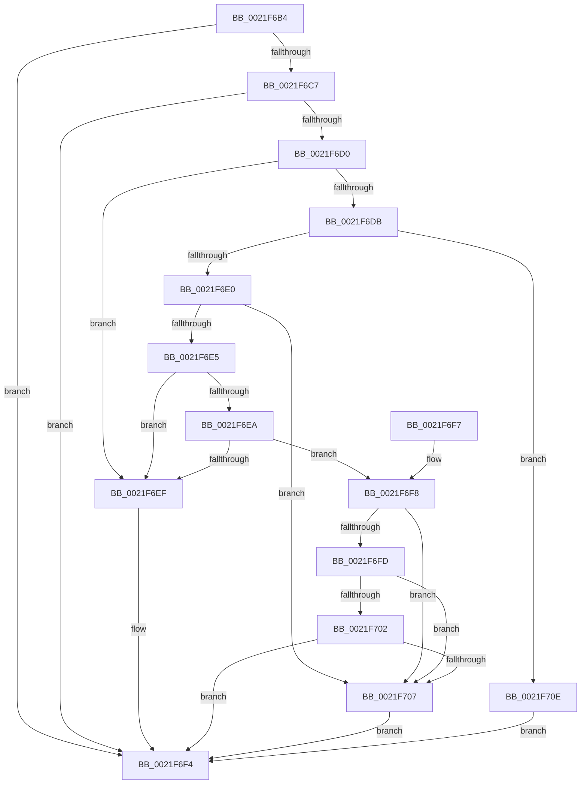

# KiQueryQuantumReset

- RVA: `0x0021F6B4`–`0x0021F715` (길이 `97` bytes)
- VA: `0x000000014021F6B4`
- 실행 섹션: `.text`
- PDB 이름 있음: `예`; PDB Function 태그: `아니요`
- unwind 정보 RVA: `0x000DB714`
- 디코드: `30`개 명령, `97/97` bytes 표시
- 미해석 바이트: `0` (있으면 어셈블리에 `.byte`로 보존)

> 이 문서는 커널 이미지의 기계어와 PDB 기호를 분석해 생성했습니다. 4번과 5번은 함수 원형과 자료형을 바이너리 사용 방식에서 추정한 C 해석이며 원본 소스 복구 결과는 아닙니다.

## 1. Dependencies

- 직접 호출 지점: **0**; 고유 호출 대상: **0**
- 직접 호출자로 확인된 함수: **12**
- RIP 상대 이미지 참조: **2**

### Outgoing calls
- 직접 디코드된 call 명령이 없습니다.

### Direct callers
- [KeYieldExecution](../20/KeYieldExecution_function_00209FA0.md) at `0x0020A136`
- [sub_0021BDD6](Unknown_function_0021BDD6.md) at `0x0021BEFA`
- [KiQueueReadyThread](KiQueueReadyThread_function_0021C7B0.md) at `0x0021CEF9`
- [sub_0021D7F8](Unknown_function_0021D7F8.md) at `0x0021DCBA`
- [KiWakePriQueueWaiter](KiWakePriQueueWaiter_function_0021F720.md) at `0x0021F8E5`
- [KeSetPriorityThread](../2C/KeSetPriorityThread_function_002C76E0.md) at `0x002C77B0`
- [KeSetPriorityAndQuantumProcess](../3C/KeSetPriorityAndQuantumProcess_function_003C2EC0.md) at `0x003C30F3`
- [KeSetActualBasePriorityThread](../3C/KeSetActualBasePriorityThread_function_003C4370.md) at `0x003C44D4`
- [KeRemovePriQueue](../3C/KeRemovePriQueue_function_003C5090.md) at `0x003C55B4`
- [KeSetBasePriorityThread](../3C/KeSetBasePriorityThread_function_003C6EB0.md) at `0x003C706B`
- [KeBoostPriorityThread](../4D/KeBoostPriorityThread_function_004D37F8.md) at `0x004D397D`
- [sub_006E7EC2](../6E/Unknown_function_006E7EC2.md) at `0x006E7F31`

### Static image references
- `0x0021F6B4` → RVA `0x00FC6B38` (`ALMOSTRO`; read)
- `0x0021F6C7` → RVA `0x00FC6AF5` (`ALMOSTRO`; read)

## 2. Other-region calls and transfers

- 다른 실행 섹션으로 향하는 call: **0**
- 별도 외부 분기/꼬리 이동을 확인하지 못했습니다.

## 3. Assembly (complete function range)

```asm
0021F6B4  F7 05 7A 74 DA 00 00 00 04 00   test dword ptr [rip + 0xda747a], 0x40000
0021F6BE  0F B6 91 8B 02 00 00            movzx edx, byte ptr [rcx + 0x28b]
0021F6C5  74 2D                           je 0x14021f6f4
0021F6C7  80 3D 27 74 DA 00 00            cmp byte ptr [rip + 0xda7427], 0
0021F6CE  74 24                           je 0x14021f6f4
0021F6D0  0F B6 89 04 02 00 00            movzx ecx, byte ptr [rcx + 0x204]
0021F6D7  85 C9                           test ecx, ecx
0021F6D9  74 14                           je 0x14021f6ef
0021F6DB  83 E9 01                        sub ecx, 1
0021F6DE  74 2E                           je 0x14021f70e
0021F6E0  83 E9 01                        sub ecx, 1
0021F6E3  74 22                           je 0x14021f707
0021F6E5  83 E9 01                        sub ecx, 1
0021F6E8  74 05                           je 0x14021f6ef
0021F6EA  83 E9 01                        sub ecx, 1
0021F6ED  75 09                           jne 0x14021f6f8
0021F6EF  BA 24 00 00 00                  mov edx, 0x24
0021F6F4  8B C2                           mov eax, edx
0021F6F6  C3                              ret
0021F6F7  CC                              int3
0021F6F8  83 E9 01                        sub ecx, 1
0021F6FB  74 0A                           je 0x14021f707
0021F6FD  83 E9 01                        sub ecx, 1
0021F700  74 05                           je 0x14021f707
0021F702  83 F9 01                        cmp ecx, 1
0021F705  75 ED                           jne 0x14021f6f4
0021F707  BA 02 00 00 00                  mov edx, 2
0021F70C  EB E6                           jmp 0x14021f6f4
0021F70E  BA 12 00 00 00                  mov edx, 0x12
0021F713  EB DF                           jmp 0x14021f6f4
```

## 4. C-style interpretation (structured pseudocode)

```c
__int64 __fastcall KiQueryQuantumReset(__int64 a1)
{
    if (((*(unsigned int *)(v_rip + 14316666)) & (0x40000ULL)) == 0) goto loc_0021F6F4;
    if ((*(unsigned __int8 *)(v_rip + 14316583)) == 0) goto loc_0021F6F4;
    if ((unsigned int)(*(unsigned __int8 *)(a1 + 516)) == 0) goto loc_0021F6EF;
    a1 = (unsigned int)((*(unsigned __int8 *)(a1 + 516)) - (1));
    if (condition_is_equal) goto loc_0021F70E;
    a1 = (unsigned int)((a1) - (1));
    if (condition_is_equal) goto loc_0021F707;
    a1 = (unsigned int)((a1) - (1));
    if (condition_is_equal) goto loc_0021F6EF;
    a1 = (unsigned int)((a1) - (1));
    if (condition_is_not_equal) goto loc_0021F6F8;
loc_0021F6EF:
loc_0021F6F4:
    return 36;
loc_0021F6F8:
    a1 = (unsigned int)((a1) - (1));
    if (condition_is_equal) goto loc_0021F707;
    a1 = (unsigned int)((a1) - (1));
    if (condition_is_equal) goto loc_0021F707;
    if (((unsigned int)(a1)) != 1) goto loc_0021F6F4;
loc_0021F707:
    goto loc_0021F6F4;
loc_0021F70E:
    goto loc_0021F6F4;
}
```

## 5. (Beta) C Style

```c
int64_t KiQueryQuantumReset(void *Arg1)
{
    uint8_t *arg1 = (uint8_t *)Arg1;

    if (((*(uint32_t *)(v_rip + 0xDA747A)) & (0x40000ULL)) == 0) goto loc_0021F6F4;
    if ((*(uint8_t *)(v_rip + 0xDA7427)) == 0) goto loc_0021F6F4;
    if ((uint32_t)(*(uint8_t *)(arg1 + 0x204)) == 0) goto loc_0021F6EF;
    Arg1 = (uint32_t)((*(uint8_t *)(arg1 + 0x204)) - (1));
    if (condition_is_equal) goto loc_0021F70E;
    Arg1 = (uint32_t)((Arg1) - (1));
    if (condition_is_equal) goto loc_0021F707;
    Arg1 = (uint32_t)((Arg1) - (1));
    if (condition_is_equal) goto loc_0021F6EF;
    Arg1 = (uint32_t)((Arg1) - (1));
    if (condition_is_not_equal) goto loc_0021F6F8;
loc_0021F6EF:
loc_0021F6F4:
    return 36;
loc_0021F6F8:
    Arg1 = (uint32_t)((Arg1) - (1));
    if (condition_is_equal) goto loc_0021F707;
    Arg1 = (uint32_t)((Arg1) - (1));
    if (condition_is_equal) goto loc_0021F707;
    if (((uint32_t)(Arg1)) != 1) goto loc_0021F6F4;
loc_0021F707:
    goto loc_0021F6F4;
loc_0021F70E:
    goto loc_0021F6F4;
}
```

### 관측된 메모리 오프셋

구조체 형식이 확인되지 않은 접근은 인자 기준의 오프셋으로만 기록했습니다.

| 기준 인자 | 오프셋 표현 | 폭 (bit) | 접근 |
|---|---:|---:|---|
| `Arg1` | `+ 0x204` | `8` | `R` |
| `Arg1` | `+ 0x28B` | `8` | `R` |

## 6. Execution-region graph

[열기: 2D/3D 그래프와 함수 탐색 컨트롤 패널](../../../control-panel.html?section=text&rva=0x0021F6B4&view=graph)

- 2D 그래프는 위에서 아래로 흐르고, 3D 그래프는 빈 공간을 드래그해 회전합니다. Shift+드래그는 이동, 휠은 확대·축소, 함수 노드 선택은 대상 보고서 이동입니다.

### Static fallback


