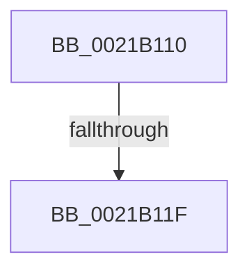

# KiRcuCheckQuiescent

- RVA: `0x0021B110`–`0x0021B127` (길이 `23` bytes)
- VA: `0x000000014021B110`
- 실행 섹션: `.text`
- PDB 이름 있음: `예`; PDB Function 태그: `예`
- unwind 정보 RVA: `0x0005ECB8`
- 디코드: `6`개 명령, `23/23` bytes 표시
- 미해석 바이트: `0` (있으면 어셈블리에 `.byte`로 보존)

> 이 문서는 커널 이미지의 기계어와 PDB 기호를 분석해 생성했습니다. 4번과 5번은 함수 원형과 자료형을 바이너리 사용 방식에서 추정한 C 해석이며 원본 소스 복구 결과는 아닙니다.

## 1. Dependencies

- 직접 호출 지점: **0**; 고유 호출 대상: **0**
- 직접 호출자로 확인된 함수: **4**
- RIP 상대 이미지 참조: **0**

### Outgoing calls
- 직접 디코드된 call 명령이 없습니다.

### Direct callers
- [KiRetireDpcList](KiRetireDpcList_function_0021A0B0.md) at `0x0021A4AE`
- [sub_0021B896](Unknown_function_0021B896.md) at `0x0021B8A6`
- [KiForceIdleParkUnparkProcessor](../35/KiForceIdleParkUnparkProcessor_function_003523B8.md) at `0x003523C9`
- [KeRcuReadUnlock](../38/KeRcuReadUnlock_function_0038A070.md) at `0x0038A186`

### Static image references
- 디코드된 RIP-relative 메모리 참조가 없습니다.

## 2. Other-region calls and transfers

- 다른 실행 섹션으로 향하는 call: **0**
- call이 아닌 외부 분기/꼬리 이동: **1**
  - `0x0021B11D` → [sub_0021B15A](Unknown_function_0021B15A.md) (`tail-transfer`)

## 3. Assembly (complete function range)

```asm
0021B110  40 53                           push rbx
0021B112  48 83 EC 20                     sub rsp, 0x20
0021B116  80 79 20 01                     cmp byte ptr [rcx + 0x20], 1
0021B11A  48 8B D9                        mov rbx, rcx
0021B11D  77 3B                           ja 0x14021b15a
0021B11F  48 83 B9 F8 38 00 00 00         cmp qword ptr [rcx + 0x38f8], 0
```

## 4. C-style interpretation (structured pseudocode)

```c
void __fastcall KiRcuCheckQuiescent(__int64 a1)
{
    __int64 v_rsp;

    v_rsp = (v_rsp) - (32);
    return;
}
```

## 5. (Beta) C Style

```c
void KiRcuCheckQuiescent(void *Arg1)
{
    uint8_t *arg1 = (uint8_t *)Arg1;

    int64_t local_rsp;

    local_rsp = (local_rsp) - (32);
    return;
}
```

### 관측된 메모리 오프셋

구조체 형식이 확인되지 않은 접근은 인자 기준의 오프셋으로만 기록했습니다.

| 기준 인자 | 오프셋 표현 | 폭 (bit) | 접근 |
|---|---:|---:|---|
| `Arg1` | `+ 0x20` | `8` | `R` |
| `Arg1` | `+ 0x38F8` | `64` | `R` |

## 6. Execution-region graph

[열기: 2D/3D 그래프와 함수 탐색 컨트롤 패널](../../../control-panel.html?section=text&rva=0x0021B110&view=graph)

- 2D 그래프는 위에서 아래로 흐르고, 3D 그래프는 빈 공간을 드래그해 회전합니다. Shift+드래그는 이동, 휠은 확대·축소, 함수 노드 선택은 대상 보고서 이동입니다.

### Static fallback


