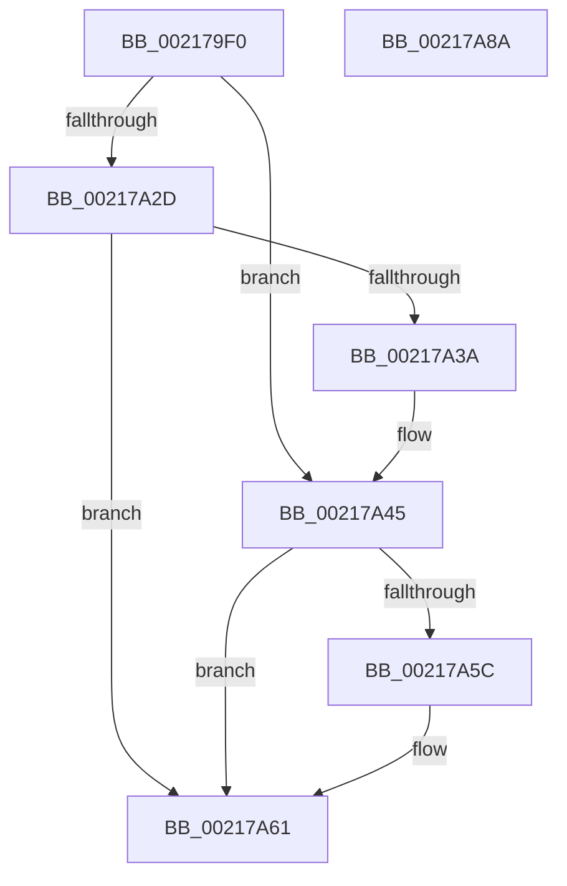

# KiReleaseQueuedSpinLockInstrumented

- RVA: `0x002179F0`–`0x00217A8B` (길이 `155` bytes)
- VA: `0x00000001402179F0`
- 실행 섹션: `.text`
- PDB 이름 있음: `예`; PDB Function 태그: `아니요`
- unwind 정보 RVA: `0x0005E6B4`
- 디코드: `47`개 명령, `155/155` bytes 표시
- 미해석 바이트: `0` (있으면 어셈블리에 `.byte`로 보존)

> 이 문서는 커널 이미지의 기계어와 PDB 기호를 분석해 생성했습니다. 4번과 5번은 함수 원형과 자료형을 바이너리 사용 방식에서 추정한 C 해석이며 원본 소스 복구 결과는 아닙니다.

## 1. Dependencies

- 직접 호출 지점: **3**; 고유 호출 대상: **3**
- 직접 호출자로 확인된 함수: **45**
- RIP 상대 이미지 참조: **0**

### Outgoing calls
- `0x00217A3D` → [KxWaitForLockChainValid](KxWaitForLockChainValid_function_00217AA0.md) (function, `0x00217AA0`)
- `0x00217A5C` → [KeWakeAddressAll](KeWakeAddressAll_function_00217C20.md) (function, `0x00217C20`)
- `0x00217A6A` → [PerfLogSpinLockRelease](../4C/PerfLogSpinLockRelease_function_004CD094.md) (function, `0x004CD094`)

### Direct callers
- [ExpAcquireFastResourceSharedSlow](ExpAcquireFastResourceSharedSlow_function_00211260.md) at `0x00211517`
- [ExpAcquireResourceSharedLite](ExpAcquireResourceSharedLite_function_00212040.md) at `0x0021225C`
- [ExpAcquireResourceSharedLite](ExpAcquireResourceSharedLite_function_00212040.md) at `0x00212635`
- [ExpAcquireResourceSharedLite](ExpAcquireResourceSharedLite_function_00212040.md) at `0x002128CB`
- [sub_00213F4F](Unknown_function_00213F4F.md) at `0x002142A8`
- [sub_002142F9](Unknown_function_002142F9.md) at `0x0021433D`
- [sub_00214E58](Unknown_function_00214E58.md) at `0x00214FD3`
- [sub_00215166](Unknown_function_00215166.md) at `0x002152F2`
- [sub_00215E53](Unknown_function_00215E53.md) at `0x00215E6B`
- [sub_002170BD](Unknown_function_002170BD.md) at `0x002170D3`
- [sub_00217238](Unknown_function_00217238.md) at `0x0021724C`
- [MiReacquireHigherPageTableLock](../23/MiReacquireHigherPageTableLock_function_00239650.md) at `0x00239B9E`
- [IopCompleteIrpInFileObjectList](../24/IopCompleteIrpInFileObjectList_function_0024F330.md) at `0x0024F780`
- [sub_0025D903](../25/Unknown_function_0025D903.md) at `0x0025DC1E`
- [sub_0025D903](../25/Unknown_function_0025D903.md) at `0x0025DD40`
- [sub_0025D903](../25/Unknown_function_0025D903.md) at `0x0025E282`
- [sub_0025D903](../25/Unknown_function_0025D903.md) at `0x0025E30C`
- [sub_0025FB5C](../25/Unknown_function_0025FB5C.md) at `0x0025FD63`
- [sub_0025FB5C](../25/Unknown_function_0025FB5C.md) at `0x0025FE78`
- [sub_00260366](../26/Unknown_function_00260366.md) at `0x00260539`
- [sub_00260366](../26/Unknown_function_00260366.md) at `0x002605C7`
- [ExReleaseFastResource](../26/ExReleaseFastResource_function_002613D0.md) at `0x00261798`
- [sub_00261DFE](../26/Unknown_function_00261DFE.md) at `0x00261F08`
- [KiAbEntryRemoveFromTree](../26/KiAbEntryRemoveFromTree_function_00262410.md) at `0x0026266E`
- [KiAbEntryRemoveFromTree](../26/KiAbEntryRemoveFromTree_function_00262410.md) at `0x00262987`
- [sub_00262D5A](../26/Unknown_function_00262D5A.md) at `0x00262EA6`
- [IopCheckVpbMounted](../27/IopCheckVpbMounted_function_00270540.md) at `0x00270649`
- [IopCheckVpbMounted](../27/IopCheckVpbMounted_function_00270540.md) at `0x002706FC`
- [IopDecrementDeviceObjectRef](../27/IopDecrementDeviceObjectRef_function_00270970.md) at `0x00270AB1`
- [sub_00272604](../27/Unknown_function_00272604.md) at `0x0027261A`
- [sub_00273F95](../27/Unknown_function_00273F95.md) at `0x0027419F`
- [sub_00273F95](../27/Unknown_function_00273F95.md) at `0x002742C2`
- [sub_0027475D](../27/Unknown_function_0027475D.md) at `0x00274985`
- [sub_0027475D](../27/Unknown_function_0027475D.md) at `0x00274A0E`
- [MiDeleteVaDirect](../27/MiDeleteVaDirect_function_00277560.md) at `0x00278550`
- [MiWalkPageTablesRecursively](../27/MiWalkPageTablesRecursively_function_002796C0.md) at `0x0027B023`
- [MiReleaseFaultState](../27/MiReleaseFaultState_function_0027D290.md) at `0x0027D5B0`
- [sub_0027D95C](../27/Unknown_function_0027D95C.md) at `0x0027DB2B`
- [MiCaptureDeleteHierarchy](../27/MiCaptureDeleteHierarchy_function_0027F5F0.md) at `0x0027FB10`
- [MiMakeSystemAddressValid](../27/MiMakeSystemAddressValid_function_0027FF70.md) at `0x00280888`
- [MiLockLowestValidPageTableEx](../28/MiLockLowestValidPageTableEx_function_00280D10.md) at `0x002813C9`
- [sub_0028216F](../28/Unknown_function_0028216F.md) at `0x002821E3`
- [sub_002822AC](../28/Unknown_function_002822AC.md) at `0x0028246C`
- [sub_00341D47](../34/Unknown_function_00341D47.md) at `0x00341D5F`
- [sub_00342D6F](../34/Unknown_function_00342D6F.md) at `0x00342D9A`
- [PfpPartitionGetFirst](../34/PfpPartitionGetFirst_function_00342ED0.md) at `0x00342FC3`
- [NtWaitForWorkViaWorkerFactory](../39/NtWaitForWorkViaWorkerFactory_function_00394270.md) at `0x00394713`
- [NtWaitForWorkViaWorkerFactory](../39/NtWaitForWorkViaWorkerFactory_function_00394270.md) at `0x00394AF9`
- [ExpAcquireFastResourceExclusiveSlow](../3B/ExpAcquireFastResourceExclusiveSlow_function_003BE2E0.md) at `0x003BE41A`
- [ExpAcquireFastResourceExclusiveSlow](../3B/ExpAcquireFastResourceExclusiveSlow_function_003BE2E0.md) at `0x003BE62A`
- [IopCheckDeviceAndDriver](../3F/IopCheckDeviceAndDriver_function_003FCBE0.md) at `0x003FCD35`
- [AlpcpQueueIoCompletionPort](../3F/AlpcpQueueIoCompletionPort_function_003FF760.md) at `0x003FF891`
- [sub_0040EACB](../40/Unknown_function_0040EACB.md) at `0x0040EBDE`
- [AlpcpLookasidePacketCallbackRoutine](../41/AlpcpLookasidePacketCallbackRoutine_function_00419D50.md) at `0x00419E6F`
- [sub_0041B2EE](../41/Unknown_function_0041B2EE.md) at `0x0041B304`
- [IopVerifyDeviceObjectOnStack](../41/IopVerifyDeviceObjectOnStack_function_0041B3B0.md) at `0x0041B473`
- [sub_0041DA61](../41/Unknown_function_0041DA61.md) at `0x0041DA77`
- [sub_00420F13](../42/Unknown_function_00420F13.md) at `0x00420F25`

### Static image references
- 디코드된 RIP-relative 메모리 참조가 없습니다.

## 2. Other-region calls and transfers

- 다른 실행 섹션으로 향하는 call: **0**
- 별도 외부 분기/꼬리 이동을 확인하지 못했습니다.

## 3. Assembly (complete function range)

```asm
002179F0  48 8B C4                        mov rax, rsp
002179F3  48 89 58 08                     mov qword ptr [rax + 8], rbx
002179F7  48 89 68 10                     mov qword ptr [rax + 0x10], rbp
002179FB  48 89 70 18                     mov qword ptr [rax + 0x18], rsi
002179FF  48 89 78 20                     mov qword ptr [rax + 0x20], rdi
00217A03  41 56                           push r14
00217A05  48 83 EC 20                     sub rsp, 0x20
00217A09  48 8B F2                        mov rsi, rdx
00217A0C  48 8B F9                        mov rdi, rcx
00217A0F  0F 31                           rdtsc
00217A11  48 C1 E2 20                     shl rdx, 0x20
00217A15  48 0B C2                        or rax, rdx
00217A18  48 8B E8                        mov rbp, rax
00217A1B  0F 0D 09                        prefetchw byte ptr [rcx]
00217A1E  48 8B 09                        mov rcx, qword ptr [rcx]
00217A21  48 8D 5F 08                     lea rbx, [rdi + 8]
00217A25  45 33 F6                        xor r14d, r14d
00217A28  48 85 C9                        test rcx, rcx
00217A2B  75 18                           jne 0x140217a45
00217A2D  48 8B 0B                        mov rcx, qword ptr [rbx]
00217A30  48 8B C7                        mov rax, rdi
00217A33  F0 4C 0F B1 31                  lock cmpxchg qword ptr [rcx], r14
00217A38  74 27                           je 0x140217a61
00217A3A  48 8B CF                        mov rcx, rdi
00217A3D  E8 5E 00 00 00                  call 0x140217aa0
00217A42  48 8B C8                        mov rcx, rax
00217A45  4C 89 37                        mov qword ptr [rdi], r14
00217A48  48 83 C1 08                     add rcx, 8
00217A4C  48 8B 03                        mov rax, qword ptr [rbx]
00217A4F  48 8B D0                        mov rdx, rax
00217A52  48 87 11                        xchg qword ptr [rcx], rdx
00217A55  32 D0                           xor dl, al
00217A57  F6 C2 04                        test dl, 4
00217A5A  74 05                           je 0x140217a61
00217A5C  E8 BF 01 00 00                  call 0x140217c20
00217A61  48 8B 0B                        mov rcx, qword ptr [rbx]
00217A64  4C 8B C5                        mov r8, rbp
00217A67  48 8B D6                        mov rdx, rsi
00217A6A  E8 25 56 2B 00                  call 0x1404cd094
00217A6F  48 8B 5C 24 30                  mov rbx, qword ptr [rsp + 0x30]
00217A74  48 8B 6C 24 38                  mov rbp, qword ptr [rsp + 0x38]
00217A79  48 8B 74 24 40                  mov rsi, qword ptr [rsp + 0x40]
00217A7E  48 8B 7C 24 48                  mov rdi, qword ptr [rsp + 0x48]
00217A83  48 83 C4 20                     add rsp, 0x20
00217A87  41 5E                           pop r14
00217A89  C3                              ret
00217A8A  CC                              int3
```

## 4. C-style interpretation (structured pseudocode)

```c
__int64 __fastcall KiReleaseQueuedSpinLockInstrumented(__int64 a1, __int64 a2)
{
    __int64 result;
    __int64 v_r14;
    __int64 v_rsp;
    unsigned __int64 v_stack_p10;
    unsigned __int64 v_stack_p18;
    unsigned __int64 v_stack_p20;
    unsigned __int64 v_stack_p8;

    *(unsigned __int64 *)(v_rsp + 8) = v_rbx;
    *(unsigned __int64 *)(v_rsp + 16) = v_rbp;
    *(unsigned __int64 *)(v_rsp + 24) = v_rsi;
    *(unsigned __int64 *)(v_rsp + 32) = v_rdi;
    v_rsp = (v_rsp) - (32);
    a2 = (a2) << (32);
    result = (v_rsp) | (a2);
    v_r14 = 0;
    if (*(unsigned __int64 *)(a1) != 0) goto loc_00217A45;
    if (*(unsigned __int64 *)(a1) == 0) goto loc_00217A61;
    result = KxWaitForLockChainValid(a1, a2, a3, a4);
loc_00217A45:
    *(unsigned __int64 *)(a1) = 0;
    a1 = (result) + (8);
    a2 = (unsigned __int8)((*(unsigned __int64 *)(a1 + 8)) ^ ((unsigned __int8)(*(unsigned __int64 *)(a1 + 8))));
    result = *(unsigned __int64 *)(a1 + 8);
    if ((((unsigned __int8)(a2)) & (4)) != 0) {
        result = KeWakeAddressAll(a1, a2, a3, a4);
    }
    result = PerfLogSpinLockRelease(*(unsigned __int64 *)(a1 + 8), a2, result, a4);
    v_rsp = (v_rsp) + (32);
    return result;
}
```

## 5. (Beta) C Style

```c
int64_t KiReleaseQueuedSpinLockInstrumented(void *Arg1, int64_t Arg2)
{
    uint8_t *arg1 = (uint8_t *)Arg1;

    int64_t result;
    int64_t local_r14;
    int64_t local_rsp;
    uint64_t v_stack_p10;
    uint64_t v_stack_p18;
    uint64_t v_stack_p20;
    uint64_t v_stack_p8;

    *(uint64_t *)(local_rsp + 0x8) = local_rbx;
    *(uint64_t *)(local_rsp + 0x10) = local_rbp;
    *(uint64_t *)(local_rsp + 0x18) = local_rsi;
    *(uint64_t *)(local_rsp + 0x20) = local_rdi;
    local_rsp = (local_rsp) - (32);
    Arg2 = (Arg2) << (32);
    result = (local_rsp) | (Arg2);
    local_r14 = 0;
    if (*(uint64_t *)(arg1) != 0) goto loc_00217A45;
    if (*(uint64_t *)(arg1) == 0) goto loc_00217A61;
    result = KxWaitForLockChainValid(Arg1, Arg2, a3, a4);
loc_00217A45:
    *(uint64_t *)(arg1) = 0;
    Arg1 = (result) + (8);
    Arg2 = (uint8_t)((*(uint64_t *)(arg1 + 0x8)) ^ ((uint8_t)(*(uint64_t *)(arg1 + 0x8))));
    result = *(uint64_t *)(arg1 + 0x8);
    if ((((uint8_t)(Arg2)) & (4)) != 0) {
        result = KeWakeAddressAll(Arg1, Arg2, a3, a4);
    }
    result = PerfLogSpinLockRelease(*(uint64_t *)(arg1 + 0x8), Arg2, result, a4);
    local_rsp = (local_rsp) + (32);
    return result;
}
```

### 관측된 메모리 오프셋

구조체 형식이 확인되지 않은 접근은 인자 기준의 오프셋으로만 기록했습니다.

| 기준 인자 | 오프셋 표현 | 폭 (bit) | 접근 |
|---|---:|---:|---|
| `Arg1` | `+ 0x0` | `8` | `R` |
| `Arg1` | `+ 0x0` | `64` | `R` |
| `Arg1` | `+ 0x0` | `64` | `W` |
| `Arg1` | `+ 0x8` | `64` | `R` |

## 6. Execution-region graph

[열기: 2D/3D 그래프와 함수 탐색 컨트롤 패널](../../../control-panel.html?section=text&rva=0x002179F0&view=graph)

- 2D 그래프는 위에서 아래로 흐르고, 3D 그래프는 빈 공간을 드래그해 회전합니다. Shift+드래그는 이동, 휠은 확대·축소, 함수 노드 선택은 대상 보고서 이동입니다.

### Static fallback


