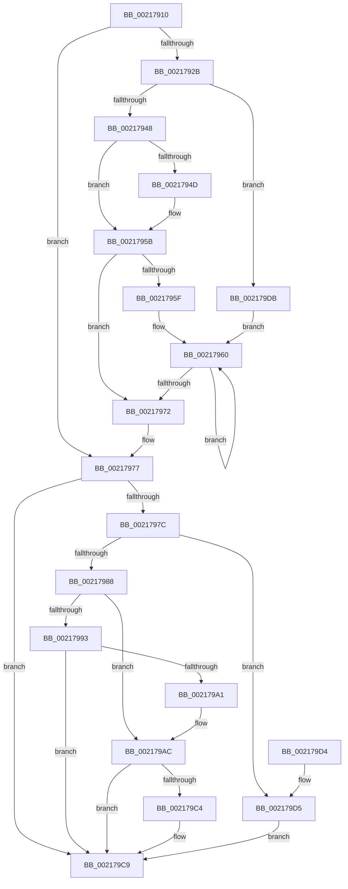

# KiReleaseThreadStateLock

- RVA: `0x00217910`–`0x002179EA` (길이 `218` bytes)
- VA: `0x0000000140217910`
- 실행 섹션: `.text`
- PDB 이름 있음: `예`; PDB Function 태그: `아니요`
- unwind 정보 RVA: `0x0005E6A4`
- 디코드: `66`개 명령, `218/218` bytes 표시
- 미해석 바이트: `0` (있으면 어셈블리에 `.byte`로 보존)

> 이 문서는 커널 이미지의 기계어와 PDB 기호를 분석해 생성했습니다. 4번과 5번은 함수 원형과 자료형을 바이너리 사용 방식에서 추정한 C 해석이며 원본 소스 복구 결과는 아닙니다.

## 1. Dependencies

- 직접 호출 지점: **2**; 고유 호출 대상: **2**
- 직접 호출자로 확인된 함수: **20**
- RIP 상대 이미지 참조: **1**

### Outgoing calls
- `0x002179A4` → [KxWaitForLockChainValid](KxWaitForLockChainValid_function_00217AA0.md) (function, `0x00217AA0`)
- `0x002179C4` → [KeWakeAddressAll](KeWakeAddressAll_function_00217C20.md) (function, `0x00217C20`)

### Direct callers
- [KiRemoveBoostThread](KiRemoveBoostThread_function_00219128.md) at `0x002192AC`
- [KiSetPriorityThread](../22/KiSetPriorityThread_function_00220E78.md) at `0x00221081`
- [KiSetIdealProcessorThread](../2D/KiSetIdealProcessorThread_function_002DCFE0.md) at `0x002DD0DE`
- [KeSetThreadSchedulerAssist](../30/KeSetThreadSchedulerAssist_function_003038F8.md) at `0x00303A7A`
- [KiUpdateVpBackingThreadPriorityFromTopLevel](../30/KiUpdateVpBackingThreadPriorityFromTopLevel_function_00303BA0.md) at `0x00303E56`
- [KiSendHeteroRescheduleIntRequestHelper](../35/KiSendHeteroRescheduleIntRequestHelper_function_0035420C.md) at `0x003545F3`
- [KiRemoveThreadFromSchedulingGroup](../35/KiRemoveThreadFromSchedulingGroup_function_00356514.md) at `0x003565F8`
- [KiRemoveThreadFromSchedulingGroup](../35/KiRemoveThreadFromSchedulingGroup_function_00356514.md) at `0x0035666B`
- [KeQueryTotalCycleTimeThread](../37/KeQueryTotalCycleTimeThread_function_0037EF20.md) at `0x0037F816`
- [KeQueryTotalCycleTimeThread](../37/KeQueryTotalCycleTimeThread_function_0037EF20.md) at `0x0037F8EA`
- [KeSetProcessPpmPolicy](../3C/KeSetProcessPpmPolicy_function_003C1CCC.md) at `0x003C1E46`
- [KeSetThreadPpmPolicy](../3C/KeSetThreadPpmPolicy_function_003C6C30.md) at `0x003C6D29`
- [KeQueryEffectivePriorityThread](../3C/KeQueryEffectivePriorityThread_function_003C7CA0.md) at `0x003C7DF1`
- [KiSetThreadSchedulingGroup](../46/KiSetThreadSchedulingGroup_function_0046E458.md) at `0x0046E531`
- [KeUpdateThreadTag](../47/KeUpdateThreadTag_function_00475770.md) at `0x0047590E`
- [KeUpdateThreadTag](../47/KeUpdateThreadTag_function_00475770.md) at `0x00475AB5`
- [KeTryToFreezeThreadStack](../4B/KeTryToFreezeThreadStack_function_004B5038.md) at `0x004B5181`
- [KiApplyForegroundBoostThread](../4F/KiApplyForegroundBoostThread_function_004F7DC0.md) at `0x004F7F98`
- [KiApplyForegroundBoostThread](../4F/KiApplyForegroundBoostThread_function_004F7DC0.md) at `0x004F8015`
- [KiAdjustCoreIsolationReasonThread](../5C/KiAdjustCoreIsolationReasonThread_function_005C3818.md) at `0x005C393F`
- [KiAdjustUserIsolationDomainThread](../5C/KiAdjustUserIsolationDomainThread_function_005C3B54.md) at `0x005C3F42`
- [KeAbCrossThreadDelete](../5C/KeAbCrossThreadDelete_function_005C517C.md) at `0x005C54B3`
- [KeAbCrossThreadDelete](../5C/KeAbCrossThreadDelete_function_005C517C.md) at `0x005C555D`
- [KeAbCrossThreadDelete](../5C/KeAbCrossThreadDelete_function_005C517C.md) at `0x005C556F`
- [sub_006DAAE6](../6D/Unknown_function_006DAAE6.md) at `0x006DAC06`
- [sub_006E0538](../6E/Unknown_function_006E0538.md) at `0x006E05C6`

### Static image references
- `0x0021797C` → RVA `0x00FC6B38` (`ALMOSTRO`; read)

## 2. Other-region calls and transfers

- 다른 실행 섹션으로 향하는 call: **0**
- 별도 외부 분기/꼬리 이동을 확인하지 못했습니다.

## 3. Assembly (complete function range)

```asm
00217910  48 89 5C 24 10                  mov qword ptr [rsp + 0x10], rbx
00217915  48 89 4C 24 08                  mov qword ptr [rsp + 8], rcx
0021791A  57                              push rdi
0021791B  48 83 EC 20                     sub rsp, 0x20
0021791F  48 8B 5C 24 50                  mov rbx, qword ptr [rsp + 0x50]
00217924  33 FF                           xor edi, edi
00217926  48 85 D2                        test rdx, rdx
00217929  74 4C                           je 0x140217977
0021792B  49 8B 10                        mov rdx, qword ptr [r8]
0021792E  44 8B D7                        mov r10d, edi
00217931  4C 8B DA                        mov r11, rdx
00217934  8B C7                           mov eax, edi
00217936  49 83 E3 FE                     and r11, 0xfffffffffffffffe
0021793A  4C 89 5C 24 30                  mov qword ptr [rsp + 0x30], r11
0021793F  83 E2 01                        and edx, 1
00217942  0F 84 93 00 00 00               je 0x1402179db
00217948  83 FA 01                        cmp edx, 1
0021794B  75 0E                           jne 0x14021795b
0021794D  49 8B 83 58 8E 00 00            mov rax, qword ptr [r11 + 0x8e58]
00217954  4C 8D 50 08                     lea r10, [rax + 8]
00217958  0F B6 00                        movzx eax, byte ptr [rax]
0021795B  85 C0                           test eax, eax
0021795D  74 13                           je 0x140217972
0021795F  90                              nop
00217960  8D 48 FF                        lea ecx, [rax - 1]
00217963  49 8B 14 CA                     mov rdx, qword ptr [r10 + rcx*8]
00217967  8B C1                           mov eax, ecx
00217969  F0 48 21 7A 30                  lock and qword ptr [rdx + 0x30], rdi
0021796E  85 C9                           test ecx, ecx
00217970  75 EE                           jne 0x140217960
00217972  33 C0                           xor eax, eax
00217974  49 89 00                        mov qword ptr [r8], rax
00217977  4D 85 C9                        test r9, r9
0021797A  74 4D                           je 0x1402179c9
0021797C  F7 05 B2 F1 DA 00 00 00 20 00   test dword ptr [rip + 0xdaf1b2], 0x200000
00217986  74 4D                           je 0x1402179d5
00217988  0F 0D 0B                        prefetchw byte ptr [rbx]
0021798B  48 8B 0B                        mov rcx, qword ptr [rbx]
0021798E  48 85 C9                        test rcx, rcx
00217991  75 19                           jne 0x1402179ac
00217993  48 8B 4B 08                     mov rcx, qword ptr [rbx + 8]
00217997  48 8B C3                        mov rax, rbx
0021799A  F0 48 0F B1 39                  lock cmpxchg qword ptr [rcx], rdi
0021799F  74 28                           je 0x1402179c9
002179A1  48 8B CB                        mov rcx, rbx
002179A4  E8 F7 00 00 00                  call 0x140217aa0
002179A9  48 8B C8                        mov rcx, rax
002179AC  48 89 3B                        mov qword ptr [rbx], rdi
002179AF  48 83 C1 08                     add rcx, 8
002179B3  48 8B 43 08                     mov rax, qword ptr [rbx + 8]
002179B7  48 8B D0                        mov rdx, rax
002179BA  48 87 11                        xchg qword ptr [rcx], rdx
002179BD  32 D0                           xor dl, al
002179BF  F6 C2 04                        test dl, 4
002179C2  74 05                           je 0x1402179c9
002179C4  E8 57 02 00 00                  call 0x140217c20
002179C9  48 8B 5C 24 38                  mov rbx, qword ptr [rsp + 0x38]
002179CE  48 83 C4 20                     add rsp, 0x20
002179D2  5F                              pop rdi
002179D3  C3                              ret
002179D4  CC                              int3
002179D5  F0 49 21 39                     lock and qword ptr [r9], rdi
002179D9  EB EE                           jmp 0x1402179c9
002179DB  4C 8D 54 24 30                  lea r10, [rsp + 0x30]
002179E0  B8 01 00 00 00                  mov eax, 1
002179E5  E9 76 FF FF FF                  jmp 0x140217960
```

## 4. C-style interpretation (structured pseudocode)

```c
__int64 __fastcall KiReleaseThreadStateLock(__int64 a1, __int64 a2, __int64 a3, __int64 a4, __int64 a5)
{
    __int64 result;
    __int64 v_r10;
    __int64 v_r11;
    __int64 v_rdi;
    __int64 v_rsp;
    unsigned __int64 v_stack_p10;
    unsigned __int64 v_stack_p30;
    unsigned __int64 v_stack_p8;

    v_stack_p10 = v_rbx;
    v_stack_p8 = a1;
    v_rsp = (v_rsp) - (32);
    v_rdi = 0;
    if (a2 == 0) goto loc_00217977;
    v_r11 = (*(unsigned __int64 *)(a3)) & (-2);
    v_stack_p8 = v_r11;
    a2 = (unsigned int)((*(unsigned __int64 *)(a3)) & (1));
    if (condition_is_equal) goto loc_002179DB;
    result = 0;
    v_r10 = 0;
    if (((unsigned int)(a2)) == 1) {
        result = *(unsigned __int64 *)(v_r11 + 36440);
        v_r10 = result + 8;
        result = *(unsigned __int8 *)(result);
    }
    if ((unsigned int)(result) == 0) goto loc_00217972;
loc_00217960:
    if ((unsigned int)(result - 1) != 0) goto loc_00217960;
loc_00217972:
    result = 0;
    *(unsigned __int64 *)(a3) = 0;
loc_00217977:
    if (a4 == 0) goto loc_002179C9;
    if (((*(unsigned int *)(v_rip + 14348722)) & (0x200000ULL)) == 0) goto loc_002179D5;
    if (*(unsigned __int64 *)(a5) != 0) goto loc_002179AC;
    if (*(unsigned __int64 *)(a5) == 0) goto loc_002179C9;
    result = KxWaitForLockChainValid(a5, *(unsigned __int64 *)(v_r10 + result - 1 * 8), a3, a4);
loc_002179AC:
    *(unsigned __int64 *)(a5) = 0;
    a1 = (result) + (8);
    a2 = (unsigned __int8)((*(unsigned __int64 *)(a5 + 8)) ^ ((unsigned __int8)(*(unsigned __int64 *)(a5 + 8))));
    result = *(unsigned __int64 *)(a5 + 8);
    if ((((unsigned __int8)(a2)) & (4)) != 0) {
        result = KeWakeAddressAll(a1, a2, a3, a4);
    }
    v_rsp = (v_rsp) + (32);
    return result;
loc_002179D5:
    goto loc_002179C9;
loc_002179DB:
    goto loc_00217960;
}
```

## 5. (Beta) C Style

```c
int64_t KiReleaseThreadStateLock(int64_t Arg1, int64_t Arg2, void *Arg3, int64_t Arg4, void *Arg5)
{
    uint8_t *arg3 = (uint8_t *)Arg3;
    uint8_t *arg5 = (uint8_t *)Arg5;

    int64_t result;
    int64_t local_r10;
    int64_t local_r11;
    int64_t local_rdi;
    int64_t local_rsp;
    uint64_t v_stack_p10;
    uint64_t v_stack_p30;
    uint64_t v_stack_p8;

    v_stack_p10 = local_rbx;
    v_stack_p8 = Arg1;
    local_rsp = (local_rsp) - (32);
    local_rdi = 0;
    if (Arg2 == 0) goto loc_00217977;
    local_r11 = (*(uint64_t *)(arg3)) & (-2);
    v_stack_p8 = local_r11;
    Arg2 = (uint32_t)((*(uint64_t *)(arg3)) & (1));
    if (condition_is_equal) goto loc_002179DB;
    result = 0;
    local_r10 = 0;
    if (((uint32_t)(Arg2)) == 1) {
        result = *(uint64_t *)(local_r11 + 0x8E58);
        local_r10 = result + 8;
        result = *(uint8_t *)(result);
    }
    if ((uint32_t)(result) == 0) goto loc_00217972;
loc_00217960:
    if ((uint32_t)(result - 1) != 0) goto loc_00217960;
loc_00217972:
    result = 0;
    *(uint64_t *)(arg3) = 0;
loc_00217977:
    if (Arg4 == 0) goto loc_002179C9;
    if (((*(uint32_t *)(v_rip + 0xDAF1B2)) & (0x200000ULL)) == 0) goto loc_002179D5;
    if (*(uint64_t *)(arg5) != 0) goto loc_002179AC;
    if (*(uint64_t *)(arg5) == 0) goto loc_002179C9;
    result = KxWaitForLockChainValid(Arg5, *(uint64_t *)(local_r10 + result - 0x1 * 8), Arg3, Arg4);
loc_002179AC:
    *(uint64_t *)(arg5) = 0;
    Arg1 = (result) + (8);
    Arg2 = (uint8_t)((*(uint64_t *)(arg5 + 0x8)) ^ ((uint8_t)(*(uint64_t *)(arg5 + 0x8))));
    result = *(uint64_t *)(arg5 + 0x8);
    if ((((uint8_t)(Arg2)) & (4)) != 0) {
        result = KeWakeAddressAll(Arg1, Arg2, Arg3, Arg4);
    }
    local_rsp = (local_rsp) + (32);
    return result;
loc_002179D5:
    goto loc_002179C9;
loc_002179DB:
    goto loc_00217960;
}
```

### 관측된 메모리 오프셋

구조체 형식이 확인되지 않은 접근은 인자 기준의 오프셋으로만 기록했습니다.

| 기준 인자 | 오프셋 표현 | 폭 (bit) | 접근 |
|---|---:|---:|---|
| `Arg3` | `+ 0x0` | `64` | `R` |
| `Arg3` | `+ 0x0` | `64` | `W` |
| `Arg5` | `+ 0x0` | `8` | `R` |
| `Arg5` | `+ 0x0` | `64` | `R` |
| `Arg5` | `+ 0x0` | `64` | `W` |
| `Arg5` | `+ 0x8` | `64` | `R` |

## 6. Execution-region graph

[열기: 2D/3D 그래프와 함수 탐색 컨트롤 패널](../../../control-panel.html?section=text&rva=0x00217910&view=graph)

- 2D 그래프는 위에서 아래로 흐르고, 3D 그래프는 빈 공간을 드래그해 회전합니다. Shift+드래그는 이동, 휠은 확대·축소, 함수 노드 선택은 대상 보고서 이동입니다.

### Static fallback


