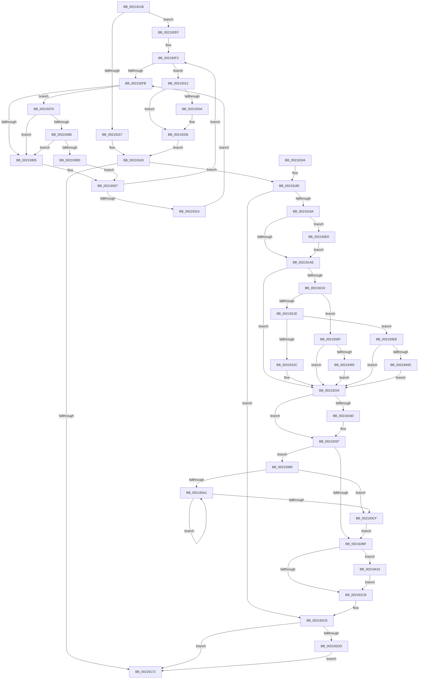

# KiRemoveBoostThread

- RVA: `0x00219128`–`0x00219429` (길이 `769` bytes)
- VA: `0x0000000140219128`
- 실행 섹션: `.text`
- PDB 이름 있음: `예`; PDB Function 태그: `아니요`
- unwind 정보 RVA: `0x0005EBD4`
- 디코드: `192`개 명령, `769/769` bytes 표시
- 미해석 바이트: `0` (있으면 어셈블리에 `.byte`로 보존)

> 이 문서는 커널 이미지의 기계어와 PDB 기호를 분석해 생성했습니다. 4번과 5번은 함수 원형과 자료형을 바이너리 사용 방식에서 추정한 C 해석이며 원본 소스 복구 결과는 아닙니다.

## 1. Dependencies

- 직접 호출 지점: **16**; 고유 호출 대상: **15**
- 직접 호출자로 확인된 함수: **11**
- RIP 상대 이미지 참조: **2**

### Outgoing calls
- `0x002191BB` → [KiAcquirePrcbLocksForIsolationUnit](../30/KiAcquirePrcbLocksForIsolationUnit_function_0030ED60.md) (function, `0x0030ED60`)
- `0x00219206` → [KiUpdateThreadPriority](../25/KiUpdateThreadPriority_function_00257810.md) (function, `0x00257810`)
- `0x00219239` → [KiUpdateSharedReadyQueueAffinityThread](../2C/KiUpdateSharedReadyQueueAffinityThread_function_002CE470.md) (function, `0x002CE470`)
- `0x0021925F` → [KiStartRescheduleContext](../30/KiStartRescheduleContext_function_0030C6B0.md) (function, `0x0030C6B0`)
- `0x0021926A` → [KiFindRescheduleContextEntryForPrcb](../35/KiFindRescheduleContextEntryForPrcb_function_00353060.md) (function, `0x00353060`)
- `0x00219278` → [KiSearchForNewThreadsForRescheduleContext](../25/KiSearchForNewThreadsForRescheduleContext_function_00258620.md) (function, `0x00258620`)
- `0x0021928B` → [KiCommitRescheduleContext](../30/KiCommitRescheduleContext_function_0030CF20.md) (function, `0x0030CF20`)
- `0x002192AC` → [KiReleaseThreadStateLock](KiReleaseThreadStateLock_function_00217910.md) (function, `0x00217910`)
- `0x002192E5` → [KiReadyDeferredReadyList](../30/KiReadyDeferredReadyList_function_0030DD80.md) (function, `0x0030DD80`)
- `0x0021931C` → [KiComputeThreadPriority](../3C/KiComputeThreadPriority_function_003C45F4.md) (function, `0x003C45F4`)
- `0x0021934D` → [KiComputeThreadPriority](../3C/KiComputeThreadPriority_function_003C45F4.md) (function, `0x003C45F4`)
- `0x00219380` → [KiCheckVpBackingLongSpinWaitHypercall](../30/KiCheckVpBackingLongSpinWaitHypercall_function_0030F490.md) (function, `0x0030F490`)
- `0x0021938F` → [HvlNotifyLongSpinWait](../30/HvlNotifyLongSpinWait_function_0030F460.md) (function, `0x0030F460`)
- `0x002193BF` → [KiCompleteRescheduleContextEntry](../35/KiCompleteRescheduleContextEntry_function_00356330.md) (function, `0x00356330`)
- `0x002193D6` → [KiFlushSoftwareInterruptBatch](../25/KiFlushSoftwareInterruptBatch_function_00252200.md) (function, `0x00252200`)
- `0x0021941F` → [KiHvEnlightenedGuestPriorityKick](../44/KiHvEnlightenedGuestPriorityKick_function_00443880.md) (function, `0x00443880`)

### Direct callers
- [sub_00219EB5](Unknown_function_00219EB5.md) at `0x00219FD0`
- [sub_0025E5F6](../25/Unknown_function_0025E5F6.md) at `0x0025E6E5`
- [sub_0025E5F6](../25/Unknown_function_0025E5F6.md) at `0x0025E859`
- [sub_00260366](../26/Unknown_function_00260366.md) at `0x0026090B`
- [sub_00260366](../26/Unknown_function_00260366.md) at `0x00260A76`
- [ExReleaseFastResource](../26/ExReleaseFastResource_function_002613D0.md) at `0x0026197C`
- [sub_00261DFE](../26/Unknown_function_00261DFE.md) at `0x002620E9`
- [sub_00262F80](../26/Unknown_function_00262F80.md) at `0x0026308E`
- [sub_0027475D](../27/Unknown_function_0027475D.md) at `0x00274D52`
- [sub_0027475D](../27/Unknown_function_0027475D.md) at `0x00274EC8`
- [KeWakeWaitChain](../34/KeWakeWaitChain_function_0034F8C0.md) at `0x0034FA33`
- [KeSetEventBoostPriorityEx](../35/KeSetEventBoostPriorityEx_function_00350148.md) at `0x003502D2`
- [KeGenericProcessorCallback](../39/KeGenericProcessorCallback_function_00398C2C.md) at `0x00398E1C`
- [KiCompleteDirectSwitchThread](../3F/KiCompleteDirectSwitchThread_function_003FFE1C.md) at `0x003FFE96`

### Static image references
- `0x002192FD` → RVA `0x00FC52AC` (`ALMOSTRO`; reference)
- `0x00219376` → RVA `0x00FC6AB8` (`ALMOSTRO`; read)

## 2. Other-region calls and transfers

- 다른 실행 섹션으로 향하는 call: **0**
- 별도 외부 분기/꼬리 이동을 확인하지 못했습니다.

## 3. Assembly (complete function range)

```asm
00219128  40 53                           push rbx
0021912A  56                              push rsi
0021912B  57                              push rdi
0021912C  41 54                           push r12
0021912E  41 55                           push r13
00219130  41 56                           push r14
00219132  41 57                           push r15
00219134  48 83 EC 60                     sub rsp, 0x60
00219138  45 33 ED                        xor r13d, r13d
0021913B  48 8B FA                        mov rdi, rdx
0021913E  4C 8B E1                        mov r12, rcx
00219141  45 8B F5                        mov r14d, r13d
00219144  4C 89 6C 24 38                  mov qword ptr [rsp + 0x38], r13
00219149  66 44 39 AA 06 02 00 00         cmp word ptr [rdx + 0x206], r13w
00219151  0F 85 98 01 00 00               jne 0x1402192ef
00219157  0F BE B2 C3 00 00 00            movsx esi, byte ptr [rdx + 0xc3]
0021915E  41 8B C5                        mov eax, r13d
00219161  FF C6                           inc esi
00219163  83 FE 10                        cmp esi, 0x10
00219166  B9 0F 00 00 00                  mov ecx, 0xf
0021916B  0F 4D F1                        cmovge esi, ecx
0021916E  85 C0                           test eax, eax
00219170  75 13                           jne 0x140219185
00219172  8B C6                           mov eax, esi
00219174  48 83 C4 60                     add rsp, 0x60
00219178  41 5F                           pop r15
0021917A  41 5E                           pop r14
0021917C  41 5D                           pop r13
0021917E  41 5C                           pop r12
00219180  5F                              pop rdi
00219181  5E                              pop rsi
00219182  5B                              pop rbx
00219183  C3                              ret
00219184  CC                              int3
00219185  0F BE 87 C3 00 00 00            movsx eax, byte ptr [rdi + 0xc3]
0021918C  4C 89 6C 24 30                  mov qword ptr [rsp + 0x30], r13
00219191  44 3B F0                        cmp r14d, eax
00219194  0F 84 34 01 00 00               je 0x1402192ce
0021919A  0F 57 C0                        xorps xmm0, xmm0
0021919D  0F 11 44 24 48                  movups xmmword ptr [rsp + 0x48], xmm0
002191A2  4D 8B FC                        mov r15, r12
002191A5  4D 85 E4                        test r12, r12
002191A8  0F 84 32 02 00 00               je 0x1402193e0
002191AE  4C 8D 44 24 38                  lea r8, [rsp + 0x38]
002191B3  BA 01 00 00 00                  mov edx, 1
002191B8  49 8B CF                        mov rcx, r15
002191BB  E8 A0 5B 0F 00                  call 0x14030ed60
002191C0  65 48 8B 04 25 20 00 00 00      mov rax, qword ptr gs:[0x20]
002191C9  45 8B E5                        mov r12d, r13d
002191CC  49 8B 5F 10                     mov rbx, qword ptr [r15 + 0x10]
002191D0  45 8B CE                        mov r9d, r14d
002191D3  48 89 44 24 40                  mov qword ptr [rsp + 0x40], rax
002191D8  48 85 DB                        test rbx, rbx
002191DB  0F BE 87 C3 00 00 00            movsx eax, byte ptr [rdi + 0xc3]
002191E2  4C 8B C7                        mov r8, rdi
002191E5  89 84 24 B8 00 00 00            mov dword ptr [rsp + 0xb8], eax
002191EC  49 8B CF                        mov rcx, r15
002191EF  0F 94 C0                        sete al
002191F2  44 88 AC 24 B0 00 00 00         mov byte ptr [rsp + 0xb0], r13b
002191FA  88 44 24 20                     mov byte ptr [rsp + 0x20], al
002191FE  44 88 A4 24 A8 00 00 00         mov byte ptr [rsp + 0xa8], r12b
00219206  E8 05 E6 03 00                  call 0x140257810
0021920B  48 85 DB                        test rbx, rbx
0021920E  75 24                           jne 0x140219234
00219210  44 3B B4 24 B8 00 00 00         cmp r14d, dword ptr [rsp + 0xb8]
00219218  0F 8D 41 01 00 00               jge 0x14021935f
0021921E  8A 87 84 01 00 00               mov al, byte ptr [rdi + 0x184]
00219224  3C 02                           cmp al, 2
00219226  0F 85 C2 01 00 00               jne 0x1402193ee
0021922C  C6 84 24 A8 00 00 00 01         mov byte ptr [rsp + 0xa8], 1
00219234  48 8B D7                        mov rdx, rdi
00219237  33 C9                           xor ecx, ecx
00219239  E8 32 52 0B 00                  call 0x1402ce470
0021923E  4C 8B 74 24 40                  mov r14, qword ptr [rsp + 0x40]
00219243  44 38 AC 24 A8 00 00 00         cmp byte ptr [rsp + 0xa8], r13b
0021924B  74 4A                           je 0x140219297
0021924D  4D 8B AE E8 37 00 00            mov r13, qword ptr [r14 + 0x37e8]
00219254  48 8D 54 24 38                  lea rdx, [rsp + 0x38]
00219259  49 8B CD                        mov rcx, r13
0021925C  45 33 C0                        xor r8d, r8d
0021925F  E8 4C 34 0F 00                  call 0x14030c6b0
00219264  49 8B D7                        mov rdx, r15
00219267  49 8B CD                        mov rcx, r13
0021926A  E8 F1 9D 13 00                  call 0x140353060
0021926F  48 8D 54 24 30                  lea rdx, [rsp + 0x30]
00219274  80 48 22 02                     or byte ptr [rax + 0x22], 2
00219278  E8 A3 F3 03 00                  call 0x140258620
0021927D  4C 8D 4C 24 30                  lea r9, [rsp + 0x30]
00219282  45 33 C0                        xor r8d, r8d
00219285  49 8B D6                        mov rdx, r14
00219288  49 8B CD                        mov rcx, r13
0021928B  E8 90 3C 0F 00                  call 0x14030cf20
00219290  88 84 24 B0 00 00 00            mov byte ptr [rsp + 0xb0], al
00219297  48 8D 44 24 48                  lea rax, [rsp + 0x48]
0021929C  45 33 C9                        xor r9d, r9d
0021929F  4C 8D 44 24 38                  lea r8, [rsp + 0x38]
002192A4  48 89 44 24 20                  mov qword ptr [rsp + 0x20], rax
002192A9  49 8B D7                        mov rdx, r15
002192AC  E8 5F E6 FF FF                  call 0x140217910
002192B1  80 BC 24 B0 00 00 00 00         cmp byte ptr [rsp + 0xb0], 0
002192B9  0F 85 DA 00 00 00               jne 0x140219399
002192BF  45 33 ED                        xor r13d, r13d
002192C2  45 85 E4                        test r12d, r12d
002192C5  0F 8F 4B 01 00 00               jg 0x140219416
002192CB  4D 8B E7                        mov r12, r15
002192CE  4C 89 6F 40                     mov qword ptr [rdi + 0x40], r13
002192D2  4C 39 6C 24 30                  cmp qword ptr [rsp + 0x30], r13
002192D7  0F 84 95 FE FF FF               je 0x140219172
002192DD  48 8D 54 24 30                  lea rdx, [rsp + 0x30]
002192E2  49 8B CC                        mov rcx, r12
002192E5  E8 96 4A 0F 00                  call 0x14030dd80
002192EA  E9 83 FE FF FF                  jmp 0x140219172
002192EF  41 8B DD                        mov ebx, r13d
002192F2  F0 48 0F BA 6F 40 00            lock bts qword ptr [rdi + 0x40], 0
002192F9  73 17                           jae 0x140219312
002192FB  FF C3                           inc ebx
002192FD  85 1D A9 BF DA 00               test dword ptr [rip + 0xdabfa9], ebx
00219303  74 71                           je 0x140219376
00219305  F3 90                           pause
00219307  48 8B 47 40                     mov rax, qword ptr [rdi + 0x40]
0021930B  48 85 C0                        test rax, rax
0021930E  74 E2                           je 0x1402192f2
00219310  EB E9                           jmp 0x1402192fb
00219312  45 33 C0                        xor r8d, r8d
00219315  48 8B CF                        mov rcx, rdi
00219318  41 8D 50 01                     lea edx, [r8 + 1]
0021931C  E8 D3 B2 1A 00                  call 0x1403c45f4
00219321  8B F0                           mov esi, eax
00219323  B9 F0 0F 00 00                  mov ecx, 0xff0
00219328  0F B7 87 06 02 00 00            movzx eax, word ptr [rdi + 0x206]
0021932F  66 85 C1                        test cx, ax
00219332  75 02                           jne 0x140219336
00219334  FF C6                           inc esi
00219336  B9 0F F0 00 00                  mov ecx, 0xf00f
0021933B  45 33 C0                        xor r8d, r8d
0021933E  66 23 C1                        and ax, cx
00219341  33 D2                           xor edx, edx
00219343  48 8B CF                        mov rcx, rdi
00219346  66 89 87 06 02 00 00            mov word ptr [rdi + 0x206], ax
0021934D  E8 A2 B2 1A 00                  call 0x1403c45f4
00219352  44 8B F0                        mov r14d, eax
00219355  B8 01 00 00 00                  mov eax, 1
0021935A  E9 04 FE FF FF                  jmp 0x140219163
0021935F  0F 8E CF FE FF FF               jle 0x140219234
00219365  8A 87 84 01 00 00               mov al, byte ptr [rdi + 0x184]
0021936B  3C 02                           cmp al, 2
0021936D  45 0F 44 E6                     cmove r12d, r14d
00219371  E9 BE FE FF FF                  jmp 0x140219234
00219376  8B 05 3C D7 DA 00               mov eax, dword ptr [rip + 0xdad73c]
0021937C  A8 40                           test al, 0x40
0021937E  74 85                           je 0x140219305
00219380  E8 0B 61 0F 00                  call 0x14030f490
00219385  84 C0                           test al, al
00219387  0F 84 78 FF FF FF               je 0x140219305
0021938D  8B CB                           mov ecx, ebx
0021938F  E8 CC 60 0F 00                  call 0x14030f460
00219394  E9 6E FF FF FF                  jmp 0x140219307
00219399  33 DB                           xor ebx, ebx
0021939B  41 38 5D 00                     cmp byte ptr [r13], bl
0021939F  76 2E                           jbe 0x1402193cf
002193A1  8B CB                           mov ecx, ebx
002193A3  45 33 C9                        xor r9d, r9d
002193A6  48 83 C1 02                     add rcx, 2
002193AA  45 33 C0                        xor r8d, r8d
002193AD  49 8B D6                        mov rdx, r14
002193B0  48 8D 0C 99                     lea rcx, [rcx + rbx*4]
002193B4  48 8D 0C CD 00 00 00 00         lea rcx, [rcx*8]
002193BC  49 03 CD                        add rcx, r13
002193BF  E8 6C CF 13 00                  call 0x140356330
002193C4  41 0F B6 45 00                  movzx eax, byte ptr [r13]
002193C9  FF C3                           inc ebx
002193CB  3B D8                           cmp ebx, eax
002193CD  72 D2                           jb 0x1402193a1
002193CF  49 8D 8E D8 35 00 00            lea rcx, [r14 + 0x35d8]
002193D6  E8 25 8E 03 00                  call 0x140252200
002193DB  E9 DF FE FF FF                  jmp 0x1402192bf
002193E0  65 4C 8B 3C 25 20 00 00 00      mov r15, qword ptr gs:[0x20]
002193E9  E9 C0 FD FF FF                  jmp 0x1402191ae
002193EE  49 8B 87 48 8E 00 00            mov rax, qword ptr [r15 + 0x8e48]
002193F5  41 8D 4E 01                     lea ecx, [r14 + 1]
002193F9  8B 50 08                        mov edx, dword ptr [rax + 8]
002193FC  41 0B 97 D8 83 00 00            or edx, dword ptr [r15 + 0x83d8]
00219403  D3 EA                           shr edx, cl
00219405  85 D2                           test edx, edx
00219407  0F 84 27 FE FF FF               je 0x140219234
0021940D  80 4F 70 10                     or byte ptr [rdi + 0x70], 0x10
00219411  E9 1E FE FF FF                  jmp 0x140219234
00219416  45 8B C4                        mov r8d, r12d
00219419  49 8B D7                        mov rdx, r15
0021941C  49 8B CE                        mov rcx, r14
0021941F  E8 5C A4 22 00                  call 0x140443880
00219424  E9 A2 FE FF FF                  jmp 0x1402192cb
```

## 4. C-style interpretation (structured pseudocode)

```c
__int64 __fastcall KiRemoveBoostThread(__int64 a1, __int64 a2)
{
    __int64 result;
    __int64 v_r13;
    __int64 v_rbx;
    __int64 v_rsi;
    __int64 v_rsp;
    unsigned __int64 v_stack_m60;
    unsigned __int8 v_stack_p20;
    unsigned __int64 v_stack_p30;
    unsigned __int64 v_stack_p38;
    unsigned __int64 v_stack_p40;
    unsigned __int64 v_stack_p48;
    unsigned __int8 v_stack_pA8;
    unsigned __int8 v_stack_pB0;
    unsigned int v_stack_pB8;

    v_rsp = (v_rsp) - (96);
    v_r13 = 0;
    v_stack_m60 = 0;
    if ((*(unsigned __int16 *)(a2 + 518)) != 0) goto loc_002192EF;
    v_rsi = (unsigned int)(((__int8)(*(unsigned __int8 *)(a2 + 195))) + 1);
loc_00219163:
    if (((unsigned int)(v_rsi)) >= 16) { v_rsi = 15; }
    if (0 != 0) goto loc_00219185;
loc_00219172:
    v_rsp = (v_rsp) + (96);
    return (unsigned int)((unsigned int)(v_rsi));
loc_00219185:
    v_stack_p30 = 0;
    if (0 == ((unsigned int)((__int8)(*(unsigned __int8 *)(a2 + 195))))) goto loc_002192CE;
    v_stack_p48 = v_xmm0;
    if (a1 == 0) goto loc_002193E0;
loc_002191AE:
    result = KiAcquirePrcbLocksForIsolationUnit(a1, 1, v_stack_p38, a4);
    v_stack_p40 = *(unsigned __int64 *)(gs_base + (0 + 32));
    v_stack_pB8 = (unsigned int)((__int8)(*(unsigned __int8 *)(a2 + 195)));
    result = (*(unsigned __int64 *)(a1 + 16) == 0) ? 1 : 0;
    v_stack_pB0 = 0;
    v_stack_p20 = (unsigned __int8)(result);
    v_stack_pA8 = 0;
    result = KiUpdateThreadPriority(a1, 1, a2, 0);
    if (*(unsigned __int64 *)(a1 + 16) != 0) goto loc_00219234;
    if (0 >= v_stack_pB8) goto loc_0021935F;
    if (((unsigned __int8)(*(unsigned __int8 *)(a2 + 388))) != 2) goto loc_002193EE;
    v_stack_pA8 = 1;
loc_00219234:
    a1 = 0;
    result = KiUpdateSharedReadyQueueAffinityThread(a1, a2, a2, 0);
    if (v_stack_pA8 != 0) {
        v_r13 = *(unsigned __int64 *)(v_stack_p40 + 14312);
        a2 = v_stack_p38;
        a1 = v_r13;
        a3 = 0;
        result = KiStartRescheduleContext(a1, a2, a3, 0);
        a2 = a1;
        a1 = v_r13;
        result = KiFindRescheduleContextEntryForPrcb(a1, a2, a3, 0);
        a2 = v_stack_p30;
        result = KiSearchForNewThreadsForRescheduleContext(a1, a2, a3, 0);
        a4 = v_stack_p30;
        a3 = 0;
        a2 = v_stack_p40;
        a1 = v_r13;
        result = KiCommitRescheduleContext(a1, a2, a3, a4);
        v_stack_pB0 = (unsigned __int8)(result);
    }
    a4 = 0;
    v_stack_p20 = v_stack_p48;
    result = KiReleaseThreadStateLock(a1, a1, v_stack_p38, a4);
    if (v_stack_pB0 != 0) goto loc_00219399;
loc_002192BF:
    v_r13 = 0;
    if (condition_is_greater) goto loc_00219416;
loc_002192CB:
loc_002192CE:
    *(unsigned __int64 *)(a2 + 64) = 0;
    if (v_stack_p30 == 0) goto loc_00219172;
    result = KiReadyDeferredReadyList(a1, v_stack_p30, v_stack_p38, a4);
    goto loc_00219172;
loc_002192EF:
loc_002192F2:
    if (v_stack_p30 >= 0) goto loc_00219312;
loc_002192FB:
    v_rbx = (unsigned int)((0) + 1);
    if (((*(unsigned int *)(v_rip + 14335913)) & ((unsigned int)(v_rbx))) == 0) goto loc_00219376;
loc_00219305:
loc_00219307:
    if (*(unsigned __int64 *)(a2 + 64) == 0) goto loc_002192F2;
    goto loc_002192FB;
loc_00219312:
    a3 = 0;
    result = KiComputeThreadPriority(a2, a3 + 1, a3, a4);
    v_rsi = (unsigned int)((unsigned int)(result));
    if ((((unsigned __int16)((unsigned int)(0xFF0ULL))) & ((unsigned __int16)(*(unsigned __int16 *)(a2 + 518)))) == 0) {
        v_rsi = (unsigned int)(((unsigned int)((unsigned int)(result))) + 1);
    }
    a3 = 0;
    result = (unsigned __int16)((*(unsigned __int16 *)(a2 + 518)) & ((unsigned __int16)((unsigned int)(0xF00FULL))));
    a2 = 0;
    *(unsigned __int16 *)(a2 + 518) = (unsigned __int16)(result);
    result = KiComputeThreadPriority(0, a2, a3, a4);
    goto loc_00219163;
loc_0021935F:
    if (condition_is_less_or_equal) goto loc_00219234;
    if (((unsigned __int8)(*(unsigned __int8 *)(a2 + 388))) == 2) { a1 = (unsigned int)((unsigned int)((unsigned int)(result))); }
    goto loc_00219234;
loc_00219376:
    if ((((unsigned __int8)((unsigned int)(*(unsigned int *)(v_rip + 14341948)))) & (64)) == 0) goto loc_00219305;
    result = KiCheckVpBackingLongSpinWaitHypercall(0, a2, a3, a4);
    if ((unsigned __int8)(result) == 0) goto loc_00219305;
    result = HvlNotifyLongSpinWait((unsigned int)((unsigned int)(v_rbx)), a2, a3, a4);
    goto loc_00219307;
loc_00219399:
    v_rbx = 0;
    if ((*(unsigned __int8 *)(v_r13)) <= 0) goto loc_002193CF;
loc_002193A1:
    a4 = 0;
    a1 = (0) + (2);
    a3 = 0;
    a1 = (a1 + v_rbx * 4 * 8) + (0);
    result = KiCompleteRescheduleContextEntry(a1, (unsigned int)((unsigned int)(result)), a3, a4);
    v_rbx = (unsigned int)((v_rbx) + 1);
    if (((unsigned int)(v_rbx)) < ((unsigned int)(*(unsigned __int8 *)(v_r13)))) goto loc_002193A1;
loc_002193CF:
    result = KiFlushSoftwareInterruptBatch((unsigned int)((unsigned int)(result)) + 13784, (unsigned int)((unsigned int)(result)), a3, a4);
    goto loc_002192BF;
loc_002193E0:
    goto loc_002191AE;
loc_002193EE:
    a2 = (unsigned int)(((unsigned int)(*(unsigned int *)(*(unsigned __int64 *)(*(unsigned __int64 *)(gs_base + (0 + 32)) + 36424) + 8))) | (*(unsigned int *)(*(unsigned __int64 *)(gs_base + (0 + 32)) + 33752)));
    a2 = (unsigned int)((a2) >> ((unsigned __int8)((unsigned int)((unsigned int)(result)) + 1)));
    if ((unsigned int)(a2) == 0) goto loc_00219234;
    goto loc_00219234;
loc_00219416:
    result = KiHvEnlightenedGuestPriorityKick((unsigned int)((unsigned int)(result)), *(unsigned __int64 *)(gs_base + (0 + 32)), (unsigned int)((unsigned int)(a1)), a4);
    goto loc_002192CB;
}
```

## 5. (Beta) C Style

```c
int64_t KiRemoveBoostThread(int64_t Arg1, void *Arg2)
{
    uint8_t *arg2 = (uint8_t *)Arg2;

    int64_t result;
    int64_t local_r13;
    int64_t local_rbx;
    int64_t local_rsi;
    int64_t local_rsp;
    uint64_t v_stack_m60;
    uint8_t v_stack_p20;
    uint64_t v_stack_p30;
    uint64_t v_stack_p38;
    uint64_t v_stack_p40;
    uint64_t v_stack_p48;
    uint8_t v_stack_pA8;
    uint8_t v_stack_pB0;
    uint32_t v_stack_pB8;

    local_rsp = (local_rsp) - (96);
    local_r13 = 0;
    v_stack_m60 = 0;
    if ((*(uint16_t *)(arg2 + 0x206)) != 0) goto loc_002192EF;
    local_rsi = (uint32_t)(((int8_t)(*(uint8_t *)(arg2 + 0xC3))) + 1);
loc_00219163:
    if (((uint32_t)(local_rsi)) >= 16) { local_rsi = 15; }
    if (0 != 0) goto loc_00219185;
loc_00219172:
    local_rsp = (local_rsp) + (96);
    return (uint32_t)((uint32_t)(local_rsi));
loc_00219185:
    v_stack_p30 = 0;
    if (0 == ((uint32_t)((int8_t)(*(uint8_t *)(arg2 + 0xC3))))) goto loc_002192CE;
    v_stack_p48 = v_xmm0;
    if (Arg1 == 0) goto loc_002193E0;
loc_002191AE:
    result = KiAcquirePrcbLocksForIsolationUnit(Arg1, 1, v_stack_p38, a4);
    v_stack_p40 = *(uint64_t *)(gs_base + (0 + 0x20));
    v_stack_pB8 = (uint32_t)((int8_t)(*(uint8_t *)(arg2 + 0xC3)));
    result = (*(uint64_t *)(Arg1 + 0x10) == 0) ? 1 : 0;
    v_stack_pB0 = 0;
    v_stack_p20 = (uint8_t)(result);
    v_stack_pA8 = 0;
    result = KiUpdateThreadPriority(Arg1, 1, Arg2, 0);
    if (*(uint64_t *)(Arg1 + 0x10) != 0) goto loc_00219234;
    if (0 >= v_stack_pB8) goto loc_0021935F;
    if (((uint8_t)(*(uint8_t *)(arg2 + 0x184))) != 2) goto loc_002193EE;
    v_stack_pA8 = 1;
loc_00219234:
    Arg1 = 0;
    result = KiUpdateSharedReadyQueueAffinityThread(Arg1, Arg2, Arg2, 0);
    if (v_stack_pA8 != 0) {
        local_r13 = *(uint64_t *)(v_stack_p40 + 0x37E8);
        Arg2 = v_stack_p38;
        Arg1 = local_r13;
        a3 = 0;
        result = KiStartRescheduleContext(Arg1, Arg2, a3, 0);
        Arg2 = Arg1;
        Arg1 = local_r13;
        result = KiFindRescheduleContextEntryForPrcb(Arg1, Arg2, a3, 0);
        Arg2 = v_stack_p30;
        result = KiSearchForNewThreadsForRescheduleContext(Arg1, Arg2, a3, 0);
        a4 = v_stack_p30;
        a3 = 0;
        Arg2 = v_stack_p40;
        Arg1 = local_r13;
        result = KiCommitRescheduleContext(Arg1, Arg2, a3, a4);
        v_stack_pB0 = (uint8_t)(result);
    }
    a4 = 0;
    v_stack_p20 = v_stack_p48;
    result = KiReleaseThreadStateLock(Arg1, Arg1, v_stack_p38, a4);
    if (v_stack_pB0 != 0) goto loc_00219399;
loc_002192BF:
    local_r13 = 0;
    if (condition_is_greater) goto loc_00219416;
loc_002192CB:
loc_002192CE:
    *(uint64_t *)(arg2 + 0x40) = 0;
    if (v_stack_p30 == 0) goto loc_00219172;
    result = KiReadyDeferredReadyList(Arg1, v_stack_p30, v_stack_p38, a4);
    goto loc_00219172;
loc_002192EF:
loc_002192F2:
    if (v_stack_p30 >= 0) goto loc_00219312;
loc_002192FB:
    local_rbx = (uint32_t)((0) + 1);
    if (((*(uint32_t *)(v_rip + 0xDABFA9)) & ((uint32_t)(local_rbx))) == 0) goto loc_00219376;
loc_00219305:
loc_00219307:
    if (*(uint64_t *)(arg2 + 0x40) == 0) goto loc_002192F2;
    goto loc_002192FB;
loc_00219312:
    a3 = 0;
    result = KiComputeThreadPriority(Arg2, a3 + 1, a3, a4);
    local_rsi = (uint32_t)((uint32_t)(result));
    if ((((uint16_t)((uint32_t)(0xFF0ULL))) & ((uint16_t)(*(uint16_t *)(arg2 + 0x206)))) == 0) {
        local_rsi = (uint32_t)(((uint32_t)((uint32_t)(result))) + 1);
    }
    a3 = 0;
    result = (uint16_t)((*(uint16_t *)(arg2 + 0x206)) & ((uint16_t)((uint32_t)(0xF00FULL))));
    Arg2 = 0;
    *(uint16_t *)(arg2 + 0x206) = (uint16_t)(result);
    result = KiComputeThreadPriority(0, Arg2, a3, a4);
    goto loc_00219163;
loc_0021935F:
    if (condition_is_less_or_equal) goto loc_00219234;
    if (((uint8_t)(*(uint8_t *)(arg2 + 0x184))) == 2) { Arg1 = (uint32_t)((uint32_t)((uint32_t)(result))); }
    goto loc_00219234;
loc_00219376:
    if ((((uint8_t)((uint32_t)(*(uint32_t *)(v_rip + 0xDAD73C)))) & (64)) == 0) goto loc_00219305;
    result = KiCheckVpBackingLongSpinWaitHypercall(0, Arg2, a3, a4);
    if ((uint8_t)(result) == 0) goto loc_00219305;
    result = HvlNotifyLongSpinWait((uint32_t)((uint32_t)(local_rbx)), Arg2, a3, a4);
    goto loc_00219307;
loc_00219399:
    local_rbx = 0;
    if ((*(uint8_t *)(local_r13)) <= 0) goto loc_002193CF;
loc_002193A1:
    a4 = 0;
    Arg1 = (0) + (2);
    a3 = 0;
    Arg1 = (Arg1 + local_rbx * 4 * 8) + (0);
    result = KiCompleteRescheduleContextEntry(Arg1, (uint32_t)((uint32_t)(result)), a3, a4);
    local_rbx = (uint32_t)((local_rbx) + 1);
    if (((uint32_t)(local_rbx)) < ((uint32_t)(*(uint8_t *)(local_r13)))) goto loc_002193A1;
loc_002193CF:
    result = KiFlushSoftwareInterruptBatch((uint32_t)((uint32_t)(result)) + 13784, (uint32_t)((uint32_t)(result)), a3, a4);
    goto loc_002192BF;
loc_002193E0:
    goto loc_002191AE;
loc_002193EE:
    Arg2 = (uint32_t)(((uint32_t)(*(uint32_t *)(*(uint64_t *)(*(uint64_t *)(gs_base + (0 + 0x20)) + 0x8E48) + 0x8))) | (*(uint32_t *)(*(uint64_t *)(gs_base + (0 + 0x20)) + 0x83D8)));
    Arg2 = (uint32_t)((Arg2) >> ((uint8_t)((uint32_t)((uint32_t)(result)) + 1)));
    if ((uint32_t)(Arg2) == 0) goto loc_00219234;
    goto loc_00219234;
loc_00219416:
    result = KiHvEnlightenedGuestPriorityKick((uint32_t)((uint32_t)(result)), *(uint64_t *)(gs_base + (0 + 0x20)), (uint32_t)((uint32_t)(Arg1)), a4);
    goto loc_002192CB;
}
```

### 관측된 메모리 오프셋

구조체 형식이 확인되지 않은 접근은 인자 기준의 오프셋으로만 기록했습니다.

| 기준 인자 | 오프셋 표현 | 폭 (bit) | 접근 |
|---|---:|---:|---|
| `Arg2` | `+ 0x40` | `64` | `R` |
| `Arg2` | `+ 0x40` | `64` | `R/W` |
| `Arg2` | `+ 0x40` | `64` | `W` |
| `Arg2` | `+ 0x70` | `8` | `R/W` |
| `Arg2` | `+ 0xC3` | `8` | `R` |
| `Arg2` | `+ 0x184` | `8` | `R` |
| `Arg2` | `+ 0x206` | `16` | `R` |
| `Arg2` | `+ 0x206` | `16` | `W` |

## 6. Execution-region graph

[열기: 2D/3D 그래프와 함수 탐색 컨트롤 패널](../../../control-panel.html?section=text&rva=0x00219128&view=graph)

- 2D 그래프는 위에서 아래로 흐르고, 3D 그래프는 빈 공간을 드래그해 회전합니다. Shift+드래그는 이동, 휠은 확대·축소, 함수 노드 선택은 대상 보고서 이동입니다.

### Static fallback


