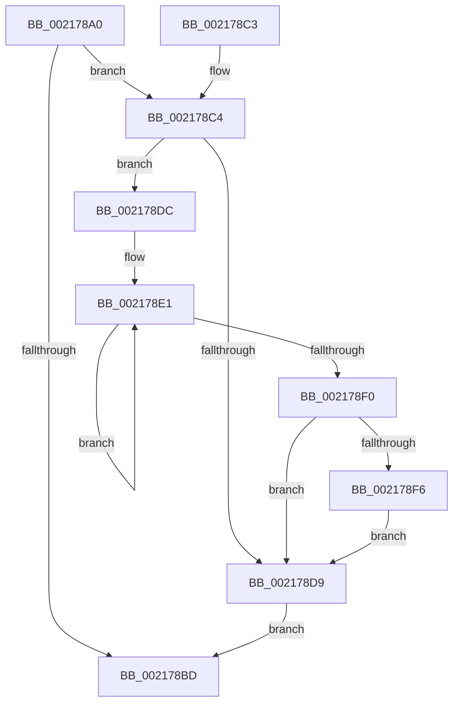

# KiSetAddressPolicy

- RVA: `0x002178A0`–`0x002178FD` (길이 `93` bytes)
- VA: `0x00000001402178A0`
- 실행 섹션: `.text`
- PDB 이름 있음: `예`; PDB Function 태그: `아니요`
- unwind 정보 RVA: `0x0005E698`
- 디코드: `29`개 명령, `93/93` bytes 표시
- 미해석 바이트: `0` (있으면 어셈블리에 `.byte`로 보존)

> 이 문서는 커널 이미지의 기계어와 PDB 기호를 분석해 생성했습니다. 4번과 5번은 함수 원형과 자료형을 바이너리 사용 방식에서 추정한 C 해석이며 원본 소스 복구 결과는 아닙니다.

## 1. Dependencies

- 직접 호출 지점: **3**; 고유 호출 대상: **3**
- 직접 호출자로 확인된 함수: **12**
- RIP 상대 이미지 참조: **0**

### Outgoing calls
- `0x002178A9` → [KeDisableInterrupts](KeDisableInterrupts_function_00217BE0.md) (function, `0x00217BE0`)
- `0x002178B4` → [KxSetAddressPolicy](../6B/KxSetAddressPolicy_function_006B20D0.md) (function, `0x006B20D0`)
- `0x002178F6` → [KiRemoveSystemWorkPriorityKick](../26/KiRemoveSystemWorkPriorityKick_function_002631D0.md) (function, `0x002631D0`)

### Direct callers
- [sub_00216952](Unknown_function_00216952.md) at `0x00216A24`
- [sub_00216B4F](Unknown_function_00216B4F.md) at `0x00216C76`
- [sub_0021736A](Unknown_function_0021736A.md) at `0x0021745E`
- [KiLoadDirectoryTableBase](KiLoadDirectoryTableBase_function_00217800.md) at `0x00217839`
- [sub_00217E2A](Unknown_function_00217E2A.md) at `0x00217F1E`
- [KiAttachProcess](KiAttachProcess_function_002182D0.md) at `0x00218431`
- [sub_00218694](Unknown_function_00218694.md) at `0x00218773`
- [sub_0028F14A](../28/Unknown_function_0028F14A.md) at `0x0028F22D`
- [sub_003C73D7](../3C/Unknown_function_003C73D7.md) at `0x003C74BA`
- [sub_003C789A](../3C/Unknown_function_003C789A.md) at `0x003C7991`
- [KiSynchronizeAddressPolicyTarget](../49/KiSynchronizeAddressPolicyTarget_function_00498500.md) at `0x00498533`
- [KiEnableKvaShadowing](../../pagelk/B6/KiEnableKvaShadowing_function_00B6ACBC.md) at `0x00B6AD86`

### Static image references
- 디코드된 RIP-relative 메모리 참조가 없습니다.

## 2. Other-region calls and transfers

- 다른 실행 섹션으로 향하는 call: **0**
- 별도 외부 분기/꼬리 이동을 확인하지 못했습니다.

## 3. Assembly (complete function range)

```asm
002178A0  40 53                           push rbx
002178A2  48 83 EC 20                     sub rsp, 0x20
002178A6  44 8B C1                        mov r8d, ecx
002178A9  E8 32 03 00 00                  call 0x140217be0
002178AE  41 8B C8                        mov ecx, r8d
002178B1  0F B6 D8                        movzx ebx, al
002178B4  E8 17 A8 49 00                  call 0x1406b20d0
002178B9  84 DB                           test bl, bl
002178BB  75 07                           jne 0x1402178c4
002178BD  48 83 C4 20                     add rsp, 0x20
002178C1  5B                              pop rbx
002178C2  C3                              ret
002178C3  CC                              int3
002178C4  65 48 8B 0C 25 20 00 00 00      mov rcx, qword ptr gs:[0x20]
002178CD  48 8B 91 B8 8E 00 00            mov rdx, qword ptr [rcx + 0x8eb8]
002178D4  48 85 D2                        test rdx, rdx
002178D7  75 03                           jne 0x1402178dc
002178D9  FB                              sti
002178DA  EB E1                           jmp 0x1402178bd
002178DC  0F 0D 0A                        prefetchw byte ptr [rdx]
002178DF  8B 02                           mov eax, dword ptr [rdx]
002178E1  44 8B C0                        mov r8d, eax
002178E4  41 0F BA F0 15                  btr r8d, 0x15
002178E9  F0 44 0F B1 02                  lock cmpxchg dword ptr [rdx], r8d
002178EE  75 F1                           jne 0x1402178e1
002178F0  0F BA E0 15                     bt eax, 0x15
002178F4  73 E3                           jae 0x1402178d9
002178F6  E8 D5 B8 04 00                  call 0x1402631d0
002178FB  EB DC                           jmp 0x1402178d9
```

## 4. C-style interpretation (structured pseudocode)

```c
__int64 __fastcall KiSetAddressPolicy(int a1)
{
    __int64 result;
    __int64 v_rsp;

    v_rsp = (v_rsp) - (32);
    result = KeDisableInterrupts(a1, a2, (unsigned int)(a1), a4);
    result = KxSetAddressPolicy((unsigned int)((unsigned int)((unsigned int)(a1))), a2, (unsigned int)(a1), a4);
    if ((unsigned __int8)((unsigned __int8)(result)) != 0) goto loc_002178C4;
loc_002178BD:
    v_rsp = (v_rsp) + (32);
    return result;
loc_002178C4:
    if (*(unsigned __int64 *)(*(unsigned __int64 *)(gs_base + (0 + 32)) + 36536) != 0) goto loc_002178DC;
loc_002178D9:
    goto loc_002178BD;
loc_002178DC:
loc_002178E1:
    if (*(unsigned __int64 *)(*(unsigned __int64 *)(gs_base + (0 + 32)) + 36536) != 0) goto loc_002178E1;
    if (condition_is_above_or_equal) goto loc_002178D9;
    result = KiRemoveSystemWorkPriorityKick(*(unsigned __int64 *)(gs_base + (0 + 32)), *(unsigned __int64 *)(*(unsigned __int64 *)(gs_base + (0 + 32)) + 36536), (unsigned int)((unsigned int)((unsigned int)(*(unsigned int *)(*(unsigned __int64 *)(*(unsigned __int64 *)(gs_base + (0 + 32)) + 36536))))), a4);
    goto loc_002178D9;
}
```

## 5. (Beta) C Style

```c
int64_t KiSetAddressPolicy(int32_t Arg1)
{
    int64_t result;
    int64_t local_rsp;

    local_rsp = (local_rsp) - (32);
    result = KeDisableInterrupts(Arg1, a2, (uint32_t)(Arg1), a4);
    result = KxSetAddressPolicy((uint32_t)((uint32_t)((uint32_t)(Arg1))), a2, (uint32_t)(Arg1), a4);
    if ((uint8_t)((uint8_t)(result)) != 0) goto loc_002178C4;
loc_002178BD:
    local_rsp = (local_rsp) + (32);
    return result;
loc_002178C4:
    if (*(uint64_t *)(*(uint64_t *)(gs_base + (0 + 0x20)) + 0x8EB8) != 0) goto loc_002178DC;
loc_002178D9:
    goto loc_002178BD;
loc_002178DC:
loc_002178E1:
    if (*(uint64_t *)(*(uint64_t *)(gs_base + (0 + 0x20)) + 0x8EB8) != 0) goto loc_002178E1;
    if (condition_is_above_or_equal) goto loc_002178D9;
    result = KiRemoveSystemWorkPriorityKick(*(uint64_t *)(gs_base + (0 + 0x20)), *(uint64_t *)(*(uint64_t *)(gs_base + (0 + 0x20)) + 0x8EB8), (uint32_t)((uint32_t)((uint32_t)(*(uint32_t *)(*(uint64_t *)(*(uint64_t *)(gs_base + (0 + 0x20)) + 0x8EB8))))), a4);
    goto loc_002178D9;
}
```

## 6. Execution-region graph

[열기: 2D/3D 그래프와 함수 탐색 컨트롤 패널](../../../control-panel.html?section=text&rva=0x002178A0&view=graph)

- 2D 그래프는 위에서 아래로 흐르고, 3D 그래프는 빈 공간을 드래그해 회전합니다. Shift+드래그는 이동, 휠은 확대·축소, 함수 노드 선택은 대상 보고서 이동입니다.

### Static fallback


