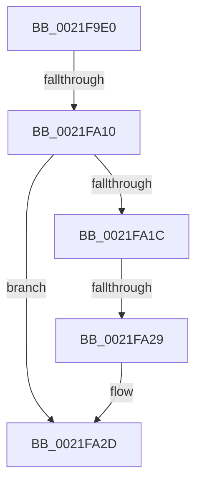

# KiSignalThread

- RVA: `0x0021F9E0`–`0x0021FA3B` (길이 `91` bytes)
- VA: `0x000000014021F9E0`
- 실행 섹션: `.text`
- PDB 이름 있음: `예`; PDB Function 태그: `아니요`
- unwind 정보 RVA: `0x0005F224`
- 디코드: `27`개 명령, `91/91` bytes 표시
- 미해석 바이트: `0` (있으면 어셈블리에 `.byte`로 보존)

> 이 문서는 커널 이미지의 기계어와 PDB 기호를 분석해 생성했습니다. 4번과 5번은 함수 원형과 자료형을 바이너리 사용 방식에서 추정한 C 해석이며 원본 소스 복구 결과는 아닙니다.

## 1. Dependencies

- 직접 호출 지점: **0**; 고유 호출 대상: **0**
- 직접 호출자로 확인된 함수: **5**
- RIP 상대 이미지 참조: **0**

### Outgoing calls
- 직접 디코드된 call 명령이 없습니다.

### Direct callers
- [KiResumeThread](../20/KiResumeThread_function_00203644.md) at `0x002037DD`
- [KiSignalThreadForApc](../20/KiSignalThreadForApc_function_00204360.md) at `0x00204469`
- [KiSignalThreadForApc](../20/KiSignalThreadForApc_function_00204360.md) at `0x002045C1`
- [KiWakePriQueueWaiter](KiWakePriQueueWaiter_function_0021F720.md) at `0x0021F7C9`
- [KiSuspendThread](../46/KiSuspendThread_function_0046B964.md) at `0x0046BC05`
- [KeAlertThread](../48/KeAlertThread_function_00489B40.md) at `0x00489C44`

### Static image references
- 디코드된 RIP-relative 메모리 참조가 없습니다.

## 2. Other-region calls and transfers

- 다른 실행 섹션으로 향하는 call: **0**
- call이 아닌 외부 분기/꼬리 이동: **3**
  - `0x0021FA0A` → [sub_0021FB7E](Unknown_function_0021FB7E.md) (`tail-transfer`)
  - `0x0021FA23` → [sub_0021FA7D + 0xB8](Unknown_function_0021FA7D.md) (`tail-transfer`)
  - `0x0021FA39` → [sub_0021FA7D + 0x36](Unknown_function_0021FA7D.md) (`tail-transfer`)

## 3. Assembly (complete function range)

```asm
0021F9E0  48 89 5C 24 10                  mov qword ptr [rsp + 0x10], rbx
0021F9E5  48 89 6C 24 18                  mov qword ptr [rsp + 0x18], rbp
0021F9EA  57                              push rdi
0021F9EB  41 56                           push r14
0021F9ED  41 57                           push r15
0021F9EF  48 83 EC 20                     sub rsp, 0x20
0021F9F3  48 8B DA                        mov rbx, rdx
0021F9F6  4C 8B F1                        mov r14, rcx
0021F9F9  0F B6 4A 70                     movzx ecx, byte ptr [rdx + 0x70]
0021F9FD  32 C0                           xor al, al
0021F9FF  8B D1                           mov edx, ecx
0021FA01  4D 8B F8                        mov r15, r8
0021FA04  83 E2 07                        and edx, 7
0021FA07  83 FA 01                        cmp edx, 1
0021FA0A  0F 85 6E 01 00 00               jne 0x14021fb7e
0021FA10  48 8B 93 E8 00 00 00            mov rdx, qword ptr [rbx + 0xe8]
0021FA17  48 85 D2                        test rdx, rdx
0021FA1A  74 11                           je 0x14021fa2d
0021FA1C  0F B6 02                        movzx eax, byte ptr [rdx]
0021FA1F  24 7F                           and al, 0x7f
0021FA21  3C 15                           cmp al, 0x15
0021FA23  0F 84 0C 01 00 00               je 0x14021fb35
0021FA29  F0 FF 42 28                     lock inc dword ptr [rdx + 0x28]
0021FA2D  48 8B BB C8 02 00 00            mov rdi, qword ptr [rbx + 0x2c8]
0021FA34  33 ED                           xor ebp, ebp
0021FA36  48 85 FF                        test rdi, rdi
0021FA39  74 78                           je 0x14021fab3
```

## 4. C-style interpretation (structured pseudocode)

```c
__int64 __fastcall KiSignalThread(__int64 a1, __int64 a2, __int64 a3)
{
    __int64 result;
    __int64 v_rbp;
    __int64 v_rsp;
    unsigned __int64 v_stack_p10;
    unsigned __int64 v_stack_p18;

    v_stack_p10 = v_rbx;
    v_stack_p18 = v_rbp;
    v_rsp = (v_rsp) - (32);
    result = 0;
    a2 = (unsigned int)(((unsigned int)((unsigned int)(*(unsigned __int8 *)(a2 + 112)))) & (7));
    if (*(unsigned __int64 *)(a2 + 232) == 0) goto loc_0021FA2D;
    result = (unsigned __int8)((*(unsigned __int8 *)(*(unsigned __int64 *)(a2 + 232))) & (127));
loc_0021FA2D:
    v_rbp = 0;
}
```

## 5. (Beta) C Style

```c
int64_t KiSignalThread(int64_t Arg1, void *Arg2, int64_t Arg3)
{
    uint8_t *arg2 = (uint8_t *)Arg2;

    int64_t result;
    int64_t local_rbp;
    int64_t local_rsp;
    uint64_t v_stack_p10;
    uint64_t v_stack_p18;

    v_stack_p10 = local_rbx;
    v_stack_p18 = local_rbp;
    local_rsp = (local_rsp) - (32);
    result = 0;
    Arg2 = (uint32_t)(((uint32_t)((uint32_t)(*(uint8_t *)(arg2 + 0x70)))) & (7));
    if (*(uint64_t *)(arg2 + 0xE8) == 0) goto loc_0021FA2D;
    result = (uint8_t)((*(uint8_t *)(*(uint64_t *)(arg2 + 0xE8))) & (127));
loc_0021FA2D:
    local_rbp = 0;
}
```

### 관측된 메모리 오프셋

구조체 형식이 확인되지 않은 접근은 인자 기준의 오프셋으로만 기록했습니다.

| 기준 인자 | 오프셋 표현 | 폭 (bit) | 접근 |
|---|---:|---:|---|
| `Arg2` | `+ 0x70` | `8` | `R` |
| `Arg2` | `+ 0xE8` | `64` | `R` |
| `Arg2` | `+ 0x2C8` | `64` | `R` |

## 6. Execution-region graph

[열기: 2D/3D 그래프와 함수 탐색 컨트롤 패널](../../../control-panel.html?section=text&rva=0x0021F9E0&view=graph)

- 2D 그래프는 위에서 아래로 흐르고, 3D 그래프는 빈 공간을 드래그해 회전합니다. Shift+드래그는 이동, 휠은 확대·축소, 함수 노드 선택은 대상 보고서 이동입니다.

### Static fallback


