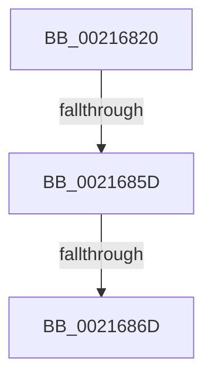

# KiStackAttachProcess

- RVA: `0x00216820`–`0x0021687A` (길이 `90` bytes)
- VA: `0x0000000140216820`
- 실행 섹션: `.text`
- PDB 이름 있음: `예`; PDB Function 태그: `아니요`
- unwind 정보 RVA: `0x0005E380`
- 디코드: `20`개 명령, `90/90` bytes 표시
- 미해석 바이트: `0` (있으면 어셈블리에 `.byte`로 보존)

> 이 문서는 커널 이미지의 기계어와 PDB 기호를 분석해 생성했습니다. 4번과 5번은 함수 원형과 자료형을 바이너리 사용 방식에서 추정한 C 해석이며 원본 소스 복구 결과는 아닙니다.

## 1. Dependencies

- 직접 호출 지점: **0**; 고유 호출 대상: **0**
- 직접 호출자로 확인된 함수: **142**
- RIP 상대 이미지 참조: **0**

### Outgoing calls
- 직접 디코드된 call 명령이 없습니다.

### Direct callers
- [KeForceAttachProcess](KeForceAttachProcess_function_00216650.md) at `0x0021668A`
- [KeStackAttachProcess](KeStackAttachProcess_function_00216800.md) at `0x00216809`
- [IoRaiseHardError](../22/IoRaiseHardError_function_002230D0.md) at `0x00223234`
- [NtGetWriteWatch](../2A/NtGetWriteWatch_function_002A7CE0.md) at `0x002A83AC`
- [MiGetWorkingSetInfoList](../2A/MiGetWorkingSetInfoList_function_002AF770.md) at `0x002B026C`
- [MiSharePages](../31/MiSharePages_function_00315110.md) at `0x0031525D`
- [SMKM_STORE&lt;SM_TRAITS&gt;::SmStPrioritizeRegionsStore](../34/SMKM_STORE_SM_TRAITS_SmStPrioritizeRegionsStore_function_0034DE28.md) at `0x0034DEB8`
- [NtLockVirtualMemory](../40/NtLockVirtualMemory_function_004088A0.md) at `0x004089D3`
- [MiAttachWorkingSet](../44/MiAttachWorkingSet_function_00443BBC.md) at `0x00443C41`
- [MiDeleteFinalPageTables](../46/MiDeleteFinalPageTables_function_004659AC.md) at `0x00465A28`
- [PspIsProcessReadyForRemoteThread](../48/PspIsProcessReadyForRemoteThread_function_00486494.md) at `0x0048650C`
- [MmEnforceWorkingSetLimit](../48/MmEnforceWorkingSetLimit_function_004881E0.md) at `0x00488351`
- [PsDispatchIumService](../4A/PsDispatchIumService_function_004A2F0C.md) at `0x004A31C9`
- [PsDispatchIumService](../4A/PsDispatchIumService_function_004A2F0C.md) at `0x004A31DD`
- [PsDispatchIumService](../4A/PsDispatchIumService_function_004A2F0C.md) at `0x004A32A6`
- [KeCopyXfdMaskToTeb](../4A/KeCopyXfdMaskToTeb_function_004A6410.md) at `0x004A6487`
- [MiBuildForkPageTable](../4A/MiBuildForkPageTable_function_004ACF5C.md) at `0x004AD210`
- [SMKM_STORE&lt;SM_TRAITS&gt;::SmStTrimWsStore](../4B/SMKM_STORE_SM_TRAITS_SmStTrimWsStore_function_004BEB4C.md) at `0x004BEBAC`
- [MiLockDownWorkingSet](../4D/MiLockDownWorkingSet_function_004D4950.md) at `0x004D4993`
- [SmFirstTimeInit](../4E/SmFirstTimeInit_function_004EA944.md) at `0x004EAA64`
- [MmUpdateOldWorkingSetPages](../4E/MmUpdateOldWorkingSetPages_function_004EDF18.md) at `0x004EDFA8`
- [MiQueryImageExtensionInformation](../4E/MiQueryImageExtensionInformation_function_004EE3C8.md) at `0x004EE47E`
- [NtUnlockVirtualMemory](../4E/NtUnlockVirtualMemory_function_004EE890.md) at `0x004EE989`
- [KeSecureProcess](../5B/KeSecureProcess_function_005B988C.md) at `0x005B98DB`
- [KeSetExpectedConcurrencyCountProcess](../5C/KeSetExpectedConcurrencyCountProcess_function_005C1AC0.md) at `0x005C1B47`
- [KiTpWriteMemory](../5C/KiTpWriteMemory_function_005CAB94.md) at `0x005CABDC`
- [PopStateTransitionTimeoutDispatch](../5D/PopStateTransitionTimeoutDispatch_function_005D51F0.md) at `0x005D52D0`
- [PspChangeProcessExecutionStateLegacy](../5E/PspChangeProcessExecutionStateLegacy_function_005E4098.md) at `0x005E4161`
- [PsAttachSession](../5E/PsAttachSession_function_005E4F40.md) at `0x005E4FA5`
- [ExpSvmServicePageFault](../65/ExpSvmServicePageFault_function_0065BEC0.md) at `0x0065BF5E`
- [CmSiProcessTupleStartFromHandle](../66/CmSiProcessTupleStartFromHandle_function_0066DC44.md) at `0x0066DCC3`
- [CmSiSetProcessWorkingSetMaximum](../66/CmSiSetProcessWorkingSetMaximum_function_0066DD6C.md) at `0x0066DDA1`
- [MmSetCommitReleaseEligibility](../66/MmSetCommitReleaseEligibility_function_0066FF84.md) at `0x0066FFDD`
- [MiDeleteAwePageTables](../68/MiDeleteAwePageTables_function_006884B0.md) at `0x0068850F`
- [MiEmptyAccessLogs](../68/MiEmptyAccessLogs_function_00689FF0.md) at `0x0068A09D`
- [MiStoreDiscardPoisonedPage](../69/MiStoreDiscardPoisonedPage_function_00692858.md) at `0x006929DF`
- [sub_006D6658](../6D/Unknown_function_006D6658.md) at `0x006D6675`
- [sub_006D8170](../6D/Unknown_function_006D8170.md) at `0x006D818C`
- [sub_006E4560](../6E/Unknown_function_006E4560.md) at `0x006E4576`
- [sub_006F88AE](../6F/Unknown_function_006F88AE.md) at `0x006F8E3B`
- [sub_006F88AE](../6F/Unknown_function_006F88AE.md) at `0x006F8E5B`
- [sub_006FB3A8](../6F/Unknown_function_006FB3A8.md) at `0x006FB3CD`
- [KiLogUserCetSetContextIpValidationFailureWorker](../../page/74/KiLogUserCetSetContextIpValidationFailureWorker_function_00747760.md) at `0x0074779C`
- [KiTpReadImageData](../../page/74/KiTpReadImageData_function_007489B4.md) at `0x00748A1B`
- [PfSnAppLaunchScenarioControl](../../page/75/PfSnAppLaunchScenarioControl_function_00752294.md) at `0x0075234D`
- [PsQueryProcessExceptionFlags](../../page/78/PsQueryProcessExceptionFlags_function_007811E0.md) at `0x007812DA`
- [PspProcessDynamicEHContinuationTargets](../../page/78/PspProcessDynamicEHContinuationTargets_function_00782348.md) at `0x0078247C`
- [PspProcessDynamicEnforcedAddressRanges](../../page/78/PspProcessDynamicEnforcedAddressRanges_function_00782624.md) at `0x0078279E`
- [PspTrySetProcessPebThrottlingFlags](../../page/78/PspTrySetProcessPebThrottlingFlags_function_00782A50.md) at `0x00782A88`
- [PspApplyWorkingSetLimits](../../page/78/PspApplyWorkingSetLimits_function_00784C00.md) at `0x00784CAD`
- [PsStartSiloMonitor](../../page/78/PsStartSiloMonitor_function_007867C0.md) at `0x0078686A`
- [PsStartSiloMonitor](../../page/78/PsStartSiloMonitor_function_007867C0.md) at `0x007868C1`
- [PsStartSiloMonitor](../../page/78/PsStartSiloMonitor_function_007867C0.md) at `0x0078695D`
- [PsUnregisterSiloMonitor](../../page/78/PsUnregisterSiloMonitor_function_00786A00.md) at `0x00786A59`
- [PsUnregisterSiloMonitor](../../page/78/PsUnregisterSiloMonitor_function_00786A00.md) at `0x00786AF7`
- [PsCreateMinimalProcess](../../page/78/PsCreateMinimalProcess_function_00786D14.md) at `0x00786F71`
- [PspAllocatePartition](../../page/78/PspAllocatePartition_function_0078802C.md) at `0x00788200`
- [PspAttachSession](../../page/78/PspAttachSession_function_00788EB0.md) at `0x00788F2D`
- [SmHwAcceleratorMgrAcquireAccelerators](../../page/7A/SmHwAcceleratorMgrAcquireAccelerators_function_007AA628.md) at `0x007AA95D`
- [SmHwAcceleratorPartitionMgrStart](../../page/7A/SmHwAcceleratorPartitionMgrStart_function_007AB480.md) at `0x007AB537`
- [EtwpUMGLEnabled](../../page/7B/EtwpUMGLEnabled_function_007B8E44.md) at `0x007B8EAE`
- [NtPssCaptureVaSpaceBulk](../../page/7D/NtPssCaptureVaSpaceBulk_function_007D4EA0.md) at `0x007D5199`
- [CmpFinishSystemHivesLoad](../../page/7D/CmpFinishSystemHivesLoad_function_007DA210.md) at `0x007DA3C5`
- [CmpFinishSystemHivesLoad](../../page/7D/CmpFinishSystemHivesLoad_function_007DA210.md) at `0x007DAA8B`
- [CmpMountPreloadedHives](../../page/7D/CmpMountPreloadedHives_function_007DBE18.md) at `0x007DC43D`
- [MiLogHotPatchRundown](../../page/80/MiLogHotPatchRundown_function_008057A4.md) at `0x00805E3D`
- [MmCreateShadowMapping](../../page/80/MmCreateShadowMapping_function_00807AB0.md) at `0x00807C03`
- [MmDeleteShadowMapping](../../page/80/MmDeleteShadowMapping_function_00807D00.md) at `0x00807DD9`
- [NtCreateEnclave](../../page/80/NtCreateEnclave_function_00808CC0.md) at `0x00808FA6`
- [NtInitializeEnclave](../../page/80/NtInitializeEnclave_function_008090B0.md) at `0x0080926B`
- [MiAllocateUserPhysicalPages](../../page/80/MiAllocateUserPhysicalPages_function_00809828.md) at `0x00809AF7`
- [NtFreeUserPhysicalPages](../../page/80/NtFreeUserPhysicalPages_function_0080AF30.md) at `0x0080B1D8`
- [MiScrubActiveLargePage](../../page/80/MiScrubActiveLargePage_function_0080ED58.md) at `0x0080EDB6`
- [MiDeleteInsertedCloneVads](../../page/81/MiDeleteInsertedCloneVads_function_00811564.md) at `0x008115AB`
- [MiCopyLargeVad](../../page/81/MiCopyLargeVad_function_008118A4.md) at `0x00811931`
- [MiCopyLargeVad](../../page/81/MiCopyLargeVad_function_008118A4.md) at `0x00811A62`
- [PspApplyWorkingSetLimitsToProcess](../../page/87/PspApplyWorkingSetLimitsToProcess_function_0087DE9C.md) at `0x0087DEF0`
- [MmAssignProcessToJob](../../page/87/MmAssignProcessToJob_function_0087EEF8.md) at `0x0087EF58`
- [NtProtectVirtualMemory](../../page/88/NtProtectVirtualMemory_function_00880CA0.md) at `0x00880F95`
- [EtwTiLogProtectExecVm](../../page/88/EtwTiLogProtectExecVm_function_00881A48.md) at `0x00881DE9`
- [PspSetupUserShadowStack](../../page/88/PspSetupUserShadowStack_function_008825D4.md) at `0x008826A9`
- [MiAllocateVirtualMemory](../../page/88/MiAllocateVirtualMemory_function_00883B40.md) at `0x00883F15`
- [AlpcViewDestroyProcedure](../../page/88/AlpcViewDestroyProcedure_function_0088B080.md) at `0x0088B1DF`
- [EtwQueryProcessTelemetryInfo](../../page/8A/EtwQueryProcessTelemetryInfo_function_008A51A0.md) at `0x008A52F2`
- [sub_008A8E86](../../page/8A/Unknown_function_008A8E86.md) at `0x008A8EE5`
- [PspWow64ReadOrWriteThreadCpuArea](../../page/8C/PspWow64ReadOrWriteThreadCpuArea_function_008CD404.md) at `0x008CD4B2`
- [PspSetupUserStack](../../page/8C/PspSetupUserStack_function_008CD794.md) at `0x008CD804`
- [PspWow64InitThread](../../page/8C/PspWow64InitThread_function_008CDC98.md) at `0x008CDD3B`
- [MmInitializeProcessAddressSpace](../../page/8C/MmInitializeProcessAddressSpace_function_008CF6B0.md) at `0x008CF760`
- [MmInitializeProcessAddressSpace](../../page/8C/MmInitializeProcessAddressSpace_function_008CF6B0.md) at `0x008CFAB2`
- [PsMapSystemDlls](../../page/8C/PsMapSystemDlls_function_008CFFA0.md) at `0x008D00C0`
- [PspProcessDelete](../../page/90/PspProcessDelete_function_00907B90.md) at `0x00907CCB`
- [ExpWnfWriteStateData](../../page/90/ExpWnfWriteStateData_function_0090B7B0.md) at `0x0090BCC7`
- [PfSnAsyncPrefetchWorker](../../page/93/PfSnAsyncPrefetchWorker_function_009394B0.md) at `0x0093956D`
- [EtwpCovSampEnumerateProcess](../../page/97/EtwpCovSampEnumerateProcess_function_0097D9B0.md) at `0x0097DB67`
- [MiInsertChildVads](../../page/97/MiInsertChildVads_function_0097DBB0.md) at `0x0097DBF4`
- [MiAllocateChildVads](../../page/97/MiAllocateChildVads_function_0097E380.md) at `0x0097E6ED`
- [MiAllocateChildVads](../../page/97/MiAllocateChildVads_function_0097E380.md) at `0x0097E710`
- [MiAllocateChildVads](../../page/97/MiAllocateChildVads_function_0097E380.md) at `0x0097E7AF`
- [MmCreatePeb](../../page/98/MmCreatePeb_function_00980FB4.md) at `0x00981076`
- [MmCreateTeb](../../page/98/MmCreateTeb_function_009818E4.md) at `0x0098195E`
- [PoEnergyContextStart](../../page/98/PoEnergyContextStart_function_0098EAD4.md) at `0x0098EB54`
- [NtQueryInformationProcess](../../page/9A/NtQueryInformationProcess_function_009AA250.md) at `0x009AB2B8`
- [NtQueryInformationProcess](../../page/9A/NtQueryInformationProcess_function_009AA250.md) at `0x009AB8EC`
- [NtQueryInformationProcess](../../page/9A/NtQueryInformationProcess_function_009AA250.md) at `0x009AC8F5`
- [PspSetQuotaLimits](../../page/9B/PspSetQuotaLimits_function_009BA8A8.md) at `0x009BAB35`
- [EtwTiLogReadWriteVm](../../page/9B/EtwTiLogReadWriteVm_function_009BB7C8.md) at `0x009BBAE8`
- [EtwpRealtimeInjectEtwBuffer](../../page/9B/EtwpRealtimeInjectEtwBuffer_function_009BF910.md) at `0x009BF997`
- [PspQueryQuotaLimits](../../page/9D/PspQueryQuotaLimits_function_009D6280.md) at `0x009D6389`
- [MmFlushVirtualMemory](../../page/9D/MmFlushVirtualMemory_function_009D6F5C.md) at `0x009D7260`
- [MmQueryVirtualMemory](../../page/9D/MmQueryVirtualMemory_function_009D9280.md) at `0x009D97F3`
- [PspAllocateThread](../../page/9E/PspAllocateThread_function_009EF72C.md) at `0x009EFEB9`
- [PspWow64SetupUserStack](../../page/9F/PspWow64SetupUserStack_function_009F1250.md) at `0x009F128E`
- [EtwpAddRegEntryToGroup](../../page/9F/EtwpAddRegEntryToGroup_function_009F39D4.md) at `0x009F3EE5`
- [EtwpAddRegEntryToGroup](../../page/9F/EtwpAddRegEntryToGroup_function_009F39D4.md) at `0x009F3FDF`
- [NtSetInformationVirtualMemory](../../page/9F/NtSetInformationVirtualMemory_function_009F4580.md) at `0x009F4DE3`
- [MmProbeAndLockProcessPages](../../page/9F/MmProbeAndLockProcessPages_function_009FE840.md) at `0x009FE8A8`
- [PspIumResolveVirtualFault](../../page/9F/PspIumResolveVirtualFault_function_009FF5E4.md) at `0x009FF6FF`
- [ObSetHandleAttributes](../../page/A0/ObSetHandleAttributes_function_00A03730.md) at `0x00A038E8`
- [EtwpTiQueryVad](../../page/A0/EtwpTiQueryVad_function_00A03A70.md) at `0x00A03BBC`
- [EtwpTrackGuidEntryRegistrations](../../page/A0/EtwpTrackGuidEntryRegistrations_function_00A03CC0.md) at `0x00A03E58`
- [DbgkpPostFakeProcessCreateMessages](../../page/A1/DbgkpPostFakeProcessCreateMessages_function_00A10780.md) at `0x00A107E7`
- [DbgkSendSystemDllMessages](../../page/A1/DbgkSendSystemDllMessages_function_00A10C04.md) at `0x00A10CF9`
- [PspAllocateProcess](../../page/A1/PspAllocateProcess_function_00A13B3C.md) at `0x00A15F1E`
- [PspAllocateProcess](../../page/A1/PspAllocateProcess_function_00A13B3C.md) at `0x00A160DD`
- [MiCopyPagesIntoEnclave](../../page/A4/MiCopyPagesIntoEnclave_function_00A472AC.md) at `0x00A47400`
- [MiCopyPagesIntoEnclave](../../page/A4/MiCopyPagesIntoEnclave_function_00A472AC.md) at `0x00A47708`
- [PspUpdatePebForAffinityChange](../../page/A5/PspUpdatePebForAffinityChange_function_00A50790.md) at `0x00A507DC`
- [SmpKeyedStoreCreate](../../page/A5/SmpKeyedStoreCreate_function_00A50B64.md) at `0x00A50BCF`
- [PspSetupReservedUserMappings](../../page/A5/PspSetupReservedUserMappings_function_00A575F0.md) at `0x00A57660`
- [EtwpEnableGuid](../../page/A5/EtwpEnableGuid_function_00A5CD28.md) at `0x00A5D73E`
- [MmProcessWorkingSetControl](../../page/A6/MmProcessWorkingSetControl_function_00A616C4.md) at `0x00A617E3`
- [IopRaiseHardError](../../page/A6/IopRaiseHardError_function_00A64260.md) at `0x00A6446C`
- [SmProcessStoreMemoryPriorityRequest](../../page/A7/SmProcessStoreMemoryPriorityRequest_function_00A7830C.md) at `0x00A784B0`
- [PspDeleteUserStack](../../page/A7/PspDeleteUserStack_function_00A78D18.md) at `0x00A78D54`
- [PspCreateSecureThread](../../page/A8/PspCreateSecureThread_function_00A89160.md) at `0x00A891A9`
- [MiMapImageForEnclaveUse](../../page/AB/MiMapImageForEnclaveUse_function_00AB213C.md) at `0x00AB2267`
- [MiCombineIdenticalPages](../../page/AB/MiCombineIdenticalPages_function_00AB2324.md) at `0x00AB2493`
- [MiUnmapImageForEnclaveUse](../../page/AB/MiUnmapImageForEnclaveUse_function_00AB90C4.md) at `0x00AB90FC`
- [MmInitializeHandBuiltProcess2](../../page/AC/MmInitializeHandBuiltProcess2_function_00AC1138.md) at `0x00AC1193`
- [MiQueryProcessActivePatches](../../page/AC/MiQueryProcessActivePatches_function_00AC6164.md) at `0x00AC6352`
- [MiLoadDataIntoVsmEnclave](../../page/AC/MiLoadDataIntoVsmEnclave_function_00ACD114.md) at `0x00ACD3B6`
- [MiQueryMemoryPhysicalContiguity](../../page/AD/MiQueryMemoryPhysicalContiguity_function_00AD5B98.md) at `0x00AD5EAD`
- [MiCloneProcessAddressSpace](../../page/AD/MiCloneProcessAddressSpace_function_00AD6F7C.md) at `0x00AD701D`
- [MiCloneProcessAddressSpace](../../page/AD/MiCloneProcessAddressSpace_function_00AD6F7C.md) at `0x00AD720E`
- [PspFindFirstThreadByTebValue](../../page/AD/PspFindFirstThreadByTebValue_function_00AD8E2C.md) at `0x00AD8EF6`
- [NtSetInformationProcess](../../page/AE/NtSetInformationProcess_function_00AE5370.md) at `0x00AE74DA`
- [NtSetInformationProcess](../../page/AE/NtSetInformationProcess_function_00AE5370.md) at `0x00AE75B9`
- [PspSetupUserProcessAddressSpace](../../page/AE/PspSetupUserProcessAddressSpace_function_00AEBDC8.md) at `0x00AEBEBD`
- [PspChangeProcessExecutionState](../../page/AE/PspChangeProcessExecutionState_function_00AEC594.md) at `0x00AEC665`
- [NtLoadEnclaveData](../../page/AF/NtLoadEnclaveData_function_00AF8DF0.md) at `0x00AF90C7`
- [sub_00B30C5A](../../page/B3/Unknown_function_00B30C5A.md) at `0x00B30F7A`
- [sub_00B36B22](../../page/B3/Unknown_function_00B36B22.md) at `0x00B36B48`
- [sub_00B3B77E](../../page/B3/Unknown_function_00B3B77E.md) at `0x00B3B7D6`
- [sub_00B413EC](../../page/B4/Unknown_function_00B413EC.md) at `0x00B41425`
- [sub_00B484E6](../../page/B4/Unknown_function_00B484E6.md) at `0x00B48513`
- [MiDeleteAllHardwareEnclaves](../../pagelk/B7/MiDeleteAllHardwareEnclaves_function_00B74CAC.md) at `0x00B74DC2`
- [ExpDebuggerWorker](../../pagekd/B8/ExpDebuggerWorker_function_00B89F70.md) at `0x00B8A053`
- [EmpMapPhysicalAddress](../../init/C2/EmpMapPhysicalAddress_function_00C27FA4.md) at `0x00C2803F`
- [PspInitPhase3](../../init/C4/PspInitPhase3_function_00C455F8.md) at `0x00C4564A`

### Static image references
- 디코드된 RIP-relative 메모리 참조가 없습니다.

## 2. Other-region calls and transfers

- 다른 실행 섹션으로 향하는 call: **0**
- call이 아닌 외부 분기/꼬리 이동: **3**
  - `0x00216857` → [sub_00216EA4](Unknown_function_00216EA4.md) (`tail-transfer`)
  - `0x00216867` → [sub_00216E41](Unknown_function_00216E41.md) (`tail-transfer`)
  - `0x00216874` → [sub_0021693F](Unknown_function_0021693F.md) (`tail-transfer`)

## 3. Assembly (complete function range)

```asm
00216820  4C 89 44 24 18                  mov qword ptr [rsp + 0x18], r8
00216825  53                              push rbx
00216826  55                              push rbp
00216827  56                              push rsi
00216828  41 56                           push r14
0021682A  48 83 EC 38                     sub rsp, 0x38
0021682E  65 48 8B 1C 25 88 01 00 00      mov rbx, qword ptr gs:[0x188]
00216837  44 8B CA                        mov r9d, edx
0021683A  65 8B 04 25 3C 3A 00 00         mov eax, dword ptr gs:[0x3a3c]
00216842  41 83 E1 02                     and r9d, 2
00216846  40 32 ED                        xor bpl, bpl
00216849  4D 8B D0                        mov r10, r8
0021684C  44 8B F2                        mov r14d, edx
0021684F  48 8B F1                        mov rsi, rcx
00216852  A9 01 00 01 00                  test eax, 0x10001
00216857  0F 85 47 06 00 00               jne 0x140216ea4
0021685D  F7 81 88 00 00 00 00 08 00 00   test dword ptr [rcx + 0x88], 0x800
00216867  0F 85 D4 05 00 00               jne 0x140216e41
0021686D  48 39 B3 B8 00 00 00            cmp qword ptr [rbx + 0xb8], rsi
00216874  0F 84 C5 00 00 00               je 0x14021693f
```

## 4. C-style interpretation (structured pseudocode)

```c
__int64 __fastcall KiStackAttachProcess(__int64 a1, int a2, __int64 a3)
{
    __int64 v_rbp;
    __int64 v_rsp;
    unsigned __int64 v_stack_p18;

    v_stack_p18 = a3;
    v_rsp = (v_rsp) - (56);
    a4 = (unsigned int)(((unsigned int)(a2)) & (2));
    v_rbp = 0;
}
```

## 5. (Beta) C Style

```c
int64_t KiStackAttachProcess(void *Arg1, int32_t Arg2, int64_t Arg3)
{
    uint8_t *arg1 = (uint8_t *)Arg1;

    int64_t local_rbp;
    int64_t local_rsp;
    uint64_t v_stack_p18;

    v_stack_p18 = Arg3;
    local_rsp = (local_rsp) - (56);
    a4 = (uint32_t)(((uint32_t)(Arg2)) & (2));
    local_rbp = 0;
}
```

### 관측된 메모리 오프셋

구조체 형식이 확인되지 않은 접근은 인자 기준의 오프셋으로만 기록했습니다.

| 기준 인자 | 오프셋 표현 | 폭 (bit) | 접근 |
|---|---:|---:|---|
| `Arg1` | `+ 0x88` | `32` | `R` |

## 6. Execution-region graph

[열기: 2D/3D 그래프와 함수 탐색 컨트롤 패널](../../../control-panel.html?section=text&rva=0x00216820&view=graph)

- 2D 그래프는 위에서 아래로 흐르고, 3D 그래프는 빈 공간을 드래그해 회전합니다. Shift+드래그는 이동, 휠은 확대·축소, 함수 노드 선택은 대상 보고서 이동입니다.

### Static fallback


