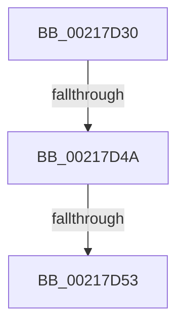

# KiUnstackDetachProcess

- RVA: `0x00217D30`–`0x00217D5C` (길이 `44` bytes)
- VA: `0x0000000140217D30`
- 실행 섹션: `.text`
- PDB 이름 있음: `예`; PDB Function 태그: `아니요`
- unwind 정보 RVA: `0x0005E790`
- 디코드: `10`개 명령, `44/44` bytes 표시
- 미해석 바이트: `0` (있으면 어셈블리에 `.byte`로 보존)

> 이 문서는 커널 이미지의 기계어와 PDB 기호를 분석해 생성했습니다. 4번과 5번은 함수 원형과 자료형을 바이너리 사용 방식에서 추정한 C 해석이며 원본 소스 복구 결과는 아닙니다.

## 1. Dependencies

- 직접 호출 지점: **0**; 고유 호출 대상: **0**
- 직접 호출자로 확인된 함수: **192**
- RIP 상대 이미지 참조: **0**

### Outgoing calls
- 직접 디코드된 call 명령이 없습니다.

### Direct callers
- [IoRaiseHardError](../22/IoRaiseHardError_function_002230D0.md) at `0x00223331`
- [SepRmCallLsa](../22/SepRmCallLsa_function_00223630.md) at `0x00223828`
- [PspDetachSession](../22/PspDetachSession_function_0022480C.md) at `0x0022485F`
- [SepAdtLogAuditRecord](../22/SepAdtLogAuditRecord_function_00224B6C.md) at `0x00224D79`
- [MiGetWorkingSetInfoEx](../29/MiGetWorkingSetInfoEx_function_0029E640.md) at `0x0029E7E5`
- [NtGetWriteWatch](../2A/NtGetWriteWatch_function_002A7CE0.md) at `0x002A855E`
- [MiGetWorkingSetInfoList](../2A/MiGetWorkingSetInfoList_function_002AF770.md) at `0x002B02BB`
- [SMKM_STORE&lt;SM_TRAITS&gt;::SmStPrioritizeRegionsStore](../34/SMKM_STORE_SM_TRAITS_SmStPrioritizeRegionsStore_function_0034DE28.md) at `0x0034E14B`
- [MiWaitForInPageComplete](../38/MiWaitForInPageComplete_function_00380AB8.md) at `0x00380F4B`
- [sub_003AA889](../3A/Unknown_function_003AA889.md) at `0x003AA906`
- [SMKM_STORE&lt;SM_TRAITS&gt;::SmStCleanup](../3B/SMKM_STORE_SM_TRAITS_SmStCleanup_function_003B00E0.md) at `0x003B034C`
- [SmQuerySystemInformation](../3B/SmQuerySystemInformation_function_003B29F8.md) at `0x003B2A54`
- [MiFlushAllPages](../3B/MiFlushAllPages_function_003BD294.md) at `0x003BD346`
- [NtLockVirtualMemory](../40/NtLockVirtualMemory_function_004088A0.md) at `0x0040900C`
- [NtLockVirtualMemory](../40/NtLockVirtualMemory_function_004088A0.md) at `0x00409087`
- [MiDeleteFinalPageTables](../46/MiDeleteFinalPageTables_function_004659AC.md) at `0x00465AAB`
- [PsQueryProcessCommandLine](../46/PsQueryProcessCommandLine_function_00469810.md) at `0x00469A02`
- [CmSiAcquireProcessLockedPagesCharge](../47/CmSiAcquireProcessLockedPagesCharge_function_0047D714.md) at `0x0047D7B1`
- [CmSiReleaseProcessLockedPagesCharge](../47/CmSiReleaseProcessLockedPagesCharge_function_0047D81C.md) at `0x0047D8AB`
- [MmEnforceWorkingSetLimit](../48/MmEnforceWorkingSetLimit_function_004881E0.md) at `0x004883C2`
- [SMKM_STORE&lt;SM_TRAITS&gt;::SmStSwapStore](../49/SMKM_STORE_SM_TRAITS_SmStSwapStore_function_00496A68.md) at `0x00496ABE`
- [PsDispatchIumService](../4A/PsDispatchIumService_function_004A2F0C.md) at `0x004A308C`
- [KeCopyXfdMaskToTeb](../4A/KeCopyXfdMaskToTeb_function_004A6410.md) at `0x004A64D1`
- [MiBuildForkPageTable](../4A/MiBuildForkPageTable_function_004ACF5C.md) at `0x004AD260`
- [SMKM_STORE&lt;SM_TRAITS&gt;::SmStTrimWsStore](../4B/SMKM_STORE_SM_TRAITS_SmStTrimWsStore_function_004BEB4C.md) at `0x004BEECE`
- [MiLockDownWorkingSet](../4D/MiLockDownWorkingSet_function_004D4950.md) at `0x004D4A4D`
- [SmFirstTimeInit](../4E/SmFirstTimeInit_function_004EA944.md) at `0x004EAAC0`
- [MmUpdateOldWorkingSetPages](../4E/MmUpdateOldWorkingSetPages_function_004EDF18.md) at `0x004EE136`
- [MiQueryImageExtensionInformation](../4E/MiQueryImageExtensionInformation_function_004EE3C8.md) at `0x004EE607`
- [NtUnlockVirtualMemory](../4E/NtUnlockVirtualMemory_function_004EE890.md) at `0x004EEEF8`
- [NtUnlockVirtualMemory](../4E/NtUnlockVirtualMemory_function_004EE890.md) at `0x004EEF87`
- [KeSecureProcess](../5B/KeSecureProcess_function_005B988C.md) at `0x005B9927`
- [KeSetExpectedConcurrencyCountProcess](../5C/KeSetExpectedConcurrencyCountProcess_function_005C1AC0.md) at `0x005C1B76`
- [KiTpWriteMemory](../5C/KiTpWriteMemory_function_005CAB94.md) at `0x005CAC88`
- [PspChangeProcessExecutionStateLegacy](../5E/PspChangeProcessExecutionStateLegacy_function_005E4098.md) at `0x005E426C`
- [ExpSvmServicePageFault](../65/ExpSvmServicePageFault_function_0065BEC0.md) at `0x0065BF96`
- [CmSiProcessTupleStartFromHandle](../66/CmSiProcessTupleStartFromHandle_function_0066DC44.md) at `0x0066DD24`
- [CmSiSetProcessWorkingSetMaximum](../66/CmSiSetProcessWorkingSetMaximum_function_0066DD6C.md) at `0x0066DE02`
- [MmSetCommitReleaseEligibility](../66/MmSetCommitReleaseEligibility_function_0066FF84.md) at `0x0067004D`
- [MiDeleteAwePageTables](../68/MiDeleteAwePageTables_function_006884B0.md) at `0x00688768`
- [MiEmptyAccessLogs](../68/MiEmptyAccessLogs_function_00689FF0.md) at `0x0068A0B1`
- [MiStoreDiscardPoisonedPage](../69/MiStoreDiscardPoisonedPage_function_00692858.md) at `0x00692D35`
- [sub_006D6658](../6D/Unknown_function_006D6658.md) at `0x006D66AB`
- [sub_006D8170](../6D/Unknown_function_006D8170.md) at `0x006D81C1`
- [sub_006F5684](../6F/Unknown_function_006F5684.md) at `0x006F568B`
- [sub_006F88AE](../6F/Unknown_function_006F88AE.md) at `0x006F89F3`
- [sub_006F88AE](../6F/Unknown_function_006F88AE.md) at `0x006F8E83`
- [sub_006FB3A8](../6F/Unknown_function_006FB3A8.md) at `0x006FB41D`
- [DbgkQueueUserExceptionReport](../../page/71/DbgkQueueUserExceptionReport_function_00710B04.md) at `0x00710CD3`
- [DbgkUserReportWorkRoutine](../../page/71/DbgkUserReportWorkRoutine_function_00710D10.md) at `0x00710FCA`
- [IopIsNotNativeDriverImage](../../page/71/IopIsNotNativeDriverImage_function_0071B914.md) at `0x0071BA80`
- [IopIsNotNativeDriverImage](../../page/71/IopIsNotNativeDriverImage_function_0071B914.md) at `0x0071BAD6`
- [KiLogUserCetSetContextIpValidationFailureWorker](../../page/74/KiLogUserCetSetContextIpValidationFailureWorker_function_00747760.md) at `0x007477C2`
- [KiTpReadImageData](../../page/74/KiTpReadImageData_function_007489B4.md) at `0x00748A9C`
- [AlpcpForceUnlinkSecureView](../../page/74/AlpcpForceUnlinkSecureView_function_0074C604.md) at `0x0074C675`
- [PfSnAppLaunchScenarioControl](../../page/75/PfSnAppLaunchScenarioControl_function_00752294.md) at `0x0075236D`
- [PspShutdownCsrProcess](../../page/78/PspShutdownCsrProcess_function_00780214.md) at `0x00780386`
- [PsQueryProcessExceptionFlags](../../page/78/PsQueryProcessExceptionFlags_function_007811E0.md) at `0x0078136A`
- [PspProcessDynamicEHContinuationTargets](../../page/78/PspProcessDynamicEHContinuationTargets_function_00782348.md) at `0x007825D2`
- [PspProcessDynamicEnforcedAddressRanges](../../page/78/PspProcessDynamicEnforcedAddressRanges_function_00782624.md) at `0x00782882`
- [PspTrySetProcessPebThrottlingFlags](../../page/78/PspTrySetProcessPebThrottlingFlags_function_00782A50.md) at `0x00782ADA`
- [PspApplyWorkingSetLimits](../../page/78/PspApplyWorkingSetLimits_function_00784C00.md) at `0x00784CD9`
- [PsTerminateMinimalProcess](../../page/78/PsTerminateMinimalProcess_function_007861A8.md) at `0x007862E1`
- [PsStartSiloMonitor](../../page/78/PsStartSiloMonitor_function_007867C0.md) at `0x007868A1`
- [PsStartSiloMonitor](../../page/78/PsStartSiloMonitor_function_007867C0.md) at `0x0078690D`
- [PsStartSiloMonitor](../../page/78/PsStartSiloMonitor_function_007867C0.md) at `0x007869BB`
- [PsUnregisterSiloMonitor](../../page/78/PsUnregisterSiloMonitor_function_00786A00.md) at `0x00786AAF`
- [PsUnregisterSiloMonitor](../../page/78/PsUnregisterSiloMonitor_function_00786A00.md) at `0x00786B1B`
- [PsCreateMinimalProcess](../../page/78/PsCreateMinimalProcess_function_00786D14.md) at `0x00786F88`
- [PspAllocatePartition](../../page/78/PspAllocatePartition_function_0078802C.md) at `0x0078821D`
- [SmHwAcceleratorMgrAcquireAccelerators](../../page/7A/SmHwAcceleratorMgrAcquireAccelerators_function_007AA628.md) at `0x007AA983`
- [SmHwAcceleratorPartitionMgrCleanup](../../page/7A/SmHwAcceleratorPartitionMgrCleanup_function_007AB34C.md) at `0x007AB3FB`
- [SmHwAcceleratorPartitionMgrStart](../../page/7A/SmHwAcceleratorPartitionMgrStart_function_007AB480.md) at `0x007AB550`
- [VmpPrefetchWorker](../../page/7A/VmpPrefetchWorker_function_007ADD20.md) at `0x007ADD77`
- [EtwpUMGLEnabled](../../page/7B/EtwpUMGLEnabled_function_007B8E44.md) at `0x007B8EFF`
- [EtwpUpdateProcessTracingCallback](../../page/7B/EtwpUpdateProcessTracingCallback_function_007B8F40.md) at `0x007B901F`
- [NtPssCaptureVaSpaceBulk](../../page/7D/NtPssCaptureVaSpaceBulk_function_007D4EA0.md) at `0x007D52AE`
- [CmpFinishSystemHivesLoad](../../page/7D/CmpFinishSystemHivesLoad_function_007DA210.md) at `0x007DA3DD`
- [CmpFinishSystemHivesLoad](../../page/7D/CmpFinishSystemHivesLoad_function_007DA210.md) at `0x007DAAA3`
- [CmpMountPreloadedHives](../../page/7D/CmpMountPreloadedHives_function_007DBE18.md) at `0x007DC45B`
- [CmpAddRemoveContainerToCLFSLog](../../page/7F/CmpAddRemoveContainerToCLFSLog_function_007F69FC.md) at `0x007F6B8F`
- [CmpStartCLFSLog](../../page/7F/CmpStartCLFSLog_function_007F7228.md) at `0x007F74B3`
- [MiHotPatchAllProcesses](../../page/80/MiHotPatchAllProcesses_function_00803AC4.md) at `0x00803B3A`
- [MiLogHotPatchRundown](../../page/80/MiLogHotPatchRundown_function_008057A4.md) at `0x008062A2`
- [MmCreateShadowMapping](../../page/80/MmCreateShadowMapping_function_00807AB0.md) at `0x00807CB5`
- [MmDeleteShadowMapping](../../page/80/MmDeleteShadowMapping_function_00807D00.md) at `0x00807E93`
- [NtCreateEnclave](../../page/80/NtCreateEnclave_function_00808CC0.md) at `0x00809008`
- [NtInitializeEnclave](../../page/80/NtInitializeEnclave_function_008090B0.md) at `0x008092AD`
- [MiAllocateUserPhysicalPages](../../page/80/MiAllocateUserPhysicalPages_function_00809828.md) at `0x0080A3D6`
- [MiAllocateUserPhysicalPages](../../page/80/MiAllocateUserPhysicalPages_function_00809828.md) at `0x0080A608`
- [NtFreeUserPhysicalPages](../../page/80/NtFreeUserPhysicalPages_function_0080AF30.md) at `0x0080B360`
- [NtFreeUserPhysicalPages](../../page/80/NtFreeUserPhysicalPages_function_0080AF30.md) at `0x0080B3F3`
- [MiInSwapSharedWorkingSetWorker](../../page/80/MiInSwapSharedWorkingSetWorker_function_0080C510.md) at `0x0080C5BA`
- [MiScrubActiveLargePage](../../page/80/MiScrubActiveLargePage_function_0080ED58.md) at `0x0080EDD0`
- [MiDeleteInsertedCloneVads](../../page/81/MiDeleteInsertedCloneVads_function_00811564.md) at `0x008116B3`
- [MiCopyLargeVad](../../page/81/MiCopyLargeVad_function_008118A4.md) at `0x008119A3`
- [MiCopyLargeVad](../../page/81/MiCopyLargeVad_function_008118A4.md) at `0x00811A9C`
- [MiCopyLargeVad](../../page/81/MiCopyLargeVad_function_008118A4.md) at `0x00811AE0`
- [ObpDecrementHandleCount](../../page/86/ObpDecrementHandleCount_function_008632E0.md) at `0x008633E9`
- [ObCloseHandleTableEntry](../../page/86/ObCloseHandleTableEntry_function_00869E20.md) at `0x0086A162`
- [ObCloseHandleTableEntry](../../page/86/ObCloseHandleTableEntry_function_00869E20.md) at `0x0086A1AF`
- [ObCloseHandleTableEntry](../../page/86/ObCloseHandleTableEntry_function_00869E20.md) at `0x0086A613`
- [ObCloseHandleTableEntry](../../page/86/ObCloseHandleTableEntry_function_00869E20.md) at `0x0086A661`
- [ObpCreateHandle](../../page/86/ObpCreateHandle_function_0086B950.md) at `0x0086D59F`
- [ObpIncrementHandleCountEx](../../page/86/ObpIncrementHandleCountEx_function_0086DA10.md) at `0x0086E02E`
- [PspApplyWorkingSetLimitsToProcess](../../page/87/PspApplyWorkingSetLimitsToProcess_function_0087DE9C.md) at `0x0087E061`
- [MmAssignProcessToJob](../../page/87/MmAssignProcessToJob_function_0087EEF8.md) at `0x0087EFE0`
- [MmDeleteTeb](../../page/87/MmDeleteTeb_function_0087FAC0.md) at `0x0087FB35`
- [sub_0087FFB4](../../page/87/Unknown_function_0087FFB4.md) at `0x008800A8`
- [NtProtectVirtualMemory](../../page/88/NtProtectVirtualMemory_function_00880CA0.md) at `0x00880E8A`
- [EtwTiLogProtectExecVm](../../page/88/EtwTiLogProtectExecVm_function_00881A48.md) at `0x00881C18`
- [PspSetupUserShadowStack](../../page/88/PspSetupUserShadowStack_function_008825D4.md) at `0x00882738`
- [MiAllocateVirtualMemory](../../page/88/MiAllocateVirtualMemory_function_00883B40.md) at `0x00883EAC`
- [MiAllocateVirtualMemory](../../page/88/MiAllocateVirtualMemory_function_00883B40.md) at `0x00883F2C`
- [AlpcpRestoreWriteAccess](../../page/88/AlpcpRestoreWriteAccess_function_00889990.md) at `0x00889A07`
- [AlpcpPrepareViewForDelivery](../../page/88/AlpcpPrepareViewForDelivery_function_00889A44.md) at `0x00889B72`
- [MiUnmapViewOfSection](../../page/88/MiUnmapViewOfSection_function_0088A4C4.md) at `0x0088A61A`
- [AlpcViewDestroyProcedure](../../page/88/AlpcViewDestroyProcedure_function_0088B080.md) at `0x0088B210`
- [MmSecureVirtualMemoryAgainstWrites](../../page/89/MmSecureVirtualMemoryAgainstWrites_function_00890164.md) at `0x008903A4`
- [MiMapViewOfSection](../../page/89/MiMapViewOfSection_function_00898F10.md) at `0x008991FC`
- [EtwpWriteProcessEvent](../../page/8A/EtwpWriteProcessEvent_function_008A420C.md) at `0x008A42F6`
- [EtwTraceAppStateChange](../../page/8A/EtwTraceAppStateChange_function_008A452C.md) at `0x008A473A`
- [EtwQueryProcessTelemetryInfo](../../page/8A/EtwQueryProcessTelemetryInfo_function_008A51A0.md) at `0x008A531B`
- [EtwpProcessEnumCallback](../../page/8A/EtwpProcessEnumCallback_function_008A5F40.md) at `0x008A60A0`
- [sub_008A9240](../../page/8A/Unknown_function_008A9240.md) at `0x008A9260`
- [ObDuplicateObject](../../page/8C/ObDuplicateObject_function_008C4FA0.md) at `0x008C533B`
- [ObDuplicateObject](../../page/8C/ObDuplicateObject_function_008C4FA0.md) at `0x008C536E`
- [ObDuplicateObject](../../page/8C/ObDuplicateObject_function_008C4FA0.md) at `0x008C57A8`
- [ObDuplicateObject](../../page/8C/ObDuplicateObject_function_008C4FA0.md) at `0x008C5EC1`
- [PspWriteTebImpersonationInfo](../../page/8C/PspWriteTebImpersonationInfo_function_008CC7F0.md) at `0x008CC966`
- [PspWow64ReadOrWriteThreadCpuArea](../../page/8C/PspWow64ReadOrWriteThreadCpuArea_function_008CD404.md) at `0x008CD736`
- [PspSetupUserStack](../../page/8C/PspSetupUserStack_function_008CD794.md) at `0x008CD877`
- [PspSetupUserStack](../../page/8C/PspSetupUserStack_function_008CD794.md) at `0x008CD8D8`
- [PspWow64InitThread](../../page/8C/PspWow64InitThread_function_008CDC98.md) at `0x008CDDBA`
- [MmInitializeProcessAddressSpace](../../page/8C/MmInitializeProcessAddressSpace_function_008CF6B0.md) at `0x008CF890`
- [MmInitializeProcessAddressSpace](../../page/8C/MmInitializeProcessAddressSpace_function_008CF6B0.md) at `0x008CFA88`
- [MmInitializeProcessAddressSpace](../../page/8C/MmInitializeProcessAddressSpace_function_008CF6B0.md) at `0x008CFADA`
- [MmInitializeProcessAddressSpace](../../page/8C/MmInitializeProcessAddressSpace_function_008CF6B0.md) at `0x008CFB7A`
- [PsMapSystemDlls](../../page/8C/PsMapSystemDlls_function_008CFFA0.md) at `0x008D00E1`
- [ExSweepHandleTable](../../page/90/ExSweepHandleTable_function_00904D3C.md) at `0x00904F21`
- [PspRundownSingleProcess](../../page/90/PspRundownSingleProcess_function_00906D50.md) at `0x00906E19`
- [PspProcessDelete](../../page/90/PspProcessDelete_function_00907B90.md) at `0x00907D06`
- [ExpWnfWriteStateData](../../page/90/ExpWnfWriteStateData_function_0090B7B0.md) at `0x0090BD03`
- [MmIsFileMapped](../../page/91/MmIsFileMapped_function_0091D8D4.md) at `0x0091DA26`
- [PfSnAsyncPrefetchWorker](../../page/93/PfSnAsyncPrefetchWorker_function_009394B0.md) at `0x009396E4`
- [MmPrefetchVirtualMemory](../../page/93/MmPrefetchVirtualMemory_function_0093A698.md) at `0x0093A74A`
- [MiMapImageInSystemSpace](../../page/94/MiMapImageInSystemSpace_function_00941DD8.md) at `0x00942059`
- [MiUnmapImageInSystemSpace](../../page/94/MiUnmapImageInSystemSpace_function_0094206C.md) at `0x009420C8`
- [EtwpCovSampEnumerateProcess](../../page/97/EtwpCovSampEnumerateProcess_function_0097D9B0.md) at `0x0097DB48`
- [MiInsertChildVads](../../page/97/MiInsertChildVads_function_0097DBB0.md) at `0x0097DD00`
- [MmEnumerateAddressSpaceAndReferenceImages](../../page/97/MmEnumerateAddressSpaceAndReferenceImages_function_0097DD50.md) at `0x0097E0EC`
- [MiAllocateChildVads](../../page/97/MiAllocateChildVads_function_0097E380.md) at `0x0097E606`
- [MiAllocateChildVads](../../page/97/MiAllocateChildVads_function_0097E380.md) at `0x0097E78E`
- [MmCreatePeb](../../page/98/MmCreatePeb_function_00980FB4.md) at `0x009812A1`
- [MmCreatePeb](../../page/98/MmCreatePeb_function_00980FB4.md) at `0x009813C4`
- [MmCreatePeb](../../page/98/MmCreatePeb_function_00980FB4.md) at `0x00981543`
- [MmCreatePeb](../../page/98/MmCreatePeb_function_00980FB4.md) at `0x00981564`
- [MmCreatePeb](../../page/98/MmCreatePeb_function_00980FB4.md) at `0x00981606`
- [MmCreatePeb](../../page/98/MmCreatePeb_function_00980FB4.md) at `0x00981648`
- [MmCreateTeb](../../page/98/MmCreateTeb_function_009818E4.md) at `0x00981B7D`
- [MmCreateTeb](../../page/98/MmCreateTeb_function_009818E4.md) at `0x00981BB7`
- [PoEnergyContextStart](../../page/98/PoEnergyContextStart_function_0098EAD4.md) at `0x0098EB7F`
- [NtQueryInformationProcess](../../page/9A/NtQueryInformationProcess_function_009AA250.md) at `0x009AB30A`
- [NtQueryInformationProcess](../../page/9A/NtQueryInformationProcess_function_009AA250.md) at `0x009ABA23`
- [NtQueryInformationProcess](../../page/9A/NtQueryInformationProcess_function_009AA250.md) at `0x009AC93B`
- [PspSetQuotaLimits](../../page/9B/PspSetQuotaLimits_function_009BA8A8.md) at `0x009BAC38`
- [EtwTiLogReadWriteVm](../../page/9B/EtwTiLogReadWriteVm_function_009BB7C8.md) at `0x009BB97B`
- [MiCopyVirtualMemory](../../page/9B/MiCopyVirtualMemory_function_009BBB50.md) at `0x009BBFA0`
- [MiCopyVirtualMemory](../../page/9B/MiCopyVirtualMemory_function_009BBB50.md) at `0x009BC25A`
- [MiCopyVirtualMemory](../../page/9B/MiCopyVirtualMemory_function_009BBB50.md) at `0x009BC2EF`
- [MiCopyVirtualMemory](../../page/9B/MiCopyVirtualMemory_function_009BBB50.md) at `0x009BC422`
- [EtwpRealtimeInjectEtwBuffer](../../page/9B/EtwpRealtimeInjectEtwBuffer_function_009BF910.md) at `0x009BFAAD`
- [PspQueryQuotaLimits](../../page/9D/PspQueryQuotaLimits_function_009D6280.md) at `0x009D63CD`
- [MmFlushVirtualMemory](../../page/9D/MmFlushVirtualMemory_function_009D6F5C.md) at `0x009D72B2`
- [MmFlushVirtualMemory](../../page/9D/MmFlushVirtualMemory_function_009D6F5C.md) at `0x009D72D4`
- [MmQueryVirtualMemory](../../page/9D/MmQueryVirtualMemory_function_009D9280.md) at `0x009D9871`
- [MmQueryVirtualMemory](../../page/9D/MmQueryVirtualMemory_function_009D9280.md) at `0x009D9901`
- [MmQueryVirtualMemory](../../page/9D/MmQueryVirtualMemory_function_009D9280.md) at `0x009D994A`
- [MmQueryVirtualMemory](../../page/9D/MmQueryVirtualMemory_function_009D9280.md) at `0x009D9981`
- [MmQueryVirtualMemory](../../page/9D/MmQueryVirtualMemory_function_009D9280.md) at `0x009D9D52`
- [MmQueryVirtualMemory](../../page/9D/MmQueryVirtualMemory_function_009D9280.md) at `0x009D9DFC`
- [MmQueryVirtualMemory](../../page/9D/MmQueryVirtualMemory_function_009D9280.md) at `0x009DA073`
- [PspAllocateThread](../../page/9E/PspAllocateThread_function_009EF72C.md) at `0x009EFF62`
- [PspWow64SetupUserStack](../../page/9F/PspWow64SetupUserStack_function_009F1250.md) at `0x009F12BE`
- [PspWow64SetupUserStack](../../page/9F/PspWow64SetupUserStack_function_009F1250.md) at `0x009F12EF`
- [EtwpAddRegEntryToGroup](../../page/9F/EtwpAddRegEntryToGroup_function_009F39D4.md) at `0x009F3EFE`
- [EtwpAddRegEntryToGroup](../../page/9F/EtwpAddRegEntryToGroup_function_009F39D4.md) at `0x009F3FF8`
- [NtSetInformationVirtualMemory](../../page/9F/NtSetInformationVirtualMemory_function_009F4580.md) at `0x009F4DFE`
- [NtSetInformationVirtualMemory](../../page/9F/NtSetInformationVirtualMemory_function_009F4580.md) at `0x009F4E18`
- [MmProbeAndLockProcessPages](../../page/9F/MmProbeAndLockProcessPages_function_009FE840.md) at `0x009FE8C8`
- [PspIumResolveVirtualFault](../../page/9F/PspIumResolveVirtualFault_function_009FF5E4.md) at `0x009FF6AA`
- [ObSetHandleAttributes](../../page/A0/ObSetHandleAttributes_function_00A03730.md) at `0x00A03870`
- [EtwpTiQueryVad](../../page/A0/EtwpTiQueryVad_function_00A03A70.md) at `0x00A03B8E`
- [EtwpTrackGuidEntryRegistrations](../../page/A0/EtwpTrackGuidEntryRegistrations_function_00A03CC0.md) at `0x00A03E71`
- [DbgkpPostFakeProcessCreateMessages](../../page/A1/DbgkpPostFakeProcessCreateMessages_function_00A10780.md) at `0x00A10803`
- [DbgkSendSystemDllMessages](../../page/A1/DbgkSendSystemDllMessages_function_00A10C04.md) at `0x00A10DBC`
- [PspAllocateProcess](../../page/A1/PspAllocateProcess_function_00A13B3C.md) at `0x00A1609E`
- [PspAllocateProcess](../../page/A1/PspAllocateProcess_function_00A13B3C.md) at `0x00A1614F`
- [MiCopyPagesIntoEnclave](../../page/A4/MiCopyPagesIntoEnclave_function_00A472AC.md) at `0x00A47437`
- [MiCopyPagesIntoEnclave](../../page/A4/MiCopyPagesIntoEnclave_function_00A472AC.md) at `0x00A4772F`
- [NtResetWriteWatch](../../page/A4/NtResetWriteWatch_function_00A48F60.md) at `0x00A490D8`
- [PspUpdatePebForAffinityChange](../../page/A5/PspUpdatePebForAffinityChange_function_00A50790.md) at `0x00A507F0`
- [SmpKeyedStoreCreate](../../page/A5/SmpKeyedStoreCreate_function_00A50B64.md) at `0x00A50BF2`
- [EtwpEnableGuid](../../page/A5/EtwpEnableGuid_function_00A5CD28.md) at `0x00A5D756`
- [MmProcessWorkingSetControl](../../page/A6/MmProcessWorkingSetControl_function_00A616C4.md) at `0x00A61882`
- [MiInSwapStoreWorker](../../page/A6/MiInSwapStoreWorker_function_00A61C60.md) at `0x00A61CD7`
- [IopRaiseHardError](../../page/A6/IopRaiseHardError_function_00A64260.md) at `0x00A644CB`
- [SmProcessStoreMemoryPriorityRequest](../../page/A7/SmProcessStoreMemoryPriorityRequest_function_00A7830C.md) at `0x00A784C2`
- [PspDeleteUserStack](../../page/A7/PspDeleteUserStack_function_00A78D18.md) at `0x00A78DB8`
- [PspCreateSecureThread](../../page/A8/PspCreateSecureThread_function_00A89160.md) at `0x00A89259`
- [SepCleanupLUIDDeviceMapDirectory](../../page/A9/SepCleanupLUIDDeviceMapDirectory_function_00A98F24.md) at `0x00A9917D`
- [SepCleanupLUIDDeviceMapDirectory](../../page/A9/SepCleanupLUIDDeviceMapDirectory_function_00A98F24.md) at `0x00A991D3`
- [MiMapImageForEnclaveUse](../../page/AB/MiMapImageForEnclaveUse_function_00AB213C.md) at `0x00AB22DF`
- [MiCombineIdenticalPages](../../page/AB/MiCombineIdenticalPages_function_00AB2324.md) at `0x00AB2641`
- [MiUnmapImageForEnclaveUse](../../page/AB/MiUnmapImageForEnclaveUse_function_00AB90C4.md) at `0x00AB911D`
- [MmInitializeHandBuiltProcess2](../../page/AC/MmInitializeHandBuiltProcess2_function_00AC1138.md) at `0x00AC11C2`
- [MiQueryProcessActivePatches](../../page/AC/MiQueryProcessActivePatches_function_00AC6164.md) at `0x00AC683F`
- [DbgkpMarkProcessPeb](../../page/AC/DbgkpMarkProcessPeb_function_00AC8D0C.md) at `0x00AC8DF3`
- [MiLoadDataIntoVsmEnclave](../../page/AC/MiLoadDataIntoVsmEnclave_function_00ACD114.md) at `0x00ACD429`
- [MiQueryMemoryPhysicalContiguity](../../page/AD/MiQueryMemoryPhysicalContiguity_function_00AD5B98.md) at `0x00AD6002`
- [MiQueryMemoryPhysicalContiguity](../../page/AD/MiQueryMemoryPhysicalContiguity_function_00AD5B98.md) at `0x00AD608A`
- [MiCloneProcessAddressSpace](../../page/AD/MiCloneProcessAddressSpace_function_00AD6F7C.md) at `0x00AD70C6`
- [MiCloneProcessAddressSpace](../../page/AD/MiCloneProcessAddressSpace_function_00AD6F7C.md) at `0x00AD71F4`
- [MiCloneProcessAddressSpace](../../page/AD/MiCloneProcessAddressSpace_function_00AD6F7C.md) at `0x00AD7287`
- [PspFindFirstThreadByTebValue](../../page/AD/PspFindFirstThreadByTebValue_function_00AD8E2C.md) at `0x00AD8FE9`
- [NtSetInformationProcess](../../page/AE/NtSetInformationProcess_function_00AE5370.md) at `0x00AE7508`
- [NtSetInformationProcess](../../page/AE/NtSetInformationProcess_function_00AE5370.md) at `0x00AE75E2`
- [NtSetInformationProcess](../../page/AE/NtSetInformationProcess_function_00AE5370.md) at `0x00AE762A`
- [PspSetupUserProcessAddressSpace](../../page/AE/PspSetupUserProcessAddressSpace_function_00AEBDC8.md) at `0x00AEC032`
- [PspChangeProcessExecutionState](../../page/AE/PspChangeProcessExecutionState_function_00AEC594.md) at `0x00AEC782`
- [NtLoadEnclaveData](../../page/AF/NtLoadEnclaveData_function_00AF8DF0.md) at `0x00AF921D`
- [NtLoadEnclaveData](../../page/AF/NtLoadEnclaveData_function_00AF8DF0.md) at `0x00AF92BD`
- [MmProbeAndLockProcessPages$fin$0](../../page/B1/MmProbeAndLockProcessPages_fin_0_function_00B10F29.md) at `0x00B10F3E`
- [sub_00B19294](../../page/B1/Unknown_function_00B19294.md) at `0x00B1933A`
- [sub_00B19294](../../page/B1/Unknown_function_00B19294.md) at `0x00B19397`
- [sub_00B36B22](../../page/B3/Unknown_function_00B36B22.md) at `0x00B36BE4`
- [sub_00B3D958](../../page/B3/Unknown_function_00B3D958.md) at `0x00B3DA05`
- [sub_00B413EC](../../page/B4/Unknown_function_00B413EC.md) at `0x00B414B2`
- [sub_00B47F58](../../page/B4/Unknown_function_00B47F58.md) at `0x00B4806F`
- [sub_00B484E6](../../page/B4/Unknown_function_00B484E6.md) at `0x00B48884`
- [MiDeleteAllHardwareEnclaves](../../pagelk/B7/MiDeleteAllHardwareEnclaves_function_00B74CAC.md) at `0x00B74E11`
- [ExpDebuggerWorker](../../pagekd/B8/ExpDebuggerWorker_function_00B89F70.md) at `0x00B8A0ED`
- [CmSaveKeyToBuffer](../../pagecmrc/BC/CmSaveKeyToBuffer_function_00BC9010.md) at `0x00BC90DA`
- [CmpDetachFromRegistryProcess](../../pagecmrc/BC/CmpDetachFromRegistryProcess_function_00BC9920.md) at `0x00BC9926`
- [EmpMapPhysicalAddress](../../init/C2/EmpMapPhysicalAddress_function_00C27FA4.md) at `0x00C280A0`
- [PspInitPhase3](../../init/C4/PspInitPhase3_function_00C455F8.md) at `0x00C4572A`
- [EmpCacheBiosDate](../../init/C7/EmpCacheBiosDate_function_00C73258.md) at `0x00C73370`

### Static image references
- 디코드된 RIP-relative 메모리 참조가 없습니다.

## 2. Other-region calls and transfers

- 다른 실행 섹션으로 향하는 call: **0**
- call이 아닌 외부 분기/꼬리 이동: **2**
  - `0x00217D44` → [sub_0021804F](Unknown_function_0021804F.md) (`tail-transfer`)
  - `0x00217D4D` → [sub_0021825C](Unknown_function_0021825C.md) (`tail-transfer`)

## 3. Assembly (complete function range)

```asm
00217D30  4C 8B DC                        mov r11, rsp
00217D33  41 56                           push r14
00217D35  48 83 EC 60                     sub rsp, 0x60
00217D39  48 8B 41 20                     mov rax, qword ptr [rcx + 0x20]
00217D3D  44 8B F2                        mov r14d, edx
00217D40  48 83 F8 01                     cmp rax, 1
00217D44  0F 84 05 03 00 00               je 0x14021804f
00217D4A  48 85 C0                        test rax, rax
00217D4D  0F 85 09 05 00 00               jne 0x14021825c
00217D53  65 48 8B 04 25 88 01 00 00      mov rax, qword ptr gs:[0x188]
```

## 4. C-style interpretation (structured pseudocode)

```c
__int64 __fastcall KiUnstackDetachProcess(__int64 a1, int a2)
{
    __int64 v_rsp;

    v_rsp = (v_rsp) - (96);
    return *(unsigned __int64 *)(gs_base + (0 + 392));
}
```

## 5. (Beta) C Style

```c
int64_t KiUnstackDetachProcess(void *Arg1, int32_t Arg2)
{
    uint8_t *arg1 = (uint8_t *)Arg1;

    int64_t local_rsp;

    local_rsp = (local_rsp) - (96);
    return *(uint64_t *)(gs_base + (0 + 0x188));
}
```

### 관측된 메모리 오프셋

구조체 형식이 확인되지 않은 접근은 인자 기준의 오프셋으로만 기록했습니다.

| 기준 인자 | 오프셋 표현 | 폭 (bit) | 접근 |
|---|---:|---:|---|
| `Arg1` | `+ 0x20` | `64` | `R` |

## 6. Execution-region graph

[열기: 2D/3D 그래프와 함수 탐색 컨트롤 패널](../../../control-panel.html?section=text&rva=0x00217D30&view=graph)

- 2D 그래프는 위에서 아래로 흐르고, 3D 그래프는 빈 공간을 드래그해 회전합니다. Shift+드래그는 이동, 휠은 확대·축소, 함수 노드 선택은 대상 보고서 이동입니다.

### Static fallback


