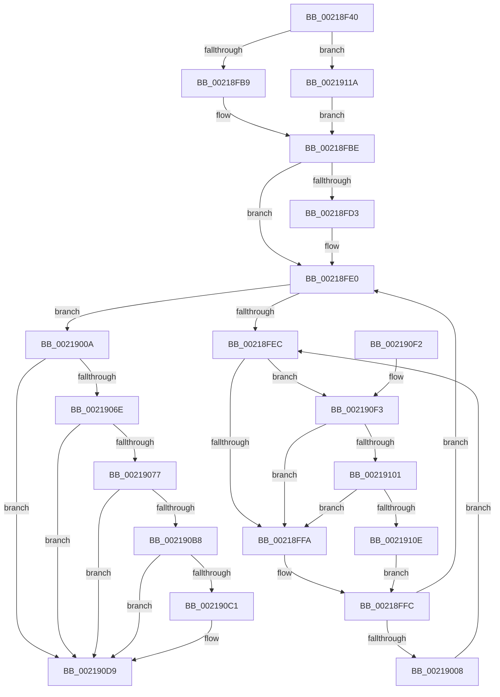

# KiUpdateSoftParkElectionStatisticsOnInsertion

- RVA: `0x00218F40`–`0x00219122` (길이 `482` bytes)
- VA: `0x0000000140218F40`
- 실행 섹션: `.text`
- PDB 이름 있음: `예`; PDB Function 태그: `아니요`
- unwind 정보 RVA: `0x0005EBC0`
- 디코드: `101`개 명령, `482/482` bytes 표시
- 미해석 바이트: `0` (있으면 어셈블리에 `.byte`로 보존)

> 이 문서는 커널 이미지의 기계어와 PDB 기호를 분석해 생성했습니다. 4번과 5번은 함수 원형과 자료형을 바이너리 사용 방식에서 추정한 C 해석이며 원본 소스 복구 결과는 아닙니다.

## 1. Dependencies

- 직접 호출 지점: **3**; 고유 호출 대상: **3**
- 직접 호출자로 확인된 함수: **4**
- RIP 상대 이미지 참조: **6**

### Outgoing calls
- `0x002190D4` → [KeInsertQueueDpc](../20/KeInsertQueueDpc_function_00207C50.md) (function, `0x00207C50`)
- `0x00219101` → [KiCheckVpBackingLongSpinWaitHypercall](../30/KiCheckVpBackingLongSpinWaitHypercall_function_0030F490.md) (function, `0x0030F490`)
- `0x00219110` → [HvlNotifyLongSpinWait](../30/HvlNotifyLongSpinWait_function_0030F460.md) (function, `0x0030F460`)

### Direct callers
- [sub_00218B2B](Unknown_function_00218B2B.md) at `0x00218C61`
- [sub_00218B2B](Unknown_function_00218B2B.md) at `0x00218D97`
- [KiQueueReadyThread](KiQueueReadyThread_function_0021C7B0.md) at `0x0021CBDB`
- [sub_00254461](../25/Unknown_function_00254461.md) at `0x0025450B`
- [KiUpdateLocalReadyQueueStatisticsOnInsertion](../4A/KiUpdateLocalReadyQueueStatisticsOnInsertion_function_004A9290.md) at `0x004A92C6`

### Static image references
- `0x00218F76` → RVA `0x00FC537C` (`ALMOSTRO`; read)
- `0x00218FC5` → RVA `0x00F23454` (`.data`; read)
- `0x00218FEE` → RVA `0x00FC52AC` (`ALMOSTRO`; reference)
- `0x0021908C` → RVA `0x00F231B8` (`.data`; read)
- `0x00219096` → RVA `0x00FC8C40` (`ALMOSTRO`; read)
- `0x002190F3` → RVA `0x00FC6AB8` (`ALMOSTRO`; read)

## 2. Other-region calls and transfers

- 다른 실행 섹션으로 향하는 call: **0**
- 별도 외부 분기/꼬리 이동을 확인하지 못했습니다.

## 3. Assembly (complete function range)

```asm
00218F40  48 89 5C 24 08                  mov qword ptr [rsp + 8], rbx
00218F45  48 89 74 24 10                  mov qword ptr [rsp + 0x10], rsi
00218F4A  57                              push rdi
00218F4B  48 83 EC 20                     sub rsp, 0x20
00218F4F  0F B6 82 04 02 00 00            movzx eax, byte ptr [rdx + 0x204]
00218F56  48 8B D9                        mov rbx, rcx
00218F59  8B 4A 54                        mov ecx, dword ptr [rdx + 0x54]
00218F5C  0F 57 C0                        xorps xmm0, xmm0
00218F5F  88 82 24 07 00 00               mov byte ptr [rdx + 0x724], al
00218F65  48 8B FA                        mov rdi, rdx
00218F68  89 8A FC 06 00 00               mov dword ptr [rdx + 0x6fc], ecx
00218F6E  8B 42 50                        mov eax, dword ptr [rdx + 0x50]
00218F71  3B C1                           cmp eax, ecx
00218F73  0F 46 C1                        cmovbe eax, ecx
00218F76  3B 05 00 C4 DA 00               cmp eax, dword ptr [rip + 0xdac400]
00218F7C  0F 93 C0                        setae al
00218F7F  33 F6                           xor esi, esi
00218F81  88 82 26 07 00 00               mov byte ptr [rdx + 0x726], al
00218F87  0F B6 82 05 02 00 00            movzx eax, byte ptr [rdx + 0x205]
00218F8E  88 82 25 07 00 00               mov byte ptr [rdx + 0x725], al
00218F94  0F B7 83 C6 02 00 00            movzx eax, word ptr [rbx + 0x2c6]
00218F9B  0F 11 82 08 07 00 00            movups xmmword ptr [rdx + 0x708], xmm0
00218FA2  48 8B 8A 40 02 00 00            mov rcx, qword ptr [rdx + 0x240]
00218FA9  66 89 82 10 07 00 00            mov word ptr [rdx + 0x710], ax
00218FB0  66 3B 01                        cmp ax, word ptr [rcx]
00218FB3  0F 83 61 01 00 00               jae 0x14021911a
00218FB9  48 8B 4C C1 08                  mov rcx, qword ptr [rcx + rax*8 + 8]
00218FBE  48 89 8A 08 07 00 00            mov qword ptr [rdx + 0x708], rcx
00218FC5  8B 05 89 A4 D0 00               mov eax, dword ptr [rip + 0xd0a489]
00218FCB  39 82 FC 06 00 00               cmp dword ptr [rdx + 0x6fc], eax
00218FD1  76 0D                           jbe 0x140218fe0
00218FD3  89 82 FC 06 00 00               mov dword ptr [rdx + 0x6fc], eax
00218FD9  0F 1F 80 00 00 00 00            nop dword ptr [rax]
00218FE0  F0 48 0F BA AB 00 03 00 00 00   lock bts qword ptr [rbx + 0x300], 0
00218FEA  73 1E                           jae 0x14021900a
00218FEC  FF C6                           inc esi
00218FEE  85 35 B8 C2 DA 00               test dword ptr [rip + 0xdac2b8], esi
00218FF4  0F 84 F9 00 00 00               je 0x1402190f3
00218FFA  F3 90                           pause
00218FFC  48 8B 83 00 03 00 00            mov rax, qword ptr [rbx + 0x300]
00219003  48 85 C0                        test rax, rax
00219006  74 D8                           je 0x140218fe0
00219008  EB E2                           jmp 0x140218fec
0021900A  48 8B 83 08 03 00 00            mov rax, qword ptr [rbx + 0x308]
00219011  48 89 87 00 07 00 00            mov qword ptr [rdi + 0x700], rax
00219018  FF 83 10 03 00 00               inc dword ptr [rbx + 0x310]
0021901E  8B 87 FC 06 00 00               mov eax, dword ptr [rdi + 0x6fc]
00219024  48 01 83 18 03 00 00            add qword ptr [rbx + 0x318], rax
0021902B  48 8B 87 08 07 00 00            mov rax, qword ptr [rdi + 0x708]
00219032  48 09 83 E0 06 00 00            or qword ptr [rbx + 0x6e0], rax
00219039  0F B6 8F 24 07 00 00            movzx ecx, byte ptr [rdi + 0x724]
00219040  0F B6 87 26 07 00 00            movzx eax, byte ptr [rdi + 0x726]
00219047  48 8D 14 48                     lea rdx, [rax + rcx*2]
0021904B  0F B6 87 25 07 00 00            movzx eax, byte ptr [rdi + 0x725]
00219052  48 8D 0C D0                     lea rcx, [rax + rdx*8]
00219056  8B 87 FC 06 00 00               mov eax, dword ptr [rdi + 0x6fc]
0021905C  48 01 84 CB 60 03 00 00         add qword ptr [rbx + rcx*8 + 0x360], rax
00219064  8B 05 EA A3 D0 00               mov eax, dword ptr [rip + 0xd0a3ea]
0021906A  85 C0                           test eax, eax
0021906C  74 6B                           je 0x1402190d9
0021906E  48 39 83 18 03 00 00            cmp qword ptr [rbx + 0x318], rax
00219075  76 62                           jbe 0x1402190d9
00219077  0F B6 83 C1 02 00 00            movzx eax, byte ptr [rbx + 0x2c1]
0021907E  0F B7 8B C6 02 00 00            movzx ecx, word ptr [rbx + 0x2c6]
00219085  48 C1 E1 06                     shl rcx, 6
00219089  48 03 C8                        add rcx, rax
0021908C  48 8B 05 25 A1 D0 00            mov rax, qword ptr [rip + 0xd0a125]
00219093  8B 04 88                        mov eax, dword ptr [rax + rcx*4]
00219096  48 8D 0D A3 FB DA 00            lea rcx, [rip + 0xdafba3]
0021909D  48 8B 04 C1                     mov rax, qword ptr [rcx + rax*8]
002190A1  48 8B 88 C0 00 00 00            mov rcx, qword ptr [rax + 0xc0]
002190A8  48 8B 51 50                     mov rdx, qword ptr [rcx + 0x50]
002190AC  48 8B 41 60                     mov rax, qword ptr [rcx + 0x60]
002190B0  48 F7 D2                        not rdx
002190B3  48 85 D0                        test rax, rdx
002190B6  74 21                           je 0x1402190d9
002190B8  80 BB 14 03 00 00 00            cmp byte ptr [rbx + 0x314], 0
002190BF  75 18                           jne 0x1402190d9
002190C1  48 8D 8B 20 03 00 00            lea rcx, [rbx + 0x320]
002190C8  C6 83 14 03 00 00 01            mov byte ptr [rbx + 0x314], 1
002190CF  45 33 C0                        xor r8d, r8d
002190D2  33 D2                           xor edx, edx
002190D4  E8 77 EB FE FF                  call 0x140207c50
002190D9  F0 48 83 A3 00 03 00 00 00      lock and qword ptr [rbx + 0x300], 0
002190E2  48 8B 5C 24 30                  mov rbx, qword ptr [rsp + 0x30]
002190E7  48 8B 74 24 38                  mov rsi, qword ptr [rsp + 0x38]
002190EC  48 83 C4 20                     add rsp, 0x20
002190F0  5F                              pop rdi
002190F1  C3                              ret
002190F2  CC                              int3
002190F3  8B 05 BF D9 DA 00               mov eax, dword ptr [rip + 0xdad9bf]
002190F9  A8 40                           test al, 0x40
002190FB  0F 84 F9 FE FF FF               je 0x140218ffa
00219101  E8 8A 63 0F 00                  call 0x14030f490
00219106  84 C0                           test al, al
00219108  0F 84 EC FE FF FF               je 0x140218ffa
0021910E  8B CE                           mov ecx, esi
00219110  E8 4B 63 0F 00                  call 0x14030f460
00219115  E9 E2 FE FF FF                  jmp 0x140218ffc
0021911A  48 8B CE                        mov rcx, rsi
0021911D  E9 9C FE FF FF                  jmp 0x140218fbe
```

## 4. C-style interpretation (structured pseudocode)

```c
__int64 __fastcall KiUpdateSoftParkElectionStatisticsOnInsertion(__int64 a1, __int64 a2, int a3)
{
    __int64 result;
    __int64 v_rsi;
    __int64 v_rsp;
    unsigned __int64 v_stack_p10;
    unsigned __int64 v_stack_p8;

    v_stack_p8 = v_rbx;
    v_stack_p10 = v_rsi;
    v_rsp = (v_rsp) - (32);
    *(unsigned __int8 *)(a2 + 1828) = (unsigned __int8)(*(unsigned __int8 *)(a2 + 516));
    *(unsigned int *)(a2 + 1788) = (unsigned int)((unsigned int)(*(unsigned int *)(a2 + 84)));
    result = (unsigned int)(*(unsigned int *)(a2 + 80));
    if (((unsigned int)((unsigned int)(*(unsigned int *)(a2 + 80)))) <= ((unsigned int)((unsigned int)(*(unsigned int *)(a2 + 84))))) { result = (unsigned int)((unsigned int)(*(unsigned int *)(a2 + 84))); }
    result = (((unsigned int)(result)) >= (*(unsigned int *)(v_rip + 14337024))) ? 1 : 0;
    v_rsi = 0;
    *(unsigned __int8 *)(a2 + 1830) = (unsigned __int8)(result);
    *(unsigned __int8 *)(a2 + 1829) = (unsigned __int8)(*(unsigned __int8 *)(a2 + 517));
    *(unsigned __int64 *)(a2 + 1800) = v_xmm0;
    *(unsigned __int16 *)(a2 + 1808) = (unsigned __int16)(*(unsigned __int16 *)(a1 + 710));
    if (((unsigned __int16)(*(unsigned __int16 *)(a1 + 710))) >= (*(unsigned __int16 *)(*(unsigned __int64 *)(a2 + 576)))) goto loc_0021911A;
loc_00218FBE:
    *(unsigned __int64 *)(a2 + 1800) = *(unsigned __int64 *)(*(unsigned __int64 *)(a2 + 576) + *(unsigned __int16 *)(a1 + 710) * 8 + 8);
    if ((*(unsigned int *)(a2 + 1788)) >= = ((unsigned int)((unsigned int)(*(unsigned int *)(v_rip + 13673609))))) {
        *(unsigned int *)(a2 + 1788) = (unsigned int)((unsigned int)(*(unsigned int *)(v_rip + 13673609)));
    }
    if ((*(unsigned int *)(a2 + 1788)) >= ((unsigned int)((unsigned int)(*(unsigned int *)(v_rip + 13673609))))) goto loc_0021900A;
loc_00218FEC:
    v_rsi = (unsigned int)((v_rsi) + 1);
    if (((*(unsigned int *)(v_rip + 14336696)) & ((unsigned int)(v_rsi))) == 0) goto loc_002190F3;
loc_00218FFA:
loc_00218FFC:
    if (*(unsigned __int64 *)(a1 + 768) == 0) goto loc_00218FE0;
    goto loc_00218FEC;
loc_0021900A:
    *(unsigned __int64 *)(a2 + 1792) = *(unsigned __int64 *)(a1 + 776);
    if ((unsigned int)((unsigned int)(*(unsigned int *)(v_rip + 13673450))) == 0) goto loc_002190D9;
    if ((*(unsigned __int64 *)(a1 + 792)) <= ((unsigned int)(*(unsigned int *)(v_rip + 13673450)))) goto loc_002190D9;
    a1 = (*(unsigned __int16 *)(a1 + 710)) << (6);
    a1 = (a1) + (*(unsigned __int8 *)(a1 + 705));
    a2 = ~(*(unsigned __int64 *)(*(unsigned __int64 *)(*(unsigned __int64 *)(v_rip + 14351267 + (unsigned int)(*(unsigned int *)(*(unsigned __int64 *)(v_rip + 13672741) + a1 * 4)) * 8) + 192) + 80));
    if (((*(unsigned __int64 *)(*(unsigned __int64 *)(*(unsigned __int64 *)(v_rip + 14351267 + (unsigned int)(*(unsigned int *)(*(unsigned __int64 *)(v_rip + 13672741) + a1 * 4)) * 8) + 192) + 96)) & (a2)) == 0) goto loc_002190D9;
    result = *(unsigned __int64 *)(*(unsigned __int64 *)(*(unsigned __int64 *)(v_rip + 14351267 + (unsigned int)(*(unsigned int *)(*(unsigned __int64 *)(v_rip + 13672741) + a1 * 4)) * 8) + 192) + 96);
    if ((*(unsigned __int8 *)(a1 + 788)) == 0) {
        a1 = a1 + 800;
        *(unsigned __int8 *)(a1 + 788) = 1;
        a3 = 0;
        a2 = 0;
        result = KeInsertQueueDpc(a1, a2, a3, a4);
    }
    v_rsp = (v_rsp) + (32);
    return result;
loc_002190F3:
    if ((((unsigned __int8)((unsigned int)(*(unsigned int *)(v_rip + 14342591)))) & (64)) == 0) goto loc_00218FFA;
    result = KiCheckVpBackingLongSpinWaitHypercall(a1, a2, a3, a4);
    if ((unsigned __int8)(result) == 0) goto loc_00218FFA;
    result = HvlNotifyLongSpinWait((unsigned int)((unsigned int)(v_stack_p10)), a2, a3, a4);
    goto loc_00218FFC;
loc_0021911A:
    goto loc_00218FBE;
}
```

## 5. (Beta) C Style

```c
int64_t KiUpdateSoftParkElectionStatisticsOnInsertion(void *Arg1, void *Arg2, int32_t Arg3)
{
    uint8_t *arg1 = (uint8_t *)Arg1;
    uint8_t *arg2 = (uint8_t *)Arg2;

    int64_t result;
    int64_t local_rsi;
    int64_t local_rsp;
    uint64_t v_stack_p10;
    uint64_t v_stack_p8;

    v_stack_p8 = local_rbx;
    v_stack_p10 = local_rsi;
    local_rsp = (local_rsp) - (32);
    *(uint8_t *)(arg2 + 0x724) = (uint8_t)(*(uint8_t *)(arg2 + 0x204));
    *(uint32_t *)(arg2 + 0x6FC) = (uint32_t)((uint32_t)(*(uint32_t *)(arg2 + 0x54)));
    result = (uint32_t)(*(uint32_t *)(arg2 + 0x50));
    if (((uint32_t)((uint32_t)(*(uint32_t *)(arg2 + 0x50)))) <= ((uint32_t)((uint32_t)(*(uint32_t *)(arg2 + 0x54))))) { result = (uint32_t)((uint32_t)(*(uint32_t *)(arg2 + 0x54))); }
    result = (((uint32_t)(result)) >= (*(uint32_t *)(v_rip + 0xDAC400))) ? 1 : 0;
    local_rsi = 0;
    *(uint8_t *)(arg2 + 0x726) = (uint8_t)(result);
    *(uint8_t *)(arg2 + 0x725) = (uint8_t)(*(uint8_t *)(arg2 + 0x205));
    *(uint64_t *)(arg2 + 0x708) = v_xmm0;
    *(uint16_t *)(arg2 + 0x710) = (uint16_t)(*(uint16_t *)(arg1 + 0x2C6));
    if (((uint16_t)(*(uint16_t *)(arg1 + 0x2C6))) >= (*(uint16_t *)(*(uint64_t *)(arg2 + 0x240)))) goto loc_0021911A;
loc_00218FBE:
    *(uint64_t *)(arg2 + 0x708) = *(uint64_t *)(*(uint64_t *)(arg2 + 0x240) + *(uint16_t *)(arg1 + 0x2C6) * 8 + 0x8);
    if ((*(uint32_t *)(arg2 + 0x6FC)) >= = ((uint32_t)((uint32_t)(*(uint32_t *)(v_rip + 0xD0A489))))) {
        *(uint32_t *)(arg2 + 0x6FC) = (uint32_t)((uint32_t)(*(uint32_t *)(v_rip + 0xD0A489)));
    }
    if ((*(uint32_t *)(arg2 + 0x6FC)) >= ((uint32_t)((uint32_t)(*(uint32_t *)(v_rip + 0xD0A489))))) goto loc_0021900A;
loc_00218FEC:
    local_rsi = (uint32_t)((local_rsi) + 1);
    if (((*(uint32_t *)(v_rip + 0xDAC2B8)) & ((uint32_t)(local_rsi))) == 0) goto loc_002190F3;
loc_00218FFA:
loc_00218FFC:
    if (*(uint64_t *)(arg1 + 0x300) == 0) goto loc_00218FE0;
    goto loc_00218FEC;
loc_0021900A:
    *(uint64_t *)(arg2 + 0x700) = *(uint64_t *)(arg1 + 0x308);
    if ((uint32_t)((uint32_t)(*(uint32_t *)(v_rip + 0xD0A3EA))) == 0) goto loc_002190D9;
    if ((*(uint64_t *)(arg1 + 0x318)) <= ((uint32_t)(*(uint32_t *)(v_rip + 0xD0A3EA)))) goto loc_002190D9;
    Arg1 = (*(uint16_t *)(arg1 + 0x2C6)) << (6);
    Arg1 = (Arg1) + (*(uint8_t *)(arg1 + 0x2C1));
    Arg2 = ~(*(uint64_t *)(*(uint64_t *)(*(uint64_t *)(v_rip + 0xDAFBA3 + (uint32_t)(*(uint32_t *)(*(uint64_t *)(v_rip + 0xD0A125) + arg1 * 4)) * 8) + 0xC0) + 0x50));
    if (((*(uint64_t *)(*(uint64_t *)(*(uint64_t *)(v_rip + 0xDAFBA3 + (uint32_t)(*(uint32_t *)(*(uint64_t *)(v_rip + 0xD0A125) + arg1 * 4)) * 8) + 0xC0) + 0x60)) & (Arg2)) == 0) goto loc_002190D9;
    result = *(uint64_t *)(*(uint64_t *)(*(uint64_t *)(v_rip + 0xDAFBA3 + (uint32_t)(*(uint32_t *)(*(uint64_t *)(v_rip + 0xD0A125) + arg1 * 4)) * 8) + 0xC0) + 0x60);
    if ((*(uint8_t *)(arg1 + 0x314)) == 0) {
        Arg1 = Arg1 + 800;
        *(uint8_t *)(arg1 + 0x314) = 1;
        Arg3 = 0;
        Arg2 = 0;
        result = KeInsertQueueDpc(Arg1, Arg2, Arg3, a4);
    }
    local_rsp = (local_rsp) + (32);
    return result;
loc_002190F3:
    if ((((uint8_t)((uint32_t)(*(uint32_t *)(v_rip + 0xDAD9BF)))) & (64)) == 0) goto loc_00218FFA;
    result = KiCheckVpBackingLongSpinWaitHypercall(Arg1, Arg2, Arg3, a4);
    if ((uint8_t)(result) == 0) goto loc_00218FFA;
    result = HvlNotifyLongSpinWait((uint32_t)((uint32_t)(v_stack_p10)), Arg2, Arg3, a4);
    goto loc_00218FFC;
loc_0021911A:
    goto loc_00218FBE;
}
```

### 관측된 메모리 오프셋

구조체 형식이 확인되지 않은 접근은 인자 기준의 오프셋으로만 기록했습니다.

| 기준 인자 | 오프셋 표현 | 폭 (bit) | 접근 |
|---|---:|---:|---|
| `Arg1` | `+ 0x2C1` | `8` | `R` |
| `Arg1` | `+ 0x2C6` | `16` | `R` |
| `Arg1` | `+ 0x300` | `64` | `R` |
| `Arg1` | `+ 0x300` | `64` | `R/W` |
| `Arg1` | `+ 0x308` | `64` | `R` |
| `Arg1` | `+ 0x310` | `32` | `R/W` |
| `Arg1` | `+ 0x314` | `8` | `R` |
| `Arg1` | `+ 0x314` | `8` | `W` |
| `Arg1` | `+ 0x318` | `64` | `R` |
| `Arg1` | `+ 0x318` | `64` | `R/W` |
| `Arg1` | `+ 0x320` | `64` | `R` |
| `Arg1` | `+ 0x360 + rcx*8` | `64` | `R/W` |
| `Arg1` | `+ 0x6E0` | `64` | `R/W` |
| `Arg2` | `+ 0x50` | `32` | `R` |
| `Arg2` | `+ 0x54` | `32` | `R` |
| `Arg2` | `+ 0x204` | `8` | `R` |
| `Arg2` | `+ 0x205` | `8` | `R` |
| `Arg2` | `+ 0x240` | `64` | `R` |
| `Arg2` | `+ 0x6FC` | `32` | `R` |
| `Arg2` | `+ 0x6FC` | `32` | `W` |
| `Arg2` | `+ 0x700` | `64` | `W` |
| `Arg2` | `+ 0x708` | `64` | `R` |
| `Arg2` | `+ 0x708` | `64` | `W` |
| `Arg2` | `+ 0x708` | `128` | `R` |
| `Arg2` | `+ 0x710` | `16` | `W` |
| `Arg2` | `+ 0x724` | `8` | `R` |
| `Arg2` | `+ 0x724` | `8` | `W` |
| `Arg2` | `+ 0x725` | `8` | `R` |
| `Arg2` | `+ 0x725` | `8` | `W` |
| `Arg2` | `+ 0x726` | `8` | `R` |
| `Arg2` | `+ 0x726` | `8` | `W` |

## 6. Execution-region graph

[열기: 2D/3D 그래프와 함수 탐색 컨트롤 패널](../../../control-panel.html?section=text&rva=0x00218F40&view=graph)

- 2D 그래프는 위에서 아래로 흐르고, 3D 그래프는 빈 공간을 드래그해 회전합니다. Shift+드래그는 이동, 휠은 확대·축소, 함수 노드 선택은 대상 보고서 이동입니다.

### Static fallback


