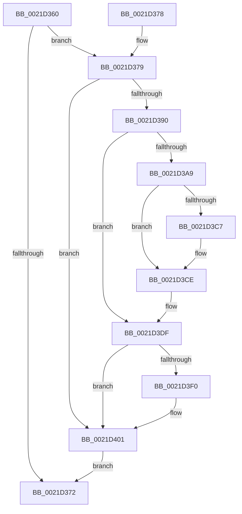

# KiUpdateVpBackingThreadPriorityOnReadyQueueInsertion

- RVA: `0x0021D360`–`0x0021D40B` (길이 `171` bytes)
- VA: `0x000000014021D360`
- 실행 섹션: `.text`
- PDB 이름 있음: `예`; PDB Function 태그: `아니요`
- unwind 정보 RVA: `0x0005EF98`
- 디코드: `42`개 명령, `171/171` bytes 표시
- 미해석 바이트: `0` (있으면 어셈블리에 `.byte`로 보존)

> 이 문서는 커널 이미지의 기계어와 PDB 기호를 분석해 생성했습니다. 4번과 5번은 함수 원형과 자료형을 바이너리 사용 방식에서 추정한 C 해석이며 원본 소스 복구 결과는 아닙니다.

## 1. Dependencies

- 직접 호출 지점: **4**; 고유 호출 대상: **4**
- 직접 호출자로 확인된 함수: **3**
- RIP 상대 이미지 참조: **5**

### Outgoing calls
- `0x0021D383` → [KiReadGuestSchedulerAssistPriority](../30/KiReadGuestSchedulerAssistPriority_function_00304BE4.md) (function, `0x00304BE4`)
- `0x0021D397` → [KeAcquireSpinLockAtDpcLevel](../20/KeAcquireSpinLockAtDpcLevel_function_00208430.md) (function, `0x00208430`)
- `0x0021D3E6` → [KxReleaseSpinLock](../20/KxReleaseSpinLock_function_00206670.md) (function, `0x00206670`)
- `0x0021D3FC` → [KeInsertQueueDpc](../20/KeInsertQueueDpc_function_00207C50.md) (function, `0x00207C50`)

### Direct callers
- [KiAddThreadToScbQueue](../20/KiAddThreadToScbQueue_function_002010DC.md) at `0x0020111A`
- [KiQueueReadyThread](KiQueueReadyThread_function_0021C7B0.md) at `0x0021CAB5`
- [sub_0025308F](../25/Unknown_function_0025308F.md) at `0x00254239`

### Static image references
- `0x0021D390` → RVA `0x00F22E58` (`.data`; read)
- `0x0021D3A9` → RVA `0x00F22C08` (`.data`; read)
- `0x0021D3B0` → RVA `0x00F22C00` (`.data`; read)
- `0x0021D3D8` → RVA `0x00F22C08` (`.data`; write)
- `0x0021D3F3` → RVA `0x00F22BC0` (`.data`; read)

## 2. Other-region calls and transfers

- 다른 실행 섹션으로 향하는 call: **0**
- 별도 외부 분기/꼬리 이동을 확인하지 못했습니다.

## 3. Assembly (complete function range)

```asm
0021D360  40 53                           push rbx
0021D362  48 83 EC 20                     sub rsp, 0x20
0021D366  F7 41 78 00 00 40 00            test dword ptr [rcx + 0x78], 0x400000
0021D36D  48 8B D9                        mov rbx, rcx
0021D370  75 07                           jne 0x14021d379
0021D372  48 83 C4 20                     add rsp, 0x20
0021D376  5B                              pop rbx
0021D377  C3                              ret
0021D378  CC                              int3
0021D379  48 89 7C 24 30                  mov qword ptr [rsp + 0x30], rdi
0021D37E  33 D2                           xor edx, edx
0021D380  40 32 FF                        xor dil, dil
0021D383  E8 5C 78 0E 00                  call 0x140304be4
0021D388  3B 83 00 04 00 00               cmp eax, dword ptr [rbx + 0x400]
0021D38E  74 71                           je 0x14021d401
0021D390  48 8D 0D C1 5A D0 00            lea rcx, [rip + 0xd05ac1]
0021D397  E8 94 B0 FE FF                  call 0x140208430
0021D39C  48 81 C3 F0 03 00 00            add rbx, 0x3f0
0021D3A3  48 83 3B 01                     cmp qword ptr [rbx], 1
0021D3A7  75 36                           jne 0x14021d3df
0021D3A9  48 8B 05 58 58 D0 00            mov rax, qword ptr [rip + 0xd05858]
0021D3B0  48 8D 0D 49 58 D0 00            lea rcx, [rip + 0xd05849]
0021D3B7  48 39 0D 42 58 D0 00            cmp qword ptr [rip + 0xd05842], rcx
0021D3BE  40 0F 94 C7                     sete dil
0021D3C2  48 39 08                        cmp qword ptr [rax], rcx
0021D3C5  74 07                           je 0x14021d3ce
0021D3C7  B9 03 00 00 00                  mov ecx, 3
0021D3CC  CD 29                           int 0x29
0021D3CE  48 89 0B                        mov qword ptr [rbx], rcx
0021D3D1  48 89 43 08                     mov qword ptr [rbx + 8], rax
0021D3D5  48 89 18                        mov qword ptr [rax], rbx
0021D3D8  48 89 1D 29 58 D0 00            mov qword ptr [rip + 0xd05829], rbx
0021D3DF  48 8D 0D 72 5A D0 00            lea rcx, [rip + 0xd05a72]
0021D3E6  E8 85 92 FE FF                  call 0x140206670
0021D3EB  40 84 FF                        test dil, dil
0021D3EE  74 11                           je 0x14021d401
0021D3F0  45 33 C0                        xor r8d, r8d
0021D3F3  48 8D 0D C6 57 D0 00            lea rcx, [rip + 0xd057c6]
0021D3FA  33 D2                           xor edx, edx
0021D3FC  E8 4F A8 FE FF                  call 0x140207c50
0021D401  48 8B 7C 24 30                  mov rdi, qword ptr [rsp + 0x30]
0021D406  E9 67 FF FF FF                  jmp 0x14021d372
```

## 4. C-style interpretation (structured pseudocode)

```c
__int64 __fastcall KiUpdateVpBackingThreadPriorityOnReadyQueueInsertion(__int64 a1, int a2, int a3)
{
    __int64 result;
    __int64 v_rbx;
    __int64 v_rdi;
    __int64 v_rsp;
    unsigned __int64 v_stack_p30;

    v_rsp = (v_rsp) - (32);
    if (((*(unsigned int *)(a1 + 120)) & (0x400000ULL)) != 0) goto loc_0021D379;
loc_0021D372:
    v_rsp = (v_rsp) + (32);
    return result;
loc_0021D379:
    v_stack_p30 = v_rdi;
    a2 = 0;
    v_rdi = 0;
    result = KiReadGuestSchedulerAssistPriority(a1, a2, a3, a4);
    if (((unsigned int)(result)) == (*(unsigned int *)(a1 + 1024))) goto loc_0021D401;
    result = KeAcquireSpinLockAtDpcLevel(v_rip + 13654721, a2, a3, a4);
    v_rbx = (a1) + (0x3F0ULL);
    if ((*(unsigned __int64 *)(v_rbx)) != 1) goto loc_0021D3DF;
    v_rdi = ((*(unsigned __int64 *)(v_rip + 13654082)) == (v_rip + 13654089)) ? 1 : 0;
    if ((*(unsigned __int64 *)(*(unsigned __int64 *)(v_rip + 13654104))) != (v_rip + 13654089)) {
        a1 = 3;
    }
    *(unsigned __int64 *)(v_rbx) = a1;
    *(unsigned __int64 *)(v_rbx + 8) = *(unsigned __int64 *)(v_rip + 13654104);
    *(unsigned __int64 *)(*(unsigned __int64 *)(v_rip + 13654104)) = v_rbx;
    *(unsigned __int64 *)(v_rip + 13654057) = v_rbx;
loc_0021D3DF:
    result = KxReleaseSpinLock(v_rip + 13654642, a2, a3, a4);
    if ((unsigned __int8)(v_rdi) != 0) {
        a3 = 0;
        a1 = v_rip + 13653958;
        a2 = 0;
        result = KeInsertQueueDpc(a1, a2, a3, a4);
    }
    goto loc_0021D372;
}
```

## 5. (Beta) C Style

```c
int64_t KiUpdateVpBackingThreadPriorityOnReadyQueueInsertion(void *Arg1, int32_t Arg2, int32_t Arg3)
{
    uint8_t *arg1 = (uint8_t *)Arg1;

    int64_t result;
    int64_t local_rbx;
    int64_t local_rdi;
    int64_t local_rsp;
    uint64_t v_stack_p30;

    local_rsp = (local_rsp) - (32);
    if (((*(uint32_t *)(arg1 + 0x78)) & (0x400000ULL)) != 0) goto loc_0021D379;
loc_0021D372:
    local_rsp = (local_rsp) + (32);
    return result;
loc_0021D379:
    v_stack_p30 = local_rdi;
    Arg2 = 0;
    local_rdi = 0;
    result = KiReadGuestSchedulerAssistPriority(Arg1, Arg2, Arg3, a4);
    if (((uint32_t)(result)) == (*(uint32_t *)(arg1 + 0x400))) goto loc_0021D401;
    result = KeAcquireSpinLockAtDpcLevel(v_rip + 13654721, Arg2, Arg3, a4);
    local_rbx = (Arg1) + (0x3F0ULL);
    if ((*(uint64_t *)(local_rbx)) != 1) goto loc_0021D3DF;
    local_rdi = ((*(uint64_t *)(v_rip + 0xD05842)) == (v_rip + 13654089)) ? 1 : 0;
    if ((*(uint64_t *)(*(uint64_t *)(v_rip + 0xD05858))) != (v_rip + 13654089)) {
        Arg1 = 3;
    }
    *(void **)(local_rbx) = Arg1;
    *(uint64_t *)(local_rbx + 0x8) = *(uint64_t *)(v_rip + 0xD05858);
    *(uint64_t *)(*(uint64_t *)(v_rip + 0xD05858)) = local_rbx;
    *(uint64_t *)(v_rip + 0xD05829) = local_rbx;
loc_0021D3DF:
    result = KxReleaseSpinLock(v_rip + 13654642, Arg2, Arg3, a4);
    if ((uint8_t)(local_rdi) != 0) {
        Arg3 = 0;
        Arg1 = v_rip + 13653958;
        Arg2 = 0;
        result = KeInsertQueueDpc(Arg1, Arg2, Arg3, a4);
    }
    goto loc_0021D372;
}
```

### 관측된 메모리 오프셋

구조체 형식이 확인되지 않은 접근은 인자 기준의 오프셋으로만 기록했습니다.

| 기준 인자 | 오프셋 표현 | 폭 (bit) | 접근 |
|---|---:|---:|---|
| `Arg1` | `+ 0x0` | `64` | `R` |
| `Arg1` | `+ 0x0` | `64` | `W` |
| `Arg1` | `+ 0x8` | `64` | `W` |
| `Arg1` | `+ 0x78` | `32` | `R` |
| `Arg1` | `+ 0x400` | `32` | `R` |

## 6. Execution-region graph

[열기: 2D/3D 그래프와 함수 탐색 컨트롤 패널](../../../control-panel.html?section=text&rva=0x0021D360&view=graph)

- 2D 그래프는 위에서 아래로 흐르고, 3D 그래프는 빈 공간을 드래그해 회전합니다. Shift+드래그는 이동, 휠은 확대·축소, 함수 노드 선택은 대상 보고서 이동입니다.

### Static fallback


