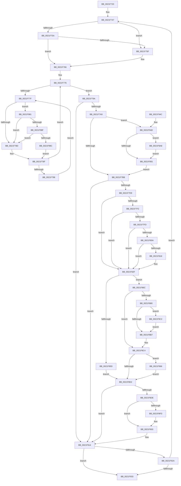

# KiWakePriQueueWaiter

- RVA: `0x0021F720`–`0x0021F9CD` (길이 `685` bytes)
- VA: `0x000000014021F720`
- 실행 섹션: `.text`
- PDB 이름 있음: `예`; PDB Function 태그: `아니요`
- unwind 정보 RVA: `0x0005F208`
- 디코드: `180`개 명령, `685/685` bytes 표시
- 미해석 바이트: `0` (있으면 어셈블리에 `.byte`로 보존)

> 이 문서는 커널 이미지의 기계어와 PDB 기호를 분석해 생성했습니다. 4번과 5번은 함수 원형과 자료형을 바이너리 사용 방식에서 추정한 C 해석이며 원본 소스 복구 결과는 아닙니다.

## 1. Dependencies

- 직접 호출 지점: **9**; 고유 호출 대상: **9**
- 직접 호출자로 확인된 함수: **5**
- RIP 상대 이미지 참조: **3**

### Outgoing calls
- `0x0021F7C9` → [KiSignalThread](KiSignalThread_function_0021F9E0.md) (function, `0x0021F9E0`)
- `0x0021F82A` → [KiAbQueueAutoBoostDpc](../20/KiAbQueueAutoBoostDpc_function_002074D0.md) (function, `0x002074D0`)
- `0x0021F84F` → [KiAdjustRealtimePriorityFloor](KiAdjustRealtimePriorityFloor_function_0021FBE0.md) (function, `0x0021FBE0`)
- `0x0021F854` → [Feature_StackingDecayBoosts__private_IsEnabledNoReportingNoInline](../4E/Feature_StackingDecayBoosts__private_IsEnabledNoReportingNoInline_function_004EF7C0.md) (function, `0x004EF7C0`)
- `0x0021F862` → [KiComputeThreadPriorityNonStacking](../5C/KiComputeThreadPriorityNonStacking_function_005CA81C.md) (function, `0x005CA81C`)
- `0x0021F8E5` → [KiQueryQuantumReset](KiQueryQuantumReset_function_0021F6B4.md) (function, `0x0021F6B4`)
- `0x0021F90F` → [KiSetPriorityThread](../22/KiSetPriorityThread_function_00220E78.md) (function, `0x00220E78`)
- `0x0021F98F` → [KiCheckVpBackingLongSpinWaitHypercall](../30/KiCheckVpBackingLongSpinWaitHypercall_function_0030F490.md) (function, `0x0030F490`)
- `0x0021F99E` → [HvlNotifyLongSpinWait](../30/HvlNotifyLongSpinWait_function_0030F460.md) (function, `0x0030F460`)

### Direct callers
- [KiActivateWaiterQueueWithNoLocks](../20/KiActivateWaiterQueueWithNoLocks_function_0020CEB0.md) at `0x0020D03F`
- [KeInsertPriQueue](KeInsertPriQueue_function_0021EDD0.md) at `0x0021EEA4`
- [sub_003C66C7](../3C/Unknown_function_003C66C7.md) at `0x003C6753`
- [sub_003C6884](../3C/Unknown_function_003C6884.md) at `0x003C68E4`
- [KiActivateWaiterPriQueue](../3C/KiActivateWaiterPriQueue_function_003C69FC.md) at `0x003C6A5F`

### Static image references
- `0x0021F781` → RVA `0x00FC52AC` (`ALMOSTRO`; reference)
- `0x0021F8EA` → RVA `0x00FC5098` (`ALMOSTRO`; read)
- `0x0021F981` → RVA `0x00FC6AB8` (`ALMOSTRO`; read)

## 2. Other-region calls and transfers

- 다른 실행 섹션으로 향하는 call: **0**
- 별도 외부 분기/꼬리 이동을 확인하지 못했습니다.

## 3. Assembly (complete function range)

```asm
0021F720  48 89 4C 24 08                  mov qword ptr [rsp + 8], rcx
0021F725  53                              push rbx
0021F726  56                              push rsi
0021F727  57                              push rdi
0021F728  41 54                           push r12
0021F72A  41 55                           push r13
0021F72C  41 56                           push r14
0021F72E  41 57                           push r15
0021F730  48 83 EC 20                     sub rsp, 0x20
0021F734  4C 8B 72 08                     mov r14, qword ptr [rdx + 8]
0021F738  4C 8D 62 08                     lea r12, [rdx + 8]
0021F73C  4D 63 F9                        movsxd r15, r9d
0021F73F  4D 8B E8                        mov r13, r8
0021F742  48 89 6C 24 70                  mov qword ptr [rsp + 0x70], rbp
0021F747  49 8B 06                        mov rax, qword ptr [r14]
0021F74A  49 8B FE                        mov rdi, r14
0021F74D  4C 8B F0                        mov r14, rax
0021F750  48 8B 4F 08                     mov rcx, qword ptr [rdi + 8]
0021F754  48 39 78 08                     cmp qword ptr [rax + 8], rdi
0021F758  75 05                           jne 0x14021f75f
0021F75A  48 39 39                        cmp qword ptr [rcx], rdi
0021F75D  74 07                           je 0x14021f766
0021F75F  B9 03 00 00 00                  mov ecx, 3
0021F764  CD 29                           int 0x29
0021F766  48 89 01                        mov qword ptr [rcx], rax
0021F769  40 32 ED                        xor bpl, bpl
0021F76C  48 89 48 08                     mov qword ptr [rax + 8], rcx
0021F770  33 F6                           xor esi, esi
0021F772  48 8B 5F 18                     mov rbx, qword ptr [rdi + 0x18]
0021F776  F0 48 0F BA 6B 40 00            lock bts qword ptr [rbx + 0x40], 0
0021F77D  73 1B                           jae 0x14021f79a
0021F77F  FF C6                           inc esi
0021F781  85 35 25 5B DA 00               test dword ptr [rip + 0xda5b25], esi
0021F787  0F 84 F4 01 00 00               je 0x14021f981
0021F78D  F3 90                           pause
0021F78F  48 8B 43 40                     mov rax, qword ptr [rbx + 0x40]
0021F793  48 85 C0                        test rax, rax
0021F796  74 DE                           je 0x14021f776
0021F798  EB E5                           jmp 0x14021f77f
0021F79A  0F B6 83 84 01 00 00            movzx eax, byte ptr [rbx + 0x184]
0021F7A1  3C 05                           cmp al, 5
0021F7A3  0F 85 6B 01 00 00               jne 0x14021f914
0021F7A9  8B 93 1C 02 00 00               mov edx, dword ptr [rbx + 0x21c]
0021F7AF  0F B6 C2                        movzx eax, dl
0021F7B2  41 3B C7                        cmp eax, r15d
0021F7B5  0F 85 92 01 00 00               jne 0x14021f94d
0021F7BB  48 8B 4C 24 60                  mov rcx, qword ptr [rsp + 0x60]
0021F7C0  4C 8B CF                        mov r9, rdi
0021F7C3  4D 8B C5                        mov r8, r13
0021F7C6  48 8B D3                        mov rdx, rbx
0021F7C9  E8 12 02 00 00                  call 0x14021f9e0
0021F7CE  0F B6 E8                        movzx ebp, al
0021F7D1  84 C0                           test al, al
0021F7D3  0F 84 3B 01 00 00               je 0x14021f914
0021F7D9  C6 83 85 02 00 00 00            mov byte ptr [rbx + 0x285], 0
0021F7E0  65 4C 8B 04 25 20 00 00 00      mov r8, qword ptr gs:[0x20]
0021F7E9  44 3A BB 33 02 00 00            cmp r15b, byte ptr [rbx + 0x233]
0021F7F0  7D 3D                           jge 0x14021f82f
0021F7F2  0F B6 8B 19 03 00 00            movzx ecx, byte ptr [rbx + 0x319]
0021F7F9  84 C9                           test cl, cl
0021F7FB  74 32                           je 0x14021f82f
0021F7FD  48 8D 8B 30 03 00 00            lea rcx, [rbx + 0x330]
0021F804  48 83 39 01                     cmp qword ptr [rcx], 1
0021F808  75 25                           jne 0x14021f82f
0021F80A  49 8D 90 70 91 00 00            lea rdx, [r8 + 0x9170]
0021F811  48 85 D2                        test rdx, rdx
0021F814  74 19                           je 0x14021f82f
0021F816  48 8B 02                        mov rax, qword ptr [rdx]
0021F819  48 89 01                        mov qword ptr [rcx], rax
0021F81C  48 89 0A                        mov qword ptr [rdx], rcx
0021F81F  66 F0 FF 83 64 03 00 00         lock inc word ptr [rbx + 0x364]
0021F827  49 8B C8                        mov rcx, r8
0021F82A  E8 A1 7C FE FF                  call 0x1402074d0
0021F82F  B9 0F F0 00 00                  mov ecx, 0xf00f
0021F834  44 88 BB 33 02 00 00            mov byte ptr [rbx + 0x233], r15b
0021F83B  66 21 8B 06 02 00 00            and word ptr [rbx + 0x206], cx
0021F842  41 8B D7                        mov edx, r15d
0021F845  48 8B CB                        mov rcx, rbx
0021F848  C6 83 66 03 00 00 00            mov byte ptr [rbx + 0x366], 0
0021F84F  E8 8C 03 00 00                  call 0x14021fbe0
0021F854  E8 67 FF 2C 00                  call 0x1404ef7c0
0021F859  85 C0                           test eax, eax
0021F85B  75 0F                           jne 0x14021f86c
0021F85D  33 D2                           xor edx, edx
0021F85F  48 8B CB                        mov rcx, rbx
0021F862  E8 B5 AF 3A 00                  call 0x1405ca81c
0021F867  44 8B C8                        mov r9d, eax
0021F86A  EB 66                           jmp 0x14021f8d2
0021F86C  44 0F BE 8B 33 02 00 00         movsx r9d, byte ptr [rbx + 0x233]
0021F874  45 8B D1                        mov r10d, r9d
0021F877  45 8B C1                        mov r8d, r9d
0021F87A  41 83 F9 10                     cmp r9d, 0x10
0021F87E  7D 44                           jge 0x14021f8c4
0021F880  0F B6 8B 66 03 00 00            movzx ecx, byte ptr [rbx + 0x366]
0021F887  0F B7 93 06 02 00 00            movzx edx, word ptr [rbx + 0x206]
0021F88E  8B C2                           mov eax, edx
0021F890  83 E0 0F                        and eax, 0xf
0021F893  41 03 C1                        add eax, r9d
0021F896  41 3B C0                        cmp eax, r8d
0021F899  44 8B C8                        mov r9d, eax
0021F89C  45 0F 4E C8                     cmovle r9d, r8d
0021F8A0  33 C0                           xor eax, eax
0021F8A2  84 C9                           test cl, cl
0021F8A4  0F 4F C1                        cmovg eax, ecx
0021F8A7  0F BE C0                        movsx eax, al
0021F8AA  44 03 C8                        add r9d, eax
0021F8AD  41 83 F9 10                     cmp r9d, 0x10
0021F8B1  0F 8D 0B 01 00 00               jge 0x14021f9c2
0021F8B7  C1 EA 04                        shr edx, 4
0021F8BA  0F B6 C2                        movzx eax, dl
0021F8BD  41 3B C1                        cmp eax, r9d
0021F8C0  44 0F 4F C8                     cmovg r9d, eax
0021F8C4  8B 83 58 03 00 00               mov eax, dword ptr [rbx + 0x358]
0021F8CA  85 C0                           test eax, eax
0021F8CC  0F 85 94 00 00 00               jne 0x14021f966
0021F8D2  0F BE 83 C3 00 00 00            movsx eax, byte ptr [rbx + 0xc3]
0021F8D9  44 3B C8                        cmp r9d, eax
0021F8DC  74 36                           je 0x14021f914
0021F8DE  4C 8B 43 48                     mov r8, qword ptr [rbx + 0x48]
0021F8E2  48 8B CB                        mov rcx, rbx
0021F8E5  E8 CA FD FF FF                  call 0x14021f6b4
0021F8EA  0F AF 05 A7 57 DA 00            imul eax, dword ptr [rip + 0xda57a7]
0021F8F1  8B C8                           mov ecx, eax
0021F8F3  8B 43 78                        mov eax, dword ptr [rbx + 0x78]
0021F8F6  49 03 C8                        add rcx, r8
0021F8F9  A8 20                           test al, 0x20
0021F8FB  74 06                           je 0x14021f903
0021F8FD  F0 0F BA 73 78 05               lock btr dword ptr [rbx + 0x78], 5
0021F903  48 89 4B 20                     mov qword ptr [rbx + 0x20], rcx
0021F907  45 8B C1                        mov r8d, r9d
0021F90A  48 8B CB                        mov rcx, rbx
0021F90D  33 D2                           xor edx, edx
0021F90F  E8 64 15 00 00                  call 0x140220e78
0021F914  48 C7 43 40 00 00 00 00         mov qword ptr [rbx + 0x40], 0
0021F91C  0F B6 47 11                     movzx eax, byte ptr [rdi + 0x11]
0021F920  FE C0                           inc al
0021F922  88 47 11                        mov byte ptr [rdi + 0x11], al
0021F925  40 84 ED                        test bpl, bpl
0021F928  75 09                           jne 0x14021f933
0021F92A  4D 3B F4                        cmp r14, r12
0021F92D  0F 85 14 FE FF FF               jne 0x14021f747
0021F933  40 0F B6 C5                     movzx eax, bpl
0021F937  48 8B 6C 24 70                  mov rbp, qword ptr [rsp + 0x70]
0021F93C  48 83 C4 20                     add rsp, 0x20
0021F940  41 5F                           pop r15
0021F942  41 5E                           pop r14
0021F944  41 5D                           pop r13
0021F946  41 5C                           pop r12
0021F948  5F                              pop rdi
0021F949  5E                              pop rsi
0021F94A  5B                              pop rbx
0021F94B  C3                              ret
0021F94C  CC                              int3
0021F94D  81 E2 00 01 00 00               and edx, 0x100
0021F953  74 53                           je 0x14021f9a8
0021F955  41 0F B6 C7                     movzx eax, r15b
0021F959  0B D0                           or edx, eax
0021F95B  89 93 1C 02 00 00               mov dword ptr [rbx + 0x21c], edx
0021F961  E9 55 FE FF FF                  jmp 0x14021f7bb
0021F966  0F BD C0                        bsr eax, eax
0021F969  C7 44 24 68 00 00 00 00         mov dword ptr [rsp + 0x68], 0
0021F971  44 3B C8                        cmp r9d, eax
0021F974  89 44 24 68                     mov dword ptr [rsp + 0x68], eax
0021F978  44 0F 4C C8                     cmovl r9d, eax
0021F97C  E9 51 FF FF FF                  jmp 0x14021f8d2
0021F981  8B 05 31 71 DA 00               mov eax, dword ptr [rip + 0xda7131]
0021F987  A8 40                           test al, 0x40
0021F989  0F 84 FE FD FF FF               je 0x14021f78d
0021F98F  E8 FC FA 0E 00                  call 0x14030f490
0021F994  84 C0                           test al, al
0021F996  0F 84 F1 FD FF FF               je 0x14021f78d
0021F99C  8B CE                           mov ecx, esi
0021F99E  E8 BD FA 0E 00                  call 0x14030f460
0021F9A3  E9 E7 FD FF FF                  jmp 0x14021f78f
0021F9A8  48 8B 8B E8 00 00 00            mov rcx, qword ptr [rbx + 0xe8]
0021F9AF  F0 FF 8C 81 18 02 00 00         lock dec dword ptr [rcx + rax*4 + 0x218]
0021F9B7  F0 42 FF 84 B9 18 02 00 00      lock inc dword ptr [rcx + r15*4 + 0x218]
0021F9C0  EB 93                           jmp 0x14021f955
0021F9C2  41 B9 0F 00 00 00               mov r9d, 0xf
0021F9C8  E9 EA FE FF FF                  jmp 0x14021f8b7
```

## 4. C-style interpretation (structured pseudocode)

```c
__int64 __fastcall KiWakePriQueueWaiter(__int64 a1, __int64 a2, __int64 a3, int a4)
{
    __int64 result;
    __int64 v_rbp;
    __int64 v_rsi;
    __int64 v_rsp;
    unsigned __int64 v_stack_p18;
    unsigned int v_stack_p68;
    unsigned __int64 v_stack_p8;

    v_stack_p8 = a1;
    v_rsp = (v_rsp) - (32);
    v_stack_p18 = v_rbp;
loc_0021F747:
    if ((*(unsigned __int64 *)(*(unsigned __int64 *)(*(unsigned __int64 *)(a2 + 8)) + 8)) != (*(unsigned __int64 *)(a2 + 8))) goto loc_0021F75F;
    if ((*(unsigned __int64 *)(*(unsigned __int64 *)(*(unsigned __int64 *)(a2 + 8) + 8))) != (*(unsigned __int64 *)(a2 + 8))) {
        a1 = 3;
    }
    *(unsigned __int64 *)(a1) = *(unsigned __int64 *)(*(unsigned __int64 *)(a2 + 8));
    v_rbp = 0;
    *(unsigned __int64 *)(*(unsigned __int64 *)(*(unsigned __int64 *)(a2 + 8)) + 8) = a1;
    v_rsi = 0;
loc_0021F776:
    if (condition_is_above_or_equal) goto loc_0021F79A;
loc_0021F77F:
    v_rsi = (unsigned int)((v_rsi) + 1);
    if (((*(unsigned int *)(v_rip + 14310181)) & ((unsigned int)(v_rsi))) == 0) goto loc_0021F981;
loc_0021F78D:
loc_0021F78F:
    if (*(unsigned __int64 *)(*(unsigned __int64 *)(*(unsigned __int64 *)(a2 + 8) + 24) + 64) == 0) goto loc_0021F776;
    goto loc_0021F77F;
loc_0021F79A:
    if (((unsigned __int8)(*(unsigned __int8 *)(*(unsigned __int64 *)(*(unsigned __int64 *)(a2 + 8) + 24) + 388))) != 5) goto loc_0021F914;
    if (((unsigned int)((unsigned __int8)((unsigned int)(*(unsigned int *)(*(unsigned __int64 *)(*(unsigned __int64 *)(a2 + 8) + 24) + 540))))) != ((unsigned int)((int)(a4)))) goto loc_0021F94D;
loc_0021F7BB:
    result = KiSignalThread(v_stack_p8, *(unsigned __int64 *)(*(unsigned __int64 *)(a2 + 8) + 24), a3, *(unsigned __int64 *)(a2 + 8));
    if ((unsigned __int8)(result) == 0) goto loc_0021F914;
    *(unsigned __int8 *)(*(unsigned __int64 *)(*(unsigned __int64 *)(a2 + 8) + 24) + 645) = 0;
    if (((unsigned __int8)((int)(a4))) >= (*(unsigned __int8 *)(*(unsigned __int64 *)(*(unsigned __int64 *)(a2 + 8) + 24) + 563))) goto loc_0021F82F;
    if ((unsigned __int8)(*(unsigned __int8 *)(*(unsigned __int64 *)(*(unsigned __int64 *)(a2 + 8) + 24) + 793)) == 0) goto loc_0021F82F;
    if ((*(unsigned __int64 *)(*(unsigned __int64 *)(*(unsigned __int64 *)(a2 + 8) + 24) + 816)) != 1) goto loc_0021F82F;
    if (*(unsigned __int64 *)(gs_base + (0 + 32)) + 37232 != 0) {
        result = *(unsigned __int64 *)(*(unsigned __int64 *)(gs_base + (0 + 32)) + 37232);
        *(unsigned __int64 *)(*(unsigned __int64 *)(*(unsigned __int64 *)(a2 + 8) + 24) + 816) = result;
        *(unsigned __int64 *)(*(unsigned __int64 *)(gs_base + (0 + 32)) + 37232) = *(unsigned __int64 *)(*(unsigned __int64 *)(a2 + 8) + 24) + 816;
        a1 = *(unsigned __int64 *)(gs_base + (0 + 32));
        result = KiAbQueueAutoBoostDpc(a1, *(unsigned __int64 *)(gs_base + (0 + 32)) + 37232, *(unsigned __int64 *)(gs_base + (0 + 32)), *(unsigned __int64 *)(a2 + 8));
    }
    *(unsigned __int8 *)(*(unsigned __int64 *)(*(unsigned __int64 *)(a2 + 8) + 24) + 563) = (unsigned __int8)((int)(a4));
    *(unsigned __int8 *)(*(unsigned __int64 *)(*(unsigned __int64 *)(a2 + 8) + 24) + 870) = 0;
    result = KiAdjustRealtimePriorityFloor(*(unsigned __int64 *)(*(unsigned __int64 *)(a2 + 8) + 24), (unsigned int)((unsigned int)((int)(a4))), *(unsigned __int64 *)(gs_base + (0 + 32)), *(unsigned __int64 *)(a2 + 8));
    result = Feature_StackingDecayBoosts__private_IsEnabledNoReportingNoInline(*(unsigned __int64 *)(*(unsigned __int64 *)(a2 + 8) + 24), (unsigned int)((unsigned int)((int)(a4))), *(unsigned __int64 *)(gs_base + (0 + 32)), *(unsigned __int64 *)(a2 + 8));
    if ((unsigned int)(result) != 0) goto loc_0021F86C;
    a2 = 0;
    result = KiComputeThreadPriorityNonStacking(*(unsigned __int64 *)(*(unsigned __int64 *)(a2 + 8) + 24), a2, *(unsigned __int64 *)(gs_base + (0 + 32)), *(unsigned __int64 *)(a2 + 8));
    goto loc_0021F8D2;
loc_0021F86C:
    if (((unsigned int)((__int8)(*(unsigned __int8 *)(*(unsigned __int64 *)(*(unsigned __int64 *)(a2 + 8) + 24) + 563)))) >= 16) goto loc_0021F8C4;
    result = (unsigned int)(((unsigned int)((unsigned int)(*(unsigned __int16 *)(*(unsigned __int64 *)(*(unsigned __int64 *)(a2 + 8) + 24) + 518)))) & (15));
    result = (unsigned int)((result) + ((unsigned int)((__int8)(*(unsigned __int8 *)(*(unsigned __int64 *)(*(unsigned __int64 *)(a2 + 8) + 24) + 563)))));
    a4 = (unsigned int)((unsigned int)(result));
    if (((unsigned int)(result)) <= ((unsigned int)((unsigned int)((unsigned int)((__int8)(*(unsigned __int8 *)(*(unsigned __int64 *)(*(unsigned __int64 *)(a2 + 8) + 24) + 563))))))) { a4 = (unsigned int)((unsigned int)((unsigned int)((__int8)(*(unsigned __int8 *)(*(unsigned __int64 *)(*(unsigned __int64 *)(a2 + 8) + 24) + 563))))); }
    result = 0;
    if (condition_is_greater) { result = (unsigned int)(*(unsigned __int8 *)(*(unsigned __int64 *)(*(unsigned __int64 *)(a2 + 8) + 24) + 870)); }
    a4 = (unsigned int)((a4) + ((unsigned int)((__int8)((unsigned __int8)(result)))));
    if (a4 >= 16) goto loc_0021F9C2;
loc_0021F8B7:
    a2 = (unsigned int)((*(unsigned __int16 *)(*(unsigned __int64 *)(*(unsigned __int64 *)(a2 + 8) + 24) + 518)) >> (4));
    if (((unsigned int)((unsigned __int8)(a2))) > a4) { a4 = (unsigned int)((unsigned __int8)(a2)); }
loc_0021F8C4:
    if ((unsigned int)((unsigned int)(*(unsigned int *)(*(unsigned __int64 *)(*(unsigned __int64 *)(a2 + 8) + 24) + 856))) != 0) goto loc_0021F966;
loc_0021F8D2:
    if (a4 == ((unsigned int)((__int8)(*(unsigned __int8 *)(*(unsigned __int64 *)(*(unsigned __int64 *)(a2 + 8) + 24) + 195))))) goto loc_0021F914;
    result = KiQueryQuantumReset(*(unsigned __int64 *)(*(unsigned __int64 *)(a2 + 8) + 24), a2, *(unsigned __int64 *)(*(unsigned __int64 *)(*(unsigned __int64 *)(a2 + 8) + 24) + 72), a4);
    result = (unsigned int)((result) * (*(unsigned int *)(v_rip + 14309287)));
    a1 = ((unsigned int)((unsigned int)(result))) + (*(unsigned __int64 *)(*(unsigned __int64 *)(*(unsigned __int64 *)(a2 + 8) + 24) + 72));
    if ((((unsigned __int8)((unsigned int)(*(unsigned int *)(*(unsigned __int64 *)(*(unsigned __int64 *)(a2 + 8) + 24) + 120)))) & (32)) != 0) {
    }
    *(unsigned __int64 *)(*(unsigned __int64 *)(*(unsigned __int64 *)(a2 + 8) + 24) + 32) = a1;
    a2 = 0;
    result = KiSetPriorityThread(*(unsigned __int64 *)(*(unsigned __int64 *)(a2 + 8) + 24), a2, (unsigned int)(a4), a4);
loc_0021F914:
    *(unsigned __int64 *)(*(unsigned __int64 *)(*(unsigned __int64 *)(a2 + 8) + 24) + 64) = 0;
    result = (unsigned __int8)((*(unsigned __int8 *)(*(unsigned __int64 *)(a2 + 8) + 17)) + 1);
    *(unsigned __int8 *)(*(unsigned __int64 *)(a2 + 8) + 17) = (unsigned __int8)(result);
    if ((unsigned __int8)((unsigned __int8)(result)) != 0) goto loc_0021F933;
    if ((*(unsigned __int64 *)(*(unsigned __int64 *)(a2 + 8))) != (a2 + 8)) goto loc_0021F747;
loc_0021F933:
    v_rsp = (v_rsp) + (32);
    return (unsigned __int8)((unsigned __int8)(result));
loc_0021F94D:
    a2 = (unsigned int)((a2) & (256));
    if (condition_is_equal) goto loc_0021F9A8;
loc_0021F955:
    a2 = (unsigned int)((a2) | ((unsigned int)((unsigned __int8)((int)(a4)))));
    *(unsigned int *)(*(unsigned __int64 *)(*(unsigned __int64 *)(a2 + 8) + 24) + 540) = (unsigned int)(a2);
    goto loc_0021F7BB;
loc_0021F966:
    v_stack_p68 = 0;
    v_stack_p68 = (unsigned int)((unsigned __int8)((int)(a4)));
    if (a4 < ((unsigned int)((unsigned __int8)((int)(a4))))) { a4 = (unsigned int)((unsigned __int8)((int)(a4))); }
    goto loc_0021F8D2;
loc_0021F981:
    if ((((unsigned __int8)((unsigned int)(*(unsigned int *)(v_rip + 14315825)))) & (64)) == 0) goto loc_0021F78D;
    result = KiCheckVpBackingLongSpinWaitHypercall(*(unsigned __int64 *)(*(unsigned __int64 *)(a2 + 8) + 24), a2, (unsigned int)(a4), a4);
    if ((unsigned __int8)(result) == 0) goto loc_0021F78D;
    result = HvlNotifyLongSpinWait((unsigned int)((unsigned int)(v_rsi)), a2, (unsigned int)(a4), a4);
    goto loc_0021F78F;
loc_0021F9A8:
    goto loc_0021F955;
loc_0021F9C2:
    goto loc_0021F8B7;
}
```

## 5. (Beta) C Style

```c
int64_t KiWakePriQueueWaiter(int64_t Arg1, void *Arg2, int64_t Arg3, int32_t Arg4)
{
    uint8_t *arg2 = (uint8_t *)Arg2;

    int64_t result;
    int64_t local_rbp;
    int64_t local_rsi;
    int64_t local_rsp;
    uint64_t v_stack_p18;
    uint32_t v_stack_p68;
    uint64_t v_stack_p8;

    v_stack_p8 = Arg1;
    local_rsp = (local_rsp) - (32);
    v_stack_p18 = local_rbp;
loc_0021F747:
    if ((*(uint64_t *)(*(uint64_t *)(*(uint64_t *)(arg2 + 0x8)) + 0x8)) != (*(uint64_t *)(arg2 + 0x8))) goto loc_0021F75F;
    if ((*(uint64_t *)(*(uint64_t *)(*(uint64_t *)(arg2 + 0x8) + 0x8))) != (*(uint64_t *)(arg2 + 0x8))) {
        Arg1 = 3;
    }
    *(uint64_t *)(Arg1) = *(uint64_t *)(*(uint64_t *)(arg2 + 0x8));
    local_rbp = 0;
    *(uint64_t *)(*(uint64_t *)(*(uint64_t *)(arg2 + 0x8)) + 0x8) = Arg1;
    local_rsi = 0;
loc_0021F776:
    if (condition_is_above_or_equal) goto loc_0021F79A;
loc_0021F77F:
    local_rsi = (uint32_t)((local_rsi) + 1);
    if (((*(uint32_t *)(v_rip + 0xDA5B25)) & ((uint32_t)(local_rsi))) == 0) goto loc_0021F981;
loc_0021F78D:
loc_0021F78F:
    if (*(uint64_t *)(*(uint64_t *)(*(uint64_t *)(arg2 + 0x8) + 0x18) + 0x40) == 0) goto loc_0021F776;
    goto loc_0021F77F;
loc_0021F79A:
    if (((uint8_t)(*(uint8_t *)(*(uint64_t *)(*(uint64_t *)(arg2 + 0x8) + 0x18) + 0x184))) != 5) goto loc_0021F914;
    if (((uint32_t)((uint8_t)((uint32_t)(*(uint32_t *)(*(uint64_t *)(*(uint64_t *)(arg2 + 0x8) + 0x18) + 0x21C))))) != ((uint32_t)((int32_t)(Arg4)))) goto loc_0021F94D;
loc_0021F7BB:
    result = KiSignalThread(v_stack_p8, *(uint64_t *)(*(uint64_t *)(arg2 + 0x8) + 0x18), Arg3, *(uint64_t *)(arg2 + 0x8));
    if ((uint8_t)(result) == 0) goto loc_0021F914;
    *(uint8_t *)(*(uint64_t *)(*(uint64_t *)(arg2 + 0x8) + 0x18) + 0x285) = 0;
    if (((uint8_t)((int32_t)(Arg4))) >= (*(uint8_t *)(*(uint64_t *)(*(uint64_t *)(arg2 + 0x8) + 0x18) + 0x233))) goto loc_0021F82F;
    if ((uint8_t)(*(uint8_t *)(*(uint64_t *)(*(uint64_t *)(arg2 + 0x8) + 0x18) + 0x319)) == 0) goto loc_0021F82F;
    if ((*(uint64_t *)(*(uint64_t *)(*(uint64_t *)(arg2 + 0x8) + 0x18) + 0x330)) != 1) goto loc_0021F82F;
    if (*(uint64_t *)(gs_base + (0 + 0x20)) + 37232 != 0) {
        result = *(uint64_t *)(*(uint64_t *)(gs_base + (0 + 0x20)) + 0x9170);
        *(uint64_t *)(*(uint64_t *)(*(uint64_t *)(arg2 + 0x8) + 0x18) + 0x330) = result;
        *(uint64_t *)(*(uint64_t *)(gs_base + (0 + 0x20)) + 0x9170) = *(uint64_t *)(*(uint64_t *)(arg2 + 0x8) + 0x18) + 816;
        Arg1 = *(uint64_t *)(gs_base + (0 + 0x20));
        result = KiAbQueueAutoBoostDpc(Arg1, *(uint64_t *)(gs_base + (0 + 0x20)) + 37232, *(uint64_t *)(gs_base + (0 + 0x20)), *(uint64_t *)(arg2 + 0x8));
    }
    *(uint8_t *)(*(uint64_t *)(*(uint64_t *)(arg2 + 0x8) + 0x18) + 0x233) = (uint8_t)((int32_t)(Arg4));
    *(uint8_t *)(*(uint64_t *)(*(uint64_t *)(arg2 + 0x8) + 0x18) + 0x366) = 0;
    result = KiAdjustRealtimePriorityFloor(*(uint64_t *)(*(uint64_t *)(arg2 + 0x8) + 0x18), (uint32_t)((uint32_t)((int32_t)(Arg4))), *(uint64_t *)(gs_base + (0 + 0x20)), *(uint64_t *)(arg2 + 0x8));
    result = Feature_StackingDecayBoosts__private_IsEnabledNoReportingNoInline(*(uint64_t *)(*(uint64_t *)(arg2 + 0x8) + 0x18), (uint32_t)((uint32_t)((int32_t)(Arg4))), *(uint64_t *)(gs_base + (0 + 0x20)), *(uint64_t *)(arg2 + 0x8));
    if ((uint32_t)(result) != 0) goto loc_0021F86C;
    Arg2 = 0;
    result = KiComputeThreadPriorityNonStacking(*(uint64_t *)(*(uint64_t *)(arg2 + 0x8) + 0x18), Arg2, *(uint64_t *)(gs_base + (0 + 0x20)), *(uint64_t *)(arg2 + 0x8));
    goto loc_0021F8D2;
loc_0021F86C:
    if (((uint32_t)((int8_t)(*(uint8_t *)(*(uint64_t *)(*(uint64_t *)(arg2 + 0x8) + 0x18) + 0x233)))) >= 16) goto loc_0021F8C4;
    result = (uint32_t)(((uint32_t)((uint32_t)(*(uint16_t *)(*(uint64_t *)(*(uint64_t *)(arg2 + 0x8) + 0x18) + 0x206)))) & (15));
    result = (uint32_t)((result) + ((uint32_t)((int8_t)(*(uint8_t *)(*(uint64_t *)(*(uint64_t *)(arg2 + 0x8) + 0x18) + 0x233)))));
    Arg4 = (uint32_t)((uint32_t)(result));
    if (((uint32_t)(result)) <= ((uint32_t)((uint32_t)((uint32_t)((int8_t)(*(uint8_t *)(*(uint64_t *)(*(uint64_t *)(arg2 + 0x8) + 0x18) + 0x233))))))) { Arg4 = (uint32_t)((uint32_t)((uint32_t)((int8_t)(*(uint8_t *)(*(uint64_t *)(*(uint64_t *)(arg2 + 0x8) + 0x18) + 0x233))))); }
    result = 0;
    if (condition_is_greater) { result = (uint32_t)(*(uint8_t *)(*(uint64_t *)(*(uint64_t *)(arg2 + 0x8) + 0x18) + 0x366)); }
    Arg4 = (uint32_t)((Arg4) + ((uint32_t)((int8_t)((uint8_t)(result)))));
    if (Arg4 >= 16) goto loc_0021F9C2;
loc_0021F8B7:
    Arg2 = (uint32_t)((*(uint16_t *)(*(uint64_t *)(*(uint64_t *)(arg2 + 0x8) + 0x18) + 0x206)) >> (4));
    if (((uint32_t)((uint8_t)(Arg2))) > Arg4) { Arg4 = (uint32_t)((uint8_t)(Arg2)); }
loc_0021F8C4:
    if ((uint32_t)((uint32_t)(*(uint32_t *)(*(uint64_t *)(*(uint64_t *)(arg2 + 0x8) + 0x18) + 0x358))) != 0) goto loc_0021F966;
loc_0021F8D2:
    if (Arg4 == ((uint32_t)((int8_t)(*(uint8_t *)(*(uint64_t *)(*(uint64_t *)(arg2 + 0x8) + 0x18) + 0xC3))))) goto loc_0021F914;
    result = KiQueryQuantumReset(*(uint64_t *)(*(uint64_t *)(arg2 + 0x8) + 0x18), Arg2, *(uint64_t *)(*(uint64_t *)(*(uint64_t *)(arg2 + 0x8) + 0x18) + 0x48), Arg4);
    result = (uint32_t)((result) * (*(uint32_t *)(v_rip + 0xDA57A7)));
    Arg1 = ((uint32_t)((uint32_t)(result))) + (*(uint64_t *)(*(uint64_t *)(*(uint64_t *)(arg2 + 0x8) + 0x18) + 0x48));
    if ((((uint8_t)((uint32_t)(*(uint32_t *)(*(uint64_t *)(*(uint64_t *)(arg2 + 0x8) + 0x18) + 0x78)))) & (32)) != 0) {
    }
    *(uint64_t *)(*(uint64_t *)(*(uint64_t *)(arg2 + 0x8) + 0x18) + 0x20) = Arg1;
    Arg2 = 0;
    result = KiSetPriorityThread(*(uint64_t *)(*(uint64_t *)(arg2 + 0x8) + 0x18), Arg2, (uint32_t)(Arg4), Arg4);
loc_0021F914:
    *(uint64_t *)(*(uint64_t *)(*(uint64_t *)(arg2 + 0x8) + 0x18) + 0x40) = 0;
    result = (uint8_t)((*(uint8_t *)(*(uint64_t *)(arg2 + 0x8) + 0x11)) + 1);
    *(uint8_t *)(*(uint64_t *)(arg2 + 0x8) + 0x11) = (uint8_t)(result);
    if ((uint8_t)((uint8_t)(result)) != 0) goto loc_0021F933;
    if ((*(uint64_t *)(*(uint64_t *)(arg2 + 0x8))) != (Arg2 + 8)) goto loc_0021F747;
loc_0021F933:
    local_rsp = (local_rsp) + (32);
    return (uint8_t)((uint8_t)(result));
loc_0021F94D:
    Arg2 = (uint32_t)((Arg2) & (256));
    if (condition_is_equal) goto loc_0021F9A8;
loc_0021F955:
    Arg2 = (uint32_t)((Arg2) | ((uint32_t)((uint8_t)((int32_t)(Arg4)))));
    *(uint32_t *)(*(uint64_t *)(*(uint64_t *)(arg2 + 0x8) + 0x18) + 0x21C) = (uint32_t)(Arg2);
    goto loc_0021F7BB;
loc_0021F966:
    v_stack_p68 = 0;
    v_stack_p68 = (uint32_t)((uint8_t)((int32_t)(Arg4)));
    if (Arg4 < ((uint32_t)((uint8_t)((int32_t)(Arg4))))) { Arg4 = (uint32_t)((uint8_t)((int32_t)(Arg4))); }
    goto loc_0021F8D2;
loc_0021F981:
    if ((((uint8_t)((uint32_t)(*(uint32_t *)(v_rip + 0xDA7131)))) & (64)) == 0) goto loc_0021F78D;
    result = KiCheckVpBackingLongSpinWaitHypercall(*(uint64_t *)(*(uint64_t *)(arg2 + 0x8) + 0x18), Arg2, (uint32_t)(Arg4), Arg4);
    if ((uint8_t)(result) == 0) goto loc_0021F78D;
    result = HvlNotifyLongSpinWait((uint32_t)((uint32_t)(local_rsi)), Arg2, (uint32_t)(Arg4), Arg4);
    goto loc_0021F78F;
loc_0021F9A8:
    goto loc_0021F955;
loc_0021F9C2:
    goto loc_0021F8B7;
}
```

### 관측된 메모리 오프셋

구조체 형식이 확인되지 않은 접근은 인자 기준의 오프셋으로만 기록했습니다.

| 기준 인자 | 오프셋 표현 | 폭 (bit) | 접근 |
|---|---:|---:|---|
| `Arg2` | `+ 0x8` | `64` | `R` |

## 6. Execution-region graph

[열기: 2D/3D 그래프와 함수 탐색 컨트롤 패널](../../../control-panel.html?section=text&rva=0x0021F720&view=graph)

- 2D 그래프는 위에서 아래로 흐르고, 3D 그래프는 빈 공간을 드래그해 회전합니다. Shift+드래그는 이동, 휠은 확대·축소, 함수 노드 선택은 대상 보고서 이동입니다.

### Static fallback


