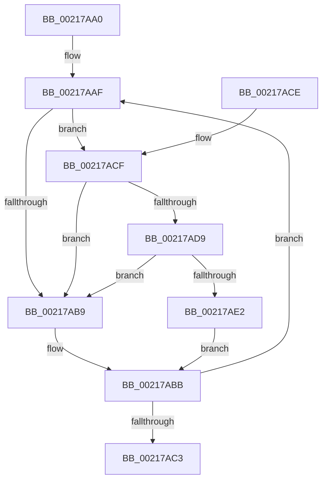

# KxWaitForLockChainValid

- RVA: `0x00217AA0`–`0x00217AEB` (길이 `75` bytes)
- VA: `0x0000000140217AA0`
- 실행 섹션: `.text`
- PDB 이름 있음: `예`; PDB Function 태그: `아니요`
- unwind 정보 RVA: `0x0005D394`
- 디코드: `26`개 명령, `75/75` bytes 표시
- 미해석 바이트: `0` (있으면 어셈블리에 `.byte`로 보존)

> 이 문서는 커널 이미지의 기계어와 PDB 기호를 분석해 생성했습니다. 4번과 5번은 함수 원형과 자료형을 바이너리 사용 방식에서 추정한 C 해석이며 원본 소스 복구 결과는 아닙니다.

## 1. Dependencies

- 직접 호출 지점: **2**; 고유 호출 대상: **2**
- 직접 호출자로 확인된 함수: **71**
- RIP 상대 이미지 참조: **2**

### Outgoing calls
- `0x00217AD9` → [KiCheckVpBackingLongSpinWaitHypercall](../30/KiCheckVpBackingLongSpinWaitHypercall_function_0030F490.md) (function, `0x0030F490`)
- `0x00217AE4` → [HvlNotifyLongSpinWait](../30/HvlNotifyLongSpinWait_function_0030F460.md) (function, `0x0030F460`)

### Direct callers
- [ExpAcquireFastResourceSharedSlow](ExpAcquireFastResourceSharedSlow_function_00211260.md) at `0x0021149E`
- [ExpAcquireResourceSharedLite](ExpAcquireResourceSharedLite_function_00212040.md) at `0x002121E0`
- [ExpAcquireResourceSharedLite](ExpAcquireResourceSharedLite_function_00212040.md) at `0x002125B9`
- [ExpAcquireResourceSharedLite](ExpAcquireResourceSharedLite_function_00212040.md) at `0x00212895`
- [sub_00213F4F](Unknown_function_00213F4F.md) at `0x00214164`
- [sub_00213F4F](Unknown_function_00213F4F.md) at `0x00214272`
- [sub_00214E58](Unknown_function_00214E58.md) at `0x00214F57`
- [sub_00215166](Unknown_function_00215166.md) at `0x002152BC`
- [sub_00215EFE](Unknown_function_00215EFE.md) at `0x00215F2F`
- [sub_00216F9F](Unknown_function_00216F9F.md) at `0x00216FE8`
- [sub_002171C2](Unknown_function_002171C2.md) at `0x002171E5`
- [KiReleaseThreadStateLock](KiReleaseThreadStateLock_function_00217910.md) at `0x002179A4`
- [KiReleaseQueuedSpinLockInstrumented](KiReleaseQueuedSpinLockInstrumented_function_002179F0.md) at `0x00217A3D`
- [sub_00218B2B](Unknown_function_00218B2B.md) at `0x00218CB0`
- [sub_0021BAB9](Unknown_function_0021BAB9.md) at `0x0021BC17`
- [KiQueueReadyThread](KiQueueReadyThread_function_0021C7B0.md) at `0x0021CD0C`
- [KiSetPriorityThread](../22/KiSetPriorityThread_function_00220E78.md) at `0x0022129D`
- [MiReacquireHigherPageTableLock](../23/MiReacquireHigherPageTableLock_function_00239650.md) at `0x002397F8`
- [IopCompleteIrpInFileObjectList](../24/IopCompleteIrpInFileObjectList_function_0024F330.md) at `0x0024F644`
- [sub_00254461](../25/Unknown_function_00254461.md) at `0x00254554`
- [KiSearchForNewThreadsForRescheduleContext](../25/KiSearchForNewThreadsForRescheduleContext_function_00258620.md) at `0x0025931C`
- [KiAttemptToScheduleThreadToBusyIsolationUnit](../25/KiAttemptToScheduleThreadToBusyIsolationUnit_function_00259B00.md) at `0x0025AE79`
- [sub_0025D903](../25/Unknown_function_0025D903.md) at `0x0025DB9D`
- [sub_0025D903](../25/Unknown_function_0025D903.md) at `0x0025DF56`
- [sub_0025D903](../25/Unknown_function_0025D903.md) at `0x0025E249`
- [sub_0025E5F6](../25/Unknown_function_0025E5F6.md) at `0x0025E649`
- [sub_0025FB5C](../25/Unknown_function_0025FB5C.md) at `0x0025FCE1`
- [sub_0025FB5C](../25/Unknown_function_0025FB5C.md) at `0x00260092`
- [sub_00260366](../26/Unknown_function_00260366.md) at `0x00260500`
- [sub_00260366](../26/Unknown_function_00260366.md) at `0x00260817`
- [ExReleaseFastResource](../26/ExReleaseFastResource_function_002613D0.md) at `0x0026175B`
- [sub_00261DFE](../26/Unknown_function_00261DFE.md) at `0x00261E86`
- [KiAbEntryRemoveFromTree](../26/KiAbEntryRemoveFromTree_function_00262410.md) at `0x00262638`
- [KiAbEntryRemoveFromTree](../26/KiAbEntryRemoveFromTree_function_00262410.md) at `0x002628DE`
- [sub_00262D5A](../26/Unknown_function_00262D5A.md) at `0x00262E69`
- [IopCheckVpbMounted](../27/IopCheckVpbMounted_function_00270540.md) at `0x00270614`
- [IopCheckVpbMounted](../27/IopCheckVpbMounted_function_00270540.md) at `0x0027075C`
- [IopDecrementDeviceObjectRef](../27/IopDecrementDeviceObjectRef_function_00270970.md) at `0x00270A37`
- [sub_0027256E](../27/Unknown_function_0027256E.md) at `0x00272591`
- [sub_00273F95](../27/Unknown_function_00273F95.md) at `0x0027411C`
- [sub_00273F95](../27/Unknown_function_00273F95.md) at `0x002744DE`
- [sub_0027475D](../27/Unknown_function_0027475D.md) at `0x002748FF`
- [sub_0027475D](../27/Unknown_function_0027475D.md) at `0x00274C53`
- [MiDeleteVaDirect](../27/MiDeleteVaDirect_function_00277560.md) at `0x00278395`
- [MiWalkPageTablesRecursively](../27/MiWalkPageTablesRecursively_function_002796C0.md) at `0x0027AF7F`
- [MiReleaseFaultState](../27/MiReleaseFaultState_function_0027D290.md) at `0x0027D4CC`
- [sub_0027D95C](../27/Unknown_function_0027D95C.md) at `0x0027DA48`
- [MiCaptureDeleteHierarchy](../27/MiCaptureDeleteHierarchy_function_0027F5F0.md) at `0x0027F9D1`
- [MiMakeSystemAddressValid](../27/MiMakeSystemAddressValid_function_0027FF70.md) at `0x00280748`
- [MiLockLowestValidPageTableEx](../28/MiLockLowestValidPageTableEx_function_00280D10.md) at `0x0028128D`
- [sub_00281DE9](../28/Unknown_function_00281DE9.md) at `0x0028209B`
- [sub_002822AC](../28/Unknown_function_002822AC.md) at `0x002823CE`
- [KiRescheduleThreadAfterAffinityChange](../30/KiRescheduleThreadAfterAffinityChange_function_0030C9E8.md) at `0x0030CC4A`
- [sub_0030E8E0](../30/Unknown_function_0030E8E0.md) at `0x0030EBE3`
- [sub_0030EE9F](../30/Unknown_function_0030EE9F.md) at `0x0030F113`
- [sub_0030F26B](../30/Unknown_function_0030F26B.md) at `0x0030F38D`
- [KiSearchForNewThreadsOnTarget](../30/KiSearchForNewThreadsOnTarget_function_0030F500.md) at `0x00310E3D`
- [sub_00341DB3](../34/Unknown_function_00341DB3.md) at `0x00341EA7`
- [sub_00342CED](../34/Unknown_function_00342CED.md) at `0x00342D1D`
- [PfpPartitionGetFirst](../34/PfpPartitionGetFirst_function_00342ED0.md) at `0x00342F89`
- [KiParkCurrentProcessor](../35/KiParkCurrentProcessor_function_003533A4.md) at `0x00353670`
- [KiJoinCooperativeIdleSearch](../35/KiJoinCooperativeIdleSearch_function_00353D1C.md) at `0x00353F24`
- [KiSendHeteroRescheduleIntRequestHelper](../35/KiSendHeteroRescheduleIntRequestHelper_function_0035420C.md) at `0x00354814`
- [KeQueryTotalCycleTimeThread](../37/KeQueryTotalCycleTimeThread_function_0037EF20.md) at `0x0037FAB5`
- [NtWaitForWorkViaWorkerFactory](../39/NtWaitForWorkViaWorkerFactory_function_00394270.md) at `0x003945C2`
- [NtWaitForWorkViaWorkerFactory](../39/NtWaitForWorkViaWorkerFactory_function_00394270.md) at `0x00394A73`
- [ExpAcquireFastResourceExclusiveSlow](../3B/ExpAcquireFastResourceExclusiveSlow_function_003BE2E0.md) at `0x003BE57D`
- [ExpAcquireFastResourceExclusiveSlow](../3B/ExpAcquireFastResourceExclusiveSlow_function_003BE2E0.md) at `0x003BE5ED`
- [KeQueryEffectivePriorityThread](../3C/KeQueryEffectivePriorityThread_function_003C7CA0.md) at `0x003C7EFC`
- [IopCheckDeviceAndDriver](../3F/IopCheckDeviceAndDriver_function_003FCBE0.md) at `0x003FCCBB`
- [AlpcpQueueIoCompletionPort](../3F/AlpcpQueueIoCompletionPort_function_003FF760.md) at `0x003FF854`
- [sub_0040EACB](../40/Unknown_function_0040EACB.md) at `0x0040EB64`
- [AlpcpLookasidePacketCallbackRoutine](../41/AlpcpLookasidePacketCallbackRoutine_function_00419D50.md) at `0x00419E35`
- [sub_0041B277](../41/Unknown_function_0041B277.md) at `0x0041B29B`
- [IopVerifyDeviceObjectOnStack](../41/IopVerifyDeviceObjectOnStack_function_0041B3B0.md) at `0x0041B4CC`
- [sub_0041D9E2](../41/Unknown_function_0041D9E2.md) at `0x0041DA05`
- [sub_00420EA4](../42/Unknown_function_00420EA4.md) at `0x00420EC7`
- [KiScanSharedReadyThreads](../46/KiScanSharedReadyThreads_function_0046F120.md) at `0x0046F247`
- [KiScanSharedReadyThreads](../46/KiScanSharedReadyThreads_function_0046F120.md) at `0x0046F37C`
- [KiScanSharedReadyThreads](../46/KiScanSharedReadyThreads_function_0046F120.md) at `0x0046F524`
- [KiLeaveCooperativeIdleSearch](../47/KiLeaveCooperativeIdleSearch_function_0047A010.md) at `0x0047A144`
- [KiLeaveCooperativeIdleSearch](../47/KiLeaveCooperativeIdleSearch_function_0047A010.md) at `0x0047A2B1`
- [KeTryToFreezeThreadStack](../4B/KeTryToFreezeThreadStack_function_004B5038.md) at `0x004B52B0`
- [KiDisarmForceParkDutyCyclingIfNecessary](../4F/KiDisarmForceParkDutyCyclingIfNecessary_function_004FA9E4.md) at `0x004FAAD3`
- [KiArmForceParkDutyCyclingForLocalReadyQueue](../4F/KiArmForceParkDutyCyclingForLocalReadyQueue_function_004FAB54.md) at `0x004FAC10`
- [KiAdjustUserIsolationDomainThread](../5C/KiAdjustUserIsolationDomainThread_function_005C3B54.md) at `0x005C3DFC`
- [KeAbCrossThreadDelete](../5C/KeAbCrossThreadDelete_function_005C517C.md) at `0x005C53FD`

### Static image references
- `0x00217AB1` → RVA `0x00FC52AC` (`ALMOSTRO`; reference)
- `0x00217ACF` → RVA `0x00FC6AB8` (`ALMOSTRO`; read)

## 2. Other-region calls and transfers

- 다른 실행 섹션으로 향하는 call: **0**
- 별도 외부 분기/꼬리 이동을 확인하지 못했습니다.

## 3. Assembly (complete function range)

```asm
00217AA0  48 89 5C 24 08                  mov qword ptr [rsp + 8], rbx
00217AA5  57                              push rdi
00217AA6  48 83 EC 20                     sub rsp, 0x20
00217AAA  48 8B F9                        mov rdi, rcx
00217AAD  33 DB                           xor ebx, ebx
00217AAF  FF C3                           inc ebx
00217AB1  85 1D F5 D7 DA 00               test dword ptr [rip + 0xdad7f5], ebx
00217AB7  74 16                           je 0x140217acf
00217AB9  F3 90                           pause
00217ABB  48 8B 07                        mov rax, qword ptr [rdi]
00217ABE  48 85 C0                        test rax, rax
00217AC1  74 EC                           je 0x140217aaf
00217AC3  48 8B 5C 24 30                  mov rbx, qword ptr [rsp + 0x30]
00217AC8  48 83 C4 20                     add rsp, 0x20
00217ACC  5F                              pop rdi
00217ACD  C3                              ret
00217ACE  CC                              int3
00217ACF  8B 05 E3 EF DA 00               mov eax, dword ptr [rip + 0xdaefe3]
00217AD5  A8 40                           test al, 0x40
00217AD7  74 E0                           je 0x140217ab9
00217AD9  E8 B2 79 0F 00                  call 0x14030f490
00217ADE  84 C0                           test al, al
00217AE0  74 D7                           je 0x140217ab9
00217AE2  8B CB                           mov ecx, ebx
00217AE4  E8 77 79 0F 00                  call 0x14030f460
00217AE9  EB D0                           jmp 0x140217abb
```

## 4. C-style interpretation (structured pseudocode)

```c
__int64 __fastcall KxWaitForLockChainValid(__int64 a1)
{
    __int64 result;
    __int64 v_rbx;
    __int64 v_rsp;
    unsigned __int64 v_stack_p8;

    v_stack_p8 = v_rbx;
    v_rsp = (v_rsp) - (32);
    v_rbx = 0;
loc_00217AAF:
    v_rbx = (unsigned int)((v_rbx) + 1);
    if (((*(unsigned int *)(v_rip + 14342133)) & ((unsigned int)(v_rbx))) == 0) goto loc_00217ACF;
loc_00217AB9:
loc_00217ABB:
    if (*(unsigned __int64 *)(a1) == 0) goto loc_00217AAF;
    v_rsp = (v_rsp) + (32);
    return *(unsigned __int64 *)(a1);
loc_00217ACF:
    if ((((unsigned __int8)((unsigned int)(*(unsigned int *)(v_rip + 14348259)))) & (64)) == 0) goto loc_00217AB9;
    result = KiCheckVpBackingLongSpinWaitHypercall(a1, a2, a3, a4);
    if ((unsigned __int8)(result) == 0) goto loc_00217AB9;
    result = HvlNotifyLongSpinWait((unsigned int)((unsigned int)(v_stack_p8)), a2, a3, a4);
    goto loc_00217ABB;
}
```

## 5. (Beta) C Style

```c
int64_t KxWaitForLockChainValid(void *Arg1)
{
    uint8_t *arg1 = (uint8_t *)Arg1;

    int64_t result;
    int64_t local_rbx;
    int64_t local_rsp;
    uint64_t v_stack_p8;

    v_stack_p8 = local_rbx;
    local_rsp = (local_rsp) - (32);
    local_rbx = 0;
loc_00217AAF:
    local_rbx = (uint32_t)((local_rbx) + 1);
    if (((*(uint32_t *)(v_rip + 0xDAD7F5)) & ((uint32_t)(local_rbx))) == 0) goto loc_00217ACF;
loc_00217AB9:
loc_00217ABB:
    if (*(uint64_t *)(arg1) == 0) goto loc_00217AAF;
    local_rsp = (local_rsp) + (32);
    return *(uint64_t *)(arg1);
loc_00217ACF:
    if ((((uint8_t)((uint32_t)(*(uint32_t *)(v_rip + 0xDAEFE3)))) & (64)) == 0) goto loc_00217AB9;
    result = KiCheckVpBackingLongSpinWaitHypercall(Arg1, a2, a3, a4);
    if ((uint8_t)(result) == 0) goto loc_00217AB9;
    result = HvlNotifyLongSpinWait((uint32_t)((uint32_t)(v_stack_p8)), a2, a3, a4);
    goto loc_00217ABB;
}
```

### 관측된 메모리 오프셋

구조체 형식이 확인되지 않은 접근은 인자 기준의 오프셋으로만 기록했습니다.

| 기준 인자 | 오프셋 표현 | 폭 (bit) | 접근 |
|---|---:|---:|---|
| `Arg1` | `+ 0x0` | `64` | `R` |

## 6. Execution-region graph

[열기: 2D/3D 그래프와 함수 탐색 컨트롤 패널](../../../control-panel.html?section=text&rva=0x00217AA0&view=graph)

- 2D 그래프는 위에서 아래로 흐르고, 3D 그래프는 빈 공간을 드래그해 회전합니다. Shift+드래그는 이동, 휠은 확대·축소, 함수 노드 선택은 대상 보고서 이동입니다.

### Static fallback


