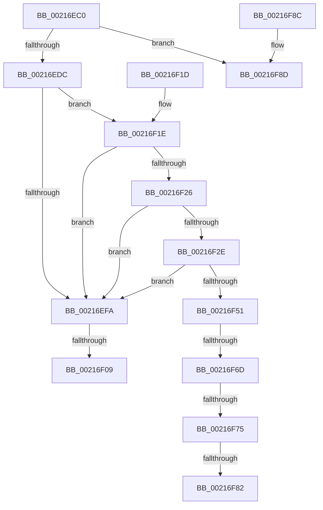

# MiUnlockPageTable

- RVA: `0x00216EC0`–`0x00216F9F` (길이 `223` bytes)
- VA: `0x0000000140216EC0`
- 실행 섹션: `.text`
- PDB 이름 있음: `예`; PDB Function 태그: `아니요`
- unwind 정보 RVA: `0x0005E4B0`
- 디코드: `51`개 명령, `223/223` bytes 표시
- 미해석 바이트: `0` (있으면 어셈블리에 `.byte`로 보존)

> 이 문서는 커널 이미지의 기계어와 PDB 기호를 분석해 생성했습니다. 4번과 5번은 함수 원형과 자료형을 바이너리 사용 방식에서 추정한 C 해석이며 원본 소스 복구 결과는 아닙니다.

## 1. Dependencies

- 직접 호출 지점: **0**; 고유 호출 대상: **0**
- 직접 호출자로 확인된 함수: **145**
- RIP 상대 이미지 참조: **1**

### Outgoing calls
- 직접 디코드된 call 명령이 없습니다.

### Direct callers
- [MiEncodeProtoFill](../22/MiEncodeProtoFill_function_0022F3B0.md) at `0x0022F46A`
- [MiEncodeProtoFill](../22/MiEncodeProtoFill_function_0022F3B0.md) at `0x0022F4C1`
- [MiReacquireHigherPageTableLock](../23/MiReacquireHigherPageTableLock_function_00239650.md) at `0x00239C82`
- [MiYieldPageTableWalk](../23/MiYieldPageTableWalk_function_00239D20.md) at `0x00239E74`
- [MiLockPageLeafPageTable](../23/MiLockPageLeafPageTable_function_0023D160.md) at `0x0023D2EF`
- [sub_0023F124](../23/Unknown_function_0023F124.md) at `0x0023F2FB`
- [MiUnlockNestedPageTableWritePte](../23/MiUnlockNestedPageTableWritePte_function_0023F4E4.md) at `0x0023F774`
- [MiWsleFlush](../23/MiWsleFlush_function_0023FB30.md) at `0x0023FD7F`
- [sub_0024359E](../24/Unknown_function_0024359E.md) at `0x002435A5`
- [MiWalkVaRange](../24/MiWalkVaRange_function_00243BF0.md) at `0x00244275`
- [MiWalkVaRange](../24/MiWalkVaRange_function_00243BF0.md) at `0x00244A27`
- [MmProtectPool](../26/MmProtectPool_function_002697AC.md) at `0x00269A78`
- [MmProtectPool](../26/MmProtectPool_function_002697AC.md) at `0x00269E18`
- [MmProtectPool](../26/MmProtectPool_function_002697AC.md) at `0x00269EE4`
- [sub_002762C2](../27/Unknown_function_002762C2.md) at `0x002762C5`
- [MiFastLockLeafPageTable](../27/MiFastLockLeafPageTable_function_00276340.md) at `0x00277376`
- [MiDeleteVaDirect](../27/MiDeleteVaDirect_function_00277560.md) at `0x0027880A`
- [MiDeleteVaDirect](../27/MiDeleteVaDirect_function_00277560.md) at `0x0027886E`
- [MiDeleteVa](../27/MiDeleteVa_function_002789E0.md) at `0x00278E38`
- [MiDecommitPagesTail](../27/MiDecommitPagesTail_function_002790FC.md) at `0x002791CB`
- [MiWalkPageTablesRecursively](../27/MiWalkPageTablesRecursively_function_002796C0.md) at `0x0027B5FE`
- [sub_0027BF19](../27/Unknown_function_0027BF19.md) at `0x0027BF81`
- [MiMakeHyperRangeAccessible](../27/MiMakeHyperRangeAccessible_function_0027CE10.md) at `0x0027D22D`
- [MiMakeHyperRangeAccessible](../27/MiMakeHyperRangeAccessible_function_0027CE10.md) at `0x0027D253`
- [sub_0027E69B](../27/Unknown_function_0027E69B.md) at `0x0027E7E5`
- [MiMakeSystemAddressValid](../27/MiMakeSystemAddressValid_function_0027FF70.md) at `0x00280A55`
- [MiClearPteAccessed](../29/MiClearPteAccessed_function_00290630.md) at `0x00290868`
- [MiSetVaAgeList](../29/MiSetVaAgeList_function_00290A20.md) at `0x00291452`
- [MiSetVaAgeList](../29/MiSetVaAgeList_function_00290A20.md) at `0x00291652`
- [MiSetReadOnlyOnSectionView](../29/MiSetReadOnlyOnSectionView_function_00294538.md) at `0x0029475D`
- [MiSetReadOnlyOnSectionView](../29/MiSetReadOnlyOnSectionView_function_00294538.md) at `0x00294874`
- [MiSwapStackPage](../29/MiSwapStackPage_function_0029FDE0.md) at `0x002A009D`
- [MiSwapStackPage](../29/MiSwapStackPage_function_0029FDE0.md) at `0x002A0214`
- [MiOutPageSingleKernelStack](../2A/MiOutPageSingleKernelStack_function_002A1790.md) at `0x002A1AC8`
- [MiOutPageSingleKernelStack](../2A/MiOutPageSingleKernelStack_function_002A1790.md) at `0x002A1AD3`
- [MiAllocateKernelStackPages](../2A/MiAllocateKernelStackPages_function_002A1BEC.md) at `0x002A2034`
- [MiAllocateKernelStackPages](../2A/MiAllocateKernelStackPages_function_002A1BEC.md) at `0x002A208A`
- [MiUnlockCodePage](../2A/MiUnlockCodePage_function_002A2AB8.md) at `0x002A2BE2`
- [MiUnlockCodePage](../2A/MiUnlockCodePage_function_002A2AB8.md) at `0x002A2C7E`
- [MiInsertViewOfPhysicalSection](../2A/MiInsertViewOfPhysicalSection_function_002A57E0.md) at `0x002A591F`
- [MiInsertViewOfPhysicalSection](../2A/MiInsertViewOfPhysicalSection_function_002A57E0.md) at `0x002A5967`
- [MiInsertViewOfPhysicalSection](../2A/MiInsertViewOfPhysicalSection_function_002A57E0.md) at `0x002A59A1`
- [MiSplitPrivatePage](../2A/MiSplitPrivatePage_function_002A6210.md) at `0x002A6394`
- [MiSplitPrivatePage](../2A/MiSplitPrivatePage_function_002A6210.md) at `0x002A6415`
- [MiSplitPrivatePage](../2A/MiSplitPrivatePage_function_002A6210.md) at `0x002A64EE`
- [MiSplitPrivatePage](../2A/MiSplitPrivatePage_function_002A6210.md) at `0x002A662C`
- [MiSplitPrivatePage](../2A/MiSplitPrivatePage_function_002A6210.md) at `0x002A66E2`
- [MiMakeProtoLeafValid](../2A/MiMakeProtoLeafValid_function_002A6710.md) at `0x002A67A4`
- [NtGetWriteWatch](../2A/NtGetWriteWatch_function_002A7CE0.md) at `0x002A854A`
- [MiMoveDirtyBitsToPfns](../2A/MiMoveDirtyBitsToPfns_function_002A8624.md) at `0x002A890F`
- [MiMoveDirtyBitsToPfns](../2A/MiMoveDirtyBitsToPfns_function_002A8624.md) at `0x002A8A5D`
- [MiUnlockOpportunisticPagesInPageTable](../2A/MiUnlockOpportunisticPagesInPageTable_function_002AA88C.md) at `0x002AAACA`
- [MiReplaceRotateWithDemandZeroNoCopy](../2A/MiReplaceRotateWithDemandZeroNoCopy_function_002AAB04.md) at `0x002AAD97`
- [MiFastTrimWorkingSet](../2A/MiFastTrimWorkingSet_function_002AD420.md) at `0x002AD5EC`
- [MiFastTrimWorkingSet](../2A/MiFastTrimWorkingSet_function_002AD420.md) at `0x002AD6D2`
- [MiMapLockedPagesInUserSpaceHelper](../2A/MiMapLockedPagesInUserSpaceHelper_function_002ADFE0.md) at `0x002AE12E`
- [MiMapLockedPagesInUserSpaceHelper](../2A/MiMapLockedPagesInUserSpaceHelper_function_002ADFE0.md) at `0x002AE189`
- [MiMapLockedPagesInUserSpaceHelper](../2A/MiMapLockedPagesInUserSpaceHelper_function_002ADFE0.md) at `0x002AE1AE`
- [MiWorkingSetInfoCheckPageTable](../2A/MiWorkingSetInfoCheckPageTable_function_002AEFCC.md) at `0x002AF04A`
- [MiWorkingSetInfoCheckPageTable](../2A/MiWorkingSetInfoCheckPageTable_function_002AEFCC.md) at `0x002AF079`
- [MiGetWorkingSetInfoList](../2A/MiGetWorkingSetInfoList_function_002AF770.md) at `0x002AFC2C`
- [MiGetWorkingSetInfoList](../2A/MiGetWorkingSetInfoList_function_002AF770.md) at `0x002AFF48`
- [MiGetWorkingSetInfoList](../2A/MiGetWorkingSetInfoList_function_002AF770.md) at `0x002B0496`
- [MiGetWorkingSetInfoList](../2A/MiGetWorkingSetInfoList_function_002AF770.md) at `0x002B0826`
- [MiGetWorkingSetInfoList](../2A/MiGetWorkingSetInfoList_function_002AF770.md) at `0x002B09DB`
- [MiGetWorkingSetInfoList](../2A/MiGetWorkingSetInfoList_function_002AF770.md) at `0x002B0B2B`
- [MiIsCfgBitMapPageShared](../2C/MiIsCfgBitMapPageShared_function_002C1200.md) at `0x002C12B6`
- [MiClearNonPagedPtes](../2C/MiClearNonPagedPtes_function_002C17A0.md) at `0x002C1A23`
- [MiEvictPageTableLock](../2C/MiEvictPageTableLock_function_002C1FBC.md) at `0x002C20C6`
- [MiCountSharedPages](../2C/MiCountSharedPages_function_002C30A4.md) at `0x002C320B`
- [MiCountSharedPages](../2C/MiCountSharedPages_function_002C30A4.md) at `0x002C3335`
- [sub_002C3A7C](../2C/Unknown_function_002C3A7C.md) at `0x002C3DDC`
- [sub_002C3A7C](../2C/Unknown_function_002C3A7C.md) at `0x002C3FA4`
- [sub_002C3A7C](../2C/Unknown_function_002C3A7C.md) at `0x002C43D2`
- [MiProtectPrivateMemory](../2C/MiProtectPrivateMemory_function_002C45B0.md) at `0x002C4AED`
- [MiProtectPrivateMemory](../2C/MiProtectPrivateMemory_function_002C45B0.md) at `0x002C4B9D`
- [MiProtectPrivateMemory](../2C/MiProtectPrivateMemory_function_002C45B0.md) at `0x002C4D47`
- [MiComputePageCommitment](../2C/MiComputePageCommitment_function_002C5C34.md) at `0x002C5E0E`
- [MiMakeProtoPrivate](../2C/MiMakeProtoPrivate_function_002C64A4.md) at `0x002C65D0`
- [MiTrimSharedPageFromViews](../2E/MiTrimSharedPageFromViews_function_002E16F8.md) at `0x002E1AB8`
- [MiTrimSharedPageFromViews](../2E/MiTrimSharedPageFromViews_function_002E16F8.md) at `0x002E2195`
- [MiSharePages](../31/MiSharePages_function_00315110.md) at `0x00315729`
- [MiSharePages](../31/MiSharePages_function_00315110.md) at `0x00315796`
- [MiLockPoolCommitPageTable](../32/MiLockPoolCommitPageTable_function_00328BAC.md) at `0x00328CDB`
- [MiCommitPoolMemory](../32/MiCommitPoolMemory_function_00329520.md) at `0x0032962A`
- [MiUnlockPoolCommitWs](../32/MiUnlockPoolCommitWs_function_003297DC.md) at `0x003297F6`
- [MiCommitExistingVad](../32/MiCommitExistingVad_function_0032A860.md) at `0x0032AE02`
- [MiCommitExistingVad](../32/MiCommitExistingVad_function_0032A860.md) at `0x0032AFDC`
- [MiCommitExistingVad](../32/MiCommitExistingVad_function_0032A860.md) at `0x0032B02B`
- [MiQueryAddressState](../32/MiQueryAddressState_function_0032C380.md) at `0x0032CA43`
- [MiQueryAddressState](../32/MiQueryAddressState_function_0032C380.md) at `0x0032CBE1`
- [MiQueryAddressState](../32/MiQueryAddressState_function_0032C380.md) at `0x0032CF9F`
- [MiQueryAddressState](../32/MiQueryAddressState_function_0032C380.md) at `0x0032D3D4`
- [MiQueryAddressState](../32/MiQueryAddressState_function_0032C380.md) at `0x0032D56C`
- [sub_0034512B](../34/Unknown_function_0034512B.md) at `0x003451AB`
- [MiSoftFaultMappedView](../36/MiSoftFaultMappedView_function_00365364.md) at `0x003656FE`
- [MiSoftFaultMappedView](../36/MiSoftFaultMappedView_function_00365364.md) at `0x003657FA`
- [MiCommitEnclavePages](../36/MiCommitEnclavePages_function_00367CCC.md) at `0x00367E60`
- [MiCommitEnclavePages](../36/MiCommitEnclavePages_function_00367CCC.md) at `0x00367ED2`
- [MiAddPagesToEnclave](../36/MiAddPagesToEnclave_function_00367EEC.md) at `0x0036802C`
- [MiAddPagesToEnclave](../36/MiAddPagesToEnclave_function_00367EEC.md) at `0x00368259`
- [MiAddPagesToEnclave](../36/MiAddPagesToEnclave_function_00367EEC.md) at `0x00368288`
- [MiWriteEnclavePte](../36/MiWriteEnclavePte_function_00368570.md) at `0x00368672`
- [MiDecommitHardwareEnclavePages](../36/MiDecommitHardwareEnclavePages_function_003688D4.md) at `0x00368C43`
- [MiRelockFaultState](../36/MiRelockFaultState_function_0036A230.md) at `0x0036A2C7`
- [MiLockCode](../36/MiLockCode_function_0036F91C.md) at `0x0036FC51`
- [MiLockCode](../36/MiLockCode_function_0036F91C.md) at `0x0036FCF2`
- [MiLockCode](../36/MiLockCode_function_0036F91C.md) at `0x0036FD48`
- [MiLockCode](../36/MiLockCode_function_0036F91C.md) at `0x00370016`
- [MiLockCode](../36/MiLockCode_function_0036F91C.md) at `0x003700AF`
- [MiSetSystemCodeProtection](../38/MiSetSystemCodeProtection_function_00384420.md) at `0x00384700`
- [MiSetSystemCodeProtection](../38/MiSetSystemCodeProtection_function_00384420.md) at `0x00384802`
- [MiMakeDriverPagesPrivate](../38/MiMakeDriverPagesPrivate_function_00384C60.md) at `0x00384D90`
- [MiMakeDriverPagesPrivate](../38/MiMakeDriverPagesPrivate_function_00384C60.md) at `0x00384E1E`
- [MiMakeDriverPagesPrivate](../38/MiMakeDriverPagesPrivate_function_00384C60.md) at `0x00384EFF`
- [MiMakeDriverPagesPrivate](../38/MiMakeDriverPagesPrivate_function_00384C60.md) at `0x00384F6B`
- [MiCopyToUserVa](../3D/MiCopyToUserVa_function_003D1E68.md) at `0x003D200E`
- [MiCopyToUserVa](../3D/MiCopyToUserVa_function_003D1E68.md) at `0x003D2044`
- [MiCopyToUserVa](../3D/MiCopyToUserVa_function_003D1E68.md) at `0x003D20DE`
- [MiMapUserLargePages](../3D/MiMapUserLargePages_function_003D26F4.md) at `0x003D2C8A`
- [MiMapUserLargePages](../3D/MiMapUserLargePages_function_003D26F4.md) at `0x003D2D5B`
- [MiUnmapMdlCommon](../3E/MiUnmapMdlCommon_function_003E7DF0.md) at `0x003E7FD4`
- [MiUnmapMdlCommon](../3E/MiUnmapMdlCommon_function_003E7DF0.md) at `0x003E81E4`
- [MiUnmapMdlCommon](../3E/MiUnmapMdlCommon_function_003E7DF0.md) at `0x003E831B`
- [MiUnmapMdlCommon](../3E/MiUnmapMdlCommon_function_003E7DF0.md) at `0x003E8436`
- [MiUnlockPageTableRange](../40/MiUnlockPageTableRange_function_00407E44.md) at `0x00407F10`
- [NtLockVirtualMemory](../40/NtLockVirtualMemory_function_004088A0.md) at `0x00408B28`
- [NtLockVirtualMemory](../40/NtLockVirtualMemory_function_004088A0.md) at `0x00408D4B`
- [NtLockVirtualMemory](../40/NtLockVirtualMemory_function_004088A0.md) at `0x00408E3E`
- [NtLockVirtualMemory](../40/NtLockVirtualMemory_function_004088A0.md) at `0x00408FBB`
- [NtLockVirtualMemory](../40/NtLockVirtualMemory_function_004088A0.md) at `0x0040902F`
- [NtLockVirtualMemory](../40/NtLockVirtualMemory_function_004088A0.md) at `0x004090B2`
- [NtLockVirtualMemory](../40/NtLockVirtualMemory_function_004088A0.md) at `0x0040930C`
- [NtLockVirtualMemory](../40/NtLockVirtualMemory_function_004088A0.md) at `0x0040932F`
- [MiDeprioritizeVirtualAddresses](../42/MiDeprioritizeVirtualAddresses_function_0042AD1C.md) at `0x0042ADE4`
- [MiDeprioritizeVirtualAddresses](../42/MiDeprioritizeVirtualAddresses_function_0042AD1C.md) at `0x0042AEDF`
- [sub_0044565B](../44/Unknown_function_0044565B.md) at `0x00445805`
- [MiUpdateImportRelocationsOnDriverPrivatePages](../44/MiUpdateImportRelocationsOnDriverPrivatePages_function_00449BCC.md) at `0x00449CE2`
- [MiUpdateImportRelocationsOnDriverPrivatePages](../44/MiUpdateImportRelocationsOnDriverPrivatePages_function_00449BCC.md) at `0x00449D80`
- [MiUpdateImportRelocationsOnDriverPrivatePages](../44/MiUpdateImportRelocationsOnDriverPrivatePages_function_00449BCC.md) at `0x00449E71`
- [MiCreateSystemPageTable](../45/MiCreateSystemPageTable_function_004518D0.md) at `0x00451BC5`
- [MiFillHyperPtes](../46/MiFillHyperPtes_function_004644AC.md) at `0x004645F5`
- [MiDeleteEmptyPageTableWorker](../47/MiDeleteEmptyPageTableWorker_function_0047FE18.md) at `0x0047FEEC`
- [MiLockPagedAddress](../48/MiLockPagedAddress_function_00484CDC.md) at `0x00484E22`
- [MiLockPagedAddress](../48/MiLockPagedAddress_function_00484CDC.md) at `0x00484E58`
- [MiConvertAndFlushWsleVas](../49/MiConvertAndFlushWsleVas_function_00492CB4.md) at `0x00492E57`
- [MmUpdateUserShadowStackValue](../49/MmUpdateUserShadowStackValue_function_004935D8.md) at `0x00493711`
- [MmUpdateUserShadowStackValue](../49/MmUpdateUserShadowStackValue_function_004935D8.md) at `0x00493857`
- [MiDeleteShadowStackPtes](../49/MiDeleteShadowStackPtes_function_00493AE4.md) at `0x00493C27`
- [MiGetWsAndMakePageTablesNx](../49/MiGetWsAndMakePageTablesNx_function_00494240.md) at `0x004942C8`
- [MiLockPageTableRange](../49/MiLockPageTableRange_function_0049A850.md) at `0x0049A95D`
- [MiReleaseLargePdeMappings](../49/MiReleaseLargePdeMappings_function_0049D0B0.md) at `0x0049D2A8`
- [MiReleaseLargePdeMappings](../49/MiReleaseLargePdeMappings_function_0049D0B0.md) at `0x0049D385`
- [MiSetPagesModified](../49/MiSetPagesModified_function_0049DC2C.md) at `0x0049DF32`
- [MiSetPagesModified](../49/MiSetPagesModified_function_0049DC2C.md) at `0x0049DFE2`
- [MiSetPagingOfDriver](../4A/MiSetPagingOfDriver_function_004A76C4.md) at `0x004A78D4`
- [MiSetPagingOfDriver](../4A/MiSetPagingOfDriver_function_004A76C4.md) at `0x004A797B`
- [MiUnmapKernelScp](../4A/MiUnmapKernelScp_function_004A82E8.md) at `0x004A84D7`
- [MiBuildForkPageTable](../4A/MiBuildForkPageTable_function_004ACF5C.md) at `0x004AD17C`
- [MiInitializeWorkingSetList](../4A/MiInitializeWorkingSetList_function_004AE640.md) at `0x004AE773`
- [MiFaultInPagedPool](../4B/MiFaultInPagedPool_function_004B3BC0.md) at `0x004B3C42`
- [MiAdjustSecureDriverStateForIatCapture](../4B/MiAdjustSecureDriverStateForIatCapture_function_004BE864.md) at `0x004BE98A`
- [MiAdjustSecureDriverStateForIatCapture](../4B/MiAdjustSecureDriverStateForIatCapture_function_004BE864.md) at `0x004BEA92`
- [MiSwitchToTransition](../4C/MiSwitchToTransition_function_004C0F5C.md) at `0x004C122A`
- [MiSwitchToTransition](../4C/MiSwitchToTransition_function_004C0F5C.md) at `0x004C15F5`
- [MiWriteAwePtes](../4C/MiWriteAwePtes_function_004C51E0.md) at `0x004C572E`
- [MiUpdatePrivateDemandZeroView](../4C/MiUpdatePrivateDemandZeroView_function_004CCC2C.md) at `0x004CCE5F`
- [MiUpdatePrivateDemandZeroView](../4C/MiUpdatePrivateDemandZeroView_function_004CCC2C.md) at `0x004CCF0F`
- [MiProtectAweRegion](../4C/MiProtectAweRegion_function_004CE62C.md) at `0x004CE9D8`
- [MiProtectAweRegion](../4C/MiProtectAweRegion_function_004CE62C.md) at `0x004CEDF6`
- [MiZeroAndFlushGoodCitizen](../4D/MiZeroAndFlushGoodCitizen_function_004D0828.md) at `0x004D08DC`
- [MiMapMdlWithLargePages](../4D/MiMapMdlWithLargePages_function_004D10B8.md) at `0x004D1488`
- [MiFinishPageTableForLargePage](../4D/MiFinishPageTableForLargePage_function_004D3D4C.md) at `0x004D3E47`
- [MiProtectEnclavePages](../4D/MiProtectEnclavePages_function_004D5528.md) at `0x004D57ED`
- [MiProtectEnclavePages](../4D/MiProtectEnclavePages_function_004D5528.md) at `0x004D5843`
- [MiProtectEnclavePages](../4D/MiProtectEnclavePages_function_004D5528.md) at `0x004D5A38`
- [MiVadRangeIsIoSpace](../4D/MiVadRangeIsIoSpace_function_004D5CD4.md) at `0x004D5D87`
- [MiVadRangeIsIoSpace](../4D/MiVadRangeIsIoSpace_function_004D5CD4.md) at `0x004D5E1D`
- [MiVadRangeIsIoSpace](../4D/MiVadRangeIsIoSpace_function_004D5CD4.md) at `0x004D5E56`
- [MiMapKernelScp](../4D/MiMapKernelScp_function_004DCAD4.md) at `0x004DCBF7`
- [MiMapKernelScp](../4D/MiMapKernelScp_function_004DCAD4.md) at `0x004DCD67`
- [MiMakeSystemLeavesNonZero](../4E/MiMakeSystemLeavesNonZero_function_004E26C0.md) at `0x004E2795`
- [MiQueryImageExtensionInformation](../4E/MiQueryImageExtensionInformation_function_004EE3C8.md) at `0x004EE5BE`
- [MiFinishPteChangesInPageTable](../4E/MiFinishPteChangesInPageTable_function_004EE660.md) at `0x004EE71B`
- [NtUnlockVirtualMemory](../4E/NtUnlockVirtualMemory_function_004EE890.md) at `0x004EEA45`
- [NtUnlockVirtualMemory](../4E/NtUnlockVirtualMemory_function_004EE890.md) at `0x004EEB50`
- [NtUnlockVirtualMemory](../4E/NtUnlockVirtualMemory_function_004EE890.md) at `0x004EEB7B`
- [NtUnlockVirtualMemory](../4E/NtUnlockVirtualMemory_function_004EE890.md) at `0x004EED37`
- [NtUnlockVirtualMemory](../4E/NtUnlockVirtualMemory_function_004EE890.md) at `0x004EEE1F`
- [NtUnlockVirtualMemory](../4E/NtUnlockVirtualMemory_function_004EE890.md) at `0x004EEE84`
- [NtUnlockVirtualMemory](../4E/NtUnlockVirtualMemory_function_004EE890.md) at `0x004EEEBE`
- [MiDeleteBootRange](../66/MiDeleteBootRange_function_0066E450.md) at `0x0066E53A`
- [MiDeleteBootRange](../66/MiDeleteBootRange_function_0066E450.md) at `0x0066E57A`
- [MiDeleteBootRange](../66/MiDeleteBootRange_function_0066E450.md) at `0x0066E5FE`
- [MiDeleteBootRange](../66/MiDeleteBootRange_function_0066E450.md) at `0x0066E61D`
- [MiDeleteBootRange](../66/MiDeleteBootRange_function_0066E450.md) at `0x0066E68E`
- [MiPageBootRegistry](../66/MiPageBootRegistry_function_0066E82C.md) at `0x0066E9B9`
- [MiPageBootRegistry](../66/MiPageBootRegistry_function_0066E82C.md) at `0x0066EAD4`
- [MiCheckCommitReleaseFromVad](../66/MiCheckCommitReleaseFromVad_function_0066EB90.md) at `0x0066EF08`
- [MiLockDriverPageRange](../67/MiLockDriverPageRange_function_00670160.md) at `0x00670289`
- [MiLockDriverPageRange](../67/MiLockDriverPageRange_function_00670160.md) at `0x006704CC`
- [MiLockDriverPageRange](../67/MiLockDriverPageRange_function_00670160.md) at `0x0067050B`
- [MiLockDriverPageRange](../67/MiLockDriverPageRange_function_00670160.md) at `0x00670577`
- [MiLockDriverPageRange](../67/MiLockDriverPageRange_function_00670160.md) at `0x00670682`
- [MiReplaceImportEntry](../67/MiReplaceImportEntry_function_00671440.md) at `0x00671538`
- [MiReplaceImportEntry](../67/MiReplaceImportEntry_function_00671440.md) at `0x006715C2`
- [MiReplaceImportEntry](../67/MiReplaceImportEntry_function_00671440.md) at `0x006715FD`
- [MiReplaceImportEntry](../67/MiReplaceImportEntry_function_00671440.md) at `0x006716D5`
- [MiGetNextNonGapPfnPage](../67/MiGetNextNonGapPfnPage_function_006728D8.md) at `0x006729CB`
- [MiGetNextNonGapPfnPage](../67/MiGetNextNonGapPfnPage_function_006728D8.md) at `0x00672ADF`
- [MiMapMdlCommon](../67/MiMapMdlCommon_function_00674524.md) at `0x00674940`
- [MiMapMdlCommon](../67/MiMapMdlCommon_function_00674524.md) at `0x00674B22`
- [MiSetPageProtection](../67/MiSetPageProtection_function_00674BDC.md) at `0x00674CCA`
- [MiSetPageProtection](../67/MiSetPageProtection_function_00674BDC.md) at `0x00674E0F`
- [MiSetGraphicsPtes](../67/MiSetGraphicsPtes_function_00678554.md) at `0x006786BA`
- [MiSetGraphicsPtes](../67/MiSetGraphicsPtes_function_00678554.md) at `0x00678709`
- [MiClearDriverTablePtes](../68/MiClearDriverTablePtes_function_00683024.md) at `0x00683102`
- [MiClearDriverTablePtes](../68/MiClearDriverTablePtes_function_00683024.md) at `0x006833F8`
- [MiCommitHotPatchTable](../68/MiCommitHotPatchTable_function_00683420.md) at `0x0068353F`
- [MiCommitHotPatchTable](../68/MiCommitHotPatchTable_function_00683420.md) at `0x006835C3`
- [MiPrepareImagePagesForHotPatch](../68/MiPrepareImagePagesForHotPatch_function_00683800.md) at `0x0068391E`
- [MiPrepareImagePagesForHotPatch](../68/MiPrepareImagePagesForHotPatch_function_00683800.md) at `0x00683980`
- [MiPrepareImagePagesForHotPatch](../68/MiPrepareImagePagesForHotPatch_function_00683800.md) at `0x00683A6D`
- [MiPrepareImagePagesForHotPatch](../68/MiPrepareImagePagesForHotPatch_function_00683800.md) at `0x00683AC4`
- [MiPrepareImagePagesForHotPatch](../68/MiPrepareImagePagesForHotPatch_function_00683800.md) at `0x00683B4B`
- [MmMapDriverTablePage](../68/MmMapDriverTablePage_function_00683EAC.md) at `0x00684105`
- [MiQueryImageExtensionInformationOld](../68/MiQueryImageExtensionInformationOld_function_00687384.md) at `0x00687536`
- [MiQueryVaPhysicalContiguity](../68/MiQueryVaPhysicalContiguity_function_006875B8.md) at `0x0068769C`
- [MiQueryVaPhysicalContiguity](../68/MiQueryVaPhysicalContiguity_function_006875B8.md) at `0x006878DF`
- [MiQueryVaPhysicalContiguity](../68/MiQueryVaPhysicalContiguity_function_006875B8.md) at `0x00687921`
- [MiUnmapLegacyAwePage](../68/MiUnmapLegacyAwePage_function_0068993C.md) at `0x00689A0E`
- [MiStoreDiscardPoisonedPage](../69/MiStoreDiscardPoisonedPage_function_00692858.md) at `0x00692CD7`
- [MmStoreIsVirtualAddressPoisoned](../69/MmStoreIsVirtualAddressPoisoned_function_00693120.md) at `0x006931D4`
- [MiMakeVaRangePhysicallyContiguous](../69/MiMakeVaRangePhysicallyContiguous_function_006936E0.md) at `0x0069378B`
- [MiMakeVaRangePhysicallyContiguous](../69/MiMakeVaRangePhysicallyContiguous_function_006936E0.md) at `0x0069391C`
- [MiMakeVaRangePhysicallyContiguous](../69/MiMakeVaRangePhysicallyContiguous_function_006936E0.md) at `0x00693976`
- [MiScrubLargeMappedPage](../69/MiScrubLargeMappedPage_function_00693E2C.md) at `0x00694293`
- [MiScrubLargeMappedPage](../69/MiScrubLargeMappedPage_function_00693E2C.md) at `0x006942B9`
- [MiComputeIdealLargePage](../69/MiComputeIdealLargePage_function_006987C0.md) at `0x006989F9`
- [sub_006D9212](../6D/Unknown_function_006D9212.md) at `0x006D9218`
- [sub_006D9212](../6D/Unknown_function_006D9212.md) at `0x006D94BC`
- [sub_006DA600](../6D/Unknown_function_006DA600.md) at `0x006DA644`
- [sub_006DAAE6](../6D/Unknown_function_006DAAE6.md) at `0x006DAC15`
- [sub_006DAAE6](../6D/Unknown_function_006DAAE6.md) at `0x006DAC64`
- [sub_006DAFCA](../6D/Unknown_function_006DAFCA.md) at `0x006DAFE8`
- [sub_006DB1E0](../6D/Unknown_function_006DB1E0.md) at `0x006DB25B`
- [sub_006E1C8E](../6E/Unknown_function_006E1C8E.md) at `0x006E1D27`
- [sub_006E33B0](../6E/Unknown_function_006E33B0.md) at `0x006E3408`
- [sub_006E35D2](../6E/Unknown_function_006E35D2.md) at `0x006E35DD`
- [sub_006E35FC](../6E/Unknown_function_006E35FC.md) at `0x006E3607`
- [sub_006E362E](../6E/Unknown_function_006E362E.md) at `0x006E36B8`
- [sub_006E362E](../6E/Unknown_function_006E362E.md) at `0x006E36EF`
- [sub_006E362E](../6E/Unknown_function_006E362E.md) at `0x006E37EF`
- [sub_006E3CBA](../6E/Unknown_function_006E3CBA.md) at `0x006E3CCF`
- [sub_006E3CBA](../6E/Unknown_function_006E3CBA.md) at `0x006E3D11`
- [sub_006E49E8](../6E/Unknown_function_006E49E8.md) at `0x006E49F2`
- [sub_006E94B4](../6E/Unknown_function_006E94B4.md) at `0x006E9521`
- [sub_006EE306](../6E/Unknown_function_006EE306.md) at `0x006EE30C`
- [sub_006F0B5A](../6F/Unknown_function_006F0B5A.md) at `0x006F0B60`
- [sub_006F15CE](../6F/Unknown_function_006F15CE.md) at `0x006F16EA`
- [sub_006F541A](../6F/Unknown_function_006F541A.md) at `0x006F544B`
- [sub_006F60F8](../6F/Unknown_function_006F60F8.md) at `0x006F6260`
- [sub_006F730C](../6F/Unknown_function_006F730C.md) at `0x006F7312`
- [sub_006F9C66](../6F/Unknown_function_006F9C66.md) at `0x006F9C70`
- [MiProtectLargeKernelHalRange](../../page/7F/MiProtectLargeKernelHalRange_function_007F8D20.md) at `0x007F8DC0`
- [MiProtectLargeKernelHalRange](../../page/7F/MiProtectLargeKernelHalRange_function_007F8D20.md) at `0x007F8E80`
- [MiMarkBootKernelStack](../../init/C6/MiMarkBootKernelStack_function_00C68244.md) at `0x00C682B9`
- [MiMarkBootKernelStack](../../init/C6/MiMarkBootKernelStack_function_00C68244.md) at `0x00C683F2`

### Static image references
- `0x00216F75` → RVA `0x00FC6B06` (`ALMOSTRO`; read)

## 2. Other-region calls and transfers

- 다른 실행 섹션으로 향하는 call: **0**
- call이 아닌 외부 분기/꼬리 이동: **4**
  - `0x00216F03` → [sub_00217060](Unknown_function_00217060.md) (`tail-transfer`)
  - `0x00216F67` → [sub_002170E2](Unknown_function_002170E2.md) (`tail-transfer`)
  - `0x00216F6F` → [sub_00217146](Unknown_function_00217146.md) (`tail-transfer`)
  - `0x00216F7C` → [sub_00217146 + 0x1C](Unknown_function_00217146.md) (`tail-transfer`)

## 3. Assembly (complete function range)

```asm
00216EC0  40 53                           push rbx
00216EC2  48 83 EC 30                     sub rsp, 0x30
00216EC6  4C 8B C9                        mov r9, rcx
00216EC9  48 B8 68 DF BE 7D FB F6 FF FF   movabs rax, 0xfffff6fb7dbedf68
00216ED3  48 3B D0                        cmp rdx, rax
00216ED6  0F 84 B1 00 00 00               je 0x140216f8d
00216EDC  8B 81 B8 00 00 00               mov eax, dword ptr [rcx + 0xb8]
00216EE2  49 B8 00 D0 BE 7D FB F6 FF FF   movabs r8, 0xfffff6fb7dbed000
00216EEC  49 BA FF DF BE 7D FB F6 FF FF   movabs r10, 0xfffff6fb7dbedfff
00216EF6  A8 0F                           test al, 0xf
00216EF8  74 24                           je 0x140216f1e
00216EFA  41 8B 81 B8 00 00 00            mov eax, dword ptr [r9 + 0xb8]
00216F01  A8 0F                           test al, 0xf
00216F03  0F 85 57 01 00 00               jne 0x140217060
00216F09  48 B8 FF FF FF FF FF FF FF CF   movabs rax, 0xcfffffffffffffff
00216F13  F0 48 21 02                     lock and qword ptr [rdx], rax
00216F17  48 83 C4 30                     add rsp, 0x30
00216F1B  5B                              pop rbx
00216F1C  C3                              ret
00216F1D  CC                              int3
00216F1E  49 8B C0                        mov rax, r8
00216F21  48 3B D0                        cmp rdx, rax
00216F24  72 D4                           jb 0x140216efa
00216F26  49 8B C2                        mov rax, r10
00216F29  48 3B D0                        cmp rdx, rax
00216F2C  77 CC                           ja 0x140216efa
00216F2E  65 48 8B 04 25 88 01 00 00      mov rax, qword ptr gs:[0x188]
00216F37  48 8B 88 B8 00 00 00            mov rcx, qword ptr [rax + 0xb8]
00216F3E  48 8B 81 10 04 00 00            mov rax, qword ptr [rcx + 0x410]
00216F45  48 8B 88 68 05 00 00            mov rcx, qword ptr [rax + 0x568]
00216F4C  48 85 C9                        test rcx, rcx
00216F4F  74 A9                           je 0x140216efa
00216F51  48 C1 EA 03                     shr rdx, 3
00216F55  81 E2 FF 01 00 00               and edx, 0x1ff
00216F5B  8B 04 91                        mov eax, dword ptr [rcx + rdx*4]
00216F5E  48 8D 0C 91                     lea rcx, [rcx + rdx*4]
00216F62  A9 FF FF FF 3F                  test eax, 0x3fffffff
00216F67  0F 85 75 01 00 00               jne 0x1402170e2
00216F6D  85 C0                           test eax, eax
00216F6F  0F 89 D1 01 00 00               jns 0x140217146
00216F75  F6 05 8A FB DA 00 01            test byte ptr [rip + 0xdafb8a], 1
00216F7C  0F 85 E0 01 00 00               jne 0x140217162
00216F82  33 DB                           xor ebx, ebx
00216F84  89 19                           mov dword ptr [rcx], ebx
00216F86  48 83 C4 30                     add rsp, 0x30
00216F8A  5B                              pop rbx
00216F8B  C3                              ret
00216F8C  CC                              int3
00216F8D  65 48 8B 0C 25 20 00 00 00      mov rcx, qword ptr gs:[0x20]
00216F96  33 DB                           xor ebx, ebx
00216F98  41 8B 81 B8 00 00 00            mov eax, dword ptr [r9 + 0xb8]
```

## 4. C-style interpretation (structured pseudocode)

```c
__int64 __fastcall MiUnlockPageTable(__int64 a1, __int64 a2)
{
    __int64 v_rbx;
    __int64 v_rsp;

    v_rsp = (v_rsp) - (48);
    if (a2 == result) goto loc_00216F8D;
    if ((((unsigned __int8)((unsigned int)(*(unsigned int *)(a1 + 184)))) & (15)) == 0) goto loc_00216F1E;
loc_00216EFA:
    v_rsp = (v_rsp) + (48);
    return (unsigned int)(*(unsigned int *)(a1 + 184));
loc_00216F1E:
    if (a2 < a3) goto loc_00216EFA;
    if (a2 > v_r10) goto loc_00216EFA;
    if (*(unsigned __int64 *)(*(unsigned __int64 *)(*(unsigned __int64 *)(*(unsigned __int64 *)(gs_base + (0 + 392)) + 184) + 1040) + 1384) == 0) goto loc_00216EFA;
    a2 = (a2) >> (3);
    a2 = (unsigned int)((a2) & (511));
    v_rbx = 0;
    *(unsigned int *)(*(unsigned __int64 *)(*(unsigned __int64 *)(*(unsigned __int64 *)(*(unsigned __int64 *)(gs_base + (0 + 392)) + 184) + 1040) + 1384) + a2 * 4) = 0;
    v_rsp = (v_rsp) + (48);
    return (unsigned int)(*(unsigned int *)(*(unsigned __int64 *)(*(unsigned __int64 *)(*(unsigned __int64 *)(*(unsigned __int64 *)(gs_base + (0 + 392)) + 184) + 1040) + 1384) + a2 * 4));
loc_00216F8D:
    v_rbx = 0;
    return (unsigned int)(*(unsigned int *)(a1 + 184));
}
```

## 5. (Beta) C Style

```c
int64_t MiUnlockPageTable(void *Arg1, int64_t Arg2)
{
    uint8_t *arg1 = (uint8_t *)Arg1;

    int64_t local_rbx;
    int64_t local_rsp;

    local_rsp = (local_rsp) - (48);
    if (Arg2 == result) goto loc_00216F8D;
    if ((((uint8_t)((uint32_t)(*(uint32_t *)(arg1 + 0xB8)))) & (15)) == 0) goto loc_00216F1E;
loc_00216EFA:
    local_rsp = (local_rsp) + (48);
    return (uint32_t)(*(uint32_t *)(arg1 + 0xB8));
loc_00216F1E:
    if (Arg2 < a3) goto loc_00216EFA;
    if (Arg2 > local_r10) goto loc_00216EFA;
    if (*(uint64_t *)(*(uint64_t *)(*(uint64_t *)(*(uint64_t *)(gs_base + (0 + 0x188)) + 0xB8) + 0x410) + 0x568) == 0) goto loc_00216EFA;
    Arg2 = (Arg2) >> (3);
    Arg2 = (uint32_t)((Arg2) & (511));
    local_rbx = 0;
    *(uint32_t *)(*(uint64_t *)(*(uint64_t *)(*(uint64_t *)(*(uint64_t *)(gs_base + (0 + 0x188)) + 0xB8) + 0x410) + 0x568) + Arg2 * 4) = 0;
    local_rsp = (local_rsp) + (48);
    return (uint32_t)(*(uint32_t *)(*(uint64_t *)(*(uint64_t *)(*(uint64_t *)(*(uint64_t *)(gs_base + (0 + 0x188)) + 0xB8) + 0x410) + 0x568) + Arg2 * 4));
loc_00216F8D:
    local_rbx = 0;
    return (uint32_t)(*(uint32_t *)(arg1 + 0xB8));
}
```

### 관측된 메모리 오프셋

구조체 형식이 확인되지 않은 접근은 인자 기준의 오프셋으로만 기록했습니다.

| 기준 인자 | 오프셋 표현 | 폭 (bit) | 접근 |
|---|---:|---:|---|
| `Arg1` | `+ 0xB8` | `32` | `R` |

## 6. Execution-region graph

[열기: 2D/3D 그래프와 함수 탐색 컨트롤 패널](../../../control-panel.html?section=text&rva=0x00216EC0&view=graph)

- 2D 그래프는 위에서 아래로 흐르고, 3D 그래프는 빈 공간을 드래그해 회전합니다. Shift+드래그는 이동, 휠은 확대·축소, 함수 노드 선택은 대상 보고서 이동입니다.

### Static fallback


