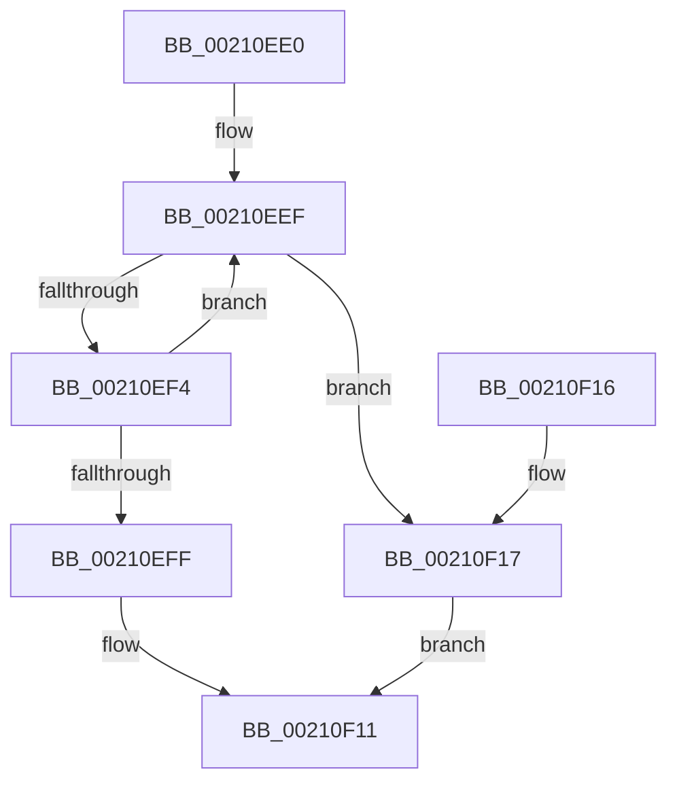

# ObReferenceObjectSafeWithTag

- RVA: `0x00210EE0`–`0x00210F19` (길이 `57` bytes)
- VA: `0x0000000140210EE0`
- 실행 섹션: `.text`
- PDB 이름 있음: `예`; PDB Function 태그: `아니요`
- unwind 정보 RVA: `0x0005DDFC`
- 디코드: `18`개 명령, `57/57` bytes 표시
- 미해석 바이트: `0` (있으면 어셈블리에 `.byte`로 보존)

> 이 문서는 커널 이미지의 기계어와 PDB 기호를 분석해 생성했습니다. 4번과 5번은 함수 원형과 자료형을 바이너리 사용 방식에서 추정한 C 해석이며 원본 소스 복구 결과는 아닙니다.

## 1. Dependencies

- 직접 호출 지점: **1**; 고유 호출 대상: **1**
- 직접 호출자로 확인된 함수: **34**
- RIP 상대 이미지 참조: **0**

### Outgoing calls
- `0x00210F0A` → [ObpTraceObjectReferenceIfActive](ObpTraceObjectReferenceIfActive_function_00210780.md) (function, `0x00210780`)

### Direct callers
- [KiAbConvertWaiterToOwnerEntry](KiAbConvertWaiterToOwnerEntry_function_00219430.md) at `0x00219A34`
- [sub_00221FB6](../22/Unknown_function_00221FB6.md) at `0x00222C69`
- [sub_00221FB6](../22/Unknown_function_00221FB6.md) at `0x00222CCD`
- [PsGetNextPartitionUnsafe](../2F/PsGetNextPartitionUnsafe_function_002F0E38.md) at `0x002F0EC6`
- [KiAbDeferredProcessingWorker](../30/KiAbDeferredProcessingWorker_function_0030DEB0.md) at `0x0030E734`
- [KiAbDeferredProcessingWorker](../30/KiAbDeferredProcessingWorker_function_0030DEB0.md) at `0x0030E798`
- [AlpcpLookasidePacketCallbackRoutine](../41/AlpcpLookasidePacketCallbackRoutine_function_00419D50.md) at `0x00419F44`
- [MiCapturePfnVm](../46/MiCapturePfnVm_function_00465570.md) at `0x00465684`
- [IoNotifyQuotaState](../4A/IoNotifyQuotaState_function_004A13C0.md) at `0x004A140F`
- [HalpDmaFindAdapterByDeviceId](../53/HalpDmaFindAdapterByDeviceId_function_0053E0CC.md) at `0x0053E13D`
- [HalpDmaFindAdapterByDeviceObject](../53/HalpDmaFindAdapterByDeviceObject_function_0053FC8C.md) at `0x0053FCED`
- [KiMonitorCacheErrata](../5C/KiMonitorCacheErrata_function_005C4E90.md) at `0x005C4F70`
- [PspProcessQosChangeNotificationInsertList](../5E/PspProcessQosChangeNotificationInsertList_function_005E2FD4.md) at `0x005E3014`
- [PspJobCycleTimeNotificationDpcRoutine](../5E/PspJobCycleTimeNotificationDpcRoutine_function_005E3980.md) at `0x005E3991`
- [MiLocateSharedPageViews](../67/MiLocateSharedPageViews_function_0067F1E4.md) at `0x0067F320`
- [sub_006DCCA8](../6D/Unknown_function_006DCCA8.md) at `0x006DCCE2`
- [PspGetNextSyscallProviderProcess](../../page/77/PspGetNextSyscallProviderProcess_function_0077E598.md) at `0x0077E633`
- [PspAddProcessToWorkingSetChangeList](../../page/78/PspAddProcessToWorkingSetChangeList_function_00784B38.md) at `0x00784B69`
- [PspQueryProcessInterferenceCountCallback](../../page/78/PspQueryProcessInterferenceCountCallback_function_007851C0.md) at `0x00785206`
- [PspGetPreviousProcessThread](../../page/8C/PspGetPreviousProcessThread_function_008C9A68.md) at `0x008C9AC7`
- [PsGetNextProcessThread](../../page/8C/PsGetNextProcessThread_function_008C9CF0.md) at `0x008C9D94`
- [PspExitLastThread](../../page/90/PspExitLastThread_function_00904184.md) at `0x009043A7`
- [PspGetNextJobProcess](../../page/91/PspGetNextJobProcess_function_00918450.md) at `0x009184A4`
- [PspEnforceLimitsProcessCallback](../../page/91/PspEnforceLimitsProcessCallback_function_00919030.md) at `0x0091911F`
- [sub_0091A0A7](../../page/91/Unknown_function_0091A0A7.md) at `0x0091A14C`
- [sub_0091BCD9](../../page/91/Unknown_function_0091BCD9.md) at `0x0091BD54`
- [PsGetNextProcess](../../page/91/PsGetNextProcess_function_0091C900.md) at `0x0091C9AB`
- [ExGetNextProcess](../../page/91/ExGetNextProcess_function_0091CAD0.md) at `0x0091CB7F`
- [PsGetPreviousProcess](../../page/91/PsGetPreviousProcess_function_0091E24C.md) at `0x0091E2AB`
- [PopEtGetNextEnergyTracker](../../page/98/PopEtGetNextEnergyTracker_function_0098E384.md) at `0x0098E3CA`
- [PspGetNextChildJob](../../page/9F/PspGetNextChildJob_function_009F66A4.md) at `0x009F6773`
- [PspSelectSessionAttachProcess](../../page/A2/PspSelectSessionAttachProcess_function_00A25CA0.md) at `0x00A25CFD`
- [PsGetNextProcessEx](../../page/A4/PsGetNextProcessEx_function_00A48CC0.md) at `0x00A48D1F`
- [ExpGetNextCallback](../../page/A7/ExpGetNextCallback_function_00A77380.md) at `0x00A773D9`
- [SepCleanupLUIDDeviceMapDirectory](../../page/A9/SepCleanupLUIDDeviceMapDirectory_function_00A98F24.md) at `0x00A98FB4`
- [PopPowerRequestNotifyUserSessionAttributed](../../page/AD/PopPowerRequestNotifyUserSessionAttributed_function_00ADF48C.md) at `0x00ADF4FC`

### Static image references
- 디코드된 RIP-relative 메모리 참조가 없습니다.

## 2. Other-region calls and transfers

- 다른 실행 섹션으로 향하는 call: **0**
- 별도 외부 분기/꼬리 이동을 확인하지 못했습니다.

## 3. Assembly (complete function range)

```asm
00210EE0  48 83 EC 28                     sub rsp, 0x28
00210EE4  4C 8D 49 D0                     lea r9, [rcx - 0x30]
00210EE8  41 0F 0D 09                     prefetchw byte ptr [r9]
00210EEC  49 8B 01                        mov rax, qword ptr [r9]
00210EEF  48 85 C0                        test rax, rax
00210EF2  74 23                           je 0x140210f17
00210EF4  48 8D 48 01                     lea rcx, [rax + 1]
00210EF8  F0 49 0F B1 09                  lock cmpxchg qword ptr [r9], rcx
00210EFD  75 F0                           jne 0x140210eef
00210EFF  44 8B C2                        mov r8d, edx
00210F02  49 8B C9                        mov rcx, r9
00210F05  BA 01 00 00 00                  mov edx, 1
00210F0A  E8 71 F8 FF FF                  call 0x140210780
00210F0F  B0 01                           mov al, 1
00210F11  48 83 C4 28                     add rsp, 0x28
00210F15  C3                              ret
00210F16  CC                              int3
00210F17  EB F8                           jmp 0x140210f11
```

## 4. C-style interpretation (structured pseudocode)

```c
__int64 __fastcall ObReferenceObjectSafeWithTag(__int64 a1, int a2)
{
    __int64 result;
    __int64 v_rsp;

    v_rsp = (v_rsp) - (40);
loc_00210EEF:
    if (*(unsigned __int64 *)(a1 - 48) == 0) goto loc_00210F17;
    if (*(unsigned __int64 *)(a1 - 48) != 0) goto loc_00210EEF;
    result = ObpTraceObjectReferenceIfActive(a1 - 48, 1, (unsigned int)(a2), a1 - 48);
loc_00210F11:
    v_rsp = (v_rsp) + (40);
    return 1;
loc_00210F17:
    goto loc_00210F11;
}
```

## 5. (Beta) C Style

```c
int64_t ObReferenceObjectSafeWithTag(void *Arg1, int32_t Arg2)
{
    uint8_t *arg1 = (uint8_t *)Arg1;

    int64_t result;
    int64_t local_rsp;

    local_rsp = (local_rsp) - (40);
loc_00210EEF:
    if (*(uint64_t *)(arg1 - 0x30) == 0) goto loc_00210F17;
    if (*(uint64_t *)(arg1 - 0x30) != 0) goto loc_00210EEF;
    result = ObpTraceObjectReferenceIfActive(Arg1 - 48, 1, (uint32_t)(Arg2), Arg1 - 48);
loc_00210F11:
    local_rsp = (local_rsp) + (40);
    return 1;
loc_00210F17:
    goto loc_00210F11;
}
```

### 관측된 메모리 오프셋

구조체 형식이 확인되지 않은 접근은 인자 기준의 오프셋으로만 기록했습니다.

| 기준 인자 | 오프셋 표현 | 폭 (bit) | 접근 |
|---|---:|---:|---|
| `Arg1` | `- 0x30` | `64` | `R` |
| `Arg1` | `+ 0x0` | `8` | `R` |
| `Arg1` | `+ 0x0` | `64` | `R` |

## 6. Execution-region graph

[열기: 2D/3D 그래프와 함수 탐색 컨트롤 패널](../../../control-panel.html?section=text&rva=0x00210EE0&view=graph)

- 2D 그래프는 위에서 아래로 흐르고, 3D 그래프는 빈 공간을 드래그해 회전합니다. Shift+드래그는 이동, 휠은 확대·축소, 함수 노드 선택은 대상 보고서 이동입니다.

### Static fallback


