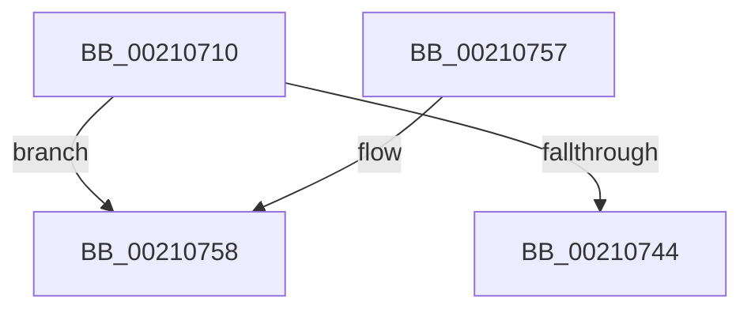

# ObfReferenceObjectWithTag

- RVA: `0x00210710`–`0x00210771` (길이 `97` bytes)
- VA: `0x0000000140210710`
- 실행 섹션: `.text`
- PDB 이름 있음: `예`; PDB Function 태그: `아니요`
- unwind 정보 RVA: `0x0005DCDC`
- 디코드: `28`개 명령, `97/97` bytes 표시
- 미해석 바이트: `0` (있으면 어셈블리에 `.byte`로 보존)

> 이 문서는 커널 이미지의 기계어와 PDB 기호를 분석해 생성했습니다. 4번과 5번은 함수 원형과 자료형을 바이너리 사용 방식에서 추정한 C 해석이며 원본 소스 복구 결과는 아닙니다.

## 1. Dependencies

- 직접 호출 지점: **2**; 고유 호출 대상: **2**
- 직접 호출자로 확인된 함수: **284**
- RIP 상대 이미지 참조: **0**

### Outgoing calls
- `0x00210730` → [ObpTraceObjectReferenceIfActive](ObpTraceObjectReferenceIfActive_function_00210780.md) (function, `0x00210780`)
- `0x0021076B` → [KeBugCheckEx](../4F/KeBugCheckEx_function_004FD660.md) (function, `0x004FD660`)

### Direct callers
- [KeInsertQueueApc](../20/KeInsertQueueApc_function_00203F10.md) at `0x002040E8`
- [sub_00207070](../20/Unknown_function_00207070.md) at `0x0020709F`
- [sub_00207070](../20/Unknown_function_00207070.md) at `0x002070BE`
- [IopCompleteRequest](../20/IopCompleteRequest_function_0020AF50.md) at `0x0020B059`
- [ObfReferenceObject](../20/ObfReferenceObject_function_0020FA20.md) at `0x0020FA29`
- [sub_00210015](Unknown_function_00210015.md) at `0x0021006A`
- [sub_00211104](Unknown_function_00211104.md) at `0x00211211`
- [ExpAcquireFastResourceSharedSlow](ExpAcquireFastResourceSharedSlow_function_00211260.md) at `0x00211886`
- [ExpAcquireFastResourceSharedSlow](ExpAcquireFastResourceSharedSlow_function_00211260.md) at `0x00211A40`
- [sub_00211E87](Unknown_function_00211E87.md) at `0x00211F62`
- [sub_00213F4F](Unknown_function_00213F4F.md) at `0x00214125`
- [sub_002142F9](Unknown_function_002142F9.md) at `0x0021464C`
- [sub_00215166](Unknown_function_00215166.md) at `0x00215A21`
- [IoBoostThreadIoPriority](IoBoostThreadIoPriority_function_00216110.md) at `0x0021637A`
- [IoBoostThreadIoPriority](IoBoostThreadIoPriority_function_00216110.md) at `0x00216387`
- [IoBoostThreadIoPriority](IoBoostThreadIoPriority_function_00216110.md) at `0x002165A4`
- [IoBoostThreadIoPriority](IoBoostThreadIoPriority_function_00216110.md) at `0x002165B3`
- [ExpCenturyDpcRoutine](../22/ExpCenturyDpcRoutine_function_00223520.md) at `0x002235F3`
- [SepAdtLogAuditRecord](../22/SepAdtLogAuditRecord_function_00224B6C.md) at `0x00224D1C`
- [PsGetSessionObjectById](../22/PsGetSessionObjectById_function_002250C0.md) at `0x00225110`
- [PopPowerRequestCreateUserModeRequest](../22/PopPowerRequestCreateUserModeRequest_function_0022F91C.md) at `0x0022F98A`
- [PopPowerRequestCreateCommon](../23/PopPowerRequestCreateCommon_function_00230150.md) at `0x00230324`
- [PsRemoveVirtualizedTimer](../23/PsRemoveVirtualizedTimer_function_00230B5C.md) at `0x00230B8C`
- [PopAllocateIrp](../27/PopAllocateIrp_function_0027116C.md) at `0x0027159B`
- [IopGetDevicePDO](../27/IopGetDevicePDO_function_002724D8.md) at `0x0027250E`
- [IoGetLowerDeviceObjectWithTag](../27/IoGetLowerDeviceObjectWithTag_function_00272660.md) at `0x002726C9`
- [IoGetDeviceAttachmentBaseRef](../27/IoGetDeviceAttachmentBaseRef_function_00272710.md) at `0x0027273D`
- [IoGetDeviceAttachmentBaseRefWithTag](../27/IoGetDeviceAttachmentBaseRefWithTag_function_00272788.md) at `0x002727BE`
- [IoGetAttachedDeviceReferenceWithTag](../27/IoGetAttachedDeviceReferenceWithTag_function_00273B84.md) at `0x00273BBC`
- [IoPageReadEx](../29/IoPageReadEx_function_0029ABF0.md) at `0x0029AF06`
- [sub_0029B1D6](../29/Unknown_function_0029B1D6.md) at `0x0029B1FA`
- [sub_0029BFC9](../29/Unknown_function_0029BFC9.md) at `0x0029BFFB`
- [MiBackgroundZeroNodePages](../2C/MiBackgroundZeroNodePages_function_002CB9B0.md) at `0x002CBB03`
- [PfSnGetFileInformation](../34/PfSnGetFileInformation_function_00343210.md) at `0x00343355`
- [ExpSetResourceOwnerPointerEx](../34/ExpSetResourceOwnerPointerEx_function_00343E20.md) at `0x0034406B`
- [ExpSetResourceOwnerPointerEx](../34/ExpSetResourceOwnerPointerEx_function_00343E20.md) at `0x0034419B`
- [ExpSetResourceOwnerPointerEx](../34/ExpSetResourceOwnerPointerEx_function_00343E20.md) at `0x003442C9`
- [sub_0034466C](../34/Unknown_function_0034466C.md) at `0x003446D0`
- [sub_0034847F](../34/Unknown_function_0034847F.md) at `0x003484A4`
- [KeDeleteMutant](../35/KeDeleteMutant_function_00351788.md) at `0x003519E3`
- [IoQueueWorkItem](../35/IoQueueWorkItem_function_00357F80.md) at `0x00358024`
- [IoQueueWorkItem](../35/IoQueueWorkItem_function_00357F80.md) at `0x00358036`
- [IoQueueWorkItem](../35/IoQueueWorkItem_function_00357F80.md) at `0x003580B3`
- [IoQueueWorkItem](../35/IoQueueWorkItem_function_00357F80.md) at `0x003580E1`
- [IoQueueWorkItemEx](../35/IoQueueWorkItemEx_function_00358140.md) at `0x003581E0`
- [IoQueueWorkItemEx](../35/IoQueueWorkItemEx_function_00358140.md) at `0x003581F2`
- [IoQueueWorkItemEx](../35/IoQueueWorkItemEx_function_00358140.md) at `0x0035826F`
- [IoQueueWorkItemEx](../35/IoQueueWorkItemEx_function_00358140.md) at `0x0035829D`
- [ObFastReferenceObjectLocked](../38/ObFastReferenceObjectLocked_function_00381DA0.md) at `0x00381DB2`
- [CcScheduleReadAheadNuma](../38/CcScheduleReadAheadNuma_function_0038883C.md) at `0x00388B0B`
- [FsRtlPrivateCheckWaitingLocks](../38/FsRtlPrivateCheckWaitingLocks_function_0038DCBC.md) at `0x0038DDF2`
- [FsRtlPrivateLock](../38/FsRtlPrivateLock_function_0038DF90.md) at `0x0038E550`
- [PspHardDereferenceSiloWorker](../38/PspHardDereferenceSiloWorker_function_0038F740.md) at `0x0038F77B`
- [ExTimerRundown](../39/ExTimerRundown_function_00391394.md) at `0x00391415`
- [ExpTryEnterWorkerFactoryAwayMode](../39/ExpTryEnterWorkerFactoryAwayMode_function_003930B0.md) at `0x00393130`
- [PspUpdateContainerImpersonation](../39/PspUpdateContainerImpersonation_function_003931EC.md) at `0x00393227`
- [sub_00393D34](../39/Unknown_function_00393D34.md) at `0x00393D54`
- [NtWaitForWorkViaWorkerFactory](../39/NtWaitForWorkViaWorkerFactory_function_00394270.md) at `0x00394C30`
- [NtWaitForWorkViaWorkerFactory](../39/NtWaitForWorkViaWorkerFactory_function_00394270.md) at `0x00394C8D`
- [IopUnloadSafeCompletion](../3A/IopUnloadSafeCompletion_function_003A16A0.md) at `0x003A16F7`
- [EtwpTiAllocVadQueryEventWriteWorkItemContext](../3B/EtwpTiAllocVadQueryEventWriteWorkItemContext_function_003B958C.md) at `0x003B96BE`
- [ExAcquireFastResourceSharedStarveExclusive](../3B/ExAcquireFastResourceSharedStarveExclusive_function_003BDC80.md) at `0x003BDF69`
- [sub_003BE220](../3B/Unknown_function_003BE220.md) at `0x003BE264`
- [ExpAcquireFastResourceExclusiveSlow](../3B/ExpAcquireFastResourceExclusiveSlow_function_003BE2E0.md) at `0x003BE6EA`
- [sub_003CB5DC](../3C/Unknown_function_003CB5DC.md) at `0x003CB600`
- [CcInitializeCacheMapInternal](../3C/CcInitializeCacheMapInternal_function_003CC720.md) at `0x003CCB1A`
- [IopCompleteIoRingEntry](../3E/IopCompleteIoRingEntry_function_003ED2C0.md) at `0x003ED367`
- [FsRtlpAcknowledgeOplockBreakByCacheFlags](../3F/FsRtlpAcknowledgeOplockBreakByCacheFlags_function_003F1988.md) at `0x003F2135`
- [FsRtlpAcknowledgeOplockBreakByCacheFlags](../3F/FsRtlpAcknowledgeOplockBreakByCacheFlags_function_003F1988.md) at `0x003F2159`
- [FsRtlpRequestExclusiveOplock](../3F/FsRtlpRequestExclusiveOplock_function_003F3800.md) at `0x003F3FAC`
- [FsRtlpRequestExclusiveOplock](../3F/FsRtlpRequestExclusiveOplock_function_003F3800.md) at `0x003F3FD1`
- [IopAllocateAndPopulateWriteIrp](../40/IopAllocateAndPopulateWriteIrp_function_004011F4.md) at `0x004012BE`
- [IopQueueIrpToFileObject](../40/IopQueueIrpToFileObject_function_00409864.md) at `0x00409936`
- [IopQueueIrpToFileObject](../40/IopQueueIrpToFileObject_function_00409864.md) at `0x00409995`
- [IopAttachDeviceToDeviceStackSafe](../41/IopAttachDeviceToDeviceStackSafe_function_00410574.md) at `0x00410794`
- [ExpMoveSharedFastResourceOwnershipWithFlags](../41/ExpMoveSharedFastResourceOwnershipWithFlags_function_00415C4C.md) at `0x00415FF0`
- [sub_0041D94A](../41/Unknown_function_0041D94A.md) at `0x0041D9C4`
- [IoIncrementKeepAliveCount](../42/IoIncrementKeepAliveCount_function_0042EAD0.md) at `0x0042EBC0`
- [NtCancelWaitCompletionPacket](../42/NtCancelWaitCompletionPacket_function_0042F100.md) at `0x0042F18E`
- [IopCloseWaitCompletionPacket](../42/IopCloseWaitCompletionPacket_function_0042F520.md) at `0x0042F573`
- [sub_004314C3](../43/Unknown_function_004314C3.md) at `0x00431519`
- [MiReferenceControlAreaFile](../43/MiReferenceControlAreaFile_function_00431554.md) at `0x00431652`
- [PspInsertProperty](../43/PspInsertProperty_function_00434B2C.md) at `0x00434BF3`
- [PsGetWorkOnBehalfThread](../43/PsGetWorkOnBehalfThread_function_00439560.md) at `0x004395C4`
- [sub_0043C9E8](../43/Unknown_function_0043C9E8.md) at `0x0043CA4C`
- [sub_0043CA64](../43/Unknown_function_0043CA64.md) at `0x0043CA6D`
- [sub_0043CAB1](../43/Unknown_function_0043CAB1.md) at `0x0043CAD3`
- [sub_0043CAF8](../43/Unknown_function_0043CAF8.md) at `0x0043CB09`
- [MiAgeAweRegions](../44/MiAgeAweRegions_function_004464A4.md) at `0x0044663E`
- [PsGetEffectiveContainerId](../44/PsGetEffectiveContainerId_function_004497A0.md) at `0x004498B1`
- [CcSetLogHandleForFileEx](../44/CcSetLogHandleForFileEx_function_0044EA30.md) at `0x0044ED8D`
- [FsRtlCreateSectionForDataScan](../45/FsRtlCreateSectionForDataScan_function_00453330.md) at `0x004534B5`
- [CcChangeBackingFileObject](../45/CcChangeBackingFileObject_function_00457E5C.md) at `0x00457F93`
- [MmChangeSectionBackingFile](../45/MmChangeSectionBackingFile_function_0045808C.md) at `0x00458113`
- [CcSlowReferenceSharedCacheMapFileObject](../45/CcSlowReferenceSharedCacheMapFileObject_function_00458C10.md) at `0x00458C7A`
- [MmInSwapWorkingSet](../45/MmInSwapWorkingSet_function_0045B6C4.md) at `0x0045B88A`
- [ObpReferenceNamedObject](../45/ObpReferenceNamedObject_function_0045FEBC.md) at `0x0045FECE`
- [PsAcquireSiloHardReference](../46/PsAcquireSiloHardReference_function_00467620.md) at `0x0046765F`
- [PsInsertVirtualizedTimer](../46/PsInsertVirtualizedTimer_function_0046C130.md) at `0x0046C1E7`
- [PnpRemoveLockedDeviceNode](../47/PnpRemoveLockedDeviceNode_function_004702AC.md) at `0x00470570`
- [PopDispatchQuerySetIrp](../47/PopDispatchQuerySetIrp_function_00470CE8.md) at `0x00470D05`
- [SeSetTokenTrustLink](../47/SeSetTokenTrustLink_function_00475004.md) at `0x0047501C`
- [IoReportTargetDeviceChangeAsynchronous](../47/IoReportTargetDeviceChangeAsynchronous_function_00475DA0.md) at `0x00475F06`
- [PopPowerRequestEvaluatePendingRequestStatus](../47/PopPowerRequestEvaluatePendingRequestStatus_function_00477914.md) at `0x00477A10`
- [PnpRequestDeviceAction](../47/PnpRequestDeviceAction_function_00477FF8.md) at `0x00478087`
- [PnpDeviceActionWorker](../47/PnpDeviceActionWorker_function_00478400.md) at `0x00478650`
- [IoEnumerateDeviceObjectList](../47/IoEnumerateDeviceObjectList_function_0047D440.md) at `0x0047D4A6`
- [IopKeepAliveWorker](../49/IopKeepAliveWorker_function_00494FD0.md) at `0x0049515F`
- [EtwpCancelPendingApcs](../49/EtwpCancelPendingApcs_function_00497D88.md) at `0x00497E23`
- [IopQueueInvalidateBusRelationsRequest](../49/IopQueueInvalidateBusRelationsRequest_function_0049E28C.md) at `0x0049E31A`
- [ExpTimerDpcRoutine](../4A/ExpTimerDpcRoutine_function_004A1570.md) at `0x004A1636`
- [ExDisownFastResource](../4A/ExDisownFastResource_function_004A2C10.md) at `0x004A2DAE`
- [PopFxIsDevicePotentialDripsConstraint](../4A/PopFxIsDevicePotentialDripsConstraint_function_004A5D34.md) at `0x004A5D75`
- [IoGetDiskDeviceObject](../4A/IoGetDiskDeviceObject_function_004A8540.md) at `0x004A8594`
- [IopPerfCallDriver](../4A/IopPerfCallDriver_function_004A9680.md) at `0x004A96BC`
- [PopUpdateWakeSource](../4A/PopUpdateWakeSource_function_004AA70C.md) at `0x004AA7A9`
- [IopAllocateErrorLogEntry](../4A/IopAllocateErrorLogEntry_function_004ABF5C.md) at `0x004ABFE4`
- [IopAllocateErrorLogEntry](../4A/IopAllocateErrorLogEntry_function_004ABF5C.md) at `0x004ABFF6`
- [IopReplaceCompletionPort](../4B/IopReplaceCompletionPort_function_004BCA58.md) at `0x004BCAFA`
- [ExRegisterCallback](../4B/ExRegisterCallback_function_004BDFC0.md) at `0x004BDFE2`
- [PnpHandleEnumerateHandlesAgainstPdoStack](../4C/PnpHandleEnumerateHandlesAgainstPdoStack_function_004C8F94.md) at `0x004C8FBB`
- [PnpHandleEnumerateHandlesAgainstPdoStack](../4C/PnpHandleEnumerateHandlesAgainstPdoStack_function_004C8F94.md) at `0x004C9000`
- [PnpHandleEnumerateHandlesAgainstPdoStack](../4C/PnpHandleEnumerateHandlesAgainstPdoStack_function_004C8F94.md) at `0x004C906E`
- [PnpMarkDeviceForRemove](../4C/PnpMarkDeviceForRemove_function_004C9DA8.md) at `0x004C9E22`
- [FsRtlpRequestShareableOplock](../4E/FsRtlpRequestShareableOplock_function_004E6EC8.md) at `0x004E7500`
- [FsRtlpRequestShareableOplock](../4E/FsRtlpRequestShareableOplock_function_004E6EC8.md) at `0x004E753E`
- [FsRtlpRequestShareableOplock](../4E/FsRtlpRequestShareableOplock_function_004E6EC8.md) at `0x004E78EA`
- [HalpIommuCreateDevice](../54/HalpIommuCreateDevice_function_0054ED60.md) at `0x0054EF81`
- [HalpIommuCreateDevice](../54/HalpIommuCreateDevice_function_0054ED60.md) at `0x0054F1FD`
- [HalpCreateSecondaryIcEntry](../55/HalpCreateSecondaryIcEntry_function_00556D4C.md) at `0x00556DD5`
- [IommuRegisterInterfaceStateChangeCallback](../56/IommuRegisterInterfaceStateChangeCallback_function_00568200.md) at `0x005682E4`
- [CcGetFileObjectFromSectionPtrsRef](../57/CcGetFileObjectFromSectionPtrsRef_function_0057B180.md) at `0x0057B1C8`
- [CcQueueAsyncGetDeviceGuid](../57/CcQueueAsyncGetDeviceGuid_function_0057EE74.md) at `0x0057EEAE`
- [FsRtlOplockGetAnyBreakOwnerProcess](../58/FsRtlOplockGetAnyBreakOwnerProcess_function_005820D0.md) at `0x00582119`
- [FsRtlpGrantAnyOplockFromExclusive](../58/FsRtlpGrantAnyOplockFromExclusive_function_00582540.md) at `0x0058285C`
- [FsRtlpGrantAnyOplockFromExclusive](../58/FsRtlpGrantAnyOplockFromExclusive_function_00582540.md) at `0x00582875`
- [IopDisassociateThreadIrp](../59/IopDisassociateThreadIrp_function_0059708C.md) at `0x00597147`
- [IopDisassociateThreadIrp](../59/IopDisassociateThreadIrp_function_0059708C.md) at `0x005971C9`
- [IoRequestDeviceEjectEx](../5A/IoRequestDeviceEjectEx_function_005A59D0.md) at `0x005A5AAF`
- [PnpProcessRebalance](../5A/PnpProcessRebalance_function_005AA7C8.md) at `0x005AA8B0`
- [KiLogUserCetSetContextIpValidationFailure](../5C/KiLogUserCetSetContextIpValidationFailure_function_005C830C.md) at `0x005C839D`
- [PoGetRequester](../5C/PoGetRequester_function_005CE468.md) at `0x005CE49A`
- [PopIdleWakeDelayedWakeSourceReferencer](../5D/PopIdleWakeDelayedWakeSourceReferencer_function_005DC080.md) at `0x005DC0AF`
- [PspIumAllocatePartitionState](../5E/PspIumAllocatePartitionState_function_005E43A8.md) at `0x005E44E7`
- [PsAttachSession](../5E/PsAttachSession_function_005E4F40.md) at `0x005E4F98`
- [SeCreateClientSecurityFromSubjectContextEx](../60/SeCreateClientSecurityFromSubjectContextEx_function_00609440.md) at `0x00609486`
- [DifObfReferenceObjectWithTagWrapper](../63/DifObfReferenceObjectWithTagWrapper_function_006389A0.md) at `0x00638A74`
- [DifObfReferenceObjectWrapper](../63/DifObfReferenceObjectWrapper_function_00638B10.md) at `0x00638BE2`
- [EtwpCovSampCaptureCancelApcs](../65/EtwpCovSampCaptureCancelApcs_function_00653B44.md) at `0x00653BA4`
- [ExpNextYearDpcRoutine](../65/ExpNextYearDpcRoutine_function_006555A0.md) at `0x006555D6`
- [ExpTimeZoneDpcRoutine](../65/ExpTimeZoneDpcRoutine_function_00655710.md) at `0x0065580D`
- [ExRegisterBootDevice](../65/ExRegisterBootDevice_function_00657B90.md) at `0x00657CE6`
- [ExRegisterBootDevice](../65/ExRegisterBootDevice_function_00657B90.md) at `0x00657CF9`
- [ExAcquireFastResourceWithFlags](../65/ExAcquireFastResourceWithFlags_function_00658120.md) at `0x00658617`
- [ExCreateDpcEvent](../65/ExCreateDpcEvent_function_00659520.md) at `0x006595E3`
- [MiReAcquireOutSwappedProcessCommit](../66/MiReAcquireOutSwappedProcessCommit_function_0066F598.md) at `0x0066F6CB`
- [FsRtlPrivateLock$fin$0](../6D/FsRtlPrivateLock_fin_0_function_006D2360.md) at `0x006D23C3`
- [sub_006F45AA](../6F/Unknown_function_006F45AA.md) at `0x006F45CA`
- [FsRtlpOplockGetThreadIntegrityLevel](../../page/6F/FsRtlpOplockGetThreadIntegrityLevel_function_006FD814.md) at `0x006FD873`
- [PsSessionCreate](../../page/70/PsSessionCreate_function_00700438.md) at `0x007004FB`
- [PspInitializeSessionGlobals](../../page/70/PspInitializeSessionGlobals_function_007005B8.md) at `0x0070063D`
- [PspInitializeSessionGlobals](../../page/70/PspInitializeSessionGlobals_function_007005B8.md) at `0x007006B2`
- [PopFxPlatformRegisterInterface](../../page/70/PopFxPlatformRegisterInterface_function_007030FC.md) at `0x00703163`
- [DbgkCaptureLiveDump](../../page/71/DbgkCaptureLiveDump_function_0071113C.md) at `0x00711390`
- [IopSetFileObjectIosbRange](../../page/71/IopSetFileObjectIosbRange_function_0071C1C8.md) at `0x0071C4D3`
- [IopSetFileMemoryPartitionInformation](../../page/71/IopSetFileMemoryPartitionInformation_function_0071E414.md) at `0x0071E4C0`
- [PiProcessResourceRequirementsChanged](../../page/72/PiProcessResourceRequirementsChanged_function_0072D504.md) at `0x0072D53E`
- [PnpSetDeviceRemovalSafe](../../page/73/PnpSetDeviceRemovalSafe_function_00738184.md) at `0x007381F4`
- [PnpSetPowerVetoEvent](../../page/73/PnpSetPowerVetoEvent_function_007383E4.md) at `0x00738477`
- [PiDmaGuardQueueInsertEntry](../../page/74/PiDmaGuardQueueInsertEntry_function_007445F0.md) at `0x00744630`
- [KeRegisterAvailableCpusChangeNotification](../../page/74/KeRegisterAvailableCpusChangeNotification_function_00745D7C.md) at `0x00745E01`
- [AlpcpPortQueryServerInfo](../../page/74/AlpcpPortQueryServerInfo_function_0074C784.md) at `0x0074C9F0`
- [ObInitServerSilo](../../page/74/ObInitServerSilo_function_0074D8FC.md) at `0x0074DA66`
- [PopAssociateThermalRequest](../../page/75/PopAssociateThermalRequest_function_00756E78.md) at `0x00756F32`
- [PopFxRegisterDevice](../../page/75/PopFxRegisterDevice_function_00759B80.md) at `0x00759D39`
- [PopGetPolicyDeviceObject](../../page/76/PopGetPolicyDeviceObject_function_00765EB8.md) at `0x00765F96`
- [PsRegisterSyscallProvider](../../page/77/PsRegisterSyscallProvider_function_0077E140.md) at `0x0077E1EB`
- [PsCreateCpuPartition](../../page/78/PsCreateCpuPartition_function_00783A8C.md) at `0x00783B62`
- [PsReferenceCpuPartition](../../page/78/PsReferenceCpuPartition_function_00783CD4.md) at `0x00783CD8`
- [PspReferenceCpuPartitionByHandle](../../page/78/PspReferenceCpuPartitionByHandle_function_007846F4.md) at `0x007847B8`
- [PspEstablishDfssHierarchy](../../page/78/PspEstablishDfssHierarchy_function_00784EF0.md) at `0x00784FEA`
- [PspGetProcessInJobHierarchyCallback](../../page/78/PspGetProcessInJobHierarchyCallback_function_00785010.md) at `0x00785025`
- [PspSetJobMemoryPartition](../../page/78/PspSetJobMemoryPartition_function_00785574.md) at `0x00785674`
- [PsWaitForAllProcesses](../../page/78/PsWaitForAllProcesses_function_00786318.md) at `0x0078638C`
- [PspWaitForUsermodeExit](../../page/78/PspWaitForUsermodeExit_function_0078661C.md) at `0x00786657`
- [PspAllocatePartition](../../page/78/PspAllocatePartition_function_0078802C.md) at `0x007880F0`
- [SepInformFileSystemsOfDeletedLogon](../../page/7A/SepInformFileSystemsOfDeletedLogon_function_007A16F0.md) at `0x007A1738`
- [EtwpObjectHandleEnumCallback](../../page/7C/EtwpObjectHandleEnumCallback_function_007C0240.md) at `0x007C033F`
- [MiReferenceNonPagedMemoryProcessList](../../page/80/MiReferenceNonPagedMemoryProcessList_function_0080EAF8.md) at `0x0080EB7A`
- [MiInitializePartitionSpecialPurposeMemory](../../page/80/MiInitializePartitionSpecialPurposeMemory_function_0080F704.md) at `0x0080F931`
- [MiDeleteNewlyCreatedPartialVads](../../page/81/MiDeleteNewlyCreatedPartialVads_function_00810374.md) at `0x008103FD`
- [ObCreateSiloRootDirectory](../../page/83/ObCreateSiloRootDirectory_function_0083CA34.md) at `0x0083CC37`
- [sub_0086B892](../../page/86/Unknown_function_0086B892.md) at `0x0086B8C8`
- [ObpCreateHandle](../../page/86/ObpCreateHandle_function_0086B950.md) at `0x0086C830`
- [sub_00871FFC](../../page/87/Unknown_function_00871FFC.md) at `0x0087209E`
- [CmpCmdHiveOpen](../../page/87/CmpCmdHiveOpen_function_00878404.md) at `0x00878675`
- [CmpOpenHiveFile](../../page/87/CmpOpenHiveFile_function_0087A71C.md) at `0x0087AD0B`
- [PspGetMemoryPartitionImplicit](../../page/87/PspGetMemoryPartitionImplicit_function_0087D888.md) at `0x0087D978`
- [PspGetMemoryPartitionFromJobList](../../page/87/PspGetMemoryPartitionFromJobList_function_0087D988.md) at `0x0087DA80`
- [PspEstablishJobHierarchy](../../page/87/PspEstablishJobHierarchy_function_0087E17C.md) at `0x0087E1D1`
- [PspEstablishJobHierarchy](../../page/87/PspEstablishJobHierarchy_function_0087E17C.md) at `0x0087E2A9`
- [PspEstablishJobHierarchy](../../page/87/PspEstablishJobHierarchy_function_0087E17C.md) at `0x0087E301`
- [PspEstablishJobHierarchy](../../page/87/PspEstablishJobHierarchy_function_0087E17C.md) at `0x0087E5DB`
- [MiCommitFileBackedSection](../../page/88/MiCommitFileBackedSection_function_00882238.md) at `0x0088245E`
- [MiReferenceFileObjectForMap](../../page/88/MiReferenceFileObjectForMap_function_00885C00.md) at `0x00885C24`
- [MiAllocateSplitVads](../../page/88/MiAllocateSplitVads_function_00887818.md) at `0x00887937`
- [AlpcpCreateView](../../page/88/AlpcpCreateView_function_0088A9B8.md) at `0x0088AC0C`
- [AlpcpSendMessage](../../page/88/AlpcpSendMessage_function_0088BD40.md) at `0x0088CBCA`
- [PspChargeProcessWakeCounter](../../page/88/PspChargeProcessWakeCounter_function_0088D2A0.md) at `0x0088D46E`
- [AlpcpCreateSecurityContext](../../page/89/AlpcpCreateSecurityContext_function_00890D94.md) at `0x00890F5A`
- [AlpcpCreateSecurityContext](../../page/89/AlpcpCreateSecurityContext_function_00890D94.md) at `0x00891093`
- [SeCreateClientSecurity](../../page/89/SeCreateClientSecurity_function_008911B0.md) at `0x0089130A`
- [AlpcpExposeTokenAttribute](../../page/89/AlpcpExposeTokenAttribute_function_00891390.md) at `0x00891696`
- [sub_0089189E](../../page/89/Unknown_function_0089189E.md) at `0x008918CF`
- [sub_00891B72](../../page/89/Unknown_function_00891B72.md) at `0x00891BB7`
- [AlpcpCreateReserve](../../page/89/AlpcpCreateReserve_function_00892318.md) at `0x008923F8`
- [ObCaptureObjectStateForDuplication](../../page/89/ObCaptureObjectStateForDuplication_function_00893684.md) at `0x00893801`
- [ObCompleteObjectDuplication](../../page/89/ObCompleteObjectDuplication_function_0089387C.md) at `0x00893961`
- [PsOpenProcess](../../page/89/PsOpenProcess_function_00894A30.md) at `0x00894C37`
- [NtAlpcOpenSenderProcess](../../page/89/NtAlpcOpenSenderProcess_function_008953B0.md) at `0x008955EA`
- [NtAlpcOpenSenderProcess](../../page/89/NtAlpcOpenSenderProcess_function_008953B0.md) at `0x00895742`
- [IopAllocRealFileObject](../../page/89/IopAllocRealFileObject_function_00899720.md) at `0x00899C9D`
- [sub_0089AE5C](../../page/89/Unknown_function_0089AE5C.md) at `0x0089AE91`
- [ObCreateObjectEx](../../page/89/ObCreateObjectEx_function_0089B1E0.md) at `0x0089B64F`
- [ObpLookupObjectName](../../page/89/ObpLookupObjectName_function_0089BE90.md) at `0x0089C21A`
- [ObpLookupObjectName](../../page/89/ObpLookupObjectName_function_0089BE90.md) at `0x0089DB9F`
- [IopParseDevice](../../page/89/IopParseDevice_function_0089E510.md) at `0x0089F7D7`
- [DbgkpQueueMessage](../../page/8A/DbgkpQueueMessage_function_008A31C0.md) at `0x008A3256`
- [DbgkpQueueMessage](../../page/8A/DbgkpQueueMessage_function_008A31C0.md) at `0x008A3260`
- [IopFlushBuffersFile](../../page/8A/IopFlushBuffersFile_function_008ACFA4.md) at `0x008AD27A`
- [IopReadFile](../../page/8A/IopReadFile_function_008AEFF0.md) at `0x008AF6C0`
- [sub_008B4AB4](../../page/8B/Unknown_function_008B4AB4.md) at `0x008B4AED`
- [sub_008B76B1](../../page/8B/Unknown_function_008B76B1.md) at `0x008B76EA`
- [NtOpenThreadTokenEx](../../page/8B/NtOpenThreadTokenEx_function_008B7840.md) at `0x008B7EDB`
- [ObInsertObjectEx](../../page/8B/ObInsertObjectEx_function_008B97A0.md) at `0x008B9D17`
- [EtwpInitializeRegEntry](../../page/8C/EtwpInitializeRegEntry_function_008C1A78.md) at `0x008C1AE0`
- [sub_008C2328](../../page/8C/Unknown_function_008C2328.md) at `0x008C271D`
- [sub_008C4D01](../../page/8C/Unknown_function_008C4D01.md) at `0x008C4D34`
- [ObpCallPreOperationCallbacks](../../page/8C/ObpCallPreOperationCallbacks_function_008C6570.md) at `0x008C65D2`
- [sub_008C6B6D](../../page/8C/Unknown_function_008C6B6D.md) at `0x008C6BA6`
- [PspTerminateAllThreads](../../page/8C/PspTerminateAllThreads_function_008C97D0.md) at `0x008C9863`
- [sub_008E5659](../../page/8E/Unknown_function_008E5659.md) at `0x008E56DC`
- [PnpDeviceObjectFromDeviceInstanceWithTag](../../page/8E/PnpDeviceObjectFromDeviceInstanceWithTag_function_008E7490.md) at `0x008E74F3`
- [PiGetRelatedDevice](../../page/8E/PiGetRelatedDevice_function_008E846C.md) at `0x008E8523`
- [PnpSetPlugPlayEvent](../../page/8F/PnpSetPlugPlayEvent_function_008FBE04.md) at `0x008FBF2E`
- [IopConnectInterrupt](../../page/90/IopConnectInterrupt_function_00900B40.md) at `0x00900CDE`
- [PspSendReliableJobNotification](../../page/91/PspSendReliableJobNotification_function_009171D4.md) at `0x00917234`
- [PspAllocateAndQueryNotificationChannel](../../page/91/PspAllocateAndQueryNotificationChannel_function_00917EE4.md) at `0x009182E5`
- [DbgkpSendErrorMessage](../../page/92/DbgkpSendErrorMessage_function_009210A8.md) at `0x00921282`
- [AlpcpCreateClientPort](../../page/92/AlpcpCreateClientPort_function_009270AC.md) at `0x009271CC`
- [VrpPreOpenOrCreate](../../page/93/VrpPreOpenOrCreate_function_00932B84.md) at `0x00932F18`
- [sub_0093345B](../../page/93/Unknown_function_0093345B.md) at `0x00933870`
- [VrpCreateNamespaceNode](../../page/93/VrpCreateNamespaceNode_function_00935538.md) at `0x009357DE`
- [VrpPostOpenOrCreate](../../page/93/VrpPostOpenOrCreate_function_00936510.md) at `0x00936683`
- [VrpAllocateKeyContext](../../page/93/VrpAllocateKeyContext_function_00937204.md) at `0x00937236`
- [PspInsertProcess](../../page/94/PspInsertProcess_function_009472CC.md) at `0x00947488`
- [sub_00947B26](../../page/94/Unknown_function_00947B26.md) at `0x00947B5C`
- [PnpInitializeTargetDeviceRemoveEvent](../../page/94/PnpInitializeTargetDeviceRemoveEvent_function_0094FBC8.md) at `0x0094FBF9`
- [PnpSetCustomTargetEvent](../../page/95/PnpSetCustomTargetEvent_function_009519E8.md) at `0x00951A71`
- [PnpNotifyTargetDeviceChange](../../page/95/PnpNotifyTargetDeviceChange_function_00954790.md) at `0x009547E4`
- [sub_00957F93](../../page/95/Unknown_function_00957F93.md) at `0x00957FE0`
- [PfSnBeginTrace](../../page/96/PfSnBeginTrace_function_00960DE8.md) at `0x00960EE1`
- [ObpReferenceCurrentDeviceMap](../../page/96/ObpReferenceCurrentDeviceMap_function_0096CBD0.md) at `0x0096CC95`
- [MiInsertChildVads](../../page/97/MiInsertChildVads_function_0097DBB0.md) at `0x0097DC83`
- [sub_009848DC](../../page/98/Unknown_function_009848DC.md) at `0x00984985`
- [ExpWnfQueryCurrentUserSID](../../page/98/ExpWnfQueryCurrentUserSID_function_0098FFB0.md) at `0x009900B8`
- [sub_0099C7E1](../../page/99/Unknown_function_0099C7E1.md) at `0x0099C834`
- [PspAddSchedulingGroupToJobChain](../../page/99/PspAddSchedulingGroupToJobChain_function_0099DE5C.md) at `0x0099E089`
- [sub_009A2B7F](../../page/9A/Unknown_function_009A2B7F.md) at `0x009A2C03`
- [sub_009A8F31](../../page/9A/Unknown_function_009A8F31.md) at `0x009A8F62`
- [AlpcpPortQueryServerSessionInfo](../../page/9C/AlpcpPortQueryServerSessionInfo_function_009CAB0C.md) at `0x009CABA0`
- [AlpcpPortQueryConnectedSidInfo](../../page/9C/AlpcpPortQueryConnectedSidInfo_function_009CAC3C.md) at `0x009CAD1D`
- [PspChargeJobWakeCounter](../../page/9D/PspChargeJobWakeCounter_function_009D5D20.md) at `0x009D5F89`
- [AlpcpSetOwnerProcessPort](../../page/9E/AlpcpSetOwnerProcessPort_function_009E761C.md) at `0x009E764E`
- [PspCreateThread](../../page/9E/PspCreateThread_function_009EF034.md) at `0x009EF24D`
- [PspCreateThread](../../page/9E/PspCreateThread_function_009EF034.md) at `0x009EF3B4`
- [PspCreatePicoThread](../../page/9F/PspCreatePicoThread_function_009F0D70.md) at `0x009F0E9E`
- [PspRundownProcess](../../page/9F/PspRundownProcess_function_009F65CC.md) at `0x009F65EF`
- [PspSendWakeNotification](../../page/9F/PspSendWakeNotification_function_009FB394.md) at `0x009FB3F2`
- [NtQueryInformationJobObject](../../page/9F/NtQueryInformationJobObject_function_009FB860.md) at `0x009FC4CF`
- [MiIsUserQueryVmCallerTrusted](../../page/9F/MiIsUserQueryVmCallerTrusted_function_009FE378.md) at `0x009FE4E1`
- [PipDeviceObjectListAdd](../../page/A0/PipDeviceObjectListAdd_function_00A04E18.md) at `0x00A04E5A`
- [PipAddtoRebuildPowerRelationsQueue](../../page/A0/PipAddtoRebuildPowerRelationsQueue_function_00A07174.md) at `0x00A071BF`
- [PnpDelayedRemoveWorker](../../page/A0/PnpDelayedRemoveWorker_function_00A08AE0.md) at `0x00A08CCB`
- [DbgkpPostFakeThreadMessages](../../page/A1/DbgkpPostFakeThreadMessages_function_00A108CC.md) at `0x00A10993`
- [DbgkpPostFakeThreadMessages](../../page/A1/DbgkpPostFakeThreadMessages_function_00A108CC.md) at `0x00A109C4`
- [DbgkpPostFakeThreadMessages](../../page/A1/DbgkpPostFakeThreadMessages_function_00A108CC.md) at `0x00A10A97`
- [PspAllocateProcess](../../page/A1/PspAllocateProcess_function_00A13B3C.md) at `0x00A14572`
- [ObpInsertDirectoryEntry](../../page/A1/ObpInsertDirectoryEntry_function_00A18AC0.md) at `0x00A18B03`
- [ObpInsertDirectoryEntry](../../page/A1/ObpInsertDirectoryEntry_function_00A18AC0.md) at `0x00A18B2F`
- [PspAssignProcessToJob](../../page/A2/PspAssignProcessToJob_function_00A23370.md) at `0x00A23400`
- [SepCreateLogonSessionTrack](../../page/A2/SepCreateLogonSessionTrack_function_00A2CD3C.md) at `0x00A2CEA8`
- [PsLookupProcessThreadByCid](../../page/A3/PsLookupProcessThreadByCid_function_00A37420.md) at `0x00A37479`
- [SepCopyAnonymousTokenAndSetSilo](../../page/A3/SepCopyAnonymousTokenAndSetSilo_function_00A3A510.md) at `0x00A3A5F6`
- [NtWaitForDebugEvent](../../page/A4/NtWaitForDebugEvent_function_00A464E0.md) at `0x00A46750`
- [NtWaitForDebugEvent](../../page/A4/NtWaitForDebugEvent_function_00A464E0.md) at `0x00A4675D`
- [PiQueryDeviceRelations](../../page/A4/PiQueryDeviceRelations_function_00A4BE8C.md) at `0x00A4BFA3`
- [SeCreateClientSecurityFromSubjectContext](../../page/A4/SeCreateClientSecurityFromSubjectContext_function_00A4D360.md) at `0x00A4D3A6`
- [MiInSwapStore](../../page/A6/MiInSwapStore_function_00A61B74.md) at `0x00A61BCE`
- [SepRmLsaConnectRequest](../../page/A6/SepRmLsaConnectRequest_function_00A6AB54.md) at `0x00A6ACD4`
- [PopRequestShutdownWait](../../page/A6/PopRequestShutdownWait_function_00A6AE34.md) at `0x00A6AE78`
- [PiPnpPdoDeviceListEnumCallback](../../page/A7/PiPnpPdoDeviceListEnumCallback_function_00A79830.md) at `0x00A7985A`
- [ObpSetDeviceMap](../../page/A9/ObpSetDeviceMap_function_00A925D0.md) at `0x00A9270C`
- [MiCreateLargePageVad](../../page/A9/MiCreateLargePageVad_function_00A99B50.md) at `0x00A99BDA`
- [IopReadFileScatter](../../page/AA/IopReadFileScatter_function_00AA5D78.md) at `0x00AA6236`
- [IopWriteFileGather](../../page/AA/IopWriteFileGather_function_00AAA95C.md) at `0x00AAAE29`
- [FsRtlNotifyFilterChangeDirectory](../../page/AA/FsRtlNotifyFilterChangeDirectory_function_00AAB9E0.md) at `0x00AABBD5`
- [FsRtlNotifyFilterChangeDirectoryLite](../../page/AD/FsRtlNotifyFilterChangeDirectoryLite_function_00ADC950.md) at `0x00ADCB16`
- [NtCreateUserProcess](../../page/AE/NtCreateUserProcess_function_00AEA680.md) at `0x00AEB3AB`
- [sub_00B36A42](../../page/B3/Unknown_function_00B36A42.md) at `0x00B36A72`
- [sub_00B3E114](../../page/B3/Unknown_function_00B3E114.md) at `0x00B3E13D`
- [MiDeleteAllHardwareEnclaves](../../pagelk/B7/MiDeleteAllHardwareEnclaves_function_00B74CAC.md) at `0x00B74D61`
- [IoBuildPoDeviceNotifyList](../../pagelk/B7/IoBuildPoDeviceNotifyList_function_00B78B0C.md) at `0x00B78E66`
- [IopCheckDeviceFlags](../../pagelk/B7/IopCheckDeviceFlags_function_00B79250.md) at `0x00B79274`
- [ExpAllocatePoolWithQuotaTag](../../poolcode/B8/ExpAllocatePoolWithQuotaTag_function_00B82210.md) at `0x00B824B4`
- [ViIrpAllocateLockedPacket](../../pagevrfy/B9/ViIrpAllocateLockedPacket_function_00B9E0AC.md) at `0x00B9E1E8`
- [IovUtilGetBottomDeviceObjectWithTag](../../pagevrfy/BA/IovUtilGetBottomDeviceObjectWithTag_function_00BA2A20.md) at `0x00BA2A5A`
- [IovUtilGetLowerDeviceObjectWithTag](../../pagevrfy/BA/IovUtilGetLowerDeviceObjectWithTag_function_00BA2A84.md) at `0x00BA2AB6`
- [IovUtilGetUpperDeviceObjectWithTag](../../pagevrfy/BA/IovUtilGetUpperDeviceObjectWithTag_function_00BA2AE0.md) at `0x00BA2B0B`
- [IopMarkBootPartition](../../init/C2/IopMarkBootPartition_function_00C2CFA0.md) at `0x00C2D138`
- [IopInitializeBootDrivers](../../init/C2/IopInitializeBootDrivers_function_00C2E6F4.md) at `0x00C2EC5C`
- [RawInitialize](../../init/C4/RawInitialize_function_00C47090.md) at `0x00C47272`
- [RawInitialize](../../init/C4/RawInitialize_function_00C47090.md) at `0x00C47280`
- [RawInitialize](../../init/C4/RawInitialize_function_00C47090.md) at `0x00C4728E`
- [PnpLoadBootFilterDriver](../../init/C7/PnpLoadBootFilterDriver_function_00C77938.md) at `0x00C77A7B`

### Static image references
- 디코드된 RIP-relative 메모리 참조가 없습니다.

## 2. Other-region calls and transfers

- 다른 실행 섹션으로 향하는 call: **0**
- 별도 외부 분기/꼬리 이동을 확인하지 못했습니다.

## 3. Assembly (complete function range)

```asm
00210710  48 89 5C 24 08                  mov qword ptr [rsp + 8], rbx
00210715  48 89 74 24 10                  mov qword ptr [rsp + 0x10], rsi
0021071A  57                              push rdi
0021071B  48 83 EC 30                     sub rsp, 0x30
0021071F  48 8B F1                        mov rsi, rcx
00210722  44 8B C2                        mov r8d, edx
00210725  BB 01 00 00 00                  mov ebx, 1
0021072A  48 83 C1 D0                     add rcx, -0x30
0021072E  8B D3                           mov edx, ebx
00210730  E8 4B 00 00 00                  call 0x140210780
00210735  F0 48 0F C1 5E D0               lock xadd qword ptr [rsi - 0x30], rbx
0021073B  48 FF C3                        inc rbx
0021073E  48 83 FB 01                     cmp rbx, 1
00210742  7E 14                           jle 0x140210758
00210744  48 8B 74 24 48                  mov rsi, qword ptr [rsp + 0x48]
00210749  48 8B C3                        mov rax, rbx
0021074C  48 8B 5C 24 40                  mov rbx, qword ptr [rsp + 0x40]
00210751  48 83 C4 30                     add rsp, 0x30
00210755  5F                              pop rdi
00210756  C3                              ret
00210757  CC                              int3
00210758  33 D2                           xor edx, edx
0021075A  48 89 5C 24 20                  mov qword ptr [rsp + 0x20], rbx
0021075F  41 B9 10 00 00 00               mov r9d, 0x10
00210765  4C 8B C6                        mov r8, rsi
00210768  8D 4A 18                        lea ecx, [rdx + 0x18]
0021076B  E8 F0 CE 2E 00                  call 0x1404fd660
00210770  CC                              int3
```

## 4. C-style interpretation (structured pseudocode)

```c
__int64 __fastcall ObfReferenceObjectWithTag(__int64 a1, int a2)
{
    __int64 result;
    __int64 v_rbx;
    __int64 v_rsp;
    unsigned __int64 v_stack_p10;
    unsigned __int64 v_stack_p20;
    unsigned __int64 v_stack_p8;

    v_stack_p8 = v_rbx;
    v_stack_p10 = v_rsi;
    v_rsp = (v_rsp) - (48);
    a1 = (a1) + (-48);
    result = ObpTraceObjectReferenceIfActive(a1, 1, (unsigned int)(a2), a4);
    v_rbx = (1) + 1;
    if (v_rbx <= 1) goto loc_00210758;
    v_rsp = (v_rsp) + (48);
    return v_rbx;
loc_00210758:
    a2 = 0;
    v_stack_p20 = v_stack_p8;
    result = KeBugCheckEx(a2 + 24, a2, v_stack_p10, 16);
    return result;
}
```

## 5. (Beta) C Style

```c
int64_t ObfReferenceObjectWithTag(void *Arg1, int32_t Arg2)
{
    uint8_t *arg1 = (uint8_t *)Arg1;

    int64_t result;
    int64_t local_rbx;
    int64_t local_rsp;
    uint64_t v_stack_p10;
    uint64_t v_stack_p20;
    uint64_t v_stack_p8;

    v_stack_p8 = local_rbx;
    v_stack_p10 = local_rsi;
    local_rsp = (local_rsp) - (48);
    Arg1 = (Arg1) + (-48);
    result = ObpTraceObjectReferenceIfActive(Arg1, 1, (uint32_t)(Arg2), a4);
    local_rbx = (1) + 1;
    if (local_rbx <= 1) goto loc_00210758;
    local_rsp = (local_rsp) + (48);
    return local_rbx;
loc_00210758:
    Arg2 = 0;
    v_stack_p20 = v_stack_p8;
    result = KeBugCheckEx(Arg2 + 24, Arg2, v_stack_p10, 16);
    return result;
}
```

### 관측된 메모리 오프셋

구조체 형식이 확인되지 않은 접근은 인자 기준의 오프셋으로만 기록했습니다.

| 기준 인자 | 오프셋 표현 | 폭 (bit) | 접근 |
|---|---:|---:|---|
| `Arg1` | `- 0x30` | `64` | `R/W` |

## 6. Execution-region graph

[열기: 2D/3D 그래프와 함수 탐색 컨트롤 패널](../../../control-panel.html?section=text&rva=0x00210710&view=graph)

- 2D 그래프는 위에서 아래로 흐르고, 3D 그래프는 빈 공간을 드래그해 회전합니다. Shift+드래그는 이동, 휠은 확대·축소, 함수 노드 선택은 대상 보고서 이동입니다.

### Static fallback


