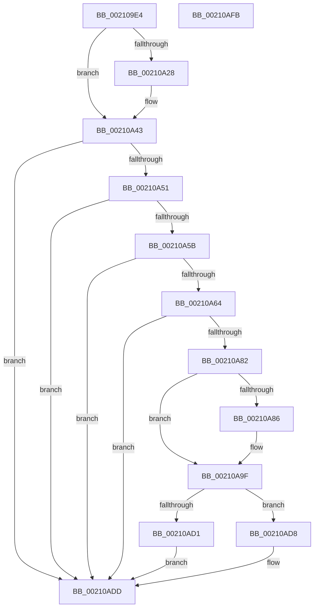

# ObpPushStackInfo

- RVA: `0x002109E4`–`0x00210AFC` (길이 `280` bytes)
- VA: `0x00000001402109E4`
- 실행 섹션: `.text`
- PDB 이름 있음: `예`; PDB Function 태그: `아니요`
- unwind 정보 RVA: `0x0005DD2C`
- 디코드: `76`개 명령, `280/280` bytes 표시
- 미해석 바이트: `0` (있으면 어셈블리에 `.byte`로 보존)

> 이 문서는 커널 이미지의 기계어와 PDB 기호를 분석해 생성했습니다. 4번과 5번은 함수 원형과 자료형을 바이너리 사용 방식에서 추정한 C 해석이며 원본 소스 복구 결과는 아닙니다.

## 1. Dependencies

- 직접 호출 지점: **8**; 고유 호출 대상: **7**
- 직접 호출자로 확인된 함수: **80**
- RIP 상대 이미지 참조: **3**

### Outgoing calls
- `0x00210A19` → [memset](../6C/memset_function_006C6C40.md) (function, `0x006C6C40`)
- `0x00210A3E` → [EtwTraceObjectOperation](../3F/EtwTraceObjectOperation_function_003FFFD4.md) (function, `0x003FFFD4`)
- `0x00210A5B` → [KeGetEffectiveIrql](../2F/KeGetEffectiveIrql_function_002F8030.md) (function, `0x002F8030`)
- `0x00210A75` → [RtlCaptureStackBackTrace](../2F/RtlCaptureStackBackTrace_function_002F9FF0.md) (function, `0x002F9FF0`)
- `0x00210A9A` → [memset](../6C/memset_function_006C6C40.md) (function, `0x006C6C40`)
- `0x00210AAC` → [MmCanThreadFault](../2F/MmCanThreadFault_function_002F86B0.md) (function, `0x002F86B0`)
- `0x00210AD1` → [ObpPushRefDerefInfo](../../page/74/ObpPushRefDerefInfo_function_0074FEC4.md) (function, `0x0074FEC4`)
- `0x00210AD8` → [ObpDeferPushRefDerefInfo](../5C/ObpDeferPushRefDerefInfo_function_005CD9E0.md) (function, `0x005CD9E0`)

### Direct callers
- [IoRemoveIoCompletion](../20/IoRemoveIoCompletion_function_0020B580.md) at `0x0020B92B`
- [IoRemoveIoCompletion](../20/IoRemoveIoCompletion_function_0020B580.md) at `0x0020B972`
- [IoRemoveIoCompletion](../20/IoRemoveIoCompletion_function_0020B580.md) at `0x0020B9B1`
- [ExpFreeOwnerEntry](../20/ExpFreeOwnerEntry_function_0020F740.md) at `0x0020F7F5`
- [ObpTraceObjectReferenceIfActive](ObpTraceObjectReferenceIfActive_function_00210780.md) at `0x00210795`
- [sub_00210801](Unknown_function_00210801.md) at `0x002108A8`
- [sub_00213F4F](Unknown_function_00213F4F.md) at `0x002141CA`
- [sub_002142F9](Unknown_function_002142F9.md) at `0x002147F5`
- [NtCancelTimer](../23/NtCancelTimer_function_00230D90.md) at `0x00230F09`
- [ExpSetTimerObject](../23/ExpSetTimerObject_function_00231730.md) at `0x00231D9C`
- [ObFastDereferenceObjectDeferDelete](../23/ObFastDereferenceObjectDeferDelete_function_002378C0.md) at `0x002378FF`
- [sub_00237912](../23/Unknown_function_00237912.md) at `0x00237926`
- [sub_0024E0D5](../24/Unknown_function_0024E0D5.md) at `0x0024E2C6`
- [sub_0024E7EF](../24/Unknown_function_0024E7EF.md) at `0x0024E9E3`
- [IopReleaseFileObjectLock](../25/IopReleaseFileObjectLock_function_00250A90.md) at `0x00250CFB`
- [sub_0025D903](../25/Unknown_function_0025D903.md) at `0x0025DAD7`
- [sub_0025FB5C](../25/Unknown_function_0025FB5C.md) at `0x0025FC1B`
- [sub_00260366](../26/Unknown_function_00260366.md) at `0x00260441`
- [ObDereferenceObjectDeferDeleteWithTag](../26/ObDereferenceObjectDeferDeleteWithTag_function_00263EA0.md) at `0x00263EC3`
- [sub_00273F95](../27/Unknown_function_00273F95.md) at `0x00274050`
- [sub_0027475D](../27/Unknown_function_0027475D.md) at `0x00274833`
- [sub_0029B2B7](../29/Unknown_function_0029B2B7.md) at `0x0029B2D0`
- [NtSetInformationFile](../29/NtSetInformationFile_function_0029C5E0.md) at `0x0029C962`
- [sub_002F0254](../2F/Unknown_function_002F0254.md) at `0x002F041C`
- [ObfDereferenceObjectWithTag](../2F/ObfDereferenceObjectWithTag_function_002F78E0.md) at `0x002F790B`
- [ObfDereferenceObject](../2F/ObfDereferenceObject_function_002F9350.md) at `0x002F937E`
- [NtTraceEvent](../2F/NtTraceEvent_function_002FA6C0.md) at `0x002FA9E8`
- [PfSnGetFileInformation](../34/PfSnGetFileInformation_function_00343210.md) at `0x003433F9`
- [sub_003439EB](../34/Unknown_function_003439EB.md) at `0x00343BB2`
- [MiCompleteProtoPteFault](../34/MiCompleteProtoPteFault_function_00345710.md) at `0x00345DA6`
- [IopFreeWaitCompletionPacket](../35/IopFreeWaitCompletionPacket_function_00351A50.md) at `0x00351B0D`
- [IopFreeWaitCompletionPacket](../35/IopFreeWaitCompletionPacket_function_00351A50.md) at `0x00351B4C`
- [IopFreeWaitCompletionPacket](../35/IopFreeWaitCompletionPacket_function_00351A50.md) at `0x00351B7D`
- [ExAllocateHeapPool](../35/ExAllocateHeapPool_function_0035BA30.md) at `0x0035D11A`
- [ExAllocateHeapPool](../35/ExAllocateHeapPool_function_0035BA30.md) at `0x0035D7D0`
- [sub_003602E3](../36/Unknown_function_003602E3.md) at `0x003605CC`
- [sub_00360968](../36/Unknown_function_00360968.md) at `0x00360AC3`
- [CcUnmapAndPurge](../38/CcUnmapAndPurge_function_0038ADF0.md) at `0x0038AE7E`
- [sub_0038C58B](../38/Unknown_function_0038C58B.md) at `0x0038C5EE`
- [PspUpdateContainerImpersonation](../39/PspUpdateContainerImpersonation_function_003931EC.md) at `0x003932F7`
- [sub_00393C19](../39/Unknown_function_00393C19.md) at `0x00393C8C`
- [sub_00393C19](../39/Unknown_function_00393C19.md) at `0x00393CDF`
- [sub_00393E0F](../39/Unknown_function_00393E0F.md) at `0x00393E28`
- [NtWaitForWorkViaWorkerFactory](../39/NtWaitForWorkViaWorkerFactory_function_00394270.md) at `0x00394666`
- [sub_0039523E](../39/Unknown_function_0039523E.md) at `0x0039524E`
- [ObpDereferenceNamedObject](../3A/ObpDereferenceNamedObject_function_003A0310.md) at `0x003A036A`
- [ExpSetTimerObject2](../3A/ExpSetTimerObject2_function_003A0658.md) at `0x003A06E1`
- [NtSignalAndWaitForSingleObject](../3A/NtSignalAndWaitForSingleObject_function_003A11D0.md) at `0x003A13B8`
- [NtSignalAndWaitForSingleObject](../3A/NtSignalAndWaitForSingleObject_function_003A11D0.md) at `0x003A13FE`
- [IopUnloadSafeCompletion](../3A/IopUnloadSafeCompletion_function_003A16A0.md) at `0x003A1734`
- [sub_003CB4E1](../3C/Unknown_function_003CB4E1.md) at `0x003CB4FA`
- [ObFastDereferenceObject](../3E/ObFastDereferenceObject_function_003ED5F0.md) at `0x003ED62F`
- [sub_003ED642](../3E/Unknown_function_003ED642.md) at `0x003ED656`
- [ObDereferenceObjectDeferDelete](../3F/ObDereferenceObjectDeferDelete_function_003FCE40.md) at `0x003FCE66`
- [MiDereferenceControlAreaFile](../43/MiDereferenceControlAreaFile_function_004345E0.md) at `0x00434620`
- [RtlpQueryLowBoxId](../43/RtlpQueryLowBoxId_function_00438A50.md) at `0x00438B0E`
- [ObDereferenceObjectEx](../43/ObDereferenceObjectEx_function_0043BD80.md) at `0x0043BDB5`
- [ObDereferenceObjectExWithTag](../43/ObDereferenceObjectExWithTag_function_0043CBC0.md) at `0x0043CBEF`
- [NtSetInformationKey](../../page/84/NtSetInformationKey_function_00843720.md) at `0x00843A88`
- [SeReleaseSubjectContext](../../page/86/SeReleaseSubjectContext_function_0086B710.md) at `0x0086B780`
- [ObpCreateHandle](../../page/86/ObpCreateHandle_function_0086B950.md) at `0x0086D06D`
- [ObpCreateHandle](../../page/86/ObpCreateHandle_function_0086B950.md) at `0x0086D086`
- [sub_00871F84](../../page/87/Unknown_function_00871F84.md) at `0x00871FBC`
- [ObCreateObject](../../page/87/ObCreateObject_function_00872CB0.md) at `0x008731B6`
- [sub_00891E2F](../../page/89/Unknown_function_00891E2F.md) at `0x00891E54`
- [sub_00891E2F](../../page/89/Unknown_function_00891E2F.md) at `0x00891E6D`
- [sub_00891E2F](../../page/89/Unknown_function_00891E2F.md) at `0x00891F5B`
- [sub_00891E2F](../../page/89/Unknown_function_00891E2F.md) at `0x00891F74`
- [IopAllocRealFileObject](../../page/89/IopAllocRealFileObject_function_00899720.md) at `0x00899EC0`
- [sub_0089A903](../../page/89/Unknown_function_0089A903.md) at `0x0089AD7E`
- [sub_0089AEE3](../../page/89/Unknown_function_0089AEE3.md) at `0x0089B0AB`
- [sub_0089AEE3](../../page/89/Unknown_function_0089AEE3.md) at `0x0089B0C3`
- [ObCreateObjectEx](../../page/89/ObCreateObjectEx_function_0089B1E0.md) at `0x0089B539`
- [ObCreateObjectEx](../../page/89/ObCreateObjectEx_function_0089B1E0.md) at `0x0089B917`
- [ObpLookupObjectName](../../page/89/ObpLookupObjectName_function_0089BE90.md) at `0x0089CB63`
- [sub_008B4915](../../page/8B/Unknown_function_008B4915.md) at `0x008B4982`
- [sub_008B4EDF](../../page/8B/Unknown_function_008B4EDF.md) at `0x008B4F96`
- [sub_008B756E](../../page/8B/Unknown_function_008B756E.md) at `0x008B7672`
- [NtOpenThreadTokenEx](../../page/8B/NtOpenThreadTokenEx_function_008B7840.md) at `0x008B7B0C`
- [NtCreateEvent](../../page/8B/NtCreateEvent_function_008B9140.md) at `0x008B9782`
- [ObInsertObjectEx](../../page/8B/ObInsertObjectEx_function_008B97A0.md) at `0x008B9CB6`
- [sub_008C2DC2](../../page/8C/Unknown_function_008C2DC2.md) at `0x008C2E62`
- [NtCreateSemaphore](../../page/8C/NtCreateSemaphore_function_008C38D0.md) at `0x008C3BE8`
- [sub_008C405D](../../page/8C/Unknown_function_008C405D.md) at `0x008C420D`
- [NtCreateMutant](../../page/8C/NtCreateMutant_function_008C43D0.md) at `0x008C46E1`
- [NtCreateWaitCompletionPacket](../../page/8C/NtCreateWaitCompletionPacket_function_008C4700.md) at `0x008C49E3`
- [SeDeleteAccessState](../../page/8C/SeDeleteAccessState_function_008C5F70.md) at `0x008C5FE5`
- [PsImpersonateClient](../../page/8C/PsImpersonateClient_function_008CBE10.md) at `0x008CBEF1`
- [PsImpersonateClient](../../page/8C/PsImpersonateClient_function_008CBE10.md) at `0x008CC1D5`
- [sub_009A8E8D](../../page/9A/Unknown_function_009A8E8D.md) at `0x009A8EDA`
- [PsQueryProcessAttributes](../../page/9D/PsQueryProcessAttributes_function_009DB630.md) at `0x009DB6CA`
- [sub_009DB894](../../page/9D/Unknown_function_009DB894.md) at `0x009DB8AA`
- [sub_009DB894](../../page/9D/Unknown_function_009DB894.md) at `0x009DB8BF`
- [sub_00B830A9](../../poolcode/B8/Unknown_function_00B830A9.md) at `0x00B8338F`
- [sub_00B8371E](../../poolcode/B8/Unknown_function_00B8371E.md) at `0x00B8387E`

### Static image references
- `0x00210A1E` → RVA `0x00FC6B10` (`ALMOSTRO`; read)
- `0x00210A43` → RVA `0x00FC5010` (`ALMOSTRO`; read)
- `0x00210AA4` → RVA `0x00F0F550` (`.data`; read/write)

## 2. Other-region calls and transfers

- 다른 실행 섹션으로 향하는 call: **1**
  - `0x00210AD1` → [ObpPushRefDerefInfo](../../page/74/ObpPushRefDerefInfo_function_0074FEC4.md) (`.text` → `PAGE`)
- 별도 외부 분기/꼬리 이동을 확인하지 못했습니다.

## 3. Assembly (complete function range)

```asm
002109E4  48 8B C4                        mov rax, rsp
002109E7  48 89 58 08                     mov qword ptr [rax + 8], rbx
002109EB  48 89 68 10                     mov qword ptr [rax + 0x10], rbp
002109EF  48 89 70 18                     mov qword ptr [rax + 0x18], rsi
002109F3  48 89 78 20                     mov qword ptr [rax + 0x20], rdi
002109F7  41 56                           push r14
002109F9  48 81 EC B0 00 00 00            sub rsp, 0xb0
00210A00  41 8B E8                        mov ebp, r8d
00210A03  44 8A F2                        mov r14b, dl
00210A06  48 8B F9                        mov rdi, rcx
00210A09  33 D2                           xor edx, edx
00210A0B  41 B8 80 00 00 00               mov r8d, 0x80
00210A11  48 8D 4C 24 30                  lea rcx, [rsp + 0x30]
00210A16  41 8B F1                        mov esi, r9d
00210A19  E8 22 62 4B 00                  call 0x1406c6c40
00210A1E  8B 05 EC 60 DB 00               mov eax, dword ptr [rip + 0xdb60ec]
00210A24  84 C0                           test al, al
00210A26  79 1B                           jns 0x140210a43
00210A28  41 8A C6                        mov al, r14b
00210A2B  44 8B CE                        mov r9d, esi
00210A2E  F6 D8                           neg al
00210A30  44 8B C5                        mov r8d, ebp
00210A33  48 8B D7                        mov rdx, rdi
00210A36  66 1B C9                        sbb cx, cx
00210A39  66 81 C1 33 11                  add cx, 0x1133
00210A3E  E8 91 F5 1E 00                  call 0x1403fffd4
00210A43  8B 05 C7 45 DB 00               mov eax, dword ptr [rip + 0xdb45c7]
00210A49  A8 73                           test al, 0x73
00210A4B  0F 84 8C 00 00 00               je 0x140210add
00210A51  F6 47 19 01                     test byte ptr [rdi + 0x19], 1
00210A55  0F 84 82 00 00 00               je 0x140210add
00210A5B  E8 D0 75 0E 00                  call 0x1402f8030
00210A60  3C 02                           cmp al, 2
00210A62  77 79                           ja 0x140210add
00210A64  45 33 C9                        xor r9d, r9d
00210A67  4C 8D 44 24 30                  lea r8, [rsp + 0x30]
00210A6C  41 8D 59 10                     lea ebx, [r9 + 0x10]
00210A70  8B D3                           mov edx, ebx
00210A72  8D 4B F1                        lea ecx, [rbx - 0xf]
00210A75  E8 76 95 0E 00                  call 0x1402f9ff0
00210A7A  0F B7 C0                        movzx eax, ax
00210A7D  83 F8 01                        cmp eax, 1
00210A80  72 5B                           jb 0x140210add
00210A82  3B C3                           cmp eax, ebx
00210A84  73 19                           jae 0x140210a9f
00210A86  2B D8                           sub ebx, eax
00210A88  48 8D 4C 24 30                  lea rcx, [rsp + 0x30]
00210A8D  44 8B C3                        mov r8d, ebx
00210A90  48 8D 0C C1                     lea rcx, [rcx + rax*8]
00210A94  49 C1 E0 03                     shl r8, 3
00210A98  33 D2                           xor edx, edx
00210A9A  E8 A1 61 4B 00                  call 0x1406c6c40
00210A9F  BB 01 00 00 00                  mov ebx, 1
00210AA4  F0 0F C1 1D A4 EA CF 00         lock xadd dword ptr [rip + 0xcfeaa4], ebx
00210AAC  E8 FF 7B 0E 00                  call 0x1402f86b0
00210AB1  85 C0                           test eax, eax
00210AB3  89 74 24 28                     mov dword ptr [rsp + 0x28], esi
00210AB7  48 8D 44 24 30                  lea rax, [rsp + 0x30]
00210ABC  44 0F B7 C5                     movzx r8d, bp
00210AC0  48 89 44 24 20                  mov qword ptr [rsp + 0x20], rax
00210AC5  44 8D 4B 01                     lea r9d, [rbx + 1]
00210AC9  41 8A D6                        mov dl, r14b
00210ACC  48 8B CF                        mov rcx, rdi
00210ACF  74 07                           je 0x140210ad8
00210AD1  E8 EE F3 53 00                  call 0x14074fec4
00210AD6  EB 05                           jmp 0x140210add
00210AD8  E8 03 CF 3B 00                  call 0x1405cd9e0
00210ADD  4C 8D 9C 24 B0 00 00 00         lea r11, [rsp + 0xb0]
00210AE5  49 8B 5B 10                     mov rbx, qword ptr [r11 + 0x10]
00210AE9  49 8B 6B 18                     mov rbp, qword ptr [r11 + 0x18]
00210AED  49 8B 73 20                     mov rsi, qword ptr [r11 + 0x20]
00210AF1  49 8B 7B 28                     mov rdi, qword ptr [r11 + 0x28]
00210AF5  49 8B E3                        mov rsp, r11
00210AF8  41 5E                           pop r14
00210AFA  C3                              ret
00210AFB  CC                              int3
```

## 4. C-style interpretation (structured pseudocode)

```c
__int64 __fastcall ObpPushStackInfo(__int64 a1, int a2, int a3, int a4)
{
    __int64 result;
    __int64 v_rbx;
    __int64 v_rsp;
    unsigned __int64 v_stack_m8;
    unsigned __int64 v_stack_m88;
    unsigned int v_stack_m90;
    unsigned __int64 v_stack_m98;

    *(unsigned __int64 *)(v_rsp + 8) = v_rbx;
    *(unsigned __int64 *)(v_rsp + 16) = v_rbp;
    *(unsigned __int64 *)(v_rsp + 24) = v_rsi;
    *(unsigned __int64 *)(v_rsp + 32) = v_rdi;
    v_rsp = (v_rsp) - (176);
    a2 = 0;
    result = memset(v_stack_m88, a2, 128, a4);
    result = (unsigned int)(*(unsigned int *)(v_rip + 14377196));
    if (sign_flag) {
        result = (unsigned __int8)((unsigned __int8)(a2));
        a4 = (unsigned int)((unsigned int)(a4));
        result = (unsigned __int8)(-(result));
        a3 = (unsigned int)((unsigned int)(a3));
        a2 = a1;
        a1 = (unsigned __int16)((v_stack_m88) + (0x1133ULL));
        result = EtwTraceObjectOperation(a1, a2, a3, a4);
    }
    if ((((unsigned __int8)((unsigned int)(*(unsigned int *)(v_rip + 14370247)))) & (115)) == 0) goto loc_00210ADD;
    if (((*(unsigned __int8 *)(a1 + 25)) & (1)) == 0) goto loc_00210ADD;
    result = KeGetEffectiveIrql(a1, a2, a3, a4);
    if (((unsigned __int8)(result)) > 2) goto loc_00210ADD;
    a4 = 0;
    result = RtlCaptureStackBackTrace(a4 + 16 - 15, (unsigned int)((unsigned int)(a4 + 16)), v_stack_m88, a4);
    if (((unsigned int)((unsigned __int16)(result))) < 1) goto loc_00210ADD;
    result = (unsigned __int16)(result);
    v_rbx = a4 + 16;
    if (((unsigned int)((unsigned __int16)(result))) < ((unsigned int)(a4 + 16))) {
        v_rbx = (unsigned int)((a4 + 16) - ((unsigned int)((unsigned __int16)(result))));
        a1 = v_stack_m88;
        a3 = (unsigned int)(v_rbx);
        a1 = a1 + (unsigned __int16)(result) * 8;
        a3 = (a3) << (3);
        a2 = 0;
        result = memset(a1, a2, a3, a4);
    }
    result = MmCanThreadFault(a1, a2, a3, a4);
    v_stack_m90 = (unsigned int)((unsigned int)(a4));
    v_stack_m98 = v_stack_m88;
    if ((unsigned int)(result) == 0) goto loc_00210AD8;
    result = ObpPushRefDerefInfo(a1, (unsigned __int8)((unsigned __int8)(a2)), (unsigned __int16)((unsigned int)(a3)), 1 + 1);
    goto loc_00210ADD;
loc_00210AD8:
    result = ObpDeferPushRefDerefInfo(a1, (unsigned __int8)((unsigned __int8)(a2)), (unsigned __int16)((unsigned int)(a3)), 1 + 1);
loc_00210ADD:
    return result;
}
```

## 5. (Beta) C Style

```c
int64_t ObpPushStackInfo(void *Arg1, int32_t Arg2, int32_t Arg3, int32_t Arg4)
{
    uint8_t *arg1 = (uint8_t *)Arg1;

    int64_t result;
    int64_t local_rbx;
    int64_t local_rsp;
    uint64_t v_stack_m8;
    uint64_t v_stack_m88;
    uint32_t v_stack_m90;
    uint64_t v_stack_m98;

    *(uint64_t *)(local_rsp + 0x8) = local_rbx;
    *(uint64_t *)(local_rsp + 0x10) = local_rbp;
    *(uint64_t *)(local_rsp + 0x18) = local_rsi;
    *(uint64_t *)(local_rsp + 0x20) = local_rdi;
    local_rsp = (local_rsp) - (176);
    Arg2 = 0;
    result = memset(v_stack_m88, Arg2, 128, Arg4);
    result = (uint32_t)(*(uint32_t *)(v_rip + 0xDB60EC));
    if (sign_flag) {
        result = (uint8_t)((uint8_t)(Arg2));
        Arg4 = (uint32_t)((uint32_t)(Arg4));
        result = (uint8_t)(-(result));
        Arg3 = (uint32_t)((uint32_t)(Arg3));
        Arg2 = Arg1;
        Arg1 = (uint16_t)((v_stack_m88) + (0x1133ULL));
        result = EtwTraceObjectOperation(Arg1, Arg2, Arg3, Arg4);
    }
    if ((((uint8_t)((uint32_t)(*(uint32_t *)(v_rip + 0xDB45C7)))) & (115)) == 0) goto loc_00210ADD;
    if (((*(uint8_t *)(arg1 + 0x19)) & (1)) == 0) goto loc_00210ADD;
    result = KeGetEffectiveIrql(Arg1, Arg2, Arg3, Arg4);
    if (((uint8_t)(result)) > 2) goto loc_00210ADD;
    Arg4 = 0;
    result = RtlCaptureStackBackTrace(Arg4 + 16 - 15, (uint32_t)((uint32_t)(Arg4 + 16)), v_stack_m88, Arg4);
    if (((uint32_t)((uint16_t)(result))) < 1) goto loc_00210ADD;
    result = (uint16_t)(result);
    local_rbx = Arg4 + 16;
    if (((uint32_t)((uint16_t)(result))) < ((uint32_t)(Arg4 + 16))) {
        local_rbx = (uint32_t)((Arg4 + 16) - ((uint32_t)((uint16_t)(result))));
        Arg1 = v_stack_m88;
        Arg3 = (uint32_t)(local_rbx);
        Arg1 = Arg1 + (uint16_t)(result) * 8;
        Arg3 = (Arg3) << (3);
        Arg2 = 0;
        result = memset(Arg1, Arg2, Arg3, Arg4);
    }
    result = MmCanThreadFault(Arg1, Arg2, Arg3, Arg4);
    v_stack_m90 = (uint32_t)((uint32_t)(Arg4));
    v_stack_m98 = v_stack_m88;
    if ((uint32_t)(result) == 0) goto loc_00210AD8;
    result = ObpPushRefDerefInfo(Arg1, (uint8_t)((uint8_t)(Arg2)), (uint16_t)((uint32_t)(Arg3)), 1 + 1);
    goto loc_00210ADD;
loc_00210AD8:
    result = ObpDeferPushRefDerefInfo(Arg1, (uint8_t)((uint8_t)(Arg2)), (uint16_t)((uint32_t)(Arg3)), 1 + 1);
loc_00210ADD:
    return result;
}
```

### 관측된 메모리 오프셋

구조체 형식이 확인되지 않은 접근은 인자 기준의 오프셋으로만 기록했습니다.

| 기준 인자 | 오프셋 표현 | 폭 (bit) | 접근 |
|---|---:|---:|---|
| `Arg1` | `+ 0x19` | `8` | `R` |

## 6. Execution-region graph

[열기: 2D/3D 그래프와 함수 탐색 컨트롤 패널](../../../control-panel.html?section=text&rva=0x002109E4&view=graph)

- 2D 그래프는 위에서 아래로 흐르고, 3D 그래프는 빈 공간을 드래그해 회전합니다. Shift+드래그는 이동, 휠은 확대·축소, 함수 노드 선택은 대상 보고서 이동입니다.

### Static fallback


