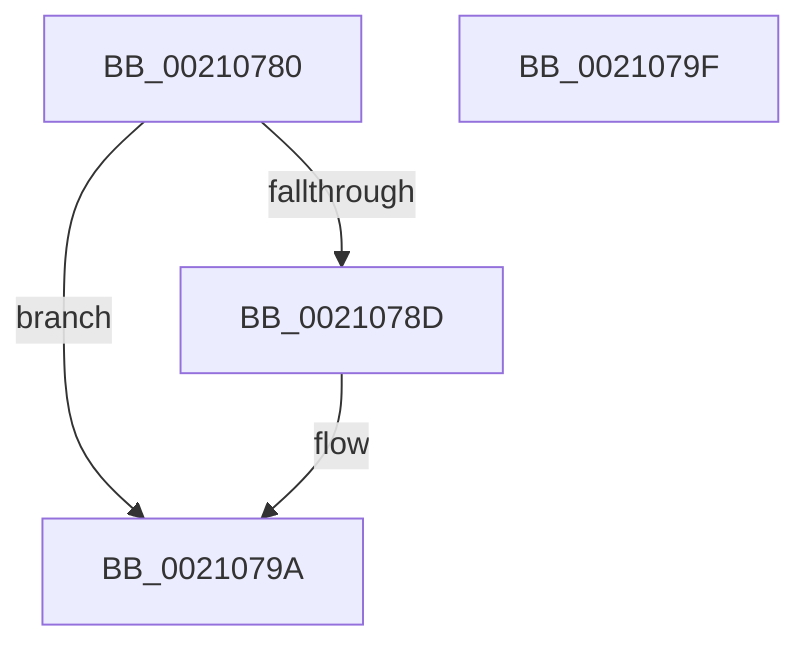

# ObpTraceObjectReferenceIfActive

- RVA: `0x00210780`–`0x002107A0` (길이 `32` bytes)
- VA: `0x0000000140210780`
- 실행 섹션: `.text`
- PDB 이름 있음: `예`; PDB Function 태그: `아니요`
- unwind 정보 RVA: `0x0005C788`
- 디코드: `10`개 명령, `32/32` bytes 표시
- 미해석 바이트: `0` (있으면 어셈블리에 `.byte`로 보존)

> 이 문서는 커널 이미지의 기계어와 PDB 기호를 분석해 생성했습니다. 4번과 5번은 함수 원형과 자료형을 바이너리 사용 방식에서 추정한 C 해석이며 원본 소스 복구 결과는 아닙니다.

## 1. Dependencies

- 직접 호출 지점: **1**; 고유 호출 대상: **1**
- 직접 호출자로 확인된 함수: **28**
- RIP 상대 이미지 참조: **1**

### Outgoing calls
- `0x00210795` → [ObpPushStackInfo](ObpPushStackInfo_function_002109E4.md) (function, `0x002109E4`)

### Direct callers
- [PsReferencePrimaryTokenWithTag](../20/PsReferencePrimaryTokenWithTag_function_0020FF80.md) at `0x0020FFF4`
- [ObfReferenceObjectWithTag](ObfReferenceObjectWithTag_function_00210710.md) at `0x00210730`
- [ObReferenceObjectSafeWithTag](ObReferenceObjectSafeWithTag_function_00210EE0.md) at `0x00210F0A`
- [CcReferenceSharedCacheMapFileObject](../23/CcReferenceSharedCacheMapFileObject_function_002379BC.md) at `0x00237A11`
- [MiStoreWriteModifiedPages](../2B/MiStoreWriteModifiedPages_function_002B46C4.md) at `0x002B4A38`
- [MiViewMayContainPage](../2E/MiViewMayContainPage_function_002E11F0.md) at `0x002E151E`
- [MiCompleteProtoPteFault](../34/MiCompleteProtoPteFault_function_00345710.md) at `0x00345CC9`
- [MiReferenceControlAreaFileWithTag](../34/MiReferenceControlAreaFileWithTag_function_00348390.md) at `0x003483EF`
- [MiEmptyPageAccessLog](../34/MiEmptyPageAccessLog_function_00348700.md) at `0x003488DD`
- [sub_003808A2](../38/Unknown_function_003808A2.md) at `0x003808F9`
- [ObFastReferenceObject](../40/ObFastReferenceObject_function_004099C0.md) at `0x00409A07`
- [sub_004198B2](../41/Unknown_function_004198B2.md) at `0x004198BE`
- [ObReferenceObjectSafe](../41/ObReferenceObjectSafe_function_0041DAE0.md) at `0x0041DB0D`
- [ObReferenceObjectExWithTag](../41/ObReferenceObjectExWithTag_function_0041FDB0.md) at `0x0041FDCB`
- [PopPushPowerStateTransitionRecordWithCallback](../43/PopPushPowerStateTransitionRecordWithCallback_function_00430A04.md) at `0x00430A82`
- [PopPushPowerStateTransitionRecordWithCallback](../43/PopPushPowerStateTransitionRecordWithCallback_function_00430A04.md) at `0x00430A9D`
- [MiReferenceControlAreaFile](../43/MiReferenceControlAreaFile_function_00431554.md) at `0x004315B3`
- [ObReferenceObjectByPointer](../43/ObReferenceObjectByPointer_function_00438D00.md) at `0x00438D49`
- [sub_00868496](../../page/86/Unknown_function_00868496.md) at `0x00868517`
- [ObWaitForMultipleObjects](../../page/86/ObWaitForMultipleObjects_function_00868DF0.md) at `0x00869064`
- [ObpReferenceObjectByHandleWithTag](../../page/86/ObpReferenceObjectByHandleWithTag_function_00869650.md) at `0x008697E2`
- [ObpReferenceObjectByHandleWithTag](../../page/86/ObpReferenceObjectByHandleWithTag_function_00869650.md) at `0x0086992C`
- [ObpReferenceObjectByHandleWithTag](../../page/86/ObpReferenceObjectByHandleWithTag_function_00869650.md) at `0x00869ADD`
- [ObpReferenceProcessObjectByHandle](../../page/89/ObpReferenceProcessObjectByHandle_function_00893C00.md) at `0x00893D3C`
- [ObpReferenceProcessObjectByHandle](../../page/89/ObpReferenceProcessObjectByHandle_function_00893C00.md) at `0x00893DA7`
- [ObpReferenceProcessObjectByHandle](../../page/89/ObpReferenceProcessObjectByHandle_function_00893C00.md) at `0x00893E2E`
- [ObpLookupObjectName](../../page/89/ObpLookupObjectName_function_0089BE90.md) at `0x0089C44E`
- [sub_008A2C2F](../../page/8A/Unknown_function_008A2C2F.md) at `0x008A2CB1`
- [ObDuplicateObject](../../page/8C/ObDuplicateObject_function_008C4FA0.md) at `0x008C51CA`
- [ObDuplicateObject](../../page/8C/ObDuplicateObject_function_008C4FA0.md) at `0x008C587E`
- [ObDuplicateObject](../../page/8C/ObDuplicateObject_function_008C4FA0.md) at `0x008C5B2F`
- [sub_008CBB8C](../../page/8C/Unknown_function_008CBB8C.md) at `0x008CBC0B`
- [NtWriteFile](../../page/8E/NtWriteFile_function_008E92D0.md) at `0x008E9442`
- [sub_0094BE3F](../../page/94/Unknown_function_0094BE3F.md) at `0x0094BF17`
- [sub_009A7932](../../page/9A/Unknown_function_009A7932.md) at `0x009A79B1`

### Static image references
- `0x00210784` → RVA `0x00FC5010` (`ALMOSTRO`; read)

## 2. Other-region calls and transfers

- 다른 실행 섹션으로 향하는 call: **0**
- 별도 외부 분기/꼬리 이동을 확인하지 못했습니다.

## 3. Assembly (complete function range)

```asm
00210780  48 83 EC 28                     sub rsp, 0x28
00210784  83 3D 85 48 DB 00 00            cmp dword ptr [rip + 0xdb4885], 0
0021078B  74 0D                           je 0x14021079a
0021078D  45 8B C8                        mov r9d, r8d
00210790  44 8B C2                        mov r8d, edx
00210793  B2 01                           mov dl, 1
00210795  E8 4A 02 00 00                  call 0x1402109e4
0021079A  48 83 C4 28                     add rsp, 0x28
0021079E  C3                              ret
0021079F  CC                              int3
```

## 4. C-style interpretation (structured pseudocode)

```c
__int64 __fastcall ObpTraceObjectReferenceIfActive(__int64 a1, int a2, int a3)
{
    __int64 result;
    __int64 v_rsp;

    v_rsp = (v_rsp) - (40);
    if ((*(unsigned int *)(v_rip + 14370949)) != 0) {
        a4 = a3;
        a3 = a2;
        a2 = 1;
        result = ObpPushStackInfo(a1, a2, a3, a4);
    }
    v_rsp = (v_rsp) + (40);
    return result;
}
```

## 5. (Beta) C Style

```c
int64_t ObpTraceObjectReferenceIfActive(int64_t Arg1, int32_t Arg2, int32_t Arg3)
{
    int64_t result;
    int64_t local_rsp;

    local_rsp = (local_rsp) - (40);
    if ((*(uint32_t *)(v_rip + 0xDB4885)) != 0) {
        a4 = Arg3;
        Arg3 = Arg2;
        Arg2 = 1;
        result = ObpPushStackInfo(Arg1, Arg2, Arg3, a4);
    }
    local_rsp = (local_rsp) + (40);
    return result;
}
```

## 6. Execution-region graph

[열기: 2D/3D 그래프와 함수 탐색 컨트롤 패널](../../../control-panel.html?section=text&rva=0x00210780&view=graph)

- 2D 그래프는 위에서 아래로 흐르고, 3D 그래프는 빈 공간을 드래그해 회전합니다. Shift+드래그는 이동, 휠은 확대·축소, 함수 노드 선택은 대상 보고서 이동입니다.

### Static fallback


