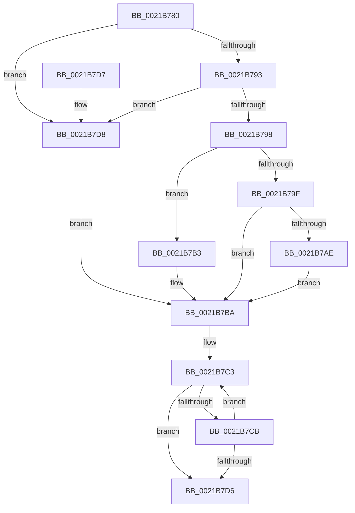

# PoGetFrequencyBucket

- RVA: `0x0021B780`–`0x0021B7E0` (길이 `96` bytes)
- VA: `0x000000014021B780`
- 실행 섹션: `.text`
- PDB 이름 있음: `예`; PDB Function 태그: `아니요`
- unwind 정보 RVA: `0x000DB714`
- 디코드: `28`개 명령, `96/96` bytes 표시
- 미해석 바이트: `0` (있으면 어셈블리에 `.byte`로 보존)

> 이 문서는 커널 이미지의 기계어와 PDB 기호를 분석해 생성했습니다. 4번과 5번은 함수 원형과 자료형을 바이너리 사용 방식에서 추정한 C 해석이며 원본 소스 복구 결과는 아닙니다.

## 1. Dependencies

- 직접 호출 지점: **0**; 고유 호출 대상: **0**
- 직접 호출자로 확인된 함수: **1**
- RIP 상대 이미지 참조: **0**

### Outgoing calls
- 직접 디코드된 call 명령이 없습니다.

### Direct callers
- [KiRetireDpcList](KiRetireDpcList_function_0021A0B0.md) at `0x0021AA1A`

### Static image references
- 디코드된 RIP-relative 메모리 참조가 없습니다.

## 2. Other-region calls and transfers

- 다른 실행 섹션으로 향하는 call: **0**
- 별도 외부 분기/꼬리 이동을 확인하지 못했습니다.

## 3. Assembly (complete function range)

```asm
0021B780  48 8B 81 B0 89 00 00            mov rax, qword ptr [rcx + 0x89b0]
0021B787  4C 8B 81 B8 89 00 00            mov r8, qword ptr [rcx + 0x89b8]
0021B78E  48 85 C0                        test rax, rax
0021B791  74 45                           je 0x14021b7d8
0021B793  4D 85 C0                        test r8, r8
0021B796  74 40                           je 0x14021b7d8
0021B798  41 80 78 70 00                  cmp byte ptr [r8 + 0x70], 0
0021B79D  75 14                           jne 0x14021b7b3
0021B79F  45 8B 40 50                     mov r8d, dword ptr [r8 + 0x50]
0021B7A3  8B 90 10 02 00 00               mov edx, dword ptr [rax + 0x210]
0021B7A9  44 3B C2                        cmp r8d, edx
0021B7AC  72 0C                           jb 0x14021b7ba
0021B7AE  44 8B C2                        mov r8d, edx
0021B7B1  EB 07                           jmp 0x14021b7ba
0021B7B3  45 8B 80 84 00 00 00            mov r8d, dword ptr [r8 + 0x84]
0021B7BA  33 C0                           xor eax, eax
0021B7BC  48 81 C1 6A 8A 00 00            add rcx, 0x8a6a
0021B7C3  0F B7 11                        movzx edx, word ptr [rcx]
0021B7C6  44 3B C2                        cmp r8d, edx
0021B7C9  76 0B                           jbe 0x14021b7d6
0021B7CB  FF C0                           inc eax
0021B7CD  48 83 C1 02                     add rcx, 2
0021B7D1  83 F8 03                        cmp eax, 3
0021B7D4  72 ED                           jb 0x14021b7c3
0021B7D6  C3                              ret
0021B7D7  CC                              int3
0021B7D8  41 B8 64 00 00 00               mov r8d, 0x64
0021B7DE  EB DA                           jmp 0x14021b7ba
```

## 4. C-style interpretation (structured pseudocode)

```c
__int64 __fastcall PoGetFrequencyBucket(__int64 a1)
{
    __int64 result;

    if (*(unsigned __int64 *)(a1 + 35248) == 0) goto loc_0021B7D8;
    if (*(unsigned __int64 *)(a1 + 35256) == 0) goto loc_0021B7D8;
    if ((*(unsigned __int8 *)(*(unsigned __int64 *)(a1 + 35256) + 112)) != 0) goto loc_0021B7B3;
    if (((unsigned int)((unsigned int)(*(unsigned int *)(*(unsigned __int64 *)(a1 + 35256) + 80)))) < ((unsigned int)((unsigned int)(*(unsigned int *)(*(unsigned __int64 *)(a1 + 35248) + 528))))) goto loc_0021B7BA;
    goto loc_0021B7BA;
loc_0021B7B3:
loc_0021B7BA:
    result = 0;
    a1 = (a1) + (0x8A6AULL);
loc_0021B7C3:
    if (((unsigned int)((unsigned int)(*(unsigned int *)((unsigned int)((unsigned int)((unsigned int)(*(unsigned int *)(*(unsigned __int64 *)(a1 + 35248) + 528)))) + 132)))) <= ((unsigned int)(*(unsigned __int16 *)(a1)))) goto loc_0021B7D6;
    result = (unsigned int)((result) + 1);
    a1 = (a1) + (2);
    if (((unsigned int)(result)) < 3) goto loc_0021B7C3;
loc_0021B7D6:
    return result;
loc_0021B7D8:
    goto loc_0021B7BA;
}
```

## 5. (Beta) C Style

```c
int64_t PoGetFrequencyBucket(void *Arg1)
{
    uint8_t *arg1 = (uint8_t *)Arg1;

    int64_t result;

    if (*(uint64_t *)(arg1 + 0x89B0) == 0) goto loc_0021B7D8;
    if (*(uint64_t *)(arg1 + 0x89B8) == 0) goto loc_0021B7D8;
    if ((*(uint8_t *)(*(uint64_t *)(arg1 + 0x89B8) + 0x70)) != 0) goto loc_0021B7B3;
    if (((uint32_t)((uint32_t)(*(uint32_t *)(*(uint64_t *)(arg1 + 0x89B8) + 0x50)))) < ((uint32_t)((uint32_t)(*(uint32_t *)(*(uint64_t *)(arg1 + 0x89B0) + 0x210))))) goto loc_0021B7BA;
    goto loc_0021B7BA;
loc_0021B7B3:
loc_0021B7BA:
    result = 0;
    Arg1 = (Arg1) + (0x8A6AULL);
loc_0021B7C3:
    if (((uint32_t)((uint32_t)(*(uint32_t *)((uint32_t)((uint32_t)((uint32_t)(*(uint32_t *)(*(uint64_t *)(arg1 + 0x89B0) + 0x210)))) + 0x84)))) <= ((uint32_t)(*(uint16_t *)(arg1)))) goto loc_0021B7D6;
    result = (uint32_t)((result) + 1);
    Arg1 = (Arg1) + (2);
    if (((uint32_t)(result)) < 3) goto loc_0021B7C3;
loc_0021B7D6:
    return result;
loc_0021B7D8:
    goto loc_0021B7BA;
}
```

### 관측된 메모리 오프셋

구조체 형식이 확인되지 않은 접근은 인자 기준의 오프셋으로만 기록했습니다.

| 기준 인자 | 오프셋 표현 | 폭 (bit) | 접근 |
|---|---:|---:|---|
| `Arg1` | `+ 0x0` | `16` | `R` |
| `Arg1` | `+ 0x89B0` | `64` | `R` |
| `Arg1` | `+ 0x89B8` | `64` | `R` |

## 6. Execution-region graph

[열기: 2D/3D 그래프와 함수 탐색 컨트롤 패널](../../../control-panel.html?section=text&rva=0x0021B780&view=graph)

- 2D 그래프는 위에서 아래로 흐르고, 3D 그래프는 빈 공간을 드래그해 회전합니다. Shift+드래그는 이동, 휠은 확대·축소, 함수 노드 선택은 대상 보고서 이동입니다.

### Static fallback


