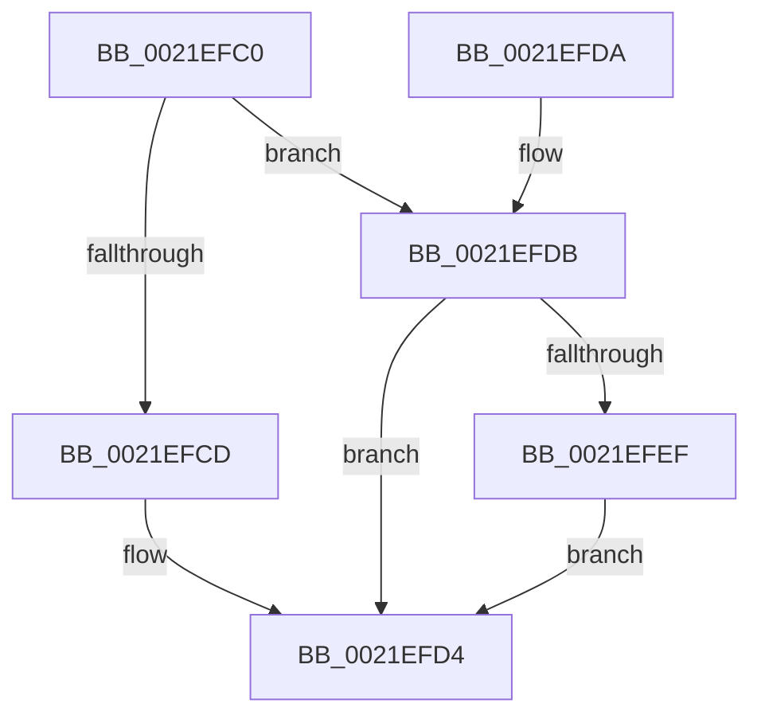

# PsBoostThreadIoQoS

- RVA: `0x0021EFC0`–`0x0021EFFA` (길이 `58` bytes)
- VA: `0x000000014021EFC0`
- 실행 섹션: `.text`
- PDB 이름 있음: `예`; PDB Function 태그: `아니요`
- unwind 정보 RVA: `0x0005F10C`
- 디코드: `18`개 명령, `58/58` bytes 표시
- 미해석 바이트: `0` (있으면 어셈블리에 `.byte`로 보존)

> 이 문서는 커널 이미지의 기계어와 PDB 기호를 분석해 생성했습니다. 4번과 5번은 함수 원형과 자료형을 바이너리 사용 방식에서 추정한 C 해석이며 원본 소스 복구 결과는 아닙니다.

## 1. Dependencies

- 직접 호출 지점: **0**; 고유 호출 대상: **0**
- 직접 호출자로 확인된 함수: **8**
- RIP 상대 이미지 참조: **0**

### Outgoing calls
- 직접 디코드된 call 명령이 없습니다.

### Direct callers
- [sub_00210EB6](Unknown_function_00210EB6.md) at `0x00210EC5`
- [sub_0021F36F](Unknown_function_0021F36F.md) at `0x0021F543`
- [sub_00220023](../22/Unknown_function_00220023.md) at `0x002200AA`
- [sub_002209D5](../22/Unknown_function_002209D5.md) at `0x00220A5C`
- [ExpSetResourceOwnerPointerEx](../34/ExpSetResourceOwnerPointerEx_function_00343E20.md) at `0x003441DF`
- [ExpSetResourceOwnerPointerEx](../34/ExpSetResourceOwnerPointerEx_function_00343E20.md) at `0x00344201`
- [ExpSetResourceOwnerPointerEx](../34/ExpSetResourceOwnerPointerEx_function_00343E20.md) at `0x003442B6`
- [sub_0038BBFB](../38/Unknown_function_0038BBFB.md) at `0x0038BD57`
- [sub_0038BBFB](../38/Unknown_function_0038BBFB.md) at `0x0038BDBB`
- [sub_0038BEEF](../38/Unknown_function_0038BEEF.md) at `0x0038BFF5`
- [sub_006E5438](../6E/Unknown_function_006E5438.md) at `0x006E5465`

### Static image references
- 디코드된 RIP-relative 메모리 참조가 없습니다.

## 2. Other-region calls and transfers

- 다른 실행 섹션으로 향하는 call: **0**
- 별도 외부 분기/꼬리 이동을 확인하지 못했습니다.

## 3. Assembly (complete function range)

```asm
0021EFC0  40 53                           push rbx
0021EFC2  48 83 EC 20                     sub rsp, 0x20
0021EFC6  48 8B D9                        mov rbx, rcx
0021EFC9  85 D2                           test edx, edx
0021EFCB  74 0E                           je 0x14021efdb
0021EFCD  F0 FF 89 E4 05 00 00            lock dec dword ptr [rcx + 0x5e4]
0021EFD4  48 83 C4 20                     add rsp, 0x20
0021EFD8  5B                              pop rbx
0021EFD9  C3                              ret
0021EFDA  CC                              int3
0021EFDB  B8 01 00 00 00                  mov eax, 1
0021EFE0  F0 0F C1 81 E4 05 00 00         lock xadd dword ptr [rcx + 0x5e4], eax
0021EFE8  FF C0                           inc eax
0021EFEA  83 F8 01                        cmp eax, 1
0021EFED  75 E5                           jne 0x14021efd4
0021EFEF  0F B6 81 18 03 00 00            movzx eax, byte ptr [rcx + 0x318]
0021EFF6  84 C0                           test al, al
0021EFF8  74 DA                           je 0x14021efd4
```

## 4. C-style interpretation (structured pseudocode)

```c
__int64 __fastcall PsBoostThreadIoQoS(__int64 a1, int a2)
{
    __int64 result;
    __int64 v_rsp;

    v_rsp = (v_rsp) - (32);
    if (a2 == 0) goto loc_0021EFDB;
loc_0021EFD4:
    v_rsp = (v_rsp) + (32);
    return result;
loc_0021EFDB:
    result = (unsigned int)((1) + 1);
    if (((unsigned int)(result)) != 1) goto loc_0021EFD4;
    if ((unsigned __int8)(*(unsigned __int8 *)(a1 + 792)) == 0) goto loc_0021EFD4;
}
```

## 5. (Beta) C Style

```c
int64_t PsBoostThreadIoQoS(void *Arg1, int32_t Arg2)
{
    uint8_t *arg1 = (uint8_t *)Arg1;

    int64_t result;
    int64_t local_rsp;

    local_rsp = (local_rsp) - (32);
    if (Arg2 == 0) goto loc_0021EFDB;
loc_0021EFD4:
    local_rsp = (local_rsp) + (32);
    return result;
loc_0021EFDB:
    result = (uint32_t)((1) + 1);
    if (((uint32_t)(result)) != 1) goto loc_0021EFD4;
    if ((uint8_t)(*(uint8_t *)(arg1 + 0x318)) == 0) goto loc_0021EFD4;
}
```

### 관측된 메모리 오프셋

구조체 형식이 확인되지 않은 접근은 인자 기준의 오프셋으로만 기록했습니다.

| 기준 인자 | 오프셋 표현 | 폭 (bit) | 접근 |
|---|---:|---:|---|
| `Arg1` | `+ 0x318` | `8` | `R` |
| `Arg1` | `+ 0x5E4` | `32` | `R/W` |

## 6. Execution-region graph

[열기: 2D/3D 그래프와 함수 탐색 컨트롤 패널](../../../control-panel.html?section=text&rva=0x0021EFC0&view=graph)

- 2D 그래프는 위에서 아래로 흐르고, 3D 그래프는 빈 공간을 드래그해 회전합니다. Shift+드래그는 이동, 휠은 확대·축소, 함수 노드 선택은 대상 보고서 이동입니다.

### Static fallback


