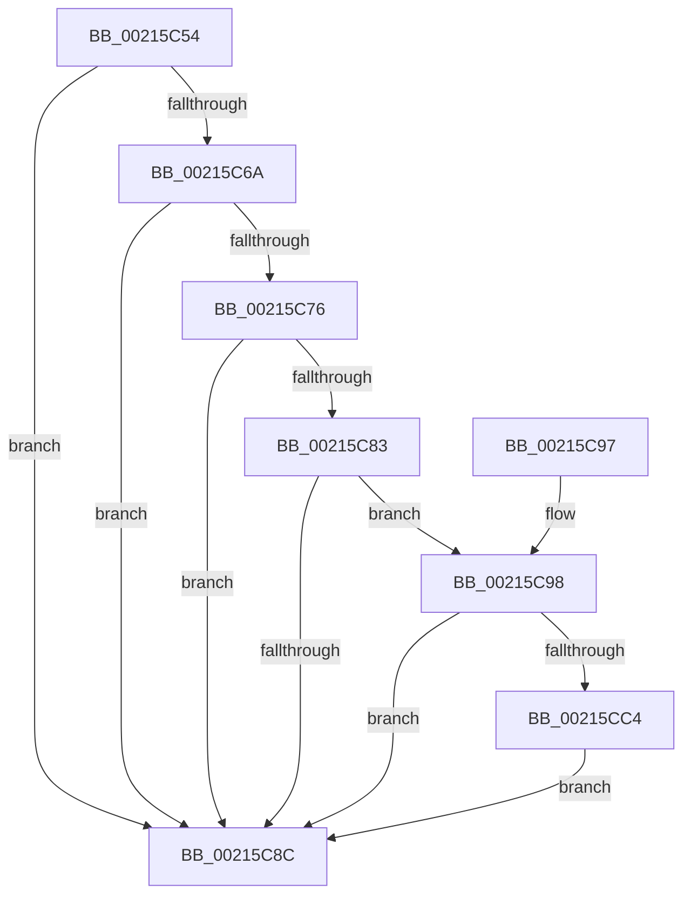

# PsBoostThreadOutstandingIoQoS

- RVA: `0x00215C54`–`0x00215CCB` (길이 `119` bytes)
- VA: `0x0000000140215C54`
- 실행 섹션: `.text`
- PDB 이름 있음: `예`; PDB Function 태그: `아니요`
- unwind 정보 RVA: `0x0005E1F8`
- 디코드: `34`개 명령, `119/119` bytes 표시
- 미해석 바이트: `0` (있으면 어셈블리에 `.byte`로 보존)

> 이 문서는 커널 이미지의 기계어와 PDB 기호를 분석해 생성했습니다. 4번과 5번은 함수 원형과 자료형을 바이너리 사용 방식에서 추정한 C 해석이며 원본 소스 복구 결과는 아닙니다.

## 1. Dependencies

- 직접 호출 지점: **3**; 고유 호출 대상: **3**
- 직접 호출자로 확인된 함수: **6**
- RIP 상대 이미지 참조: **1**

### Outgoing calls
- `0x00215C7A` → [ExAcquireRundownProtection](ExAcquireRundownProtection_function_00216620.md) (function, `0x00216620`)
- `0x00215C9F` → [guard_dispatch_icall](../6B/guard_dispatch_icall_function_006BAAD0.md) (function, `0x006BAAD0`)
- `0x00215CC4` → [ExfReleaseRundownProtection](../34/ExfReleaseRundownProtection_function_00349EB0.md) (function, `0x00349EB0`)

### Direct callers
- [ExpAcquireResourceSharedLite](ExpAcquireResourceSharedLite_function_00212040.md) at `0x00212EE6`
- [sub_002142F9](Unknown_function_002142F9.md) at `0x0021467C`
- [sub_00215166](Unknown_function_00215166.md) at `0x00215581`
- [KiAbConvertWaiterToOwnerEntry](KiAbConvertWaiterToOwnerEntry_function_00219430.md) at `0x00219A69`
- [sub_00221FB6](../22/Unknown_function_00221FB6.md) at `0x00222C98`
- [sub_00221FB6](../22/Unknown_function_00221FB6.md) at `0x00222CFC`
- [KiAbDeferredProcessingWorker](../30/KiAbDeferredProcessingWorker_function_0030DEB0.md) at `0x0030E75F`
- [KiAbDeferredProcessingWorker](../30/KiAbDeferredProcessingWorker_function_0030DEB0.md) at `0x0030E7C7`

### Static image references
- `0x00215C6A` → RVA `0x00F8D130` (`.data`; read)

## 2. Other-region calls and transfers

- 다른 실행 섹션으로 향하는 call: **0**
- 별도 외부 분기/꼬리 이동을 확인하지 못했습니다.

## 3. Assembly (complete function range)

```asm
00215C54  48 89 5C 24 10                  mov qword ptr [rsp + 0x10], rbx
00215C59  57                              push rdi
00215C5A  48 83 EC 20                     sub rsp, 0x20
00215C5E  83 B9 E8 05 00 00 00            cmp dword ptr [rcx + 0x5e8], 0
00215C65  48 8B F9                        mov rdi, rcx
00215C68  74 22                           je 0x140215c8c
00215C6A  48 8B 1D BF 74 D7 00            mov rbx, qword ptr [rip + 0xd774bf]
00215C71  48 85 DB                        test rbx, rbx
00215C74  74 16                           je 0x140215c8c
00215C76  48 8D 4B 58                     lea rcx, [rbx + 0x58]
00215C7A  E8 A1 09 00 00                  call 0x140216620
00215C7F  84 C0                           test al, al
00215C81  74 09                           je 0x140215c8c
00215C83  48 8B 43 60                     mov rax, qword ptr [rbx + 0x60]
00215C87  48 85 C0                        test rax, rax
00215C8A  75 0C                           jne 0x140215c98
00215C8C  48 8B 5C 24 38                  mov rbx, qword ptr [rsp + 0x38]
00215C91  48 83 C4 20                     add rsp, 0x20
00215C95  5F                              pop rdi
00215C96  C3                              ret
00215C97  CC                              int3
00215C98  48 8B 40 10                     mov rax, qword ptr [rax + 0x10]
00215C9C  48 8B CF                        mov rcx, rdi
00215C9F  E8 2C 4E 4A 00                  call 0x1406baad0
00215CA4  48 8B 0D 85 74 D7 00            mov rcx, qword ptr [rip + 0xd77485]
00215CAB  48 83 C1 58                     add rcx, 0x58
00215CAF  0F 0D 09                        prefetchw byte ptr [rcx]
00215CB2  48 8B 01                        mov rax, qword ptr [rcx]
00215CB5  48 83 E0 FE                     and rax, 0xfffffffffffffffe
00215CB9  48 8D 50 FE                     lea rdx, [rax - 2]
00215CBD  F0 48 0F B1 11                  lock cmpxchg qword ptr [rcx], rdx
00215CC2  74 C8                           je 0x140215c8c
00215CC4  E8 E7 41 13 00                  call 0x140349eb0
00215CC9  EB C1                           jmp 0x140215c8c
```

## 4. C-style interpretation (structured pseudocode)

```c
__int64 __fastcall PsBoostThreadOutstandingIoQoS(__int64 a1)
{
    __int64 result;
    __int64 v_rsp;
    unsigned __int64 v_stack_p10;

    v_stack_p10 = v_rbx;
    v_rsp = (v_rsp) - (32);
    if ((*(unsigned int *)(a1 + 1512)) == 0) goto loc_00215C8C;
    if (*(unsigned __int64 *)(v_rip + 14120127) == 0) goto loc_00215C8C;
    result = ExAcquireRundownProtection(*(unsigned __int64 *)(v_rip + 14120127) + 88, a2, a3, a4);
    if ((unsigned __int8)(result) == 0) goto loc_00215C8C;
    if (*(unsigned __int64 *)(*(unsigned __int64 *)(v_rip + 14120127) + 96) != 0) goto loc_00215C98;
loc_00215C8C:
    v_rsp = (v_rsp) + (32);
    return *(unsigned __int64 *)(*(unsigned __int64 *)(v_rip + 14120127) + 96);
loc_00215C98:
    result = guard_dispatch_icall(a1, a2, a3, a4);
    a1 = (*(unsigned __int64 *)(v_rip + 14120069)) + (88);
    result = (*(unsigned __int64 *)(a1)) & (-2);
    if (condition_is_equal) goto loc_00215C8C;
    result = ExfReleaseRundownProtection(a1, result - 2, a3, a4);
    goto loc_00215C8C;
}
```

## 5. (Beta) C Style

```c
int64_t PsBoostThreadOutstandingIoQoS(void *Arg1)
{
    uint8_t *arg1 = (uint8_t *)Arg1;

    int64_t result;
    int64_t local_rsp;
    uint64_t v_stack_p10;

    v_stack_p10 = local_rbx;
    local_rsp = (local_rsp) - (32);
    if ((*(uint32_t *)(arg1 + 0x5E8)) == 0) goto loc_00215C8C;
    if (*(uint64_t *)(v_rip + 0xD774BF) == 0) goto loc_00215C8C;
    result = ExAcquireRundownProtection(*(uint64_t *)(v_rip + 0xD774BF) + 88, a2, a3, a4);
    if ((uint8_t)(result) == 0) goto loc_00215C8C;
    if (*(uint64_t *)(*(uint64_t *)(v_rip + 0xD774BF) + 0x60) != 0) goto loc_00215C98;
loc_00215C8C:
    local_rsp = (local_rsp) + (32);
    return *(uint64_t *)(*(uint64_t *)(v_rip + 0xD774BF) + 0x60);
loc_00215C98:
    result = guard_dispatch_icall(Arg1, a2, a3, a4);
    Arg1 = (*(uint64_t *)(v_rip + 0xD77485)) + (88);
    result = (*(uint64_t *)(arg1)) & (-2);
    if (condition_is_equal) goto loc_00215C8C;
    result = ExfReleaseRundownProtection(Arg1, result - 2, a3, a4);
    goto loc_00215C8C;
}
```

### 관측된 메모리 오프셋

구조체 형식이 확인되지 않은 접근은 인자 기준의 오프셋으로만 기록했습니다.

| 기준 인자 | 오프셋 표현 | 폭 (bit) | 접근 |
|---|---:|---:|---|
| `Arg1` | `+ 0x5E8` | `32` | `R` |

## 6. Execution-region graph

[열기: 2D/3D 그래프와 함수 탐색 컨트롤 패널](../../../control-panel.html?section=text&rva=0x00215C54&view=graph)

- 2D 그래프는 위에서 아래로 흐르고, 3D 그래프는 빈 공간을 드래그해 회전합니다. Shift+드래그는 이동, 휠은 확대·축소, 함수 노드 선택은 대상 보고서 이동입니다.

### Static fallback


