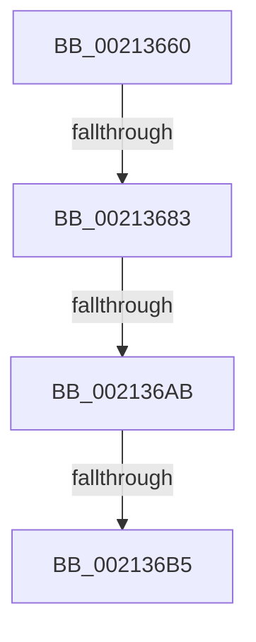

# SeSecurityAttributePresent

- RVA: `0x00213660`–`0x002136C2` (길이 `98` bytes)
- VA: `0x0000000140213660`
- 실행 섹션: `.text`
- PDB 이름 있음: `예`; PDB Function 태그: `아니요`
- unwind 정보 RVA: `0x0005DFC4`
- 디코드: `27`개 명령, `98/98` bytes 표시
- 미해석 바이트: `0` (있으면 어셈블리에 `.byte`로 보존)

> 이 문서는 커널 이미지의 기계어와 PDB 기호를 분석해 생성했습니다. 4번과 5번은 함수 원형과 자료형을 바이너리 사용 방식에서 추정한 C 해석이며 원본 소스 복구 결과는 아닙니다.

## 1. Dependencies

- 직접 호출 지점: **1**; 고유 호출 대상: **1**
- 직접 호출자로 확인된 함수: **8**
- RIP 상대 이미지 참조: **0**

### Outgoing calls
- `0x002136BA` → [ExpAcquireResourceSharedLite](ExpAcquireResourceSharedLite_function_00212040.md) (function, `0x00212040`)

### Direct callers
- [SepVerifyDesktopAppxPackageName](../3A/SepVerifyDesktopAppxPackageName_function_003A9728.md) at `0x003A97BD`
- [EtwpQueryTokenPackageInfo](../../page/8A/EtwpQueryTokenPackageInfo_function_008A5878.md) at `0x008A58AC`
- [EtwpQueryTokenPackageInfo](../../page/8A/EtwpQueryTokenPackageInfo_function_008A5878.md) at `0x008A58BD`
- [ExpGetProcessInformation](../../page/91/ExpGetProcessInformation_function_0091A878.md) at `0x0091ADD4`
- [PfpPrivSourceEnum](../../page/91/PfpPrivSourceEnum_function_0091BF00.md) at `0x0091C2B7`
- [PopEtGetProcessSidAndPackageIdentity](../../page/98/PopEtGetProcessSidAndPackageIdentity_function_0098FD2C.md) at `0x0098FD6A`
- [PopEtGetProcessSidAndPackageIdentity](../../page/98/PopEtGetProcessSidAndPackageIdentity_function_0098FD2C.md) at `0x0098FD7B`
- [PsQueryProcessAttributesByToken](../../page/9C/PsQueryProcessAttributesByToken_function_009C6350.md) at `0x009C6374`
- [PsQueryProcessAttributesByToken](../../page/9C/PsQueryProcessAttributesByToken_function_009C6350.md) at `0x009C638A`
- [PsQueryProcessAttributes](../../page/9D/PsQueryProcessAttributes_function_009DB630.md) at `0x009DB66A`
- [PsQueryProcessAttributes](../../page/9D/PsQueryProcessAttributes_function_009DB630.md) at `0x009DB681`
- [EtwpGetPsmKeyExtendedHeaderItem](../../page/AC/EtwpGetPsmKeyExtendedHeaderItem_function_00AC3EE0.md) at `0x00AC3F30`
- [EtwpGetPsmKeyExtendedHeaderItem](../../page/AC/EtwpGetPsmKeyExtendedHeaderItem_function_00AC3EE0.md) at `0x00AC3F41`

### Static image references
- 디코드된 RIP-relative 메모리 참조가 없습니다.

## 2. Other-region calls and transfers

- 다른 실행 섹션으로 향하는 call: **0**
- call이 아닌 외부 분기/꼬리 이동: **3**
  - `0x00213681` → [sub_002136C2](Unknown_function_002136C2.md) (`tail-transfer`)
  - `0x002136A5` → [sub_00213756](Unknown_function_00213756.md) (`tail-transfer`)
  - `0x002136AF` → [sub_00213798 + 0x39](Unknown_function_00213798.md) (`tail-transfer`)

## 3. Assembly (complete function range)

```asm
00213660  48 89 5C 24 10                  mov qword ptr [rsp + 0x10], rbx
00213665  48 89 6C 24 18                  mov qword ptr [rsp + 0x18], rbp
0021366A  56                              push rsi
0021366B  57                              push rdi
0021366C  41 57                           push r15
0021366E  48 83 EC 30                     sub rsp, 0x30
00213672  4C 8B FA                        mov r15, rdx
00213675  48 8B F1                        mov rsi, rcx
00213678  40 32 ED                        xor bpl, bpl
0021367B  44 0F 20 C0                     mov rax, cr8
0021367F  3C 02                           cmp al, 2
00213681  73 3F                           jae 0x1402136c2
00213683  65 48 8B 04 25 88 01 00 00      mov rax, qword ptr gs:[0x188]
0021368C  66 FF 88 E4 01 00 00            dec word ptr [rax + 0x1e4]
00213693  90                              nop
00213694  48 8B 59 30                     mov rbx, qword ptr [rcx + 0x30]
00213698  44 0F B7 43 1A                  movzx r8d, word ptr [rbx + 0x1a]
0021369D  41 0F B6 C0                     movzx eax, r8b
002136A1  24 41                           and al, 0x41
002136A3  3C 01                           cmp al, 1
002136A5  0F 84 AB 00 00 00               je 0x140213756
002136AB  41 F6 C0 01                     test r8b, 1
002136AF  0F 85 1C 01 00 00               jne 0x1402137d1
002136B5  B2 01                           mov dl, 1
002136B7  48 8B CB                        mov rcx, rbx
002136BA  E8 81 E9 FF FF                  call 0x140212040
002136BF  40 B5 01                        mov bpl, 1
```

## 4. C-style interpretation (structured pseudocode)

```c
__int64 __fastcall SeSecurityAttributePresent(__int64 a1, __int64 a2)
{
    __int64 result;
    __int64 v_rbp;
    __int64 v_rsp;
    unsigned __int64 v_stack_p10;
    unsigned __int64 v_stack_p18;

    v_stack_p10 = v_rbx;
    v_stack_p18 = v_rbp;
    v_rsp = (v_rsp) - (48);
    v_rbp = 0;
    result = (unsigned __int8)(((unsigned __int8)(*(unsigned __int16 *)(*(unsigned __int64 *)(a1 + 48) + 26))) & (65));
    result = ExpAcquireResourceSharedLite(*(unsigned __int64 *)(a1 + 48), 1, *(unsigned __int16 *)(*(unsigned __int64 *)(a1 + 48) + 26), a4);
    return result;
}
```

## 5. (Beta) C Style

```c
int64_t SeSecurityAttributePresent(void *Arg1, int64_t Arg2)
{
    uint8_t *arg1 = (uint8_t *)Arg1;

    int64_t result;
    int64_t local_rbp;
    int64_t local_rsp;
    uint64_t v_stack_p10;
    uint64_t v_stack_p18;

    v_stack_p10 = local_rbx;
    v_stack_p18 = local_rbp;
    local_rsp = (local_rsp) - (48);
    local_rbp = 0;
    result = (uint8_t)(((uint8_t)(*(uint16_t *)(*(uint64_t *)(arg1 + 0x30) + 0x1A))) & (65));
    result = ExpAcquireResourceSharedLite(*(uint64_t *)(arg1 + 0x30), 1, *(uint16_t *)(*(uint64_t *)(arg1 + 0x30) + 0x1A), a4);
    return result;
}
```

### 관측된 메모리 오프셋

구조체 형식이 확인되지 않은 접근은 인자 기준의 오프셋으로만 기록했습니다.

| 기준 인자 | 오프셋 표현 | 폭 (bit) | 접근 |
|---|---:|---:|---|
| `Arg1` | `+ 0x30` | `64` | `R` |

## 6. Execution-region graph

[열기: 2D/3D 그래프와 함수 탐색 컨트롤 패널](../../../control-panel.html?section=text&rva=0x00213660&view=graph)

- 2D 그래프는 위에서 아래로 흐르고, 3D 그래프는 빈 공간을 드래그해 회전합니다. Shift+드래그는 이동, 휠은 확대·축소, 함수 노드 선택은 대상 보고서 이동입니다.

### Static fallback


