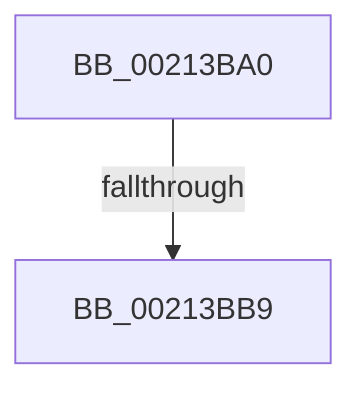

# SepAcquireOrderedReadLocks

- RVA: `0x00213BA0`–`0x00213BE2` (길이 `66` bytes)
- VA: `0x0000000140213BA0`
- 실행 섹션: `.text`
- PDB 이름 있음: `예`; PDB Function 태그: `아니요`
- unwind 정보 RVA: `0x0005E064`
- 디코드: `17`개 명령, `66/66` bytes 표시
- 미해석 바이트: `0` (있으면 어셈블리에 `.byte`로 보존)

> 이 문서는 커널 이미지의 기계어와 PDB 기호를 분석해 생성했습니다. 4번과 5번은 함수 원형과 자료형을 바이너리 사용 방식에서 추정한 C 해석이며 원본 소스 복구 결과는 아닙니다.

## 1. Dependencies

- 직접 호출 지점: **0**; 고유 호출 대상: **0**
- 직접 호출자로 확인된 함수: **3**
- RIP 상대 이미지 참조: **0**

### Outgoing calls
- 직접 디코드된 call 명령이 없습니다.

### Direct callers
- [sub_008CC5C2](../../page/8C/Unknown_function_008CC5C2.md) at `0x008CC5D2`
- [SeCompareTokens](../../page/8F/SeCompareTokens_function_008F6F40.md) at `0x008F6F74`
- [SepIsSiblingTokenByPointer](../../page/A3/SepIsSiblingTokenByPointer_function_00A3B514.md) at `0x00A3B5CC`

### Static image references
- 디코드된 RIP-relative 메모리 참조가 없습니다.

## 2. Other-region calls and transfers

- 다른 실행 섹션으로 향하는 call: **0**
- call이 아닌 외부 분기/꼬리 이동: **2**
  - `0x00213BB3` → [sub_00213C43 + 0x1](Unknown_function_00213C43.md) (`tail-transfer`)
  - `0x00213BDC` → [sub_00213C43 + 0x45](Unknown_function_00213C43.md) (`tail-transfer`)

## 3. Assembly (complete function range)

```asm
00213BA0  48 89 5C 24 10                  mov qword ptr [rsp + 0x10], rbx
00213BA5  57                              push rdi
00213BA6  48 83 EC 30                     sub rsp, 0x30
00213BAA  48 8B FA                        mov rdi, rdx
00213BAD  48 8B D9                        mov rbx, rcx
00213BB0  48 3B CA                        cmp rcx, rdx
00213BB3  0F 83 8B 00 00 00               jae 0x140213c44
00213BB9  0F AE E8                        lfence
00213BBC  65 48 8B 04 25 88 01 00 00      mov rax, qword ptr gs:[0x188]
00213BC5  66 FF 88 E4 01 00 00            dec word ptr [rax + 0x1e4]
00213BCC  90                              nop
00213BCD  48 8B 59 30                     mov rbx, qword ptr [rcx + 0x30]
00213BD1  0F B7 4B 1A                     movzx ecx, word ptr [rbx + 0x1a]
00213BD5  0F B6 C1                        movzx eax, cl
00213BD8  24 41                           and al, 0x41
00213BDA  3C 01                           cmp al, 1
00213BDC  0F 84 A6 00 00 00               je 0x140213c88
```

## 4. C-style interpretation (structured pseudocode)

```c
__int64 __fastcall SepAcquireOrderedReadLocks(__int64 a1, __int64 a2)
{
    __int64 result;
    __int64 v_rsp;
    unsigned __int64 v_stack_p10;

    v_stack_p10 = v_rbx;
    v_rsp = (v_rsp) - (48);
    result = (unsigned __int8)(((unsigned __int8)(*(unsigned __int16 *)(*(unsigned __int64 *)(a1 + 48) + 26))) & (65));
}
```

## 5. (Beta) C Style

```c
int64_t SepAcquireOrderedReadLocks(int64_t Arg1, int64_t Arg2)
{
    int64_t result;
    int64_t local_rsp;
    uint64_t v_stack_p10;

    v_stack_p10 = local_rbx;
    local_rsp = (local_rsp) - (48);
    result = (uint8_t)(((uint8_t)(*(uint16_t *)(*(uint64_t *)(Arg1 + 0x30) + 0x1A))) & (65));
}
```

## 6. Execution-region graph

[열기: 2D/3D 그래프와 함수 탐색 컨트롤 패널](../../../control-panel.html?section=text&rva=0x00213BA0&view=graph)

- 2D 그래프는 위에서 아래로 흐르고, 3D 그래프는 빈 공간을 드래그해 회전합니다. Shift+드래그는 이동, 휠은 확대·축소, 함수 노드 선택은 대상 보고서 이동입니다.

### Static fallback


