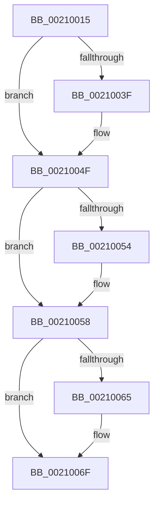

# sub_00210015

- RVA: `0x00210015`–`0x00210084` (길이 `111` bytes)
- VA: `0x0000000140210015`
- 실행 섹션: `.text`
- PDB 이름 있음: `아니요`; PDB Function 태그: `아니요`
- unwind 정보 RVA: `0x0005DC3C`
- 디코드: `30`개 명령, `111/111` bytes 표시
- 미해석 바이트: `0` (있으면 어셈블리에 `.byte`로 보존)

> 이 문서는 커널 이미지의 기계어와 PDB 기호를 분석해 생성했습니다. 4번과 5번은 함수 원형과 자료형을 바이너리 사용 방식에서 추정한 C 해석이며 원본 소스 복구 결과는 아닙니다.

## 1. Dependencies

- 직접 호출 지점: **3**; 고유 호출 대상: **3**
- 직접 호출자로 확인된 함수: **0**
- RIP 상대 이미지 참조: **0**

### Outgoing calls
- `0x00210028` → [KeAbPreAcquire](KeAbPreAcquire_function_00210230.md) (function, `0x00210230`)
- `0x0021004A` → [ExfAcquirePushLockSharedEx](ExfAcquirePushLockSharedEx_function_0021044C.md) (function, `0x0021044C`)
- `0x0021006A` → [ObfReferenceObjectWithTag](ObfReferenceObjectWithTag_function_00210710.md) (function, `0x00210710`)

### Direct callers
- 이 함수 시작 RVA로 연결되는 직접 call은 확인되지 않았습니다. 간접 호출은 완전히 역산할 수 없습니다.

### Static image references
- 디코드된 RIP-relative 메모리 참조가 없습니다.

## 2. Other-region calls and transfers

- 다른 실행 섹션으로 향하는 call: **0**
- call이 아닌 외부 분기/꼬리 이동: **1**
  - `0x0021007E` → [sub_00210084 + 0x160](Unknown_function_00210084.md) (`tail-transfer`)

## 3. Assembly (complete function range)

```asm
00210015  4C 89 7C 24 68                  mov qword ptr [rsp + 0x68], r15
0021001A  33 D2                           xor edx, edx
0021001C  48 8B CE                        mov rcx, rsi
0021001F  66 41 FF 8E E4 01 00 00         dec word ptr [r14 + 0x1e4]
00210027  90                              nop
00210028  E8 03 02 00 00                  call 0x140210230
0021002D  48 8B D8                        mov rbx, rax
00210030  41 BF 11 00 00 00               mov r15d, 0x11
00210036  33 C0                           xor eax, eax
00210038  F0 4C 0F B1 3E                  lock cmpxchg qword ptr [rsi], r15
0021003D  74 10                           je 0x14021004f
0021003F  4C 8B CE                        mov r9, rsi
00210042  4C 8B C3                        mov r8, rbx
00210045  33 D2                           xor edx, edx
00210047  48 8B CE                        mov rcx, rsi
0021004A  E8 FD 03 00 00                  call 0x14021044c
0021004F  48 85 DB                        test rbx, rbx
00210052  74 04                           je 0x140210058
00210054  C6 43 0A 01                     mov byte ptr [rbx + 0xa], 1
00210058  48 8B 9F 48 02 00 00            mov rbx, qword ptr [rdi + 0x248]
0021005F  48 83 E3 F0                     and rbx, 0xfffffffffffffff0
00210063  74 0A                           je 0x14021006f
00210065  8B D5                           mov edx, ebp
00210067  48 8B CB                        mov rcx, rbx
0021006A  E8 A1 06 00 00                  call 0x140210710
0021006F  49 8B C7                        mov rax, r15
00210072  33 ED                           xor ebp, ebp
00210074  4C 8B 7C 24 68                  mov r15, qword ptr [rsp + 0x68]
00210079  F0 48 0F B1 2E                  lock cmpxchg qword ptr [rsi], rbp
0021007E  0F 85 60 01 00 00               jne 0x1402101e4
```

## 4. C-style interpretation (structured pseudocode)

```c
__int64 __fastcall sub_00210015(__int64 a1, int a2, __int64 a3, __int64 a4, __int64 a5, __int64 a6, __int64 a7, __int64 a8, __int64 a9, __int64 a10, __int64 a11, __int64 a12, __int64 a13)
{
    __int64 result;
    __int64 v_rbp;
    __int64 v_rbx;
    unsigned __int64 v_stack_p68;

    v_stack_p68 = v_r15;
    a2 = 0;
    result = KeAbPreAcquire(v_rsi, a2, a3, a4);
    result = 0;
    if (!(condition_is_equal)) {
        a4 = v_rsi;
        a3 = 0;
        a2 = 0;
        a1 = v_rsi;
        result = ExfAcquirePushLockSharedEx(a1, a2, a3, a4);
    }
    if (result != 0) {
        *(unsigned __int8 *)(result + 10) = 1;
    }
    v_rbx = (*(unsigned __int64 *)(v_rdi + 584)) & (-16);
    if (!(condition_is_equal)) {
        a2 = (unsigned int)(v_rbp);
        a1 = v_rbx;
        result = ObfReferenceObjectWithTag(a1, a2, a3, a4);
    }
    v_rbp = 0;
}
```

## 5. (Beta) C Style

```c
int64_t sub_00210015(int64_t Arg1, int32_t Arg2, int64_t Arg3, int64_t Arg4, uint64_t Arg5, uint64_t Arg6, uint64_t Arg7, uint64_t Arg8, uint64_t Arg9, uint64_t Arg10, uint64_t Arg11, uint64_t Arg12, int64_t Arg13)
{
    int64_t result;
    int64_t local_rbp;
    int64_t local_rbx;
    uint64_t v_stack_p68;

    v_stack_p68 = local_r15;
    Arg2 = 0;
    result = KeAbPreAcquire(local_rsi, Arg2, Arg3, Arg4);
    result = 0;
    if (!(condition_is_equal)) {
        Arg4 = local_rsi;
        Arg3 = 0;
        Arg2 = 0;
        Arg1 = local_rsi;
        result = ExfAcquirePushLockSharedEx(Arg1, Arg2, Arg3, Arg4);
    }
    if (result != 0) {
        *(uint8_t *)(result + 0xA) = 1;
    }
    local_rbx = (*(uint64_t *)(local_rdi + 0x248)) & (-16);
    if (!(condition_is_equal)) {
        Arg2 = (uint32_t)(local_rbp);
        Arg1 = local_rbx;
        result = ObfReferenceObjectWithTag(Arg1, Arg2, Arg3, Arg4);
    }
    local_rbp = 0;
}
```

## 6. Execution-region graph

[열기: 2D/3D 그래프와 함수 탐색 컨트롤 패널](../../../control-panel.html?section=text&rva=0x00210015&view=graph)

- 2D 그래프는 위에서 아래로 흐르고, 3D 그래프는 빈 공간을 드래그해 회전합니다. Shift+드래그는 이동, 휠은 확대·축소, 함수 노드 선택은 대상 보고서 이동입니다.

### Static fallback


