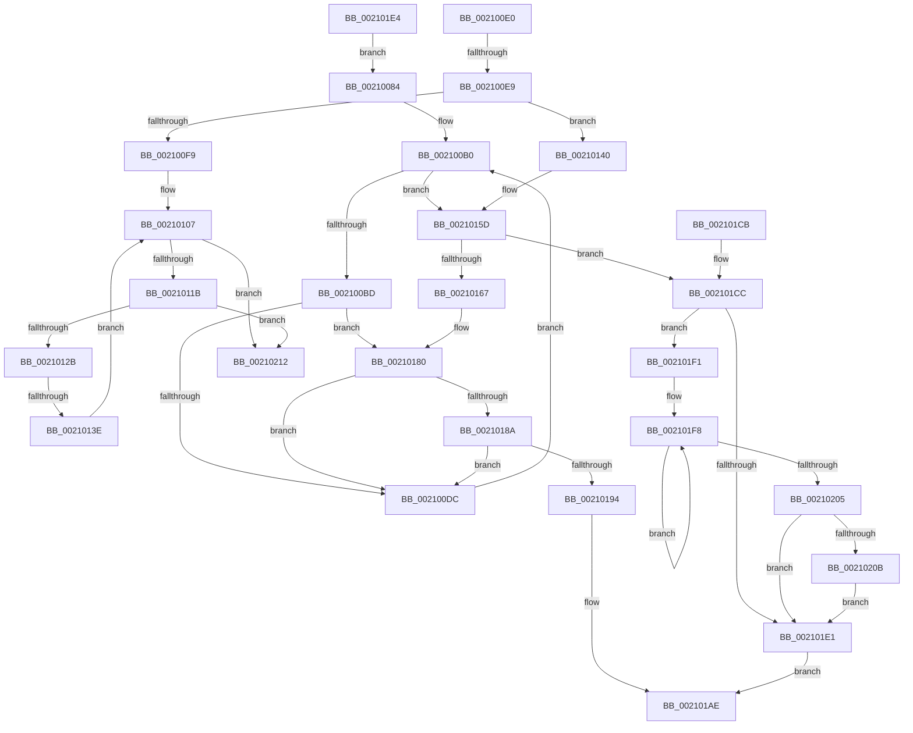

# sub_00210084

- RVA: `0x00210084`–`0x0021021D` (길이 `409` bytes)
- VA: `0x0000000140210084`
- 실행 섹션: `.text`
- PDB 이름 있음: `아니요`; PDB Function 태그: `아니요`
- unwind 정보 RVA: `0x0005DC50`
- 디코드: `103`개 명령, `409/409` bytes 표시
- 미해석 바이트: `0` (있으면 어셈블리에 `.byte`로 보존)

> 이 문서는 커널 이미지의 기계어와 PDB 기호를 분석해 생성했습니다. 4번과 5번은 함수 원형과 자료형을 바이너리 사용 방식에서 추정한 C 해석이며 원본 소스 복구 결과는 아닙니다.

## 1. Dependencies

- 직접 호출 지점: **6**; 고유 호출 대상: **5**
- 직접 호출자로 확인된 함수: **0**
- RIP 상대 이미지 참조: **0**

### Outgoing calls
- `0x00210157` → [KeBugCheckEx](../4F/KeBugCheckEx_function_004FD660.md) (function, `0x004FD660`)
- `0x0021017A` → [KeBugCheckEx](../4F/KeBugCheckEx_function_004FD660.md) (function, `0x004FD660`)
- `0x002101A9` → [KiAbEntryFreeAndEnableInterrupts](../26/KiAbEntryFreeAndEnableInterrupts_function_002622D0.md) (function, `0x002622D0`)
- `0x002101B1` → [KeLeaveCriticalRegionThread](../25/KeLeaveCriticalRegionThread_function_0025EFF0.md) (function, `0x0025EFF0`)
- `0x002101E7` → [ExfReleasePushLockShared](../26/ExfReleasePushLockShared_function_00263440.md) (function, `0x00263440`)
- `0x0021020B` → [KiRemoveSystemWorkPriorityKick](../26/KiRemoveSystemWorkPriorityKick_function_002631D0.md) (function, `0x002631D0`)

### Direct callers
- 이 함수 시작 RVA로 연결되는 직접 call은 확인되지 않았습니다. 간접 호출은 완전히 역산할 수 없습니다.

### Static image references
- 디코드된 RIP-relative 메모리 참조가 없습니다.

## 2. Other-region calls and transfers

- 다른 실행 섹션으로 향하는 call: **0**
- call이 아닌 외부 분기/꼬리 이동: **3**
  - `0x002100E3` → [PsReferencePrimaryTokenWithTag + 0x82](../20/PsReferencePrimaryTokenWithTag_function_0020FF80.md) (`tail-transfer`)
  - `0x00210138` → [PsReferencePrimaryTokenWithTag + 0x68](../20/PsReferencePrimaryTokenWithTag_function_0020FF80.md) (`tail-transfer`)
  - `0x00210218` → [PsReferencePrimaryTokenWithTag + 0x68](../20/PsReferencePrimaryTokenWithTag_function_0020FF80.md) (`tail-transfer`)

## 3. Assembly (complete function range)

```asm
00210084  65 4C 8B 14 25 88 01 00 00      mov r10, qword ptr gs:[0x188]
0021008D  FA                              cli
0021008E  4D 8B 82 70 04 00 00            mov r8, qword ptr [r10 + 0x470]
00210095  4C 8B DE                        mov r11, rsi
00210098  48 BF FC FF FF FF FF FF FF 7F   movabs rdi, 0x7ffffffffffffffc
002100A2  8B D5                           mov edx, ebp
002100A4  4C 23 DF                        and r11, rdi
002100A7  66 0F 1F 84 00 00 00 00 00      nop word ptr [rax + rax]
002100B0  41 0F B6 40 0C                  movzx eax, byte ptr [r8 + 0xc]
002100B5  3B D0                           cmp edx, eax
002100B7  0F 83 A0 00 00 00               jae 0x14021015d
002100BD  8B C2                           mov eax, edx
002100BF  48 6B C8 58                     imul rcx, rax, 0x58
002100C3  48 83 C1 10                     add rcx, 0x10
002100C7  49 03 C8                        add rcx, r8
002100CA  4C 8B 09                        mov r9, qword ptr [rcx]
002100CD  49 8B C1                        mov rax, r9
002100D0  48 23 C7                        and rax, rdi
002100D3  49 3B C3                        cmp rax, r11
002100D6  0F 84 A4 00 00 00               je 0x140210180
002100DC  FF C2                           inc edx
002100DE  EB D0                           jmp 0x1402100b0
002100E0  45 85 C0                        test r8d, r8d
002100E3  0F 84 19 FF FF FF               je 0x140210002
002100E9  B8 0F 00 00 00                  mov eax, 0xf
002100EE  F0 48 0F C1 43 D0               lock xadd qword ptr [rbx - 0x30], rax
002100F4  48 85 C0                        test rax, rax
002100F7  7E 47                           jle 0x140210140
002100F9  0F 0D 8F 48 02 00 00            prefetchw byte ptr [rdi + 0x248]
00210100  48 8B 87 48 02 00 00            mov rax, qword ptr [rdi + 0x248]
00210107  48 8B C8                        mov rcx, rax
0021010A  83 E1 0F                        and ecx, 0xf
0021010D  48 83 C1 0F                     add rcx, 0xf
00210111  48 83 F9 0F                     cmp rcx, 0xf
00210115  0F 87 F7 00 00 00               ja 0x140210212
0021011B  48 8B C8                        mov rcx, rax
0021011E  48 83 E1 F0                     and rcx, 0xfffffffffffffff0
00210122  48 3B D9                        cmp rbx, rcx
00210125  0F 85 E7 00 00 00               jne 0x140210212
0021012B  48 8D 48 0F                     lea rcx, [rax + 0xf]
0021012F  F0 48 0F B1 8F 48 02 00 00      lock cmpxchg qword ptr [rdi + 0x248], rcx
00210138  0F 84 AA FE FF FF               je 0x14020ffe8
0021013E  EB C7                           jmp 0x140210107
00210140  33 D2                           xor edx, edx
00210142  48 83 C0 0F                     add rax, 0xf
00210146  41 B9 10 00 00 00               mov r9d, 0x10
0021014C  48 89 44 24 20                  mov qword ptr [rsp + 0x20], rax
00210151  4C 8B C3                        mov r8, rbx
00210154  8D 4A 18                        lea ecx, [rdx + 0x18]
00210157  E8 04 D5 2E 00                  call 0x1404fd660
0021015C  CC                              int3
0021015D  41 8B 42 78                     mov eax, dword ptr [r10 + 0x78]
00210161  0F BA E0 10                     bt eax, 0x10
00210165  72 65                           jb 0x1402101cc
00210167  45 33 C9                        xor r9d, r9d
0021016A  48 89 6C 24 20                  mov qword ptr [rsp + 0x20], rbp
0021016F  4C 8B C6                        mov r8, rsi
00210172  49 8B D2                        mov rdx, r10
00210175  B9 62 01 00 00                  mov ecx, 0x162
0021017A  E8 E1 D4 2E 00                  call 0x1404fd660
0021017F  CC                              int3
00210180  40 38 69 0A                     cmp byte ptr [rcx + 0xa], bpl
00210184  0F 84 52 FF FF FF               je 0x1402100dc
0021018A  41 F6 C1 01                     test r9b, 1
0021018E  0F 85 48 FF FF FF               jne 0x1402100dc
00210194  41 B9 01 00 00 00               mov r9d, 1
0021019A  40 88 69 0A                     mov byte ptr [rcx + 0xa], bpl
0021019E  4C 8B C6                        mov r8, rsi
002101A1  48 89 6C 24 20                  mov qword ptr [rsp + 0x20], rbp
002101A6  49 8B D2                        mov rdx, r10
002101A9  E8 22 21 05 00                  call 0x1402622d0
002101AE  49 8B CE                        mov rcx, r14
002101B1  E8 3A EE 04 00                  call 0x14025eff0
002101B6  4C 8B 74 24 60                  mov r14, qword ptr [rsp + 0x60]
002101BB  48 8B C3                        mov rax, rbx
002101BE  48 8B 74 24 58                  mov rsi, qword ptr [rsp + 0x58]
002101C3  48 83 C4 30                     add rsp, 0x30
002101C7  5F                              pop rdi
002101C8  5D                              pop rbp
002101C9  5B                              pop rbx
002101CA  C3                              ret
002101CB  CC                              int3
002101CC  65 48 8B 0C 25 20 00 00 00      mov rcx, qword ptr gs:[0x20]
002101D5  4C 8B 81 B8 8E 00 00            mov r8, qword ptr [rcx + 0x8eb8]
002101DC  4D 85 C0                        test r8, r8
002101DF  75 10                           jne 0x1402101f1
002101E1  FB                              sti
002101E2  EB CA                           jmp 0x1402101ae
002101E4  48 8B CE                        mov rcx, rsi
002101E7  E8 54 32 05 00                  call 0x140263440
002101EC  E9 93 FE FF FF                  jmp 0x140210084
002101F1  41 0F 0D 08                     prefetchw byte ptr [r8]
002101F5  41 8B 00                        mov eax, dword ptr [r8]
002101F8  8B D0                           mov edx, eax
002101FA  0F BA F2 15                     btr edx, 0x15
002101FE  F0 41 0F B1 10                  lock cmpxchg dword ptr [r8], edx
00210203  75 F3                           jne 0x1402101f8
00210205  0F BA E0 15                     bt eax, 0x15
00210209  73 D6                           jae 0x1402101e1
0021020B  E8 C0 2F 05 00                  call 0x1402631d0
00210210  EB CF                           jmp 0x1402101e1
00210212  F0 48 83 43 D0 F1               lock add qword ptr [rbx - 0x30], -0xf
00210218  E9 CB FD FF FF                  jmp 0x14020ffe8
```

## 4. C-style interpretation (structured pseudocode)

```c
__int64 __fastcall sub_00210084(__int64 a1, __int64 a2, __int64 a3, __int64 a4, __int64 a5, __int64 a6, __int64 a7, __int64 a8, __int64 a9, __int64 a10, __int64 a11, __int64 a12)
{
    __int64 result;
    __int64 v_r11;
    __int64 v_rsp;
    unsigned __int64 v_stack_p20;

    v_r11 = (v_rsi) & (v_rdi);
loc_002100B0:
    if (((unsigned int)((unsigned int)((unsigned int)(v_rbp)))) >= ((unsigned int)(*(unsigned __int8 *)(*(unsigned __int64 *)(*(unsigned __int64 *)(gs_base + (0 + 392)) + 1136) + 12)))) goto loc_0021015D;
    a1 = (a1) * ((unsigned int)((unsigned int)((unsigned int)((unsigned int)(v_rbp)))));
    a1 = (a1) + (16);
    a1 = (a1) + (*(unsigned __int64 *)(*(unsigned __int64 *)(gs_base + (0 + 392)) + 1136));
    result = (*(unsigned __int64 *)(a1)) & (v_rdi);
    if (result == v_r11) goto loc_00210180;
loc_002100DC:
    a2 = (unsigned int)(((unsigned int)((unsigned int)(v_rbp))) + 1);
    goto loc_002100B0;
loc_0021015D:
    if (result < v_r11) goto loc_002101CC;
    a4 = 0;
    v_stack_p20 = v_rbp;
    result = KeBugCheckEx(354, *(unsigned __int64 *)(gs_base + (0 + 392)), v_rsi, a4);
loc_00210180:
    if ((*(unsigned __int8 *)(354 + 10)) == ((unsigned __int8)(v_rbp))) goto loc_002100DC;
    if (((0) & (1)) != 0) goto loc_002100DC;
    *(unsigned __int8 *)(354 + 10) = (unsigned __int8)(v_rbp);
    v_stack_p20 = v_rbp;
    result = KiAbEntryFreeAndEnableInterrupts(354, *(unsigned __int64 *)(gs_base + (0 + 392)), v_rsi, 1);
loc_002101AE:
    result = KeLeaveCriticalRegionThread(v_r14, *(unsigned __int64 *)(gs_base + (0 + 392)), v_rsi, 1);
    v_rsp = (v_rsp) + (48);
    return v_rbx;
loc_002101CC:
    if (*(unsigned __int64 *)(*(unsigned __int64 *)(gs_base + (0 + 32)) + 36536) != 0) goto loc_002101F1;
loc_002101E1:
    goto loc_002101AE;
loc_002101F1:
loc_002101F8:
    if (*(unsigned __int64 *)(*(unsigned __int64 *)(gs_base + (0 + 32)) + 36536) != 0) goto loc_002101F8;
    if (condition_is_above_or_equal) goto loc_002101E1;
    result = KiRemoveSystemWorkPriorityKick(*(unsigned __int64 *)(gs_base + (0 + 32)), (unsigned int)((unsigned int)((unsigned int)(*(unsigned int *)(*(unsigned __int64 *)(*(unsigned __int64 *)(gs_base + (0 + 32)) + 36536))))), *(unsigned __int64 *)(*(unsigned __int64 *)(gs_base + (0 + 32)) + 36536), 1);
    goto loc_002101E1;
}
```

## 5. (Beta) C Style

```c
int64_t sub_00210084(int64_t Arg1, int64_t Arg2, int64_t Arg3, int64_t Arg4, uint64_t Arg5, uint64_t Arg6, uint64_t Arg7, uint64_t Arg8, uint64_t Arg9, uint64_t Arg10, int64_t Arg11, int64_t Arg12)
{
    int64_t result;
    int64_t local_r11;
    int64_t local_rsp;
    uint64_t v_stack_p20;

    local_r11 = (local_rsi) & (local_rdi);
loc_002100B0:
    if (((uint32_t)((uint32_t)((uint32_t)(local_rbp)))) >= ((uint32_t)(*(uint8_t *)(*(uint64_t *)(*(uint64_t *)(gs_base + (0 + 0x188)) + 0x470) + 0xC)))) goto loc_0021015D;
    Arg1 = (Arg1) * ((uint32_t)((uint32_t)((uint32_t)((uint32_t)(local_rbp)))));
    Arg1 = (Arg1) + (16);
    Arg1 = (Arg1) + (*(uint64_t *)(*(uint64_t *)(gs_base + (0 + 0x188)) + 0x470));
    result = (*(uint64_t *)(Arg1)) & (local_rdi);
    if (result == local_r11) goto loc_00210180;
loc_002100DC:
    Arg2 = (uint32_t)(((uint32_t)((uint32_t)(local_rbp))) + 1);
    goto loc_002100B0;
loc_0021015D:
    if (result < local_r11) goto loc_002101CC;
    Arg4 = 0;
    v_stack_p20 = local_rbp;
    result = KeBugCheckEx(354, *(uint64_t *)(gs_base + (0 + 0x188)), local_rsi, Arg4);
loc_00210180:
    if ((*(uint8_t *)(354 + 0xA)) == ((uint8_t)(local_rbp))) goto loc_002100DC;
    if (((0) & (1)) != 0) goto loc_002100DC;
    *(uint8_t *)(354 + 0xA) = (uint8_t)(local_rbp);
    v_stack_p20 = local_rbp;
    result = KiAbEntryFreeAndEnableInterrupts(354, *(uint64_t *)(gs_base + (0 + 0x188)), local_rsi, 1);
loc_002101AE:
    result = KeLeaveCriticalRegionThread(local_r14, *(uint64_t *)(gs_base + (0 + 0x188)), local_rsi, 1);
    local_rsp = (local_rsp) + (48);
    return local_rbx;
loc_002101CC:
    if (*(uint64_t *)(*(uint64_t *)(gs_base + (0 + 0x20)) + 0x8EB8) != 0) goto loc_002101F1;
loc_002101E1:
    goto loc_002101AE;
loc_002101F1:
loc_002101F8:
    if (*(uint64_t *)(*(uint64_t *)(gs_base + (0 + 0x20)) + 0x8EB8) != 0) goto loc_002101F8;
    if (condition_is_above_or_equal) goto loc_002101E1;
    result = KiRemoveSystemWorkPriorityKick(*(uint64_t *)(gs_base + (0 + 0x20)), (uint32_t)((uint32_t)((uint32_t)(*(uint32_t *)(*(uint64_t *)(*(uint64_t *)(gs_base + (0 + 0x20)) + 0x8EB8))))), *(uint64_t *)(*(uint64_t *)(gs_base + (0 + 0x20)) + 0x8EB8), 1);
    goto loc_002101E1;
}
```

## 6. Execution-region graph

[열기: 2D/3D 그래프와 함수 탐색 컨트롤 패널](../../../control-panel.html?section=text&rva=0x00210084&view=graph)

- 2D 그래프는 위에서 아래로 흐르고, 3D 그래프는 빈 공간을 드래그해 회전합니다. Shift+드래그는 이동, 휠은 확대·축소, 함수 노드 선택은 대상 보고서 이동입니다.

### Static fallback


