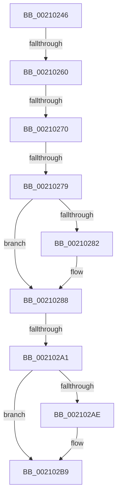

# sub_00210246

- RVA: `0x00210246`–`0x002102C8` (길이 `130` bytes)
- VA: `0x0000000140210246`
- 실행 섹션: `.text`
- PDB 이름 있음: `아니요`; PDB Function 태그: `아니요`
- unwind 정보 RVA: `0x0005DC70`
- 디코드: `31`개 명령, `130/130` bytes 표시
- 미해석 바이트: `0` (있으면 어셈블리에 `.byte`로 보존)

> 이 문서는 커널 이미지의 기계어와 PDB 기호를 분석해 생성했습니다. 4번과 5번은 함수 원형과 자료형을 바이너리 사용 방식에서 추정한 C 해석이며 원본 소스 복구 결과는 아닙니다.

## 1. Dependencies

- 직접 호출 지점: **1**; 고유 호출 대상: **1**
- 직접 호출자로 확인된 함수: **0**
- RIP 상대 이미지 참조: **1**

### Outgoing calls
- `0x002102B4` → [EtwTraceAutoBoostEntryExhaustion](EtwTraceAutoBoostEntryExhaustion_function_00210B04.md) (function, `0x00210B04`)

### Direct callers
- 이 함수 시작 RVA로 연결되는 직접 call은 확인되지 않았습니다. 간접 호출은 완전히 역산할 수 없습니다.

### Static image references
- `0x002102A2` → RVA `0x00FC6B14` (`ALMOSTRO`; read)

## 2. Other-region calls and transfers

- 다른 실행 섹션으로 향하는 call: **0**
- call이 아닌 외부 분기/꼬리 이동: **5**
  - `0x0021025A` → [sub_002102E2 + 0x5D](Unknown_function_002102E2.md) (`tail-transfer`)
  - `0x0021026E` → [sub_002102E2 + 0xB](Unknown_function_002102E2.md) (`tail-transfer`)
  - `0x00210277` → [sub_002102E2](Unknown_function_002102E2.md) (`tail-transfer`)
  - `0x0021029B` → [sub_002102E2 + 0xA5](Unknown_function_002102E2.md) (`tail-transfer`)
  - `0x002102C6` → [sub_002102C8 + 0xE](Unknown_function_002102C8.md) (`tail-transfer`)

## 3. Assembly (complete function range)

```asm
00210246  48 89 74 24 50                  mov qword ptr [rsp + 0x50], rsi
0021024B  89 54 24 58                     mov dword ptr [rsp + 0x58], edx
0021024F  48 8B E9                        mov rbp, rcx
00210252  48 89 54 24 68                  mov qword ptr [rsp + 0x68], rdx
00210257  48 85 FF                        test rdi, rdi
0021025A  0F 85 DF 00 00 00               jne 0x14021033f
00210260  FA                              cli
00210261  48 8B B3 70 04 00 00            mov rsi, qword ptr [rbx + 0x470]
00210268  0F B7 46 08                     movzx eax, word ptr [rsi + 8]
0021026C  85 C0                           test eax, eax
0021026E  75 7D                           jne 0x1402102ed
00210270  0F B7 46 0A                     movzx eax, word ptr [rsi + 0xa]
00210274  66 85 C0                        test ax, ax
00210277  75 69                           jne 0x1402102e2
00210279  F7 43 78 00 00 01 00            test dword ptr [rbx + 0x78], 0x10000
00210280  75 06                           jne 0x140210288
00210282  F0 0F BA 6B 78 10               lock bts dword ptr [rbx + 0x78], 0x10
00210288  65 48 8B 0C 25 20 00 00 00      mov rcx, qword ptr gs:[0x20]
00210291  4C 8B 81 B8 8E 00 00            mov r8, qword ptr [rcx + 0x8eb8]
00210298  4D 85 C0                        test r8, r8
0021029B  0F 85 E6 00 00 00               jne 0x140210387
002102A1  FB                              sti
002102A2  F7 05 68 68 DB 00 00 10 00 00   test dword ptr [rip + 0xdb6868], 0x1000
002102AC  74 0B                           je 0x1402102b9
002102AE  48 8B D5                        mov rdx, rbp
002102B1  48 8B CB                        mov rcx, rbx
002102B4  E8 4B 08 00 00                  call 0x140210b04
002102B9  4C 8B 44 24 68                  mov r8, qword ptr [rsp + 0x68]
002102BE  48 8B 74 24 50                  mov rsi, qword ptr [rsp + 0x50]
002102C3  45 85 C0                        test r8d, r8d
002102C6  74 0E                           je 0x1402102d6
```

## 4. C-style interpretation (structured pseudocode)

```c
__int64 __fastcall sub_00210246(__int64 a1, __int64 a2, __int64 a3, __int64 a4, __int64 a5, __int64 a6, __int64 a7, __int64 a8, __int64 a9, __int64 a10, __int64 a11, __int64 a12, __int64 a13)
{
    __int64 result;
    unsigned __int64 v_stack_p50;
    unsigned int v_stack_p58;
    unsigned __int64 v_stack_p68;

    v_stack_p50 = v_rsi;
    v_stack_p58 = (unsigned int)(a2);
    v_stack_p68 = a2;
    if (((*(unsigned int *)(v_rbx + 120)) & (0x10000ULL)) == 0) {
    }
    result = *(unsigned __int16 *)(*(unsigned __int64 *)(v_rbx + 1136) + 10);
    if (((*(unsigned int *)(v_rip + 14379112)) & (0x1000ULL)) != 0) {
        a2 = a1;
        a1 = v_rbx;
        result = EtwTraceAutoBoostEntryExhaustion(a1, a2, *(unsigned __int64 *)(*(unsigned __int64 *)(gs_base + (0 + 32)) + 36536), a4);
    }
}
```

## 5. (Beta) C Style

```c
int64_t sub_00210246(int64_t Arg1, int64_t Arg2, int64_t Arg3, int64_t Arg4, uint64_t Arg5, uint64_t Arg6, uint64_t Arg7, uint64_t Arg8, uint64_t Arg9, int64_t Arg10, uint64_t Arg11, uint64_t Arg12, int64_t Arg13)
{
    int64_t result;
    uint64_t v_stack_p50;
    uint32_t v_stack_p58;
    uint64_t v_stack_p68;

    v_stack_p50 = local_rsi;
    v_stack_p58 = (uint32_t)(Arg2);
    v_stack_p68 = Arg2;
    if (((*(uint32_t *)(local_rbx + 0x78)) & (0x10000ULL)) == 0) {
    }
    result = *(uint16_t *)(*(uint64_t *)(local_rbx + 0x470) + 0xA);
    if (((*(uint32_t *)(v_rip + 0xDB6868)) & (0x1000ULL)) != 0) {
        Arg2 = Arg1;
        Arg1 = local_rbx;
        result = EtwTraceAutoBoostEntryExhaustion(Arg1, Arg2, *(uint64_t *)(*(uint64_t *)(gs_base + (0 + 0x20)) + 0x8EB8), Arg4);
    }
}
```

## 6. Execution-region graph

[열기: 2D/3D 그래프와 함수 탐색 컨트롤 패널](../../../control-panel.html?section=text&rva=0x00210246&view=graph)

- 2D 그래프는 위에서 아래로 흐르고, 3D 그래프는 빈 공간을 드래그해 회전합니다. Shift+드래그는 이동, 휠은 확대·축소, 함수 노드 선택은 대상 보고서 이동입니다.

### Static fallback


