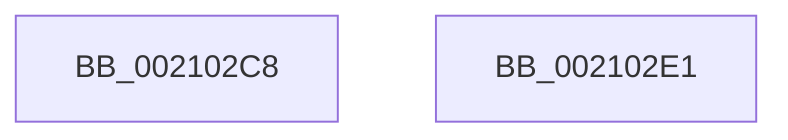

# sub_002102C8

- RVA: `0x002102C8`–`0x002102E2` (길이 `26` bytes)
- VA: `0x00000001402102C8`
- 실행 섹션: `.text`
- PDB 이름 있음: `아니요`; PDB Function 태그: `아니요`
- unwind 정보 RVA: `0x0005DC84`
- 디코드: `11`개 명령, `26/26` bytes 표시
- 미해석 바이트: `0` (있으면 어셈블리에 `.byte`로 보존)

> 이 문서는 커널 이미지의 기계어와 PDB 기호를 분석해 생성했습니다. 4번과 5번은 함수 원형과 자료형을 바이너리 사용 방식에서 추정한 C 해석이며 원본 소스 복구 결과는 아닙니다.

## 1. Dependencies

- 직접 호출 지점: **1**; 고유 호출 대상: **1**
- 직접 호출자로 확인된 함수: **0**
- RIP 상대 이미지 참조: **0**

### Outgoing calls
- `0x002102D1` → [KiAbThreadRemoveBoostsSlow](KiAbThreadRemoveBoostsSlow_function_00210BB0.md) (function, `0x00210BB0`)

### Direct callers
- 이 함수 시작 RVA로 연결되는 직접 call은 확인되지 않았습니다. 간접 호출은 완전히 역산할 수 없습니다.

### Static image references
- 디코드된 RIP-relative 메모리 참조가 없습니다.

## 2. Other-region calls and transfers

- 다른 실행 섹션으로 향하는 call: **0**
- 별도 외부 분기/꼬리 이동을 확인하지 못했습니다.

## 3. Assembly (complete function range)

```asm
002102C8  45 33 C9                        xor r9d, r9d
002102CB  48 8B D5                        mov rdx, rbp
002102CE  48 8B CB                        mov rcx, rbx
002102D1  E8 DA 08 00 00                  call 0x140210bb0
002102D6  48 8B C7                        mov rax, rdi
002102D9  48 83 C4 30                     add rsp, 0x30
002102DD  5F                              pop rdi
002102DE  5D                              pop rbp
002102DF  5B                              pop rbx
002102E0  C3                              ret
002102E1  CC                              int3
```

## 4. C-style interpretation (structured pseudocode)

```c
__int64 __fastcall sub_002102C8(__int64 a1, __int64 a2, __int64 a3, int a4)
{
    __int64 result;
    __int64 v_rsp;

    a4 = 0;
    result = KiAbThreadRemoveBoostsSlow(v_rbx, v_rbp, a3, a4);
    v_rsp = (v_rsp) + (48);
    return v_rdi;
}
```

## 5. (Beta) C Style

```c
int64_t sub_002102C8(int64_t Arg1, int64_t Arg2, int64_t Arg3, int32_t Arg4)
{
    int64_t result;
    int64_t local_rsp;

    Arg4 = 0;
    result = KiAbThreadRemoveBoostsSlow(local_rbx, local_rbp, Arg3, Arg4);
    local_rsp = (local_rsp) + (48);
    return local_rdi;
}
```

## 6. Execution-region graph

[열기: 2D/3D 그래프와 함수 탐색 컨트롤 패널](../../../control-panel.html?section=text&rva=0x002102C8&view=graph)

- 2D 그래프는 위에서 아래로 흐르고, 3D 그래프는 빈 공간을 드래그해 회전합니다. Shift+드래그는 이동, 휠은 확대·축소, 함수 노드 선택은 대상 보고서 이동입니다.

### Static fallback


