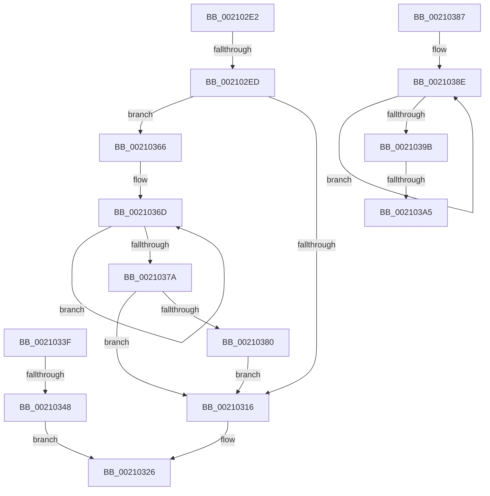

# sub_002102E2

- RVA: `0x002102E2`–`0x002103AF` (길이 `205` bytes)
- VA: `0x00000001402102E2`
- 실행 섹션: `.text`
- PDB 이름 있음: `아니요`; PDB Function 태그: `아니요`
- unwind 정보 RVA: `0x0005DC98`
- 디코드: `56`개 명령, `205/205` bytes 표시
- 미해석 바이트: `0` (있으면 어셈블리에 `.byte`로 보존)

> 이 문서는 커널 이미지의 기계어와 PDB 기호를 분석해 생성했습니다. 4번과 5번은 함수 원형과 자료형을 바이너리 사용 방식에서 추정한 C 해석이며 원본 소스 복구 결과는 아닙니다.

## 1. Dependencies

- 직접 호출 지점: **3**; 고유 호출 대상: **2**
- 직접 호출자로 확인된 함수: **0**
- RIP 상대 이미지 참조: **0**

### Outgoing calls
- `0x0021035F` → [KiAbEntryFreeAndEnableInterrupts](../26/KiAbEntryFreeAndEnableInterrupts_function_002622D0.md) (function, `0x002622D0`)
- `0x00210380` → [KiRemoveSystemWorkPriorityKick](../26/KiRemoveSystemWorkPriorityKick_function_002631D0.md) (function, `0x002631D0`)
- `0x002103A5` → [KiRemoveSystemWorkPriorityKick](../26/KiRemoveSystemWorkPriorityKick_function_002631D0.md) (function, `0x002631D0`)

### Direct callers
- 이 함수 시작 RVA로 연결되는 직접 call은 확인되지 않았습니다. 간접 호출은 완전히 역산할 수 없습니다.

### Static image references
- 디코드된 RIP-relative 메모리 참조가 없습니다.

## 2. Other-region calls and transfers

- 다른 실행 섹션으로 향하는 call: **0**
- call이 아닌 외부 분기/꼬리 이동: **5**
  - `0x002102EB` → [sub_00210246 + 0x73](Unknown_function_00210246.md) (`tail-transfer`)
  - `0x0021033A` → [sub_00210246 + 0x73](Unknown_function_00210246.md) (`tail-transfer`)
  - `0x00210342` → [sub_00210246 + 0x73](Unknown_function_00210246.md) (`tail-transfer`)
  - `0x0021039F` → [sub_00210246 + 0x5B](Unknown_function_00210246.md) (`tail-transfer`)
  - `0x002103AA` → [sub_00210246 + 0x5B](Unknown_function_00210246.md) (`tail-transfer`)

## 3. Assembly (complete function range)

```asm
002102E2  66 87 56 0A                     xchg word ptr [rsi + 0xa], dx
002102E6  0F BF C2                        movsx eax, dx
002102E9  85 C0                           test eax, eax
002102EB  74 CC                           je 0x1402102b9
002102ED  0F BC C8                        bsf ecx, eax
002102F0  0F B6 C0                        movzx eax, al
002102F3  0F B3 C8                        btr eax, ecx
002102F6  89 4C 24 58                     mov dword ptr [rsp + 0x58], ecx
002102FA  0F B6 C0                        movzx eax, al
002102FD  66 89 46 08                     mov word ptr [rsi + 8], ax
00210301  65 48 8B 0C 25 20 00 00 00      mov rcx, qword ptr gs:[0x20]
0021030A  4C 8B 81 B8 8E 00 00            mov r8, qword ptr [rcx + 0x8eb8]
00210311  4D 85 C0                        test r8, r8
00210314  75 50                           jne 0x140210366
00210316  FB                              sti
00210317  8B 44 24 58                     mov eax, dword ptr [rsp + 0x58]
0021031B  48 6B F8 58                     imul rdi, rax, 0x58
0021031F  48 83 C7 10                     add rdi, 0x10
00210323  48 03 FE                        add rdi, rsi
00210326  48 8B CD                        mov rcx, rbp
00210329  48 B8 FC FF FF FF FF FF FF 7F   movabs rax, 0x7ffffffffffffffc
00210333  48 23 C8                        and rcx, rax
00210336  90                              nop
00210337  48 89 0F                        mov qword ptr [rdi], rcx
0021033A  E9 7A FF FF FF                  jmp 0x1402102b9
0021033F  38 57 09                        cmp byte ptr [rdi + 9], dl
00210342  0F 84 71 FF FF FF               je 0x1402102b9
00210348  FA                              cli
00210349  48 8D 44 24 68                  lea rax, [rsp + 0x68]
0021034E  45 33 C9                        xor r9d, r9d
00210351  4C 8B C5                        mov r8, rbp
00210354  48 89 44 24 20                  mov qword ptr [rsp + 0x20], rax
00210359  48 8B D3                        mov rdx, rbx
0021035C  48 8B CF                        mov rcx, rdi
0021035F  E8 6C 1F 05 00                  call 0x1402622d0
00210364  EB C0                           jmp 0x140210326
00210366  41 0F 0D 08                     prefetchw byte ptr [r8]
0021036A  41 8B 00                        mov eax, dword ptr [r8]
0021036D  8B D0                           mov edx, eax
0021036F  0F BA F2 15                     btr edx, 0x15
00210373  F0 41 0F B1 10                  lock cmpxchg dword ptr [r8], edx
00210378  75 F3                           jne 0x14021036d
0021037A  0F BA E0 15                     bt eax, 0x15
0021037E  73 96                           jae 0x140210316
00210380  E8 4B 2E 05 00                  call 0x1402631d0
00210385  EB 8F                           jmp 0x140210316
00210387  41 0F 0D 08                     prefetchw byte ptr [r8]
0021038B  41 8B 00                        mov eax, dword ptr [r8]
0021038E  8B D0                           mov edx, eax
00210390  0F BA F2 15                     btr edx, 0x15
00210394  F0 41 0F B1 10                  lock cmpxchg dword ptr [r8], edx
00210399  75 F3                           jne 0x14021038e
0021039B  0F BA E0 15                     bt eax, 0x15
0021039F  0F 83 FC FE FF FF               jae 0x1402102a1
002103A5  E8 26 2E 05 00                  call 0x1402631d0
002103AA  E9 F2 FE FF FF                  jmp 0x1402102a1
```

## 4. C-style interpretation (structured pseudocode)

```c
__int64 __fastcall sub_002102E2(__int64 a1, unsigned __int16 a2, __int64 a3, int a4, __int64 a5, __int64 a6, __int64 a7, __int64 a8, __int64 a9, __int64 a10, unsigned int a11)
{
    __int64 result;
    __int64 v_rdi;
    unsigned __int64 v_stack_p20;
    unsigned int v_stack_p58;
    unsigned __int64 v_stack_p68;

    v_stack_p58 = (unsigned int)(a1);
    *(unsigned __int16 *)(v_rsi + 8) = (unsigned __int16)((unsigned __int8)((unsigned __int8)((__int16)(a2))));
    if (*(unsigned __int64 *)(*(unsigned __int64 *)(gs_base + (0 + 32)) + 36536) != 0) goto loc_00210366;
loc_00210316:
    v_rdi = (v_rdi) * ((unsigned int)(a11));
    v_rdi = (v_rdi) + (16);
    v_rdi = (v_rdi) + (v_rsi);
loc_00210326:
    a1 = (v_rbp) & ((unsigned int)(a11));
    *(unsigned __int64 *)(v_rdi) = a1;
loc_00210366:
loc_0021036D:
    if (condition_is_not_equal) goto loc_0021036D;
    if (condition_is_above_or_equal) goto loc_00210316;
    result = KiRemoveSystemWorkPriorityKick(a1, (unsigned int)((unsigned int)((unsigned int)(*(unsigned int *)(*(unsigned __int64 *)(*(unsigned __int64 *)(gs_base + (0 + 32)) + 36536))))), *(unsigned __int64 *)(*(unsigned __int64 *)(gs_base + (0 + 32)) + 36536), a4);
    goto loc_00210316;
}
```

## 5. (Beta) C Style

```c
int64_t sub_002102E2(int64_t Arg1, uint16_t Arg2, int64_t Arg3, int32_t Arg4, uint64_t Arg5, uint64_t Arg6, uint64_t Arg7, uint64_t Arg8, uint64_t Arg9, uint64_t Arg10, uint32_t Arg11)
{
    int64_t result;
    int64_t local_rdi;
    uint64_t v_stack_p20;
    uint32_t v_stack_p58;
    uint64_t v_stack_p68;

    v_stack_p58 = (uint32_t)(Arg1);
    *(uint16_t *)(local_rsi + 0x8) = (uint16_t)((uint8_t)((uint8_t)((int16_t)(Arg2))));
    if (*(uint64_t *)(*(uint64_t *)(gs_base + (0 + 0x20)) + 0x8EB8) != 0) goto loc_00210366;
loc_00210316:
    local_rdi = (local_rdi) * ((uint32_t)(Arg11));
    local_rdi = (local_rdi) + (16);
    local_rdi = (local_rdi) + (local_rsi);
loc_00210326:
    Arg1 = (local_rbp) & ((uint32_t)(Arg11));
    *(uint64_t *)(local_rdi) = Arg1;
loc_00210366:
loc_0021036D:
    if (condition_is_not_equal) goto loc_0021036D;
    if (condition_is_above_or_equal) goto loc_00210316;
    result = KiRemoveSystemWorkPriorityKick(Arg1, (uint32_t)((uint32_t)((uint32_t)(*(uint32_t *)(*(uint64_t *)(*(uint64_t *)(gs_base + (0 + 0x20)) + 0x8EB8))))), *(uint64_t *)(*(uint64_t *)(gs_base + (0 + 0x20)) + 0x8EB8), Arg4);
    goto loc_00210316;
}
```

## 6. Execution-region graph

[열기: 2D/3D 그래프와 함수 탐색 컨트롤 패널](../../../control-panel.html?section=text&rva=0x002102E2&view=graph)

- 2D 그래프는 위에서 아래로 흐르고, 3D 그래프는 빈 공간을 드래그해 회전합니다. Shift+드래그는 이동, 휠은 확대·축소, 함수 노드 선택은 대상 보고서 이동입니다.

### Static fallback


