# sub_00210801

- RVA: `0x00210801`–`0x002109A2` (길이 `417` bytes)
- VA: `0x0000000140210801`
- 실행 섹션: `.text`
- PDB 이름 있음: `아니요`; PDB Function 태그: `아니요`
- unwind 정보 RVA: `0x0005DD04`
- 디코드: `102`개 명령, `417/417` bytes 표시
- 미해석 바이트: `0` (있으면 어셈블리에 `.byte`로 보존)

> 이 문서는 커널 이미지의 기계어와 PDB 기호를 분석해 생성했습니다. 4번과 5번은 함수 원형과 자료형을 바이너리 사용 방식에서 추정한 C 해석이며 원본 소스 복구 결과는 아닙니다.

## 1. Dependencies

- 직접 호출 지점: **7**; 고유 호출 대상: **7**
- 직접 호출자로 확인된 함수: **0**
- RIP 상대 이미지 참조: **4**

### Outgoing calls
- `0x00210817` → [KeAcquireSpinLockRaiseToDpc](../20/KeAcquireSpinLockRaiseToDpc_function_00208470.md) (function, `0x00208470`)
- `0x002108A8` → [ObpPushStackInfo](ObpPushStackInfo_function_002109E4.md) (function, `0x002109E4`)
- `0x002108DE` → [KiLowerIrqlProcessIrqlFlags](../4F/KiLowerIrqlProcessIrqlFlags_function_004F5698.md) (function, `0x004F5698`)
- `0x002108FE` → [IoFreeIrp](../24/IoFreeIrp_function_0024DF70.md) (function, `0x0024DF70`)
- `0x00210935` → [KiReleaseSpinLockInstrumented](../39/KiReleaseSpinLockInstrumented_function_00392EF0.md) (function, `0x00392EF0`)
- `0x00210944` → [ObfDereferenceObjectWithTag](../2F/ObfDereferenceObjectWithTag_function_002F78E0.md) (function, `0x002F78E0`)
- `0x00210960` → [ObDereferenceObjectExWithTag](../43/ObDereferenceObjectExWithTag_function_0043CBC0.md) (function, `0x0043CBC0`)

### Direct callers
- 이 함수 시작 RVA로 연결되는 직접 call은 확인되지 않았습니다. 간접 호출은 완전히 역산할 수 없습니다.

### Static image references
- `0x0021088F` → RVA `0x00FC5010` (`ALMOSTRO`; read)
- `0x002108BB` → RVA `0x00FC6B06` (`ALMOSTRO`; read)
- `0x002108CD` → RVA `0x00FC6D20` (`ALMOSTRO`; read)
- `0x0021091F` → RVA `0x00F0DE58` (`.data`; read)

## 2. Other-region calls and transfers

- 다른 실행 섹션으로 향하는 call: **0**
- 별도 외부 분기/꼬리 이동을 확인하지 못했습니다.

## 3. Assembly (complete function range)

```asm
00210801  48 89 74 24 30                  mov qword ptr [rsp + 0x30], rsi
00210806  0F BA E0 0D                     bt eax, 0xd
0021080A  0F 83 DE 00 00 00               jae 0x1402108ee
00210810  49 8D 8E B8 00 00 00            lea rcx, [r14 + 0xb8]
00210817  E8 54 7C FF FF                  call 0x140208470
0021081C  48 8B 55 20                     mov rdx, qword ptr [rbp + 0x20]
00210820  0F B6 F0                        movzx esi, al
00210823  48 8D 45 20                     lea rax, [rbp + 0x20]
00210827  48 39 42 08                     cmp qword ptr [rdx + 8], rax
0021082B  75 09                           jne 0x140210836
0021082D  48 8B 48 08                     mov rcx, qword ptr [rax + 8]
00210831  48 39 01                        cmp qword ptr [rcx], rax
00210834  74 07                           je 0x14021083d
00210836  B9 03 00 00 00                  mov ecx, 3
0021083B  CD 29                           int 0x29
0021083D  48 89 11                        mov qword ptr [rcx], rdx
00210840  48 89 4A 08                     mov qword ptr [rdx + 8], rcx
00210844  48 89 40 08                     mov qword ptr [rax + 8], rax
00210848  48 89 00                        mov qword ptr [rax], rax
0021084B  4C 8B 45 58                     mov r8, qword ptr [rbp + 0x58]
0021084F  65 48 8B 14 25 88 01 00 00      mov rdx, qword ptr gs:[0x188]
00210858  49 83 E0 F9                     and r8, 0xfffffffffffffff9
0021085C  0F 0D 8A 90 07 00 00            prefetchw byte ptr [rdx + 0x790]
00210863  48 8B 82 90 07 00 00            mov rax, qword ptr [rdx + 0x790]
0021086A  66 0F 1F 44 00 00               nop word ptr [rax + rax]
00210870  48 8B C8                        mov rcx, rax
00210873  49 33 C8                        xor rcx, r8
00210876  48 83 F9 0F                     cmp rcx, 0xf
0021087A  0F 83 BC 00 00 00               jae 0x14021093c
00210880  48 8D 48 01                     lea rcx, [rax + 1]
00210884  F0 48 0F B1 8A 90 07 00 00      lock cmpxchg qword ptr [rdx + 0x790], rcx
0021088D  75 E1                           jne 0x140210870
0021088F  83 3D 7A 47 DB 00 00            cmp dword ptr [rip + 0xdb477a], 0
00210896  74 15                           je 0x1402108ad
00210898  33 D2                           xor edx, edx
0021089A  49 8D 48 D0                     lea rcx, [r8 - 0x30]
0021089E  41 B9 49 6F 43 70               mov r9d, 0x70436f49
002108A4  44 8D 42 01                     lea r8d, [rdx + 1]
002108A8  E8 37 01 00 00                  call 0x1402109e4
002108AD  8B 45 10                        mov eax, dword ptr [rbp + 0x10]
002108B0  0F BA F0 0D                     btr eax, 0xd
002108B4  0F BA E8 0F                     bts eax, 0xf
002108B8  89 45 10                        mov dword ptr [rbp + 0x10], eax
002108BB  F6 05 44 62 DB 00 01            test byte ptr [rip + 0xdb6244], 1
002108C2  75 5B                           jne 0x14021091f
002108C4  F0 49 83 A6 B8 00 00 00 00      lock and qword ptr [r14 + 0xb8], 0
002108CD  83 3D 4C 64 DB 00 00            cmp dword ptr [rip + 0xdb644c], 0
002108D4  74 0D                           je 0x1402108e3
002108D6  44 0F 20 C1                     mov rcx, cr8
002108DA  40 0F B6 D6                     movzx edx, sil
002108DE  E8 B5 4D 2E 00                  call 0x1404f5698
002108E3  44 0F 22 C6                     mov cr8, rsi
002108E7  8B 45 10                        mov eax, dword ptr [rbp + 0x10]
002108EA  48 8D 7D 10                     lea rdi, [rbp + 0x10]
002108EE  4D 85 F6                        test r14, r14
002108F1  75 5B                           jne 0x14021094e
002108F3  F7 07 00 80 00 00               test dword ptr [rdi], 0x8000
002108F9  75 6C                           jne 0x140210967
002108FB  48 8B CD                        mov rcx, rbp
002108FE  E8 6D D6 03 00                  call 0x14024df70
00210903  48 8B 74 24 30                  mov rsi, qword ptr [rsp + 0x30]
00210908  48 8B 5C 24 38                  mov rbx, qword ptr [rsp + 0x38]
0021090D  48 8B 6C 24 40                  mov rbp, qword ptr [rsp + 0x40]
00210912  48 8B 7C 24 48                  mov rdi, qword ptr [rsp + 0x48]
00210917  48 83 C4 20                     add rsp, 0x20
0021091B  41 5E                           pop r14
0021091D  C3                              ret
0021091E  CC                              int3
0021091F  8B 05 33 D5 CF 00               mov eax, dword ptr [rip + 0xcfd533]
00210925  85 C0                           test eax, eax
00210927  75 9B                           jne 0x1402108c4
00210929  48 8B 54 24 28                  mov rdx, qword ptr [rsp + 0x28]
0021092E  49 8D 8E B8 00 00 00            lea rcx, [r14 + 0xb8]
00210935  E8 B6 25 18 00                  call 0x140392ef0
0021093A  EB 91                           jmp 0x1402108cd
0021093C  BA 49 6F 43 70                  mov edx, 0x70436f49
00210941  49 8B C8                        mov rcx, r8
00210944  E8 97 6F 0E 00                  call 0x1402f78e0
00210949  E9 5F FF FF FF                  jmp 0x1402108ad
0021094E  84 C0                           test al, al
00210950  78 A1                           js 0x1402108f3
00210952  BA 01 00 00 00                  mov edx, 1
00210957  41 B8 44 66 6C 74               mov r8d, 0x746c6644
0021095D  49 8B CE                        mov rcx, r14
00210960  E8 5B C2 22 00                  call 0x14043cbc0
00210965  EB 8C                           jmp 0x1402108f3
00210967  48 8B 45 58                     mov rax, qword ptr [rbp + 0x58]
0021096B  4C 8B C8                        mov r9, rax
0021096E  48 8B C8                        mov rcx, rax
00210971  49 D1 E9                        shr r9, 1
00210974  48 83 E1 F9                     and rcx, 0xfffffffffffffff9
00210978  41 83 E1 03                     and r9d, 3
0021097C  4C 8B C0                        mov r8, rax
0021097F  49 FF C9                        dec r9
00210982  4B 8D 14 09                     lea rdx, [r9 + r9]
00210986  48 0B D1                        or rdx, rcx
00210989  F0 48 0F B1 55 58               lock cmpxchg qword ptr [rbp + 0x58], rdx
0021098F  4C 3B C0                        cmp r8, rax
00210992  75 D7                           jne 0x14021096b
00210994  45 85 C9                        test r9d, r9d
00210997  0F 85 66 FF FF FF               jne 0x140210903
0021099D  E9 59 FF FF FF                  jmp 0x1402108fb
```

## 4. C-style interpretation (structured pseudocode)

```c
__int64 __fastcall sub_00210801(__int64 a1, __int64 a2, __int64 a3, __int64 a4, __int64 a5, __int64 a6, __int64 a7, __int64 a8, __int64 a9)
{
    __int64 result;
    __int64 v_rsp;
    unsigned __int64 v_stack_p30;

    v_stack_p30 = v_rsi;
    if (condition_is_above_or_equal) goto loc_002108EE;
    result = KeAcquireSpinLockRaiseToDpc(v_r14 + 184, a2, a3, a4);
    if ((*(unsigned __int64 *)(*(unsigned __int64 *)(v_rbp + 32) + 8)) != (v_rbp + 32)) goto loc_00210836;
    if ((*(unsigned __int64 *)(*(unsigned __int64 *)(v_rbp + 32 + 8))) != (v_rbp + 32)) {
        a1 = 3;
    }
    *(unsigned __int64 *)(a1) = *(unsigned __int64 *)(v_rbp + 32);
    *(unsigned __int64 *)(*(unsigned __int64 *)(v_rbp + 32) + 8) = a1;
    *(unsigned __int64 *)(v_rbp + 32 + 8) = v_rbp + 32;
    *(unsigned __int64 *)(v_rbp + 32) = v_rbp + 32;
    a3 = (*(unsigned __int64 *)(v_rbp + 88)) & (-7);
loc_00210870:
    a1 = (*(unsigned __int64 *)(*(unsigned __int64 *)(gs_base + (0 + 392)) + 1936)) ^ (a3);
    if (a1 >= 15) goto loc_0021093C;
    if (a1 != 15) goto loc_00210870;
    result = *(unsigned __int64 *)(*(unsigned __int64 *)(gs_base + (0 + 392)) + 1936);
    if ((*(unsigned int *)(v_rip + 14370682)) != 0) {
        a2 = 0;
        a1 = a3 - 48;
        a4 = 0x70436F49ULL;
        a3 = a2 + 1;
        result = ObpPushStackInfo(a1, a2, a3, a4);
    }
    *(unsigned int *)(v_rbp + 16) = (unsigned int)((unsigned int)(*(unsigned int *)(v_rbp + 16)));
    if (((*(unsigned __int8 *)(v_rip + 14377540)) & (1)) != 0) goto loc_0021091F;
loc_002108C4:
loc_002108CD:
    result = (unsigned int)(*(unsigned int *)(v_rbp + 16));
    if ((*(unsigned int *)(v_rip + 14378060)) != 0) {
        a1 = v_cr8;
        a2 = (unsigned __int8)((unsigned __int8)(result));
        result = KiLowerIrqlProcessIrqlFlags(a1, a2, a3, a4);
    }
loc_002108EE:
    if (v_r14 != 0) goto loc_0021094E;
loc_002108F3:
    if (((*(unsigned int *)(v_rbp + 16)) & (0x8000ULL)) != 0) goto loc_00210967;
loc_002108FB:
    result = IoFreeIrp(v_rbp, a2, a3, a4);
loc_00210903:
    v_rsp = (v_rsp) + (32);
    return result;
loc_0021091F:
    if ((unsigned int)((unsigned int)(*(unsigned int *)(v_rip + 13620531))) != 0) goto loc_002108C4;
    result = KiReleaseSpinLockInstrumented(v_r14 + 184, a5, a3, a4);
    goto loc_002108CD;
loc_0021093C:
    result = ObfDereferenceObjectWithTag(a3, (unsigned int)(0x70436F49ULL), a3, a4);
    goto loc_002108AD;
loc_0021094E:
    if (sign_flag) goto loc_002108F3;
    result = ObDereferenceObjectExWithTag(v_r14, 1, (unsigned int)(0x746C6644ULL), a4);
    goto loc_002108F3;
loc_00210967:
loc_0021096B:
    a4 = (*(unsigned __int64 *)(a8 + 88)) >> (1);
    a1 = (*(unsigned __int64 *)(a8 + 88)) & (-7);
    a4 = (unsigned int)((a4) & (3));
    a4 = (a4) - 1;
    a2 = (a4 + a4 * 1) | (a1);
    if ((*(unsigned __int64 *)(a8 + 88)) != (*(unsigned __int64 *)(a8 + 88))) goto loc_0021096B;
    if ((unsigned int)(a4) != 0) goto loc_00210903;
    goto loc_002108FB;
}
```

## 5. (Beta) C Style

```c
int64_t sub_00210801(int64_t Arg1, int64_t Arg2, int64_t Arg3, int64_t Arg4, int64_t Arg5, int64_t Arg6, int64_t Arg7, int64_t Arg8, int64_t Arg9)
{
    int64_t result;
    int64_t local_rsp;
    uint64_t v_stack_p30;

    v_stack_p30 = local_rsi;
    if (condition_is_above_or_equal) goto loc_002108EE;
    result = KeAcquireSpinLockRaiseToDpc(local_r14 + 184, Arg2, Arg3, Arg4);
    if ((*(uint64_t *)(*(uint64_t *)(local_rbp + 0x20) + 0x8)) != (local_rbp + 32)) goto loc_00210836;
    if ((*(uint64_t *)(*(uint64_t *)(local_rbp + 0x20 + 0x8))) != (local_rbp + 32)) {
        Arg1 = 3;
    }
    *(uint64_t *)(Arg1) = *(uint64_t *)(local_rbp + 0x20);
    *(uint64_t *)(*(uint64_t *)(local_rbp + 0x20) + 0x8) = Arg1;
    *(uint64_t *)(local_rbp + 0x20 + 0x8) = local_rbp + 32;
    *(uint64_t *)(local_rbp + 0x20) = local_rbp + 32;
    Arg3 = (*(uint64_t *)(local_rbp + 0x58)) & (-7);
loc_00210870:
    Arg1 = (*(uint64_t *)(*(uint64_t *)(gs_base + (0 + 0x188)) + 0x790)) ^ (Arg3);
    if (Arg1 >= 15) goto loc_0021093C;
    if (Arg1 != 15) goto loc_00210870;
    result = *(uint64_t *)(*(uint64_t *)(gs_base + (0 + 0x188)) + 0x790);
    if ((*(uint32_t *)(v_rip + 0xDB477A)) != 0) {
        Arg2 = 0;
        Arg1 = Arg3 - 48;
        Arg4 = 0x70436F49ULL;
        Arg3 = Arg2 + 1;
        result = ObpPushStackInfo(Arg1, Arg2, Arg3, Arg4);
    }
    *(uint32_t *)(local_rbp + 0x10) = (uint32_t)((uint32_t)(*(uint32_t *)(local_rbp + 0x10)));
    if (((*(uint8_t *)(v_rip + 0xDB6244)) & (1)) != 0) goto loc_0021091F;
loc_002108C4:
loc_002108CD:
    result = (uint32_t)(*(uint32_t *)(local_rbp + 0x10));
    if ((*(uint32_t *)(v_rip + 0xDB644C)) != 0) {
        Arg1 = v_cr8;
        Arg2 = (uint8_t)((uint8_t)(result));
        result = KiLowerIrqlProcessIrqlFlags(Arg1, Arg2, Arg3, Arg4);
    }
loc_002108EE:
    if (local_r14 != 0) goto loc_0021094E;
loc_002108F3:
    if (((*(uint32_t *)(local_rbp + 0x10)) & (0x8000ULL)) != 0) goto loc_00210967;
loc_002108FB:
    result = IoFreeIrp(local_rbp, Arg2, Arg3, Arg4);
loc_00210903:
    local_rsp = (local_rsp) + (32);
    return result;
loc_0021091F:
    if ((uint32_t)((uint32_t)(*(uint32_t *)(v_rip + 0xCFD533))) != 0) goto loc_002108C4;
    result = KiReleaseSpinLockInstrumented(local_r14 + 184, Arg5, Arg3, Arg4);
    goto loc_002108CD;
loc_0021093C:
    result = ObfDereferenceObjectWithTag(Arg3, (uint32_t)(0x70436F49ULL), Arg3, Arg4);
    goto loc_002108AD;
loc_0021094E:
    if (sign_flag) goto loc_002108F3;
    result = ObDereferenceObjectExWithTag(local_r14, 1, (uint32_t)(0x746C6644ULL), Arg4);
    goto loc_002108F3;
loc_00210967:
loc_0021096B:
    Arg4 = (*(uint64_t *)(Arg8 + 0x58)) >> (1);
    Arg1 = (*(uint64_t *)(Arg8 + 0x58)) & (-7);
    Arg4 = (uint32_t)((Arg4) & (3));
    Arg4 = (Arg4) - 1;
    Arg2 = (Arg4 + Arg4 * 1) | (Arg1);
    if ((*(uint64_t *)(Arg8 + 0x58)) != (*(uint64_t *)(Arg8 + 0x58))) goto loc_0021096B;
    if ((uint32_t)(Arg4) != 0) goto loc_00210903;
    goto loc_002108FB;
}
```

## 6. Execution-region graph

[열기: 2D/3D 그래프와 함수 탐색 컨트롤 패널](../../../control-panel.html?section=text&rva=0x00210801&view=graph)

- 2D 그래프는 위에서 아래로 흐르고, 3D 그래프는 빈 공간을 드래그해 회전합니다. Shift+드래그는 이동, 휠은 확대·축소, 함수 노드 선택은 대상 보고서 이동입니다.

### Static fallback

```mermaid
flowchart TD
  bb_00210801[BB_00210801]
  bb_00210810[BB_00210810]
  bb_0021082D[BB_0021082D]
  bb_00210836[BB_00210836]
  bb_0021083D[BB_0021083D]
  bb_00210870[BB_00210870]
  bb_00210880[BB_00210880]
  bb_0021088F[BB_0021088F]
  bb_00210898[BB_00210898]
  bb_002108AD[BB_002108AD]
  bb_002108C4[BB_002108C4]
  bb_002108CD[BB_002108CD]
  bb_002108D6[BB_002108D6]
  bb_002108E3[BB_002108E3]
  bb_002108EE[BB_002108EE]
  bb_002108F3[BB_002108F3]
  bb_002108FB[BB_002108FB]
  bb_00210903[BB_00210903]
  bb_0021091E[BB_0021091E]
  bb_0021091F[BB_0021091F]
  bb_00210929[BB_00210929]
  bb_0021093C[BB_0021093C]
  bb_0021094E[BB_0021094E]
  bb_00210952[BB_00210952]
  bb_00210967[BB_00210967]
  bb_0021096B[BB_0021096B]
  bb_00210994[BB_00210994]
  bb_0021099D[BB_0021099D]
  bb_00210801 -->|branch| bb_002108EE
  bb_00210801 -->|fallthrough| bb_00210810
  bb_00210810 -->|branch| bb_00210836
  bb_00210810 -->|fallthrough| bb_0021082D
  bb_0021082D -->|branch| bb_0021083D
  bb_0021082D -->|fallthrough| bb_00210836
  bb_00210836 -->|flow| bb_0021083D
  bb_0021083D -->|flow| bb_00210870
  bb_00210870 -->|branch| bb_0021093C
  bb_00210870 -->|fallthrough| bb_00210880
  bb_00210880 -->|branch| bb_00210870
  bb_00210880 -->|fallthrough| bb_0021088F
  bb_0021088F -->|branch| bb_002108AD
  bb_0021088F -->|fallthrough| bb_00210898
  bb_00210898 -->|flow| bb_002108AD
  bb_002108AD -->|branch| bb_0021091F
  bb_002108AD -->|fallthrough| bb_002108C4
  bb_002108C4 -->|flow| bb_002108CD
  bb_002108CD -->|branch| bb_002108E3
  bb_002108CD -->|fallthrough| bb_002108D6
  bb_002108D6 -->|flow| bb_002108E3
  bb_002108E3 -->|flow| bb_002108EE
  bb_002108EE -->|branch| bb_0021094E
  bb_002108EE -->|fallthrough| bb_002108F3
  bb_002108F3 -->|branch| bb_00210967
  bb_002108F3 -->|fallthrough| bb_002108FB
  bb_002108FB -->|flow| bb_00210903
  bb_0021091E -->|flow| bb_0021091F
  bb_0021091F -->|branch| bb_002108C4
  bb_0021091F -->|fallthrough| bb_00210929
  bb_00210929 -->|branch| bb_002108CD
  bb_0021093C -->|branch| bb_002108AD
  bb_0021094E -->|branch| bb_002108F3
  bb_0021094E -->|fallthrough| bb_00210952
  bb_00210952 -->|branch| bb_002108F3
  bb_00210967 -->|flow| bb_0021096B
  bb_0021096B -->|branch| bb_0021096B
  bb_0021096B -->|fallthrough| bb_00210994
  bb_00210994 -->|branch| bb_00210903
  bb_00210994 -->|fallthrough| bb_0021099D
  bb_0021099D -->|branch| bb_002108FB
```


