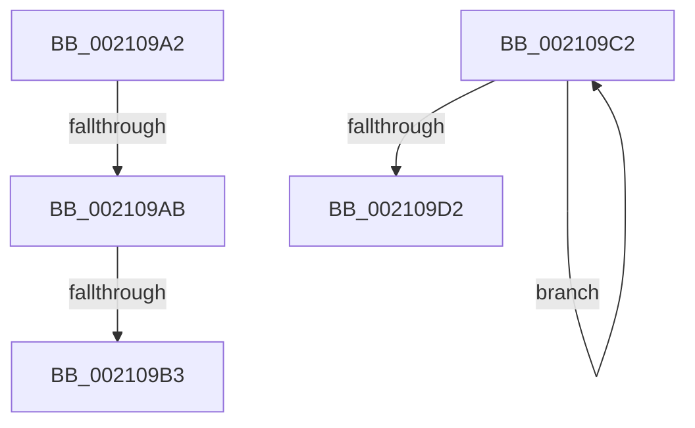

# sub_002109A2

- RVA: `0x002109A2`–`0x002109DE` (길이 `60` bytes)
- VA: `0x00000001402109A2`
- 실행 섹션: `.text`
- PDB 이름 있음: `아니요`; PDB Function 태그: `아니요`
- unwind 정보 RVA: `0x0005DD1C`
- 디코드: `15`개 명령, `60/60` bytes 표시
- 미해석 바이트: `0` (있으면 어셈블리에 `.byte`로 보존)

> 이 문서는 커널 이미지의 기계어와 PDB 기호를 분석해 생성했습니다. 4번과 5번은 함수 원형과 자료형을 바이너리 사용 방식에서 추정한 C 해석이며 원본 소스 복구 결과는 아닙니다.

## 1. Dependencies

- 직접 호출 지점: **2**; 고유 호출 대상: **2**
- 직접 호출자로 확인된 함수: **0**
- RIP 상대 이미지 참조: **0**

### Outgoing calls
- `0x002109B8` → [ObfDereferenceObjectWithTag](../2F/ObfDereferenceObjectWithTag_function_002F78E0.md) (function, `0x002F78E0`)
- `0x002109C5` → [IoFreeMdl](../29/IoFreeMdl_function_0029EA80.md) (function, `0x0029EA80`)

### Direct callers
- 이 함수 시작 RVA로 연결되는 직접 call은 확인되지 않았습니다. 간접 호출은 완전히 역산할 수 없습니다.

### Static image references
- 디코드된 RIP-relative 메모리 참조가 없습니다.

## 2. Other-region calls and transfers

- 다른 실행 섹션으로 향하는 call: **0**
- call이 아닌 외부 분기/꼬리 이동: **4**
  - `0x002109A5` → [IopDropIrp + 0x4E](IopDropIrp_function_002107B0.md) (`tail-transfer`)
  - `0x002109AD` → [IopDropIrp + 0x4E](IopDropIrp_function_002107B0.md) (`tail-transfer`)
  - `0x002109BD` → [IopDropIrp + 0x4E](IopDropIrp_function_002107B0.md) (`tail-transfer`)
  - `0x002109D9` → [IopDropIrp + 0x41](IopDropIrp_function_002107B0.md) (`tail-transfer`)

## 3. Assembly (complete function range)

```asm
002109A2  4D 85 F6                        test r14, r14
002109A5  0F 84 53 FE FF FF               je 0x1402107fe
002109AB  A8 04                           test al, 4
002109AD  0F 85 4B FE FF FF               jne 0x1402107fe
002109B3  BA 44 66 6C 74                  mov edx, 0x746c6644
002109B8  E8 23 6F 0E 00                  call 0x1402f78e0
002109BD  E9 3C FE FF FF                  jmp 0x1402107fe
002109C2  48 8B 39                        mov rdi, qword ptr [rcx]
002109C5  E8 B6 E0 08 00                  call 0x14029ea80
002109CA  48 8B CF                        mov rcx, rdi
002109CD  48 85 FF                        test rdi, rdi
002109D0  75 F0                           jne 0x1402109c2
002109D2  8B 45 10                        mov eax, dword ptr [rbp + 0x10]
002109D5  48 8D 7D 10                     lea rdi, [rbp + 0x10]
002109D9  E9 13 FE FF FF                  jmp 0x1402107f1
```

## 4. C-style interpretation (structured pseudocode)

```c
__int64 __fastcall sub_002109A2(__int64 a1)
{
    __int64 result;

    result = ObfDereferenceObjectWithTag(a1, (unsigned int)(0x746C6644ULL), a3, a4);
}
```

## 5. (Beta) C Style

```c
int64_t sub_002109A2(int64_t Arg1)
{
    int64_t result;

    result = ObfDereferenceObjectWithTag(Arg1, (uint32_t)(0x746C6644ULL), a3, a4);
}
```

## 6. Execution-region graph

[열기: 2D/3D 그래프와 함수 탐색 컨트롤 패널](../../../control-panel.html?section=text&rva=0x002109A2&view=graph)

- 2D 그래프는 위에서 아래로 흐르고, 3D 그래프는 빈 공간을 드래그해 회전합니다. Shift+드래그는 이동, 휠은 확대·축소, 함수 노드 선택은 대상 보고서 이동입니다.

### Static fallback


