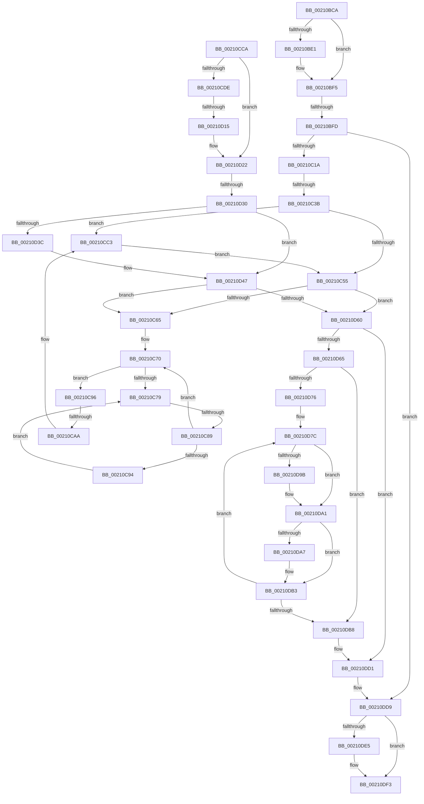

# sub_00210BCA

- RVA: `0x00210BCA`–`0x00210E14` (길이 `586` bytes)
- VA: `0x0000000140210BCA`
- 실행 섹션: `.text`
- PDB 이름 있음: `아니요`; PDB Function 태그: `아니요`
- unwind 정보 RVA: `0x0005DD74`
- 디코드: `148`개 명령, `586/586` bytes 표시
- 미해석 바이트: `0` (있으면 어셈블리에 `.byte`로 보존)

> 이 문서는 커널 이미지의 기계어와 PDB 기호를 분석해 생성했습니다. 4번과 5번은 함수 원형과 자료형을 바이너리 사용 방식에서 추정한 C 해석이며 원본 소스 복구 결과는 아닙니다.

## 1. Dependencies

- 직접 호출 지점: **9**; 고유 호출 대상: **8**
- 직접 호출자로 확인된 함수: **0**
- RIP 상대 이미지 참조: **3**

### Outgoing calls
- `0x00210BF0` → [PsBoostThreadIoEx](../39/PsBoostThreadIoEx_function_00392C00.md) (function, `0x00392C00`)
- `0x00210CBD` → [KeBugCheckEx](../4F/KeBugCheckEx_function_004FD660.md) (function, `0x004FD660`)
- `0x00210CC3` → [KiRaiseIrqlProcessIrqlFlags](../4F/KiRaiseIrqlProcessIrqlFlags_function_004F56FC.md) (function, `0x004F56FC`)
- `0x00210D42` → [KiSetPriorityThread](../22/KiSetPriorityThread_function_00220E78.md) (function, `0x00220E78`)
- `0x00210D8C` → [KiDeferredReadySingleThread](../25/KiDeferredReadySingleThread_function_00252FE0.md) (function, `0x00252FE0`)
- `0x00210DAE` → [KiFlushSoftwareInterruptBatch](../25/KiFlushSoftwareInterruptBatch_function_00252200.md) (function, `0x00252200`)
- `0x00210DBF` → [KiFlushSoftwareInterruptBatch](../25/KiFlushSoftwareInterruptBatch_function_00252200.md) (function, `0x00252200`)
- `0x00210DCC` → [KiCheckForThreadDispatch](../25/KiCheckForThreadDispatch_function_00250648.md) (function, `0x00250648`)
- `0x00210DEE` → [EtwTraceAutoBoostClearFloor](../22/EtwTraceAutoBoostClearFloor_function_0022302C.md) (function, `0x0022302C`)

### Direct callers
- 이 함수 시작 RVA로 연결되는 직접 call은 확인되지 않았습니다. 간접 호출은 완전히 역산할 수 없습니다.

### Static image references
- `0x00210C4D` → RVA `0x00FC6D20` (`ALMOSTRO`; read)
- `0x00210C7C` → RVA `0x00FC52AC` (`ALMOSTRO`; reference)
- `0x00210DD9` → RVA `0x00FC6B14` (`ALMOSTRO`; read)

## 2. Other-region calls and transfers

- 다른 실행 섹션으로 향하는 call: **0**
- call이 아닌 외부 분기/꼬리 이동: **6**
  - `0x00210BF7` → [sub_00210EB6](Unknown_function_00210EB6.md) (`tail-transfer`)
  - `0x00210C35` → [sub_00210E15 + 0x99](Unknown_function_00210E15.md) (`tail-transfer`)
  - `0x00210C83` → [sub_00210E15 + 0x71](Unknown_function_00210E15.md) (`tail-transfer`)
  - `0x00210CA4` → [sub_00210E15 + 0x13](Unknown_function_00210E15.md) (`tail-transfer`)
  - `0x00210D0F` → [sub_00210ECF](Unknown_function_00210ECF.md) (`tail-transfer`)
  - `0x00210D2A` → [sub_00210E15](Unknown_function_00210E15.md) (`tail-transfer`)

## 3. Assembly (complete function range)

```asm
00210BCA  48 89 B4 24 90 00 00 00         mov qword ptr [rsp + 0x90], rsi
00210BD2  4D 8B E9                        mov r13, r9
00210BD5  48 8B EA                        mov rbp, rdx
00210BD8  48 8B F9                        mov rdi, rcx
00210BDB  0F BA E3 1E                     bt ebx, 0x1e
00210BDF  73 14                           jae 0x140210bf5
00210BE1  F0 FF 89 5C 03 00 00            lock dec dword ptr [rcx + 0x35c]
00210BE8  45 33 C9                        xor r9d, r9d
00210BEB  45 33 C0                        xor r8d, r8d
00210BEE  B2 01                           mov dl, 1
00210BF0  E8 0B 20 18 00                  call 0x140392c00
00210BF5  85 DB                           test ebx, ebx
00210BF7  0F 88 B9 02 00 00               js 0x140210eb6
00210BFD  4C 89 64 24 60                  mov qword ptr [rsp + 0x60], r12
00210C02  8B F3                           mov esi, ebx
00210C04  4C 89 74 24 58                  mov qword ptr [rsp + 0x58], r14
00210C09  4C 89 7C 24 50                  mov qword ptr [rsp + 0x50], r15
00210C0E  81 E6 FF FF FF 3F               and esi, 0x3fffffff
00210C14  0F 84 BF 01 00 00               je 0x140210dd9
00210C1A  33 ED                           xor ebp, ebp
00210C1C  B1 FF                           mov cl, 0xff
00210C1E  89 AC 24 A0 00 00 00            mov dword ptr [rsp + 0xa0], ebp
00210C25  48 89 6C 24 40                  mov qword ptr [rsp + 0x40], rbp
00210C2A  48 89 4C 24 38                  mov qword ptr [rsp + 0x38], rcx
00210C2F  8D 55 02                        lea edx, [rbp + 2]
00210C32  4D 85 ED                        test r13, r13
00210C35  0F 85 73 02 00 00               jne 0x140210eae
00210C3B  4C 8D 74 24 40                  lea r14, [rsp + 0x40]
00210C40  44 0F 20 C1                     mov rcx, cr8
00210C44  48 89 4C 24 38                  mov qword ptr [rsp + 0x38], rcx
00210C49  44 0F 22 C2                     mov cr8, rdx
00210C4D  39 2D CD 60 DB 00               cmp dword ptr [rip + 0xdb60cd], ebp
00210C53  75 6E                           jne 0x140210cc3
00210C55  0F BC C6                        bsf eax, esi
00210C58  89 84 24 A0 00 00 00            mov dword ptr [rsp + 0xa0], eax
00210C5F  0F 84 FB 00 00 00               je 0x140210d60
00210C65  44 0F BE E0                     movsx r12d, al
00210C69  44 8B FD                        mov r15d, ebp
00210C6C  41 FF C4                        inc r12d
00210C6F  90                              nop
00210C70  F0 48 0F BA 6F 40 00            lock bts qword ptr [rdi + 0x40], 0
00210C77  73 1D                           jae 0x140210c96
00210C79  41 FF C7                        inc r15d
00210C7C  44 85 3D 29 46 DB 00            test dword ptr [rip + 0xdb4629], r15d
00210C83  0F 84 FD 01 00 00               je 0x140210e86
00210C89  F3 90                           pause
00210C8B  48 8B 47 40                     mov rax, qword ptr [rdi + 0x40]
00210C8F  48 85 C0                        test rax, rax
00210C92  74 DC                           je 0x140210c70
00210C94  EB E3                           jmp 0x140210c79
00210C96  4D 63 C4                        movsxd r8, r12d
00210C99  41 0F B6 84 38 38 03 00 00      movzx eax, byte ptr [r8 + rdi + 0x338]
00210CA2  84 C0                           test al, al
00210CA4  0F 85 7E 01 00 00               jne 0x140210e28
00210CAA  41 B9 02 00 00 00               mov r9d, 2
00210CB0  48 89 6C 24 20                  mov qword ptr [rsp + 0x20], rbp
00210CB5  48 8B D7                        mov rdx, rdi
00210CB8  B9 57 01 00 00                  mov ecx, 0x157
00210CBD  E8 9E C9 2E 00                  call 0x1404fd660
00210CC2  CC                              int3
00210CC3  E8 34 4A 2E 00                  call 0x1404f56fc
00210CC8  EB 8B                           jmp 0x140210c55
00210CCA  44 0F BE 87 33 02 00 00         movsx r8d, byte ptr [rdi + 0x233]
00210CD2  45 8B D0                        mov r10d, r8d
00210CD5  45 8B C8                        mov r9d, r8d
00210CD8  41 83 F8 10                     cmp r8d, 0x10
00210CDC  7D 44                           jge 0x140210d22
00210CDE  0F B6 8F 66 03 00 00            movzx ecx, byte ptr [rdi + 0x366]
00210CE5  0F B7 97 06 02 00 00            movzx edx, word ptr [rdi + 0x206]
00210CEC  8B C2                           mov eax, edx
00210CEE  83 E0 0F                        and eax, 0xf
00210CF1  41 03 C0                        add eax, r8d
00210CF4  41 3B C1                        cmp eax, r9d
00210CF7  44 8B C0                        mov r8d, eax
00210CFA  8B C5                           mov eax, ebp
00210CFC  45 0F 4E C1                     cmovle r8d, r9d
00210D00  84 C9                           test cl, cl
00210D02  0F 4F C1                        cmovg eax, ecx
00210D05  0F BE C0                        movsx eax, al
00210D08  44 03 C0                        add r8d, eax
00210D0B  41 83 F8 10                     cmp r8d, 0x10
00210D0F  0F 8D BA 01 00 00               jge 0x140210ecf
00210D15  C1 EA 04                        shr edx, 4
00210D18  0F B6 C2                        movzx eax, dl
00210D1B  41 3B C0                        cmp eax, r8d
00210D1E  44 0F 4F C0                     cmovg r8d, eax
00210D22  8B 87 58 03 00 00               mov eax, dword ptr [rdi + 0x358]
00210D28  85 C0                           test eax, eax
00210D2A  0F 85 E5 00 00 00               jne 0x140210e15
00210D30  0F BE 87 C3 00 00 00            movsx eax, byte ptr [rdi + 0xc3]
00210D37  44 3B C0                        cmp r8d, eax
00210D3A  7D 0B                           jge 0x140210d47
00210D3C  49 8B D6                        mov rdx, r14
00210D3F  48 8B CF                        mov rcx, rdi
00210D42  E8 31 01 01 00                  call 0x140220e78
00210D47  8D 46 FF                        lea eax, [rsi - 1]
00210D4A  48 89 6F 40                     mov qword ptr [rdi + 0x40], rbp
00210D4E  23 F0                           and esi, eax
00210D50  0F BC C6                        bsf eax, esi
00210D53  89 84 24 A0 00 00 00            mov dword ptr [rsp + 0xa0], eax
00210D5A  0F 85 05 FF FF FF               jne 0x140210c65
00210D60  4D 85 ED                        test r13, r13
00210D63  75 6C                           jne 0x140210dd1
00210D65  65 4C 8B 3C 25 20 00 00 00      mov r15, qword ptr gs:[0x20]
00210D6E  49 8B 36                        mov rsi, qword ptr [r14]
00210D71  48 85 F6                        test rsi, rsi
00210D74  74 42                           je 0x140210db8
00210D76  48 8B 06                        mov rax, qword ptr [rsi]
00210D79  49 89 06                        mov qword ptr [r14], rax
00210D7C  48 8D 96 28 FF FF FF            lea rdx, [rsi - 0xd8]
00210D83  45 33 C9                        xor r9d, r9d
00210D86  4D 8B C6                        mov r8, r14
00210D89  49 8B CF                        mov rcx, r15
00210D8C  E8 4F 22 04 00                  call 0x140252fe0
00210D91  49 8B 36                        mov rsi, qword ptr [r14]
00210D94  FF C5                           inc ebp
00210D96  48 85 F6                        test rsi, rsi
00210D99  74 06                           je 0x140210da1
00210D9B  48 8B 06                        mov rax, qword ptr [rsi]
00210D9E  49 89 06                        mov qword ptr [r14], rax
00210DA1  40 F6 C5 0F                     test bpl, 0xf
00210DA5  75 0C                           jne 0x140210db3
00210DA7  49 8D 8F D8 35 00 00            lea rcx, [r15 + 0x35d8]
00210DAE  E8 4D 14 04 00                  call 0x140252200
00210DB3  48 85 F6                        test rsi, rsi
00210DB6  75 C4                           jne 0x140210d7c
00210DB8  49 8D 8F D8 35 00 00            lea rcx, [r15 + 0x35d8]
00210DBF  E8 3C 14 04 00                  call 0x140252200
00210DC4  0F B6 54 24 38                  movzx edx, byte ptr [rsp + 0x38]
00210DC9  49 8B CF                        mov rcx, r15
00210DCC  E8 77 F8 03 00                  call 0x140250648
00210DD1  48 8B AC 24 98 00 00 00         mov rbp, qword ptr [rsp + 0x98]
00210DD9  F7 05 31 5D DB 00 00 10 00 00   test dword ptr [rip + 0xdb5d31], 0x1000
00210DE3  74 0E                           je 0x140210df3
00210DE5  44 8B C3                        mov r8d, ebx
00210DE8  48 8B D5                        mov rdx, rbp
00210DEB  48 8B CF                        mov rcx, rdi
00210DEE  E8 39 22 01 00                  call 0x14022302c
00210DF3  4C 8B 74 24 58                  mov r14, qword ptr [rsp + 0x58]
00210DF8  4C 8B 64 24 60                  mov r12, qword ptr [rsp + 0x60]
00210DFD  4C 8B 7C 24 50                  mov r15, qword ptr [rsp + 0x50]
00210E02  48 8B B4 24 90 00 00 00         mov rsi, qword ptr [rsp + 0x90]
00210E0A  48 83 C4 68                     add rsp, 0x68
00210E0E  41 5D                           pop r13
00210E10  5F                              pop rdi
00210E11  5D                              pop rbp
00210E12  5B                              pop rbx
00210E13  C3                              ret
```

## 4. C-style interpretation (structured pseudocode)

```c
__int64 __fastcall sub_00210BCA(__int64 a1, __int64 a2, int a3, __int64 a4, __int64 a5, __int64 a6, unsigned __int8 a7, __int64 a8, __int64 a9, __int64 a10, __int64 a11, __int64 a12, __int64 a13, __int64 a14, __int64 a15, __int64 a16, __int64 a17, __int64 a18, __int64 a19)
{
    __int64 result;
    __int64 v_r12;
    __int64 v_r15;
    __int64 v_rbp;
    __int64 v_rsi;
    __int64 v_rsp;
    unsigned __int64 v_stack_p20;
    unsigned __int64 v_stack_p38;
    unsigned __int64 v_stack_p40;
    unsigned __int64 v_stack_p50;
    unsigned __int64 v_stack_p58;
    unsigned __int64 v_stack_p60;
    unsigned __int64 v_stack_p90;
    unsigned int v_stack_pA0;

    v_stack_p90 = v_rsi;
    if (!(condition_is_above_or_equal)) {
        a4 = 0;
        a3 = 0;
        a2 = 1;
        result = PsBoostThreadIoEx(a1, a2, a3, a4);
    }
    v_stack_p60 = v_r12;
    v_stack_p58 = v_r14;
    v_stack_p50 = v_r15;
    v_rsi = (unsigned int)(((unsigned int)((unsigned int)(v_rbx))) & (0x3FFFFFFFULL));
    if (condition_is_equal) goto loc_00210DD9;
    v_rbp = 0;
    v_stack_pA0 = 0;
    v_stack_p40 = 0;
    v_stack_p38 = 255;
    v_stack_p38 = v_cr8;
    if ((*(unsigned int *)(v_rip + 14377165)) != 0) goto loc_00210CC3;
loc_00210C55:
    v_stack_pA0 = (unsigned int)(result);
    if ((*(unsigned int *)(v_rip + 14377165)) == 0) goto loc_00210D60;
loc_00210C65:
    v_r12 = (unsigned int)(((__int8)((unsigned __int8)(result))) + 1);
loc_00210C70:
    if ((*(unsigned int *)(v_rip + 14377165)) >= 0) goto loc_00210C96;
loc_00210C79:
    v_r15 = (unsigned int)((0) + 1);
    if (*(unsigned __int64 *)(a1 + 64) == 0) goto loc_00210C70;
    goto loc_00210C79;
loc_00210C96:
    v_stack_p20 = 0;
    result = KeBugCheckEx(343, a1, (int)((unsigned int)(v_r12)), 2);
loc_00210CC3:
    result = KiRaiseIrqlProcessIrqlFlags(343, a1, (int)((unsigned int)(v_r12)), 2);
    goto loc_00210C55;
loc_00210D60:
    if (0 != 0) goto loc_00210DD1;
    if (*(unsigned __int64 *)(a8) == 0) goto loc_00210DB8;
    *(unsigned __int64 *)(a8) = *(unsigned __int64 *)(*(unsigned __int64 *)(a8));
loc_00210D7C:
    a4 = 0;
    result = KiDeferredReadySingleThread(*(unsigned __int64 *)(gs_base + (0 + 32)), *(unsigned __int64 *)(a8) - 216, a8, a4);
    v_rbp = (unsigned int)((v_rbp) + 1);
    if (*(unsigned __int64 *)(a8) != 0) {
        result = *(unsigned __int64 *)(*(unsigned __int64 *)(a8));
        *(unsigned __int64 *)(a8) = result;
    }
    if ((((unsigned __int8)(v_rbp)) & (15)) == 0) {
        a1 = *(unsigned __int64 *)(gs_base + (0 + 32)) + 13784;
        result = KiFlushSoftwareInterruptBatch(a1, *(unsigned __int64 *)(a8) - 216, a8, a4);
    }
    if (*(unsigned __int64 *)(a8) != 0) goto loc_00210D7C;
loc_00210DB8:
    result = KiFlushSoftwareInterruptBatch(*(unsigned __int64 *)(gs_base + (0 + 32)) + 13784, *(unsigned __int64 *)(a8) - 216, a8, a4);
    result = KiCheckForThreadDispatch(*(unsigned __int64 *)(gs_base + (0 + 32)), a7, a8, a4);
loc_00210DD1:
loc_00210DD9:
    if (((*(unsigned int *)(v_rip + 14376241)) & (0x1000ULL)) != 0) {
        a3 = (unsigned int)(v_rbx);
        a2 = a19;
        a1 = a1;
        result = EtwTraceAutoBoostClearFloor(a1, a2, a3, a4);
    }
    v_rsp = (v_rsp) + (104);
    return result;
}
```

## 5. (Beta) C Style

```c
int64_t sub_00210BCA(void *Arg1, int64_t Arg2, int32_t Arg3, int64_t Arg4, uint64_t Arg5, uint64_t Arg6, uint8_t Arg7, int64_t Arg8, uint64_t Arg9, int64_t Arg10, int64_t Arg11, int64_t Arg12, uint64_t Arg13, uint64_t Arg14, uint64_t Arg15, uint64_t Arg16, uint64_t Arg17, int64_t Arg18, int64_t Arg19)
{
    uint8_t *arg1 = (uint8_t *)Arg1;

    int64_t result;
    int64_t local_r12;
    int64_t local_r15;
    int64_t local_rbp;
    int64_t local_rsi;
    int64_t local_rsp;
    uint64_t v_stack_p20;
    uint64_t v_stack_p38;
    uint64_t v_stack_p40;
    uint64_t v_stack_p50;
    uint64_t v_stack_p58;
    uint64_t v_stack_p60;
    uint64_t v_stack_p90;
    uint32_t v_stack_pA0;

    v_stack_p90 = local_rsi;
    if (!(condition_is_above_or_equal)) {
        Arg4 = 0;
        Arg3 = 0;
        Arg2 = 1;
        result = PsBoostThreadIoEx(Arg1, Arg2, Arg3, Arg4);
    }
    v_stack_p60 = local_r12;
    v_stack_p58 = local_r14;
    v_stack_p50 = local_r15;
    local_rsi = (uint32_t)(((uint32_t)((uint32_t)(local_rbx))) & (0x3FFFFFFFULL));
    if (condition_is_equal) goto loc_00210DD9;
    local_rbp = 0;
    v_stack_pA0 = 0;
    v_stack_p40 = 0;
    v_stack_p38 = 255;
    v_stack_p38 = v_cr8;
    if ((*(uint32_t *)(v_rip + 0xDB60CD)) != 0) goto loc_00210CC3;
loc_00210C55:
    v_stack_pA0 = (uint32_t)(result);
    if ((*(uint32_t *)(v_rip + 0xDB60CD)) == 0) goto loc_00210D60;
loc_00210C65:
    local_r12 = (uint32_t)(((int8_t)((uint8_t)(result))) + 1);
loc_00210C70:
    if ((*(uint32_t *)(v_rip + 0xDB60CD)) >= 0) goto loc_00210C96;
loc_00210C79:
    local_r15 = (uint32_t)((0) + 1);
    if (*(uint64_t *)(arg1 + 0x40) == 0) goto loc_00210C70;
    goto loc_00210C79;
loc_00210C96:
    v_stack_p20 = 0;
    result = KeBugCheckEx(343, Arg1, (int32_t)((uint32_t)(local_r12)), 2);
loc_00210CC3:
    result = KiRaiseIrqlProcessIrqlFlags(343, Arg1, (int32_t)((uint32_t)(local_r12)), 2);
    goto loc_00210C55;
loc_00210D60:
    if (0 != 0) goto loc_00210DD1;
    if (*(uint64_t *)(Arg8) == 0) goto loc_00210DB8;
    *(uint64_t *)(Arg8) = *(uint64_t *)(*(uint64_t *)(Arg8));
loc_00210D7C:
    Arg4 = 0;
    result = KiDeferredReadySingleThread(*(uint64_t *)(gs_base + (0 + 0x20)), *(uint64_t *)(Arg8) - 216, Arg8, Arg4);
    local_rbp = (uint32_t)((local_rbp) + 1);
    if (*(uint64_t *)(Arg8) != 0) {
        result = *(uint64_t *)(*(uint64_t *)(Arg8));
        *(uint64_t *)(Arg8) = result;
    }
    if ((((uint8_t)(local_rbp)) & (15)) == 0) {
        Arg1 = *(uint64_t *)(gs_base + (0 + 0x20)) + 13784;
        result = KiFlushSoftwareInterruptBatch(Arg1, *(uint64_t *)(Arg8) - 216, Arg8, Arg4);
    }
    if (*(uint64_t *)(Arg8) != 0) goto loc_00210D7C;
loc_00210DB8:
    result = KiFlushSoftwareInterruptBatch(*(uint64_t *)(gs_base + (0 + 0x20)) + 13784, *(uint64_t *)(Arg8) - 216, Arg8, Arg4);
    result = KiCheckForThreadDispatch(*(uint64_t *)(gs_base + (0 + 0x20)), Arg7, Arg8, Arg4);
loc_00210DD1:
loc_00210DD9:
    if (((*(uint32_t *)(v_rip + 0xDB5D31)) & (0x1000ULL)) != 0) {
        Arg3 = (uint32_t)(local_rbx);
        Arg2 = Arg19;
        Arg1 = Arg1;
        result = EtwTraceAutoBoostClearFloor(Arg1, Arg2, Arg3, Arg4);
    }
    local_rsp = (local_rsp) + (104);
    return result;
}
```

### 관측된 메모리 오프셋

구조체 형식이 확인되지 않은 접근은 인자 기준의 오프셋으로만 기록했습니다.

| 기준 인자 | 오프셋 표현 | 폭 (bit) | 접근 |
|---|---:|---:|---|
| `Arg1` | `+ 0x40` | `64` | `R` |
| `Arg1` | `+ 0x40` | `64` | `R/W` |
| `Arg1` | `+ 0x35C` | `32` | `R/W` |

## 6. Execution-region graph

[열기: 2D/3D 그래프와 함수 탐색 컨트롤 패널](../../../control-panel.html?section=text&rva=0x00210BCA&view=graph)

- 2D 그래프는 위에서 아래로 흐르고, 3D 그래프는 빈 공간을 드래그해 회전합니다. Shift+드래그는 이동, 휠은 확대·축소, 함수 노드 선택은 대상 보고서 이동입니다.

### Static fallback


