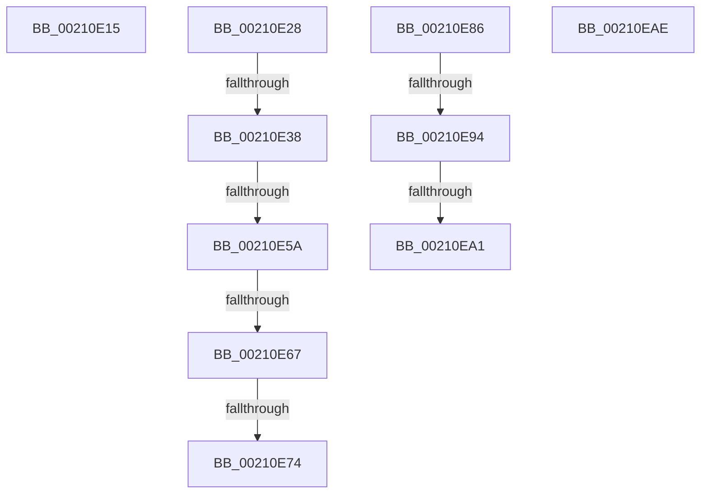

# sub_00210E15

- RVA: `0x00210E15`–`0x00210EB6` (길이 `161` bytes)
- VA: `0x0000000140210E15`
- 실행 섹션: `.text`
- PDB 이름 있음: `아니요`; PDB Function 태그: `아니요`
- unwind 정보 RVA: `0x0005DDA8`
- 디코드: `37`개 명령, `161/161` bytes 표시
- 미해석 바이트: `0` (있으면 어셈블리에 `.byte`로 보존)

> 이 문서는 커널 이미지의 기계어와 PDB 기호를 분석해 생성했습니다. 4번과 5번은 함수 원형과 자료형을 바이너리 사용 방식에서 추정한 C 해석이며 원본 소스 복구 결과는 아닙니다.

## 1. Dependencies

- 직접 호출 지점: **4**; 고유 호출 대상: **4**
- 직접 호출자로 확인된 함수: **0**
- RIP 상대 이미지 참조: **1**

### Outgoing calls
- `0x00210E67` → [Feature_StackingDecayBoosts__private_IsEnabledNoReportingNoInline](../4E/Feature_StackingDecayBoosts__private_IsEnabledNoReportingNoInline_function_004EF7C0.md) (function, `0x004EF7C0`)
- `0x00210E79` → [KiComputeThreadPriorityNonStacking](../5C/KiComputeThreadPriorityNonStacking_function_005CA81C.md) (function, `0x005CA81C`)
- `0x00210E94` → [KiCheckVpBackingLongSpinWaitHypercall](../30/KiCheckVpBackingLongSpinWaitHypercall_function_0030F490.md) (function, `0x0030F490`)
- `0x00210EA4` → [HvlNotifyLongSpinWait](../30/HvlNotifyLongSpinWait_function_0030F460.md) (function, `0x0030F460`)

### Direct callers
- 이 함수 시작 RVA로 연결되는 직접 call은 확인되지 않았습니다. 간접 호출은 완전히 역산할 수 없습니다.

### Static image references
- `0x00210E86` → RVA `0x00FC6AB8` (`ALMOSTRO`; read)

## 2. Other-region calls and transfers

- 다른 실행 섹션으로 향하는 call: **0**
- call이 아닌 외부 분기/꼬리 이동: **10**
  - `0x00210E23` → [sub_00210BCA + 0x166](Unknown_function_00210BCA.md) (`tail-transfer`)
  - `0x00210E32` → [sub_00210BCA + 0x17D](Unknown_function_00210BCA.md) (`tail-transfer`)
  - `0x00210E54` → [sub_00210BCA + 0x17D](Unknown_function_00210BCA.md) (`tail-transfer`)
  - `0x00210E61` → [sub_00210BCA + 0x17D](Unknown_function_00210BCA.md) (`tail-transfer`)
  - `0x00210E6E` → [sub_00210BCA + 0x100](Unknown_function_00210BCA.md) (`tail-transfer`)
  - `0x00210E81` → [sub_00210BCA + 0x166](Unknown_function_00210BCA.md) (`tail-transfer`)
  - `0x00210E8E` → [sub_00210BCA + 0xBF](Unknown_function_00210BCA.md) (`tail-transfer`)
  - `0x00210E9B` → [sub_00210BCA + 0xBF](Unknown_function_00210BCA.md) (`tail-transfer`)
  - `0x00210EA9` → [sub_00210BCA + 0xC1](Unknown_function_00210BCA.md) (`tail-transfer`)
  - `0x00210EB1` → [sub_00210BCA + 0x8B](Unknown_function_00210BCA.md) (`tail-transfer`)

## 3. Assembly (complete function range)

```asm
00210E15  0F BD C0                        bsr eax, eax
00210E18  44 3B C0                        cmp r8d, eax
00210E1B  89 44 24 30                     mov dword ptr [rsp + 0x30], eax
00210E1F  44 0F 4C C0                     cmovl r8d, eax
00210E23  E9 08 FF FF FF                  jmp 0x140210d30
00210E28  2C 01                           sub al, 1
00210E2A  41 88 84 38 38 03 00 00         mov byte ptr [r8 + rdi + 0x338], al
00210E32  0F 85 0F FF FF FF               jne 0x140210d47
00210E38  8B 97 58 03 00 00               mov edx, dword ptr [rdi + 0x358]
00210E3E  41 8B CC                        mov ecx, r12d
00210E41  44 0F BB E2                     btc edx, r12d
00210E45  B8 01 00 00 00                  mov eax, 1
00210E4A  D3 E0                           shl eax, cl
00210E4C  89 97 58 03 00 00               mov dword ptr [rdi + 0x358], edx
00210E52  3B D0                           cmp edx, eax
00210E54  0F 83 ED FE FF FF               jae 0x140210d47
00210E5A  80 BF C3 00 00 00 1F            cmp byte ptr [rdi + 0xc3], 0x1f
00210E61  0F 8F E0 FE FF FF               jg 0x140210d47
00210E67  E8 54 E9 2D 00                  call 0x1404ef7c0
00210E6C  85 C0                           test eax, eax
00210E6E  0F 85 56 FE FF FF               jne 0x140210cca
00210E74  33 D2                           xor edx, edx
00210E76  48 8B CF                        mov rcx, rdi
00210E79  E8 9E 99 3B 00                  call 0x1405ca81c
00210E7E  44 8B C0                        mov r8d, eax
00210E81  E9 AA FE FF FF                  jmp 0x140210d30
00210E86  8B 05 2C 5C DB 00               mov eax, dword ptr [rip + 0xdb5c2c]
00210E8C  A8 40                           test al, 0x40
00210E8E  0F 84 F5 FD FF FF               je 0x140210c89
00210E94  E8 F7 E5 0F 00                  call 0x14030f490
00210E99  84 C0                           test al, al
00210E9B  0F 84 E8 FD FF FF               je 0x140210c89
00210EA1  41 8B CF                        mov ecx, r15d
00210EA4  E8 B7 E5 0F 00                  call 0x14030f460
00210EA9  E9 DD FD FF FF                  jmp 0x140210c8b
00210EAE  4D 8B F5                        mov r14, r13
00210EB1  E9 9F FD FF FF                  jmp 0x140210c55
```

## 4. C-style interpretation (structured pseudocode)

```c
__int64 __fastcall sub_00210E15(__int64 a1, __int64 a2, int a3)
{
    unsigned int v_stack_p30;

    v_stack_p30 = (unsigned int)(result);
    if (a3 < ((unsigned int)(result))) { a3 = (unsigned int)(result); }
}
```

## 5. (Beta) C Style

```c
int64_t sub_00210E15(int64_t Arg1, int64_t Arg2, int32_t Arg3)
{
    uint32_t v_stack_p30;

    v_stack_p30 = (uint32_t)(result);
    if (Arg3 < ((uint32_t)(result))) { Arg3 = (uint32_t)(result); }
}
```

## 6. Execution-region graph

[열기: 2D/3D 그래프와 함수 탐색 컨트롤 패널](../../../control-panel.html?section=text&rva=0x00210E15&view=graph)

- 2D 그래프는 위에서 아래로 흐르고, 3D 그래프는 빈 공간을 드래그해 회전합니다. Shift+드래그는 이동, 휠은 확대·축소, 함수 노드 선택은 대상 보고서 이동입니다.

### Static fallback


