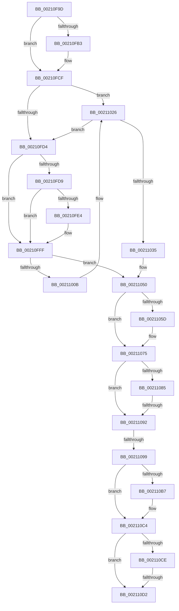

# sub_00210F9D

- RVA: `0x00210F9D`–`0x00211103` (길이 `358` bytes)
- VA: `0x0000000140210F9D`
- 실행 섹션: `.text`
- PDB 이름 있음: `아니요`; PDB Function 태그: `아니요`
- unwind 정보 RVA: `0x0005DE1C`
- 디코드: `107`개 명령, `358/358` bytes 표시
- 미해석 바이트: `0` (있으면 어셈블리에 `.byte`로 보존)

> 이 문서는 커널 이미지의 기계어와 PDB 기호를 분석해 생성했습니다. 4번과 5번은 함수 원형과 자료형을 바이너리 사용 방식에서 추정한 C 해석이며 원본 소스 복구 결과는 아닙니다.

## 1. Dependencies

- 직접 호출 지점: **8**; 고유 호출 대상: **4**
- 직접 호출자로 확인된 함수: **0**
- RIP 상대 이미지 참조: **0**

### Outgoing calls
- `0x00210FC9` → [KeBugCheckEx](../4F/KeBugCheckEx_function_004FD660.md) (function, `0x004FD660`)
- `0x00210FF9` → [KeBugCheckEx](../4F/KeBugCheckEx_function_004FD660.md) (function, `0x004FD660`)
- `0x00211002` → [ExAreApcsDisabledForThread](../40/ExAreApcsDisabledForThread_function_00409F00.md) (function, `0x00409F00`)
- `0x00211020` → [KeBugCheckEx](../4F/KeBugCheckEx_function_004FD660.md) (function, `0x004FD660`)
- `0x0021104A` → [KeBugCheckEx](../4F/KeBugCheckEx_function_004FD660.md) (function, `0x004FD660`)
- `0x0021106F` → [KeBugCheckEx](../4F/KeBugCheckEx_function_004FD660.md) (function, `0x004FD660`)
- `0x002110BC` → [KeAbPreAcquire](KeAbPreAcquire_function_00210230.md) (function, `0x00210230`)
- `0x002110E3` → [ExpAcquireFastResourceSharedSlow](ExpAcquireFastResourceSharedSlow_function_00211260.md) (function, `0x00211260`)

### Direct callers
- 이 함수 시작 RVA로 연결되는 직접 call은 확인되지 않았습니다. 간접 호출은 완전히 역산할 수 없습니다.

### Static image references
- 디코드된 RIP-relative 메모리 참조가 없습니다.

## 2. Other-region calls and transfers

- 다른 실행 섹션으로 향하는 call: **0**
- call이 아닌 외부 분기/꼬리 이동: **3**
  - `0x0021108C` → [sub_00211104 + 0xE](Unknown_function_00211104.md) (`tail-transfer`)
  - `0x00211097` → [sub_00211104](Unknown_function_00211104.md) (`tail-transfer`)
  - `0x002110D0` → [sub_00211104 + 0x2F](Unknown_function_00211104.md) (`tail-transfer`)

## 3. Assembly (complete function range)

```asm
00210F9D  48 89 6C 24 68                  mov qword ptr [rsp + 0x68], rbp
00210FA2  44 0F 20 C1                     mov rcx, cr8
00210FA6  65 48 8B 2C 25 88 01 00 00      mov rbp, qword ptr gs:[0x188]
00210FAF  3A C8                           cmp cl, al
00210FB1  76 1C                           jbe 0x140210fcf
00210FB3  44 0F B6 C1                     movzx r8d, cl
00210FB7  33 FF                           xor edi, edi
00210FB9  B9 C6 01 00 00                  mov ecx, 0x1c6
00210FBE  44 0F B6 C8                     movzx r9d, al
00210FC2  33 D2                           xor edx, edx
00210FC4  48 89 7C 24 20                  mov qword ptr [rsp + 0x20], rdi
00210FC9  E8 92 C6 2E 00                  call 0x1404fd660
00210FCE  CC                              int3
00210FCF  80 F9 02                        cmp cl, 2
00210FD2  73 52                           jae 0x140211026
00210FD4  F6 C2 08                        test dl, 8
00210FD7  75 26                           jne 0x140210fff
00210FD9  0F B6 85 C0 00 00 00            movzx eax, byte ptr [rbp + 0xc0]
00210FE0  A8 02                           test al, 2
00210FE2  74 1B                           je 0x140210fff
00210FE4  33 FF                           xor edi, edi
00210FE6  45 33 C9                        xor r9d, r9d
00210FE9  45 33 C0                        xor r8d, r8d
00210FEC  48 89 7C 24 20                  mov qword ptr [rsp + 0x20], rdi
00210FF1  B9 C6 01 00 00                  mov ecx, 0x1c6
00210FF6  8D 57 06                        lea edx, [rdi + 6]
00210FF9  E8 62 C6 2E 00                  call 0x1404fd660
00210FFE  CC                              int3
00210FFF  48 8B D5                        mov rdx, rbp
00211002  E8 F9 8E 1F 00                  call 0x140409f00
00211007  84 C0                           test al, al
00211009  75 45                           jne 0x140211050
0021100B  33 FF                           xor edi, edi
0021100D  45 33 C9                        xor r9d, r9d
00211010  45 33 C0                        xor r8d, r8d
00211013  48 89 7C 24 20                  mov qword ptr [rsp + 0x20], rdi
00211018  B9 C6 01 00 00                  mov ecx, 0x1c6
0021101D  8D 57 07                        lea edx, [rdi + 7]
00211020  E8 3B C6 2E 00                  call 0x1404fd660
00211025  CC                              int3
00211026  65 8B 04 25 3C 3A 00 00         mov eax, dword ptr gs:[0x3a3c]
0021102E  A9 01 00 01 00                  test eax, 0x10001
00211033  74 9F                           je 0x140210fd4
00211035  33 FF                           xor edi, edi
00211037  45 33 C9                        xor r9d, r9d
0021103A  45 33 C0                        xor r8d, r8d
0021103D  48 89 7C 24 20                  mov qword ptr [rsp + 0x20], rdi
00211042  B9 C6 01 00 00                  mov ecx, 0x1c6
00211047  8D 57 05                        lea edx, [rdi + 5]
0021104A  E8 11 C6 2E 00                  call 0x1404fd660
0021104F  CC                              int3
00211050  4C 8B 4B 10                     mov r9, qword ptr [rbx + 0x10]
00211054  49 83 E1 FE                     and r9, 0xfffffffffffffffe
00211058  4C 3B CD                        cmp r9, rbp
0021105B  74 18                           je 0x140211075
0021105D  33 FF                           xor edi, edi
0021105F  4C 8B C3                        mov r8, rbx
00211062  B9 C6 01 00 00                  mov ecx, 0x1c6
00211067  48 89 7C 24 20                  mov qword ptr [rsp + 0x20], rdi
0021106C  8D 57 09                        lea edx, [rdi + 9]
0021106F  E8 EC C5 2E 00                  call 0x1404fd660
00211074  CC                              int3
00211075  0F B6 43 25                     movzx eax, byte ptr [rbx + 0x25]
00211079  4C 89 74 24 78                  mov qword ptr [rsp + 0x78], r14
0021107E  44 8B F7                        mov r14d, edi
00211081  A8 02                           test al, 2
00211083  75 0D                           jne 0x140211092
00211085  4C 8B 4B 18                     mov r9, qword ptr [rbx + 0x18]
00211089  4D 85 C9                        test r9, r9
0021108C  0F 85 80 00 00 00               jne 0x140211112
00211092  8B 4B 20                        mov ecx, dword ptr [rbx + 0x20]
00211095  85 C9                           test ecx, ecx
00211097  75 6B                           jne 0x140211104
00211099  65 48 8B 2C 25 88 01 00 00      mov rbp, qword ptr gs:[0x188]
002110A2  33 FF                           xor edi, edi
002110A4  45 85 FF                        test r15d, r15d
002110A7  44 8B C7                        mov r8d, edi
002110AA  44 8B FF                        mov r15d, edi
002110AD  41 0F 94 C0                     sete r8b
002110B1  40 38 7B 24                     cmp byte ptr [rbx + 0x24], dil
002110B5  75 0D                           jne 0x1402110c4
002110B7  33 D2                           xor edx, edx
002110B9  48 8B CE                        mov rcx, rsi
002110BC  E8 6F F1 FF FF                  call 0x140210230
002110C1  4C 8B F8                        mov r15, rax
002110C4  0F 0D 0E                        prefetchw byte ptr [rsi]
002110C7  48 8B 06                        mov rax, qword ptr [rsi]
002110CA  A8 01                           test al, 1
002110CC  75 04                           jne 0x1402110d2
002110CE  A8 02                           test al, 2
002110D0  74 61                           je 0x140211133
002110D2  4C 8B CD                        mov r9, rbp
002110D5  44 89 74 24 20                  mov dword ptr [rsp + 0x20], r14d
002110DA  4D 8B C7                        mov r8, r15
002110DD  48 8B D3                        mov rdx, rbx
002110E0  48 8B CE                        mov rcx, rsi
002110E3  E8 78 01 00 00                  call 0x140211260
002110E8  4C 8B 74 24 78                  mov r14, qword ptr [rsp + 0x78]
002110ED  48 8B 6C 24 68                  mov rbp, qword ptr [rsp + 0x68]
002110F2  4C 8B 64 24 70                  mov r12, qword ptr [rsp + 0x70]
002110F7  48 83 C4 30                     add rsp, 0x30
002110FB  41 5F                           pop r15
002110FD  41 5D                           pop r13
002110FF  5F                              pop rdi
00211100  5E                              pop rsi
00211101  5B                              pop rbx
00211102  C3                              ret
```

## 4. C-style interpretation (structured pseudocode)

```c
__int64 __fastcall sub_00210F9D(__int64 a1, int a2, __int64 a3, __int64 a4, __int64 a5, __int64 a6, __int64 a7, __int64 a8, __int64 a9, __int64 a10, __int64 a11, __int64 a12, __int64 a13, __int64 a14, __int64 a15)
{
    __int64 result;
    __int64 v_r15;
    __int64 v_rdi;
    __int64 v_rsp;
    unsigned __int64 v_stack_p20;
    unsigned __int64 v_stack_p68;
    unsigned __int64 v_stack_p78;

    v_stack_p68 = v_rbp;
    if (((unsigned __int8)(v_cr8)) >= = ((unsigned __int8)(result))) {
        a3 = (unsigned __int8)(v_cr8);
        v_rdi = 0;
        a1 = 454;
        a4 = (unsigned __int8)(result);
        a2 = 0;
        v_stack_p20 = 0;
        result = KeBugCheckEx(a1, a2, a3, a4);
    }
    if (((unsigned __int8)(a1)) >= 2) goto loc_00211026;
loc_00210FD4:
    if (((0) & (8)) != 0) goto loc_00210FFF;
    result = *(unsigned __int8 *)(*(unsigned __int64 *)(gs_base + (0 + 392)) + 192);
    if ((((unsigned __int8)(*(unsigned __int8 *)(*(unsigned __int64 *)(gs_base + (0 + 392)) + 192))) & (2)) != 0) {
        v_rdi = 0;
        a4 = 0;
        a3 = 0;
        v_stack_p20 = 0;
        a1 = 454;
        a2 = v_rdi + 6;
        result = KeBugCheckEx(a1, a2, a3, a4);
    }
    result = ExAreApcsDisabledForThread(a1, *(unsigned __int64 *)(gs_base + (0 + 392)), a3, a4);
    if ((unsigned __int8)(result) != 0) goto loc_00211050;
    v_rdi = 0;
    a4 = 0;
    a3 = 0;
    v_stack_p20 = 0;
    result = KeBugCheckEx(454, v_rdi + 7, a3, a4);
loc_00211026:
    if ((((unsigned int)((unsigned int)(*(unsigned int *)(gs_base + (0 + 14908))))) & (0x10001ULL)) == 0) goto loc_00210FD4;
    v_rdi = 0;
    a4 = 0;
    a3 = 0;
    v_stack_p20 = 0;
    result = KeBugCheckEx(454, v_rdi + 5, a3, a4);
loc_00211050:
    a4 = (*(unsigned __int64 *)(v_rbx + 16)) & (-2);
    if (a4 != (*(unsigned __int64 *)(gs_base + (0 + 392)))) {
        v_rdi = 0;
        a3 = v_rbx;
        a1 = 454;
        v_stack_p20 = 0;
        a2 = v_rdi + 9;
        result = KeBugCheckEx(a1, a2, a3, a4);
    }
    v_stack_p78 = v_r14;
    if ((((unsigned __int8)(*(unsigned __int8 *)(v_rbx + 37))) & (2)) != 0) goto loc_00211092;
loc_00211092:
    v_rdi = 0;
    a3 = ((unsigned int)(v_r15) == 0) ? 1 : 0;
    result = *(unsigned __int8 *)(v_rbx + 37);
    v_r15 = 0;
    if ((*(unsigned __int8 *)(v_rbx + 36)) == 0) {
        a2 = 0;
        a1 = v_rsi;
        result = KeAbPreAcquire(a1, a2, a3, *(unsigned __int64 *)(v_rbx + 24));
        v_r15 = result;
    }
    if ((((unsigned __int8)(*(unsigned __int64 *)(v_rsi))) & (1)) != 0) goto loc_002110D2;
loc_002110D2:
    v_stack_p20 = 0;
    result = ExpAcquireFastResourceSharedSlow(v_rsi, v_rbx, v_r15, *(unsigned __int64 *)(gs_base + (0 + 392)));
    v_rsp = (v_rsp) + (48);
    return result;
}
```

## 5. (Beta) C Style

```c
int64_t sub_00210F9D(int64_t Arg1, int32_t Arg2, int64_t Arg3, int64_t Arg4, uint64_t Arg5, uint64_t Arg6, uint64_t Arg7, uint64_t Arg8, uint64_t Arg9, uint64_t Arg10, uint64_t Arg11, uint64_t Arg12, int64_t Arg13, int64_t Arg14, int64_t Arg15)
{
    int64_t result;
    int64_t local_r15;
    int64_t local_rdi;
    int64_t local_rsp;
    uint64_t v_stack_p20;
    uint64_t v_stack_p68;
    uint64_t v_stack_p78;

    v_stack_p68 = local_rbp;
    if (((uint8_t)(v_cr8)) >= = ((uint8_t)(result))) {
        Arg3 = (uint8_t)(v_cr8);
        local_rdi = 0;
        Arg1 = 454;
        Arg4 = (uint8_t)(result);
        Arg2 = 0;
        v_stack_p20 = 0;
        result = KeBugCheckEx(Arg1, Arg2, Arg3, Arg4);
    }
    if (((uint8_t)(Arg1)) >= 2) goto loc_00211026;
loc_00210FD4:
    if (((0) & (8)) != 0) goto loc_00210FFF;
    result = *(uint8_t *)(*(uint64_t *)(gs_base + (0 + 0x188)) + 0xC0);
    if ((((uint8_t)(*(uint8_t *)(*(uint64_t *)(gs_base + (0 + 0x188)) + 0xC0))) & (2)) != 0) {
        local_rdi = 0;
        Arg4 = 0;
        Arg3 = 0;
        v_stack_p20 = 0;
        Arg1 = 454;
        Arg2 = local_rdi + 6;
        result = KeBugCheckEx(Arg1, Arg2, Arg3, Arg4);
    }
    result = ExAreApcsDisabledForThread(Arg1, *(uint64_t *)(gs_base + (0 + 0x188)), Arg3, Arg4);
    if ((uint8_t)(result) != 0) goto loc_00211050;
    local_rdi = 0;
    Arg4 = 0;
    Arg3 = 0;
    v_stack_p20 = 0;
    result = KeBugCheckEx(454, local_rdi + 7, Arg3, Arg4);
loc_00211026:
    if ((((uint32_t)((uint32_t)(*(uint32_t *)(gs_base + (0 + 0x3A3C))))) & (0x10001ULL)) == 0) goto loc_00210FD4;
    local_rdi = 0;
    Arg4 = 0;
    Arg3 = 0;
    v_stack_p20 = 0;
    result = KeBugCheckEx(454, local_rdi + 5, Arg3, Arg4);
loc_00211050:
    Arg4 = (*(uint64_t *)(local_rbx + 0x10)) & (-2);
    if (Arg4 != (*(uint64_t *)(gs_base + (0 + 0x188)))) {
        local_rdi = 0;
        Arg3 = local_rbx;
        Arg1 = 454;
        v_stack_p20 = 0;
        Arg2 = local_rdi + 9;
        result = KeBugCheckEx(Arg1, Arg2, Arg3, Arg4);
    }
    v_stack_p78 = local_r14;
    if ((((uint8_t)(*(uint8_t *)(local_rbx + 0x25))) & (2)) != 0) goto loc_00211092;
loc_00211092:
    local_rdi = 0;
    Arg3 = ((uint32_t)(local_r15) == 0) ? 1 : 0;
    result = *(uint8_t *)(local_rbx + 0x25);
    local_r15 = 0;
    if ((*(uint8_t *)(local_rbx + 0x24)) == 0) {
        Arg2 = 0;
        Arg1 = local_rsi;
        result = KeAbPreAcquire(Arg1, Arg2, Arg3, *(uint64_t *)(local_rbx + 0x18));
        local_r15 = result;
    }
    if ((((uint8_t)(*(uint64_t *)(local_rsi))) & (1)) != 0) goto loc_002110D2;
loc_002110D2:
    v_stack_p20 = 0;
    result = ExpAcquireFastResourceSharedSlow(local_rsi, local_rbx, local_r15, *(uint64_t *)(gs_base + (0 + 0x188)));
    local_rsp = (local_rsp) + (48);
    return result;
}
```

## 6. Execution-region graph

[열기: 2D/3D 그래프와 함수 탐색 컨트롤 패널](../../../control-panel.html?section=text&rva=0x00210F9D&view=graph)

- 2D 그래프는 위에서 아래로 흐르고, 3D 그래프는 빈 공간을 드래그해 회전합니다. Shift+드래그는 이동, 휠은 확대·축소, 함수 노드 선택은 대상 보고서 이동입니다.

### Static fallback


