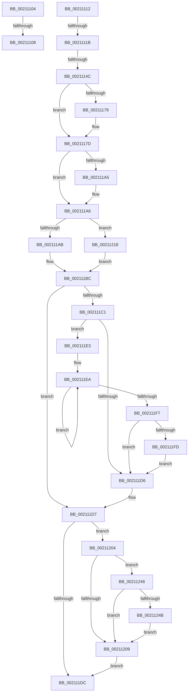

# sub_00211104

- RVA: `0x00211104`–`0x00211258` (길이 `340` bytes)
- VA: `0x0000000140211104`
- 실행 섹션: `.text`
- PDB 이름 있음: `아니요`; PDB Function 태그: `아니요`
- unwind 정보 RVA: `0x0005DE48`
- 디코드: `96`개 명령, `340/340` bytes 표시
- 미해석 바이트: `0` (있으면 어셈블리에 `.byte`로 보존)

> 이 문서는 커널 이미지의 기계어와 PDB 기호를 분석해 생성했습니다. 4번과 5번은 함수 원형과 자료형을 바이너리 사용 방식에서 추정한 C 해석이며 원본 소스 복구 결과는 아닙니다.

## 1. Dependencies

- 직접 호출 지점: **9**; 고유 호출 대상: **8**
- 직접 호출자로 확인된 함수: **0**
- RIP 상대 이미지 참조: **0**

### Outgoing calls
- `0x0021112D` → [KeBugCheckEx](../4F/KeBugCheckEx_function_004FD660.md) (function, `0x004FD660`)
- `0x0021119B` → [ExpSaveAbHandle](ExpSaveAbHandle_function_00213630.md) (function, `0x00213630`)
- `0x002111B7` → [ExpAddFastOwnerEntryToThreadList](../41/ExpAddFastOwnerEntryToThreadList_function_00411E50.md) (function, `0x00411E50`)
- `0x002111FD` → [KiRemoveSystemWorkPriorityKick](../26/KiRemoveSystemWorkPriorityKick_function_002631D0.md) (function, `0x002631D0`)
- `0x00211211` → [ObfReferenceObjectWithTag](ObfReferenceObjectWithTag_function_00210710.md) (function, `0x00210710`)
- `0x0021121F` → [KeAcquireSpinLockAtDpcLevel](../20/KeAcquireSpinLockAtDpcLevel_function_00208430.md) (function, `0x00208430`)
- `0x00211230` → [ExpAddFastOwnerEntryToThreadList](../41/ExpAddFastOwnerEntryToThreadList_function_00411E50.md) (function, `0x00411E50`)
- `0x0021123C` → [KxReleaseSpinLock](../20/KxReleaseSpinLock_function_00206670.md) (function, `0x00206670`)
- `0x00211251` → [KeAbMarkCrossThreadReleasable](../3B/KeAbMarkCrossThreadReleasable_function_003BE8AC.md) (function, `0x003BE8AC`)

### Direct callers
- 이 함수 시작 RVA로 연결되는 직접 call은 확인되지 않았습니다. 간접 호출은 완전히 역산할 수 없습니다.

### Static image references
- 디코드된 RIP-relative 메모리 참조가 없습니다.

## 2. Other-region calls and transfers

- 다른 실행 섹션으로 향하는 call: **0**
- call이 아닌 외부 분기/꼬리 이동: **5**
  - `0x00211106` → [sub_00210F9D + 0xFC](Unknown_function_00210F9D.md) (`tail-transfer`)
  - `0x00211110` → [sub_00210F9D + 0x14B](Unknown_function_00210F9D.md) (`tail-transfer`)
  - `0x00211115` → [sub_00210F9D + 0xF5](Unknown_function_00210F9D.md) (`tail-transfer`)
  - `0x00211146` → [sub_00210F9D + 0x127](Unknown_function_00210F9D.md) (`tail-transfer`)
  - `0x002111DE` → [sub_00210F9D + 0x14B](Unknown_function_00210F9D.md) (`tail-transfer`)

## 3. Assembly (complete function range)

```asm
00211104  A8 04                           test al, 4
00211106  75 91                           jne 0x140211099
00211108  8D 41 01                        lea eax, [rcx + 1]
0021110B  89 43 20                        mov dword ptr [rbx + 0x20], eax
0021110E  B0 01                           mov al, 1
00211110  EB D6                           jmp 0x1402110e8
00211112  4C 3B CE                        cmp r9, rsi
00211115  0F 84 77 FF FF FF               je 0x140211092
0021111B  33 FF                           xor edi, edi
0021111D  4C 8B C3                        mov r8, rbx
00211120  B9 C6 01 00 00                  mov ecx, 0x1c6
00211125  48 89 7C 24 20                  mov qword ptr [rsp + 0x20], rdi
0021112A  8D 57 02                        lea edx, [rdi + 2]
0021112D  E8 2E C5 2E 00                  call 0x1404fd660
00211132  CC                              int3
00211133  48 8D 48 04                     lea rcx, [rax + 4]
00211137  48 33 C8                        xor rcx, rax
0021113A  48 83 E1 FC                     and rcx, 0xfffffffffffffffc
0021113E  48 33 C8                        xor rcx, rax
00211141  F0 48 0F B1 0E                  lock cmpxchg qword ptr [rsi], rcx
00211146  0F 85 78 FF FF FF               jne 0x1402110c4
0021114C  45 85 ED                        test r13d, r13d
0021114F  B8 0F 00 00 00                  mov eax, 0xf
00211154  41 BC 03 00 00 00               mov r12d, 3
0021115A  44 0F 45 E0                     cmovne r12d, eax
0021115E  48 8D 46 40                     lea rax, [rsi + 0x40]
00211162  45 8B EC                        mov r13d, r12d
00211165  45 8B F4                        mov r14d, r12d
00211168  41 83 E5 02                     and r13d, 2
0021116C  41 83 E6 04                     and r14d, 4
00211170  41 83 E4 08                     and r12d, 8
00211174  48 3B D8                        cmp rbx, rax
00211177  74 04                           je 0x14021117d
00211179  48 89 73 18                     mov qword ptr [rbx + 0x18], rsi
0021117D  45 85 F6                        test r14d, r14d
00211180  C7 43 20 01 00 00 00            mov dword ptr [rbx + 0x20], 1
00211187  41 B0 01                        mov r8b, 1
0021118A  49 8B D7                        mov rdx, r15
0021118D  40 0F 95 C7                     setne dil
00211191  48 8B CB                        mov rcx, rbx
00211194  48 0B FD                        or rdi, rbp
00211197  48 89 7B 10                     mov qword ptr [rbx + 0x10], rdi
0021119B  E8 90 24 00 00                  call 0x140213630
002111A0  45 85 ED                        test r13d, r13d
002111A3  74 01                           je 0x1402111a6
002111A5  FA                              cli
002111A6  45 85 F6                        test r14d, r14d
002111A9  75 6D                           jne 0x140211218
002111AB  4C 8B CB                        mov r9, rbx
002111AE  45 33 C0                        xor r8d, r8d
002111B1  48 8B D6                        mov rdx, rsi
002111B4  48 8B CD                        mov rcx, rbp
002111B7  E8 94 0C 20 00                  call 0x140411e50
002111BC  45 85 ED                        test r13d, r13d
002111BF  74 16                           je 0x1402111d7
002111C1  65 48 8B 0C 25 20 00 00 00      mov rcx, qword ptr gs:[0x20]
002111CA  4C 8B 81 B8 8E 00 00            mov r8, qword ptr [rcx + 0x8eb8]
002111D1  4D 85 C0                        test r8, r8
002111D4  75 0D                           jne 0x1402111e3
002111D6  FB                              sti
002111D7  45 85 F6                        test r14d, r14d
002111DA  75 28                           jne 0x140211204
002111DC  B0 01                           mov al, 1
002111DE  E9 05 FF FF FF                  jmp 0x1402110e8
002111E3  41 0F 0D 08                     prefetchw byte ptr [r8]
002111E7  41 8B 00                        mov eax, dword ptr [r8]
002111EA  8B D0                           mov edx, eax
002111EC  0F BA F2 15                     btr edx, 0x15
002111F0  F0 41 0F B1 10                  lock cmpxchg dword ptr [r8], edx
002111F5  75 F3                           jne 0x1402111ea
002111F7  0F BA E0 15                     bt eax, 0x15
002111FB  73 D9                           jae 0x1402111d6
002111FD  E8 CE 1F 05 00                  call 0x1402631d0
00211202  EB D2                           jmp 0x1402111d6
00211204  45 85 E4                        test r12d, r12d
00211207  75 3D                           jne 0x140211246
00211209  BA 44 66 6C 74                  mov edx, 0x746c6644
0021120E  48 8B CD                        mov rcx, rbp
00211211  E8 FA F4 FF FF                  call 0x140210710
00211216  EB C4                           jmp 0x1402111dc
00211218  48 8D 8D C8 06 00 00            lea rcx, [rbp + 0x6c8]
0021121F  E8 0C 72 FF FF                  call 0x140208430
00211224  4C 8B CB                        mov r9, rbx
00211227  41 B0 01                        mov r8b, 1
0021122A  48 8B D6                        mov rdx, rsi
0021122D  48 8B CD                        mov rcx, rbp
00211230  E8 1B 0C 20 00                  call 0x140411e50
00211235  48 8D 8D C8 06 00 00            lea rcx, [rbp + 0x6c8]
0021123C  E8 2F 54 FF FF                  call 0x140206670
00211241  E9 76 FF FF FF                  jmp 0x1402111bc
00211246  4D 85 FF                        test r15, r15
00211249  74 BE                           je 0x140211209
0021124B  49 8B D7                        mov rdx, r15
0021124E  48 8B CE                        mov rcx, rsi
00211251  E8 56 D6 1A 00                  call 0x1403be8ac
00211256  EB B1                           jmp 0x140211209
```

## 4. C-style interpretation (structured pseudocode)

```c
__int64 __fastcall sub_00211104(__int64 a1, __int64 a2, __int64 a3, __int64 a4)
{
    unsigned __int64 v_stack_p20;

    *(unsigned int *)(v_rbx + 32) = (unsigned int)(a1 + 1);
}
```

## 5. (Beta) C Style

```c
int64_t sub_00211104(void *Arg1, int64_t Arg2, int64_t Arg3, int64_t Arg4)
{
    uint8_t *arg1 = (uint8_t *)Arg1;

    uint64_t v_stack_p20;

    *(uint32_t *)(local_rbx + 0x20) = (uint32_t)(Arg1 + 1);
}
```

### 관측된 메모리 오프셋

구조체 형식이 확인되지 않은 접근은 인자 기준의 오프셋으로만 기록했습니다.

| 기준 인자 | 오프셋 표현 | 폭 (bit) | 접근 |
|---|---:|---:|---|
| `Arg1` | `+ 0x1` | `32` | `R` |

## 6. Execution-region graph

[열기: 2D/3D 그래프와 함수 탐색 컨트롤 패널](../../../control-panel.html?section=text&rva=0x00211104&view=graph)

- 2D 그래프는 위에서 아래로 흐르고, 3D 그래프는 빈 공간을 드래그해 회전합니다. Shift+드래그는 이동, 휠은 확대·축소, 함수 노드 선택은 대상 보고서 이동입니다.

### Static fallback


