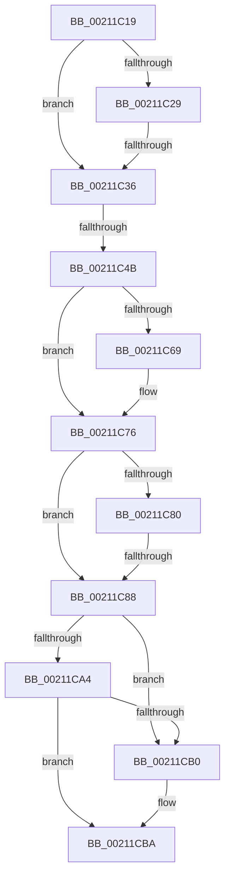

# sub_00211C19

- RVA: `0x00211C19`–`0x00211CE1` (길이 `200` bytes)
- VA: `0x0000000140211C19`
- 실행 섹션: `.text`
- PDB 이름 있음: `아니요`; PDB Function 태그: `아니요`
- unwind 정보 RVA: `0x0005DE8C`
- 디코드: `55`개 명령, `200/200` bytes 표시
- 미해석 바이트: `0` (있으면 어셈블리에 `.byte`로 보존)

> 이 문서는 커널 이미지의 기계어와 PDB 기호를 분석해 생성했습니다. 4번과 5번은 함수 원형과 자료형을 바이너리 사용 방식에서 추정한 C 해석이며 원본 소스 복구 결과는 아닙니다.

## 1. Dependencies

- 직접 호출 지점: **4**; 고유 호출 대상: **4**
- 직접 호출자로 확인된 함수: **0**
- RIP 상대 이미지 참조: **0**

### Outgoing calls
- `0x00211C6E` → [KeAbPreAcquire](KeAbPreAcquire_function_00210230.md) (function, `0x00210230`)
- `0x00211C98` → [ExpAcquireFastResourceSharedSlow](ExpAcquireFastResourceSharedSlow_function_00211260.md) (function, `0x00211260`)
- `0x00211CA7` → [ExIsFastResourceHeldExclusive](ExIsFastResourceHeldExclusive_function_00213450.md) (function, `0x00213450`)
- `0x00211CB5` → [ExFreePoolWithTag](../../poolcode/B8/ExFreePoolWithTag_function_00B82870.md) (function, `0x00B82870`)

### Direct callers
- 이 함수 시작 RVA로 연결되는 직접 call은 확인되지 않았습니다. 간접 호출은 완전히 역산할 수 없습니다.

### Static image references
- 디코드된 RIP-relative 메모리 참조가 없습니다.

## 2. Other-region calls and transfers

- 다른 실행 섹션으로 향하는 call: **1**
  - `0x00211CB5` → [ExFreePoolWithTag](../../poolcode/B8/ExFreePoolWithTag_function_00B82870.md) (`.text` → `POOLCODE`)
- call이 아닌 외부 분기/꼬리 이동: **4**
  - `0x00211C30` → [sub_00211CF4](Unknown_function_00211CF4.md) (`tail-transfer`)
  - `0x00211C45` → [sub_00211CE1](Unknown_function_00211CE1.md) (`tail-transfer`)
  - `0x00211C82` → [sub_00211E87](Unknown_function_00211E87.md) (`tail-transfer`)
  - `0x00211CDC` → [ExAcquireResourceSharedLite + 0x36](ExAcquireResourceSharedLite_function_00211BC0.md) (`tail-transfer`)

## 3. Assembly (complete function range)

```asm
00211C19  0F B6 46 25                     movzx eax, byte ptr [rsi + 0x25]
00211C1D  48 89 6C 24 70                  mov qword ptr [rsp + 0x70], rbp
00211C22  41 8B E8                        mov ebp, r8d
00211C25  A8 02                           test al, 2
00211C27  75 0D                           jne 0x140211c36
00211C29  4C 8B 4E 18                     mov r9, qword ptr [rsi + 0x18]
00211C2D  4D 85 C9                        test r9, r9
00211C30  0F 85 BE 00 00 00               jne 0x140211cf4
00211C36  8B 4E 20                        mov ecx, dword ptr [rsi + 0x20]
00211C39  4C 89 64 24 48                  mov qword ptr [rsp + 0x48], r12
00211C3E  4C 89 74 24 38                  mov qword ptr [rsp + 0x38], r14
00211C43  85 C9                           test ecx, ecx
00211C45  0F 85 96 00 00 00               jne 0x140211ce1
00211C4B  65 4C 8B 34 25 88 01 00 00      mov r14, qword ptr gs:[0x188]
00211C54  33 FF                           xor edi, edi
00211C56  45 85 D2                        test r10d, r10d
00211C59  44 8B C7                        mov r8d, edi
00211C5C  44 8B E7                        mov r12d, edi
00211C5F  41 0F 94 C0                     sete r8b
00211C63  40 38 7E 24                     cmp byte ptr [rsi + 0x24], dil
00211C67  75 0D                           jne 0x140211c76
00211C69  33 D2                           xor edx, edx
00211C6B  48 8B CB                        mov rcx, rbx
00211C6E  E8 BD E5 FF FF                  call 0x140210230
00211C73  4C 8B E0                        mov r12, rax
00211C76  0F 0D 0B                        prefetchw byte ptr [rbx]
00211C79  48 8B 03                        mov rax, qword ptr [rbx]
00211C7C  A8 01                           test al, 1
00211C7E  75 08                           jne 0x140211c88
00211C80  A8 02                           test al, 2
00211C82  0F 84 FF 01 00 00               je 0x140211e87
00211C88  4D 8B CE                        mov r9, r14
00211C8B  89 6C 24 20                     mov dword ptr [rsp + 0x20], ebp
00211C8F  4D 8B C4                        mov r8, r12
00211C92  48 8B D6                        mov rdx, rsi
00211C95  48 8B CB                        mov rcx, rbx
00211C98  E8 C3 F5 FF FF                  call 0x140211260
00211C9D  0F B6 F8                        movzx edi, al
00211CA0  84 C0                           test al, al
00211CA2  74 0C                           je 0x140211cb0
00211CA4  48 8B CB                        mov rcx, rbx
00211CA7  E8 A4 17 00 00                  call 0x140213450
00211CAC  84 C0                           test al, al
00211CAE  74 0A                           je 0x140211cba
00211CB0  33 D2                           xor edx, edx
00211CB2  48 8B CE                        mov rcx, rsi
00211CB5  E8 B6 0B 97 00                  call 0x140b82870
00211CBA  4C 8B 74 24 38                  mov r14, qword ptr [rsp + 0x38]
00211CBF  40 0F B6 C7                     movzx eax, dil
00211CC3  4C 8B 64 24 48                  mov r12, qword ptr [rsp + 0x48]
00211CC8  48 8B 6C 24 70                  mov rbp, qword ptr [rsp + 0x70]
00211CCD  48 8B 74 24 50                  mov rsi, qword ptr [rsp + 0x50]
00211CD2  4C 8B 6C 24 40                  mov r13, qword ptr [rsp + 0x40]
00211CD7  4C 8B 7C 24 30                  mov r15, qword ptr [rsp + 0x30]
00211CDC  E9 15 FF FF FF                  jmp 0x140211bf6
```

## 4. C-style interpretation (structured pseudocode)

```c
__int64 __fastcall sub_00211C19(__int64 a1, int a2, int a3, __int64 a4, __int64 a5, __int64 a6, __int64 a7, __int64 a8, __int64 a9, __int64 a10, __int64 a11, __int64 a12, __int64 a13, __int64 a14)
{
    __int64 result;
    __int64 v_r12;
    __int64 v_rdi;
    unsigned int v_stack_p20;
    unsigned __int64 v_stack_p38;
    unsigned __int64 v_stack_p48;
    unsigned __int64 v_stack_p70;

    v_stack_p70 = v_rbp;
    if ((((unsigned __int8)(*(unsigned __int8 *)(v_rsi + 37))) & (2)) != 0) goto loc_00211C36;
loc_00211C36:
    v_stack_p48 = v_r12;
    v_stack_p38 = v_r14;
    v_rdi = 0;
    a3 = ((unsigned int)(v_r10) == 0) ? 1 : 0;
    result = *(unsigned __int8 *)(v_rsi + 37);
    v_r12 = 0;
    if ((*(unsigned __int8 *)(v_rsi + 36)) == 0) {
        a2 = 0;
        a1 = v_rbx;
        result = KeAbPreAcquire(a1, a2, a3, *(unsigned __int64 *)(v_rsi + 24));
        v_r12 = result;
    }
    if ((((unsigned __int8)(*(unsigned __int64 *)(v_rbx))) & (1)) != 0) goto loc_00211C88;
loc_00211C88:
    v_stack_p20 = (unsigned int)((unsigned int)(a3));
    result = ExpAcquireFastResourceSharedSlow(v_rbx, v_rsi, v_r12, *(unsigned __int64 *)(gs_base + (0 + 392)));
    if ((unsigned __int8)(result) == 0) goto loc_00211CB0;
    result = ExIsFastResourceHeldExclusive(v_rbx, v_rsi, v_r12, *(unsigned __int64 *)(gs_base + (0 + 392)));
    if ((unsigned __int8)(result) != 0) {
        a2 = 0;
        a1 = v_rsi;
        result = ExFreePoolWithTag(a1, a2, v_r12, *(unsigned __int64 *)(gs_base + (0 + 392)));
    }
}
```

## 5. (Beta) C Style

```c
int64_t sub_00211C19(int64_t Arg1, int32_t Arg2, int32_t Arg3, int64_t Arg4, uint64_t Arg5, int64_t Arg6, int64_t Arg7, int64_t Arg8, int64_t Arg9, int64_t Arg10, uint64_t Arg11, uint64_t Arg12, uint64_t Arg13, int64_t Arg14)
{
    int64_t result;
    int64_t local_r12;
    int64_t local_rdi;
    uint32_t v_stack_p20;
    uint64_t v_stack_p38;
    uint64_t v_stack_p48;
    uint64_t v_stack_p70;

    v_stack_p70 = local_rbp;
    if ((((uint8_t)(*(uint8_t *)(local_rsi + 0x25))) & (2)) != 0) goto loc_00211C36;
loc_00211C36:
    v_stack_p48 = local_r12;
    v_stack_p38 = local_r14;
    local_rdi = 0;
    Arg3 = ((uint32_t)(local_r10) == 0) ? 1 : 0;
    result = *(uint8_t *)(local_rsi + 0x25);
    local_r12 = 0;
    if ((*(uint8_t *)(local_rsi + 0x24)) == 0) {
        Arg2 = 0;
        Arg1 = local_rbx;
        result = KeAbPreAcquire(Arg1, Arg2, Arg3, *(uint64_t *)(local_rsi + 0x18));
        local_r12 = result;
    }
    if ((((uint8_t)(*(uint64_t *)(local_rbx))) & (1)) != 0) goto loc_00211C88;
loc_00211C88:
    v_stack_p20 = (uint32_t)((uint32_t)(Arg3));
    result = ExpAcquireFastResourceSharedSlow(local_rbx, local_rsi, local_r12, *(uint64_t *)(gs_base + (0 + 0x188)));
    if ((uint8_t)(result) == 0) goto loc_00211CB0;
    result = ExIsFastResourceHeldExclusive(local_rbx, local_rsi, local_r12, *(uint64_t *)(gs_base + (0 + 0x188)));
    if ((uint8_t)(result) != 0) {
        Arg2 = 0;
        Arg1 = local_rsi;
        result = ExFreePoolWithTag(Arg1, Arg2, local_r12, *(uint64_t *)(gs_base + (0 + 0x188)));
    }
}
```

## 6. Execution-region graph

[열기: 2D/3D 그래프와 함수 탐색 컨트롤 패널](../../../control-panel.html?section=text&rva=0x00211C19&view=graph)

- 2D 그래프는 위에서 아래로 흐르고, 3D 그래프는 빈 공간을 드래그해 회전합니다. Shift+드래그는 이동, 휠은 확대·축소, 함수 노드 선택은 대상 보고서 이동입니다.

### Static fallback


