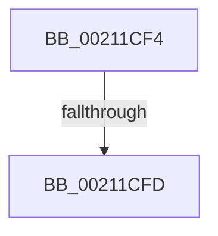

# sub_00211CF4

- RVA: `0x00211CF4`–`0x00211D20` (길이 `44` bytes)
- VA: `0x0000000140211CF4`
- 실행 섹션: `.text`
- PDB 이름 있음: `아니요`; PDB Function 태그: `아니요`
- unwind 정보 RVA: `0x0005DEDC`
- 디코드: `10`개 명령, `44/44` bytes 표시
- 미해석 바이트: `0` (있으면 어셈블리에 `.byte`로 보존)

> 이 문서는 커널 이미지의 기계어와 PDB 기호를 분석해 생성했습니다. 4번과 5번은 함수 원형과 자료형을 바이너리 사용 방식에서 추정한 C 해석이며 원본 소스 복구 결과는 아닙니다.

## 1. Dependencies

- 직접 호출 지점: **1**; 고유 호출 대상: **1**
- 직접 호출자로 확인된 함수: **0**
- RIP 상대 이미지 참조: **0**

### Outgoing calls
- `0x00211D0F` → [KeBugCheckEx](../4F/KeBugCheckEx_function_004FD660.md) (function, `0x004FD660`)

### Direct callers
- 이 함수 시작 RVA로 연결되는 직접 call은 확인되지 않았습니다. 간접 호출은 완전히 역산할 수 없습니다.

### Static image references
- 디코드된 RIP-relative 메모리 참조가 없습니다.

## 2. Other-region calls and transfers

- 다른 실행 섹션으로 향하는 call: **0**
- call이 아닌 외부 분기/꼬리 이동: **1**
  - `0x00211CF7` → [sub_00211C19 + 0x1D](Unknown_function_00211C19.md) (`tail-transfer`)

## 3. Assembly (complete function range)

```asm
00211CF4  4C 3B CB                        cmp r9, rbx
00211CF7  0F 84 39 FF FF FF               je 0x140211c36
00211CFD  33 FF                           xor edi, edi
00211CFF  4C 8B C6                        mov r8, rsi
00211D02  B9 C6 01 00 00                  mov ecx, 0x1c6
00211D07  48 89 7C 24 20                  mov qword ptr [rsp + 0x20], rdi
00211D0C  8D 57 02                        lea edx, [rdi + 2]
00211D0F  E8 4C B9 2E 00                  call 0x1404fd660
00211D14  CC                              int3
00211D15  66 66 66 0F 1F 84 00 00 00 00 00  nop word ptr [rax + rax]
```

## 4. C-style interpretation (structured pseudocode)

```c
__int64 __fastcall sub_00211CF4(__int64 a1, __int64 a2, __int64 a3, __int64 a4)
{
    __int64 result;
    __int64 v_rdi;
    unsigned __int64 v_stack_p20;

    v_rdi = 0;
    v_stack_p20 = 0;
    result = KeBugCheckEx(454, v_rdi + 2, v_rsi, a4);
    return result;
}
```

## 5. (Beta) C Style

```c
int64_t sub_00211CF4(int64_t Arg1, int64_t Arg2, int64_t Arg3, int64_t Arg4)
{
    int64_t result;
    int64_t local_rdi;
    uint64_t v_stack_p20;

    local_rdi = 0;
    v_stack_p20 = 0;
    result = KeBugCheckEx(454, local_rdi + 2, local_rsi, Arg4);
    return result;
}
```

## 6. Execution-region graph

[열기: 2D/3D 그래프와 함수 탐색 컨트롤 패널](../../../control-panel.html?section=text&rva=0x00211CF4&view=graph)

- 2D 그래프는 위에서 아래로 흐르고, 3D 그래프는 빈 공간을 드래그해 회전합니다. Shift+드래그는 이동, 휠은 확대·축소, 함수 노드 선택은 대상 보고서 이동입니다.

### Static fallback


