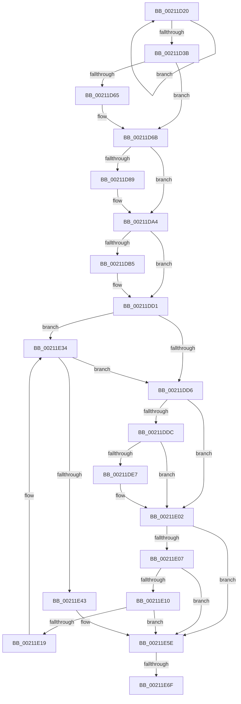

# sub_00211D20

- RVA: `0x00211D20`–`0x00211E87` (길이 `359` bytes)
- VA: `0x0000000140211D20`
- 실행 섹션: `.text`
- PDB 이름 있음: `아니요`; PDB Function 태그: `아니요`
- unwind 정보 RVA: `0x0005DEFC`
- 디코드: `99`개 명령, `359/359` bytes 표시
- 미해석 바이트: `0` (있으면 어셈블리에 `.byte`로 보존)

> 이 문서는 커널 이미지의 기계어와 PDB 기호를 분석해 생성했습니다. 4번과 5번은 함수 원형과 자료형을 바이너리 사용 방식에서 추정한 C 해석이며 원본 소스 복구 결과는 아닙니다.

## 1. Dependencies

- 직접 호출 지점: **7**; 고유 호출 대상: **2**
- 직접 호출자로 확인된 함수: **0**
- RIP 상대 이미지 참조: **0**

### Outgoing calls
- `0x00211D2E` → [ExAllocatePool2](../../poolcode/B8/ExAllocatePool2_function_00B820F0.md) (function, `0x00B820F0`)
- `0x00211D9E` → [KeBugCheckEx](../4F/KeBugCheckEx_function_004FD660.md) (function, `0x004FD660`)
- `0x00211DCB` → [KeBugCheckEx](../4F/KeBugCheckEx_function_004FD660.md) (function, `0x004FD660`)
- `0x00211DFC` → [KeBugCheckEx](../4F/KeBugCheckEx_function_004FD660.md) (function, `0x004FD660`)
- `0x00211E2E` → [KeBugCheckEx](../4F/KeBugCheckEx_function_004FD660.md) (function, `0x004FD660`)
- `0x00211E58` → [KeBugCheckEx](../4F/KeBugCheckEx_function_004FD660.md) (function, `0x004FD660`)
- `0x00211E81` → [KeBugCheckEx](../4F/KeBugCheckEx_function_004FD660.md) (function, `0x004FD660`)

### Direct callers
- 이 함수 시작 RVA로 연결되는 직접 call은 확인되지 않았습니다. 간접 호출은 완전히 역산할 수 없습니다.

### Static image references
- 디코드된 RIP-relative 메모리 참조가 없습니다.

## 2. Other-region calls and transfers

- 다른 실행 섹션으로 향하는 call: **1**
  - `0x00211D2E` → [ExAllocatePool2](../../poolcode/B8/ExAllocatePool2_function_00B820F0.md) (`.text` → `POOLCODE`)
- call이 아닌 외부 분기/꼬리 이동: **1**
  - `0x00211E69` → [sub_00211C19](Unknown_function_00211C19.md) (`tail-transfer`)

## 3. Assembly (complete function range)

```asm
00211D20  BA 28 00 00 00                  mov edx, 0x28
00211D25  41 B8 46 52 4F 45               mov r8d, 0x454f5246
00211D2B  8D 4A 18                        lea ecx, [rdx + 0x18]
00211D2E  E8 BD 03 97 00                  call 0x140b820f0
00211D33  48 8B F0                        mov rsi, rax
00211D36  48 85 C0                        test rax, rax
00211D39  74 E5                           je 0x140211d20
00211D3B  33 C0                           xor eax, eax
00211D3D  0F 57 C0                        xorps xmm0, xmm0
00211D40  0F 11 06                        movups xmmword ptr [rsi], xmm0
00211D43  0F 11 46 10                     movups xmmword ptr [rsi + 0x10], xmm0
00211D47  48 89 46 20                     mov qword ptr [rsi + 0x20], rax
00211D4B  44 8D 40 02                     lea r8d, [rax + 2]
00211D4F  65 48 8B 0C 25 88 01 00 00      mov rcx, qword ptr gs:[0x188]
00211D58  80 4E 25 01                     or byte ptr [rsi + 0x25], 1
00211D5C  48 89 4E 10                     mov qword ptr [rsi + 0x10], rcx
00211D60  40 84 FF                        test dil, dil
00211D63  74 06                           je 0x140211d6b
00211D65  41 B8 0A 00 00 00               mov r8d, 0xa
00211D6B  44 0F B7 4B 1A                  movzx r9d, word ptr [rbx + 0x1a]
00211D70  45 8B F8                        mov r15d, r8d
00211D73  41 83 E7 10                     and r15d, 0x10
00211D77  45 8B D0                        mov r10d, r8d
00211D7A  41 83 E2 08                     and r10d, 8
00211D7E  0F 94 C0                        sete al
00211D81  FE C0                           inc al
00211D83  41 F6 C1 01                     test r9b, 1
00211D87  75 1B                           jne 0x140211da4
00211D89  33 FF                           xor edi, edi
00211D8B  45 33 C9                        xor r9d, r9d
00211D8E  4C 8B C3                        mov r8, rbx
00211D91  48 89 7C 24 20                  mov qword ptr [rsp + 0x20], rdi
00211D96  B9 C6 01 00 00                  mov ecx, 0x1c6
00211D9B  8D 57 03                        lea edx, [rdi + 3]
00211D9E  E8 BD B8 2E 00                  call 0x1404fd660
00211DA3  CC                              int3
00211DA4  44 0F 20 C2                     mov rdx, cr8
00211DA8  65 48 8B 0C 25 88 01 00 00      mov rcx, qword ptr gs:[0x188]
00211DB1  3A D0                           cmp dl, al
00211DB3  76 1C                           jbe 0x140211dd1
00211DB5  44 0F B6 C2                     movzx r8d, dl
00211DB9  33 FF                           xor edi, edi
00211DBB  33 D2                           xor edx, edx
00211DBD  44 0F B6 C8                     movzx r9d, al
00211DC1  B9 C6 01 00 00                  mov ecx, 0x1c6
00211DC6  48 89 7C 24 20                  mov qword ptr [rsp + 0x20], rdi
00211DCB  E8 90 B8 2E 00                  call 0x1404fd660
00211DD0  CC                              int3
00211DD1  80 FA 02                        cmp dl, 2
00211DD4  73 5E                           jae 0x140211e34
00211DD6  41 F6 C1 08                     test r9b, 8
00211DDA  75 26                           jne 0x140211e02
00211DDC  0F B6 81 C0 00 00 00            movzx eax, byte ptr [rcx + 0xc0]
00211DE3  A8 02                           test al, 2
00211DE5  74 1B                           je 0x140211e02
00211DE7  33 FF                           xor edi, edi
00211DE9  45 33 C9                        xor r9d, r9d
00211DEC  45 33 C0                        xor r8d, r8d
00211DEF  48 89 7C 24 20                  mov qword ptr [rsp + 0x20], rdi
00211DF4  B9 C6 01 00 00                  mov ecx, 0x1c6
00211DF9  8D 57 06                        lea edx, [rdi + 6]
00211DFC  E8 5F B8 2E 00                  call 0x1404fd660
00211E01  CC                              int3
00211E02  80 FA 01                        cmp dl, 1
00211E05  73 57                           jae 0x140211e5e
00211E07  F7 41 74 00 04 00 00            test dword ptr [rcx + 0x74], 0x400
00211E0E  75 4E                           jne 0x140211e5e
00211E10  83 B9 E4 01 00 00 00            cmp dword ptr [rcx + 0x1e4], 0
00211E17  75 45                           jne 0x140211e5e
00211E19  33 FF                           xor edi, edi
00211E1B  45 33 C9                        xor r9d, r9d
00211E1E  45 33 C0                        xor r8d, r8d
00211E21  48 89 7C 24 20                  mov qword ptr [rsp + 0x20], rdi
00211E26  B9 C6 01 00 00                  mov ecx, 0x1c6
00211E2B  8D 57 07                        lea edx, [rdi + 7]
00211E2E  E8 2D B8 2E 00                  call 0x1404fd660
00211E33  CC                              int3
00211E34  65 8B 04 25 3C 3A 00 00         mov eax, dword ptr gs:[0x3a3c]
00211E3C  A9 01 00 01 00                  test eax, 0x10001
00211E41  74 93                           je 0x140211dd6
00211E43  33 FF                           xor edi, edi
00211E45  45 33 C9                        xor r9d, r9d
00211E48  45 33 C0                        xor r8d, r8d
00211E4B  48 89 7C 24 20                  mov qword ptr [rsp + 0x20], rdi
00211E50  B9 C6 01 00 00                  mov ecx, 0x1c6
00211E55  8D 57 05                        lea edx, [rdi + 5]
00211E58  E8 03 B8 2E 00                  call 0x1404fd660
00211E5D  CC                              int3
00211E5E  4C 8B 4E 10                     mov r9, qword ptr [rsi + 0x10]
00211E62  49 83 E1 FE                     and r9, 0xfffffffffffffffe
00211E66  4C 3B C9                        cmp r9, rcx
00211E69  0F 84 AA FD FF FF               je 0x140211c19
00211E6F  33 FF                           xor edi, edi
00211E71  4C 8B C6                        mov r8, rsi
00211E74  B9 C6 01 00 00                  mov ecx, 0x1c6
00211E79  48 89 7C 24 20                  mov qword ptr [rsp + 0x20], rdi
00211E7E  8D 57 09                        lea edx, [rdi + 9]
00211E81  E8 DA B7 2E 00                  call 0x1404fd660
00211E86  CC                              int3
```

## 4. C-style interpretation (structured pseudocode)

```c
__int64 __fastcall sub_00211D20(void)
{
    __int64 result;
    __int64 v_r10;
    __int64 v_r15;
    __int64 v_rdi;
    unsigned __int64 v_stack_p20;

    result = ExAllocatePool2(40 + 24, 40, (unsigned int)(0x454F5246ULL), a4);
    if (result == 0) goto loc_00211D20;
    result = 0;
    *(unsigned __int64 *)(result) = v_xmm0;
    *(unsigned __int64 *)(result + 16) = v_xmm0;
    *(unsigned __int64 *)(result + 32) = 0;
    *(unsigned __int64 *)(result + 16) = *(unsigned __int64 *)(gs_base + (0 + 392));
    if ((unsigned __int8)(v_rdi) != 0) {
        a3 = 10;
    }
    v_r15 = (unsigned int)(((unsigned int)((unsigned int)(a3))) & (16));
    v_r10 = (unsigned int)(((unsigned int)((unsigned int)(a3))) & (8));
    result = (condition_is_equal) ? 1 : 0;
    result = (unsigned __int8)((result) + 1);
    if ((((unsigned __int8)(*(unsigned __int16 *)(v_rbx + 26))) & (1)) == 0) {
        v_rdi = 0;
        a4 = 0;
        a3 = v_rbx;
        v_stack_p20 = 0;
        a1 = 454;
        a2 = v_rdi + 3;
        result = KeBugCheckEx(a1, a2, a3, a4);
    }
    if (((unsigned __int8)(v_cr8)) >= = ((unsigned __int8)(result))) {
        a3 = (unsigned __int8)(v_cr8);
        v_rdi = 0;
        a2 = 0;
        a4 = (unsigned __int8)(result);
        a1 = 454;
        v_stack_p20 = 0;
        result = KeBugCheckEx(a1, a2, a3, a4);
    }
    if (0 >= 2) goto loc_00211E34;
loc_00211DD6:
    if ((((unsigned __int8)(a4)) & (8)) != 0) goto loc_00211E02;
    result = *(unsigned __int8 *)(a1 + 192);
    if ((((unsigned __int8)(*(unsigned __int8 *)(a1 + 192))) & (2)) != 0) {
        v_rdi = 0;
        a4 = 0;
        a3 = 0;
        v_stack_p20 = 0;
        a1 = 454;
        a2 = v_rdi + 6;
        result = KeBugCheckEx(a1, a2, a3, a4);
    }
    if (((unsigned __int8)(a2)) >= 1) goto loc_00211E5E;
    if (((*(unsigned int *)(a1 + 116)) & (0x400ULL)) != 0) goto loc_00211E5E;
    if ((*(unsigned int *)(a1 + 484)) != 0) goto loc_00211E5E;
    v_rdi = 0;
    a4 = 0;
    a3 = 0;
    v_stack_p20 = 0;
    result = KeBugCheckEx(454, v_rdi + 7, a3, a4);
loc_00211E34:
    if ((((unsigned int)((unsigned int)(*(unsigned int *)(gs_base + (0 + 14908))))) & (0x10001ULL)) == 0) goto loc_00211DD6;
    v_rdi = 0;
    a4 = 0;
    a3 = 0;
    v_stack_p20 = 0;
    result = KeBugCheckEx(454, v_rdi + 5, a3, a4);
loc_00211E5E:
    a4 = (*(unsigned __int64 *)(result + 16)) & (-2);
    v_rdi = 0;
    v_stack_p20 = 0;
    result = KeBugCheckEx(454, v_rdi + 9, result, a4);
    return result;
}
```

## 5. (Beta) C Style

```c
void sub_00211D20(void)
{
    int64_t result;
    int64_t local_r10;
    int64_t local_r15;
    int64_t local_rdi;
    uint64_t v_stack_p20;

    result = ExAllocatePool2(40 + 24, 40, (uint32_t)(0x454F5246ULL), a4);
    if (result == 0) goto loc_00211D20;
    result = 0;
    *(uint64_t *)(result) = v_xmm0;
    *(uint64_t *)(result + 0x10) = v_xmm0;
    *(uint64_t *)(result + 0x20) = 0;
    *(uint64_t *)(result + 0x10) = *(uint64_t *)(gs_base + (0 + 0x188));
    if ((uint8_t)(local_rdi) != 0) {
        a3 = 10;
    }
    local_r15 = (uint32_t)(((uint32_t)((uint32_t)(a3))) & (16));
    local_r10 = (uint32_t)(((uint32_t)((uint32_t)(a3))) & (8));
    result = (condition_is_equal) ? 1 : 0;
    result = (uint8_t)((result) + 1);
    if ((((uint8_t)(*(uint16_t *)(local_rbx + 0x1A))) & (1)) == 0) {
        local_rdi = 0;
        a4 = 0;
        a3 = local_rbx;
        v_stack_p20 = 0;
        a1 = 454;
        a2 = local_rdi + 3;
        result = KeBugCheckEx(a1, a2, a3, a4);
    }
    if (((uint8_t)(v_cr8)) >= = ((uint8_t)(result))) {
        a3 = (uint8_t)(v_cr8);
        local_rdi = 0;
        a2 = 0;
        a4 = (uint8_t)(result);
        a1 = 454;
        v_stack_p20 = 0;
        result = KeBugCheckEx(a1, a2, a3, a4);
    }
    if (0 >= 2) goto loc_00211E34;
loc_00211DD6:
    if ((((uint8_t)(a4)) & (8)) != 0) goto loc_00211E02;
    result = *(uint8_t *)(a1 + 0xC0);
    if ((((uint8_t)(*(uint8_t *)(a1 + 0xC0))) & (2)) != 0) {
        local_rdi = 0;
        a4 = 0;
        a3 = 0;
        v_stack_p20 = 0;
        a1 = 454;
        a2 = local_rdi + 6;
        result = KeBugCheckEx(a1, a2, a3, a4);
    }
    if (((uint8_t)(a2)) >= 1) goto loc_00211E5E;
    if (((*(uint32_t *)(a1 + 0x74)) & (0x400ULL)) != 0) goto loc_00211E5E;
    if ((*(uint32_t *)(a1 + 0x1E4)) != 0) goto loc_00211E5E;
    local_rdi = 0;
    a4 = 0;
    a3 = 0;
    v_stack_p20 = 0;
    result = KeBugCheckEx(454, local_rdi + 7, a3, a4);
loc_00211E34:
    if ((((uint32_t)((uint32_t)(*(uint32_t *)(gs_base + (0 + 0x3A3C))))) & (0x10001ULL)) == 0) goto loc_00211DD6;
    local_rdi = 0;
    a4 = 0;
    a3 = 0;
    v_stack_p20 = 0;
    result = KeBugCheckEx(454, local_rdi + 5, a3, a4);
loc_00211E5E:
    a4 = (*(uint64_t *)(result + 0x10)) & (-2);
    local_rdi = 0;
    v_stack_p20 = 0;
    result = KeBugCheckEx(454, local_rdi + 9, result, a4);
    return result;
}
```

## 6. Execution-region graph

[열기: 2D/3D 그래프와 함수 탐색 컨트롤 패널](../../../control-panel.html?section=text&rva=0x00211D20&view=graph)

- 2D 그래프는 위에서 아래로 흐르고, 3D 그래프는 빈 공간을 드래그해 회전합니다. Shift+드래그는 이동, 휠은 확대·축소, 함수 노드 선택은 대상 보고서 이동입니다.

### Static fallback


