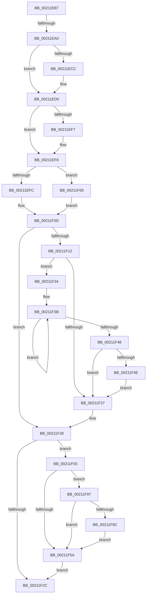

# sub_00211E87

- RVA: `0x00211E87`–`0x00211FA9` (길이 `290` bytes)
- VA: `0x0000000140211E87`
- 실행 섹션: `.text`
- PDB 이름 있음: `아니요`; PDB Function 태그: `아니요`
- unwind 정보 RVA: `0x0005DF18`
- 디코드: `81`개 명령, `290/290` bytes 표시
- 미해석 바이트: `0` (있으면 어셈블리에 `.byte`로 보존)

> 이 문서는 커널 이미지의 기계어와 PDB 기호를 분석해 생성했습니다. 4번과 5번은 함수 원형과 자료형을 바이너리 사용 방식에서 추정한 C 해석이며 원본 소스 복구 결과는 아닙니다.

## 1. Dependencies

- 직접 호출 지점: **8**; 고유 호출 대상: **7**
- 직접 호출자로 확인된 함수: **0**
- RIP 상대 이미지 참조: **0**

### Outgoing calls
- `0x00211EED` → [ExpSaveAbHandle](ExpSaveAbHandle_function_00213630.md) (function, `0x00213630`)
- `0x00211F08` → [ExpAddFastOwnerEntryToThreadList](../41/ExpAddFastOwnerEntryToThreadList_function_00411E50.md) (function, `0x00411E50`)
- `0x00211F4E` → [KiRemoveSystemWorkPriorityKick](../26/KiRemoveSystemWorkPriorityKick_function_002631D0.md) (function, `0x002631D0`)
- `0x00211F62` → [ObfReferenceObjectWithTag](ObfReferenceObjectWithTag_function_00210710.md) (function, `0x00210710`)
- `0x00211F70` → [KeAcquireSpinLockAtDpcLevel](../20/KeAcquireSpinLockAtDpcLevel_function_00208430.md) (function, `0x00208430`)
- `0x00211F81` → [ExpAddFastOwnerEntryToThreadList](../41/ExpAddFastOwnerEntryToThreadList_function_00411E50.md) (function, `0x00411E50`)
- `0x00211F8D` → [KxReleaseSpinLock](../20/KxReleaseSpinLock_function_00206670.md) (function, `0x00206670`)
- `0x00211FA2` → [KeAbMarkCrossThreadReleasable](../3B/KeAbMarkCrossThreadReleasable_function_003BE8AC.md) (function, `0x003BE8AC`)

### Direct callers
- 이 함수 시작 RVA로 연결되는 직접 call은 확인되지 않았습니다. 간접 호출은 완전히 역산할 수 없습니다.

### Static image references
- 디코드된 RIP-relative 메모리 참조가 없습니다.

## 2. Other-region calls and transfers

- 다른 실행 섹션으로 향하는 call: **0**
- call이 아닌 외부 분기/꼬리 이동: **2**
  - `0x00211E9A` → [sub_00211C19 + 0x5D](Unknown_function_00211C19.md) (`tail-transfer`)
  - `0x00211F2F` → [sub_00211C19 + 0x8B](Unknown_function_00211C19.md) (`tail-transfer`)

## 3. Assembly (complete function range)

```asm
00211E87  48 8D 48 04                     lea rcx, [rax + 4]
00211E8B  48 33 C8                        xor rcx, rax
00211E8E  48 83 E1 FC                     and rcx, 0xfffffffffffffffc
00211E92  48 33 C8                        xor rcx, rax
00211E95  F0 48 0F B1 0B                  lock cmpxchg qword ptr [rbx], rcx
00211E9A  0F 85 D6 FD FF FF               jne 0x140211c76
00211EA0  45 85 FF                        test r15d, r15d
00211EA3  B8 0F 00 00 00                  mov eax, 0xf
00211EA8  41 BD 03 00 00 00               mov r13d, 3
00211EAE  44 0F 45 E8                     cmovne r13d, eax
00211EB2  48 8D 43 40                     lea rax, [rbx + 0x40]
00211EB6  45 8B FD                        mov r15d, r13d
00211EB9  41 8B ED                        mov ebp, r13d
00211EBC  41 83 E7 02                     and r15d, 2
00211EC0  83 E5 04                        and ebp, 4
00211EC3  41 83 E5 08                     and r13d, 8
00211EC7  48 3B F0                        cmp rsi, rax
00211ECA  74 04                           je 0x140211ed0
00211ECC  48 89 5E 18                     mov qword ptr [rsi + 0x18], rbx
00211ED0  85 ED                           test ebp, ebp
00211ED2  C7 46 20 01 00 00 00            mov dword ptr [rsi + 0x20], 1
00211ED9  41 B0 01                        mov r8b, 1
00211EDC  49 8B D4                        mov rdx, r12
00211EDF  40 0F 95 C7                     setne dil
00211EE3  48 8B CE                        mov rcx, rsi
00211EE6  49 0B FE                        or rdi, r14
00211EE9  48 89 7E 10                     mov qword ptr [rsi + 0x10], rdi
00211EED  E8 3E 17 00 00                  call 0x140213630
00211EF2  45 85 FF                        test r15d, r15d
00211EF5  74 01                           je 0x140211ef8
00211EF7  FA                              cli
00211EF8  85 ED                           test ebp, ebp
00211EFA  75 6D                           jne 0x140211f69
00211EFC  4C 8B CE                        mov r9, rsi
00211EFF  45 33 C0                        xor r8d, r8d
00211F02  48 8B D3                        mov rdx, rbx
00211F05  49 8B CE                        mov rcx, r14
00211F08  E8 43 FF 1F 00                  call 0x140411e50
00211F0D  45 85 FF                        test r15d, r15d
00211F10  74 16                           je 0x140211f28
00211F12  65 48 8B 0C 25 20 00 00 00      mov rcx, qword ptr gs:[0x20]
00211F1B  4C 8B 81 B8 8E 00 00            mov r8, qword ptr [rcx + 0x8eb8]
00211F22  4D 85 C0                        test r8, r8
00211F25  75 0D                           jne 0x140211f34
00211F27  FB                              sti
00211F28  85 ED                           test ebp, ebp
00211F2A  75 29                           jne 0x140211f55
00211F2C  40 B7 01                        mov dil, 1
00211F2F  E9 70 FD FF FF                  jmp 0x140211ca4
00211F34  41 0F 0D 08                     prefetchw byte ptr [r8]
00211F38  41 8B 00                        mov eax, dword ptr [r8]
00211F3B  8B D0                           mov edx, eax
00211F3D  0F BA F2 15                     btr edx, 0x15
00211F41  F0 41 0F B1 10                  lock cmpxchg dword ptr [r8], edx
00211F46  75 F3                           jne 0x140211f3b
00211F48  0F BA E0 15                     bt eax, 0x15
00211F4C  73 D9                           jae 0x140211f27
00211F4E  E8 7D 12 05 00                  call 0x1402631d0
00211F53  EB D2                           jmp 0x140211f27
00211F55  45 85 ED                        test r13d, r13d
00211F58  75 3D                           jne 0x140211f97
00211F5A  BA 44 66 6C 74                  mov edx, 0x746c6644
00211F5F  49 8B CE                        mov rcx, r14
00211F62  E8 A9 E7 FF FF                  call 0x140210710
00211F67  EB C3                           jmp 0x140211f2c
00211F69  49 8D 8E C8 06 00 00            lea rcx, [r14 + 0x6c8]
00211F70  E8 BB 64 FF FF                  call 0x140208430
00211F75  4C 8B CE                        mov r9, rsi
00211F78  41 B0 01                        mov r8b, 1
00211F7B  48 8B D3                        mov rdx, rbx
00211F7E  49 8B CE                        mov rcx, r14
00211F81  E8 CA FE 1F 00                  call 0x140411e50
00211F86  49 8D 8E C8 06 00 00            lea rcx, [r14 + 0x6c8]
00211F8D  E8 DE 46 FF FF                  call 0x140206670
00211F92  E9 76 FF FF FF                  jmp 0x140211f0d
00211F97  4D 85 E4                        test r12, r12
00211F9A  74 BE                           je 0x140211f5a
00211F9C  49 8B D4                        mov rdx, r12
00211F9F  48 8B CB                        mov rcx, rbx
00211FA2  E8 05 C9 1A 00                  call 0x1403be8ac
00211FA7  EB B1                           jmp 0x140211f5a
```

## 4. C-style interpretation (structured pseudocode)

```c
__int64 __fastcall sub_00211E87(void)
{
    __int64 result;
    __int64 v_r13;
    __int64 v_r15;
    __int64 v_rbp;
    __int64 v_rdi;

    a1 = (result + 4) ^ (result);
    a1 = (a1) & (-4);
    a1 = (a1) ^ (result);
    v_r13 = 3;
    if ((unsigned int)(v_r15) != 0) { v_r13 = 15; }
    v_r15 = (unsigned int)(((unsigned int)((unsigned int)(v_r13))) & (2));
    v_rbp = (unsigned int)(((unsigned int)((unsigned int)(v_r13))) & (4));
    v_r13 = (unsigned int)((v_r13) & (8));
    if (v_rsi != (v_rbx + 64)) {
        *(unsigned __int64 *)(v_rsi + 24) = v_rbx;
    }
    *(unsigned int *)(v_rsi + 32) = 1;
    v_rdi = ((unsigned int)(v_rbp) != 0) ? 1 : 0;
    v_rdi = (v_rdi) | (v_r14);
    *(unsigned __int64 *)(v_rsi + 16) = v_rdi;
    result = ExpSaveAbHandle(v_rsi, v_r12, 1, a4);
    if ((unsigned int)(v_r15) != 0) {
    }
    if ((unsigned int)(v_rbp) != 0) goto loc_00211F69;
    a3 = 0;
    result = ExpAddFastOwnerEntryToThreadList(v_r14, v_rbx, a3, v_rsi);
loc_00211F0D:
    if ((unsigned int)(v_r15) == 0) goto loc_00211F28;
    if (*(unsigned __int64 *)(*(unsigned __int64 *)(gs_base + (0 + 32)) + 36536) != 0) goto loc_00211F34;
loc_00211F27:
loc_00211F28:
    if ((unsigned int)(v_rbp) != 0) goto loc_00211F55;
loc_00211F2C:
loc_00211F34:
loc_00211F3B:
    if ((unsigned int)(v_rbp) != 0) goto loc_00211F3B;
    if (condition_is_above_or_equal) goto loc_00211F27;
    result = KiRemoveSystemWorkPriorityKick(*(unsigned __int64 *)(gs_base + (0 + 32)), (unsigned int)((unsigned int)((unsigned int)(*(unsigned int *)(*(unsigned __int64 *)(*(unsigned __int64 *)(gs_base + (0 + 32)) + 36536))))), *(unsigned __int64 *)(*(unsigned __int64 *)(gs_base + (0 + 32)) + 36536), v_rsi);
    goto loc_00211F27;
loc_00211F55:
    if ((unsigned int)(v_r13) != 0) goto loc_00211F97;
loc_00211F5A:
    result = ObfReferenceObjectWithTag(v_r14, (unsigned int)(0x746C6644ULL), *(unsigned __int64 *)(*(unsigned __int64 *)(gs_base + (0 + 32)) + 36536), v_rsi);
    goto loc_00211F2C;
loc_00211F69:
    result = KeAcquireSpinLockAtDpcLevel(v_r14 + 1736, (unsigned int)(0x746C6644ULL), *(unsigned __int64 *)(*(unsigned __int64 *)(gs_base + (0 + 32)) + 36536), v_rsi);
    result = ExpAddFastOwnerEntryToThreadList(v_r14, v_rbx, 1, v_rsi);
    result = KxReleaseSpinLock(v_r14 + 1736, v_rbx, 1, v_rsi);
    goto loc_00211F0D;
loc_00211F97:
    if (v_r12 == 0) goto loc_00211F5A;
    result = KeAbMarkCrossThreadReleasable(v_rbx, v_r12, 1, v_rsi);
    goto loc_00211F5A;
}
```

## 5. (Beta) C Style

```c
void sub_00211E87(void)
{
    int64_t result;
    int64_t local_r13;
    int64_t local_r15;
    int64_t local_rbp;
    int64_t local_rdi;

    a1 = (result + 4) ^ (result);
    a1 = (a1) & (-4);
    a1 = (a1) ^ (result);
    local_r13 = 3;
    if ((uint32_t)(local_r15) != 0) { local_r13 = 15; }
    local_r15 = (uint32_t)(((uint32_t)((uint32_t)(local_r13))) & (2));
    local_rbp = (uint32_t)(((uint32_t)((uint32_t)(local_r13))) & (4));
    local_r13 = (uint32_t)((local_r13) & (8));
    if (local_rsi != (local_rbx + 64)) {
        *(uint64_t *)(local_rsi + 0x18) = local_rbx;
    }
    *(uint32_t *)(local_rsi + 0x20) = 1;
    local_rdi = ((uint32_t)(local_rbp) != 0) ? 1 : 0;
    local_rdi = (local_rdi) | (local_r14);
    *(uint64_t *)(local_rsi + 0x10) = local_rdi;
    result = ExpSaveAbHandle(local_rsi, local_r12, 1, a4);
    if ((uint32_t)(local_r15) != 0) {
    }
    if ((uint32_t)(local_rbp) != 0) goto loc_00211F69;
    a3 = 0;
    result = ExpAddFastOwnerEntryToThreadList(local_r14, local_rbx, a3, local_rsi);
loc_00211F0D:
    if ((uint32_t)(local_r15) == 0) goto loc_00211F28;
    if (*(uint64_t *)(*(uint64_t *)(gs_base + (0 + 0x20)) + 0x8EB8) != 0) goto loc_00211F34;
loc_00211F27:
loc_00211F28:
    if ((uint32_t)(local_rbp) != 0) goto loc_00211F55;
loc_00211F2C:
loc_00211F34:
loc_00211F3B:
    if ((uint32_t)(local_rbp) != 0) goto loc_00211F3B;
    if (condition_is_above_or_equal) goto loc_00211F27;
    result = KiRemoveSystemWorkPriorityKick(*(uint64_t *)(gs_base + (0 + 0x20)), (uint32_t)((uint32_t)((uint32_t)(*(uint32_t *)(*(uint64_t *)(*(uint64_t *)(gs_base + (0 + 0x20)) + 0x8EB8))))), *(uint64_t *)(*(uint64_t *)(gs_base + (0 + 0x20)) + 0x8EB8), local_rsi);
    goto loc_00211F27;
loc_00211F55:
    if ((uint32_t)(local_r13) != 0) goto loc_00211F97;
loc_00211F5A:
    result = ObfReferenceObjectWithTag(local_r14, (uint32_t)(0x746C6644ULL), *(uint64_t *)(*(uint64_t *)(gs_base + (0 + 0x20)) + 0x8EB8), local_rsi);
    goto loc_00211F2C;
loc_00211F69:
    result = KeAcquireSpinLockAtDpcLevel(local_r14 + 1736, (uint32_t)(0x746C6644ULL), *(uint64_t *)(*(uint64_t *)(gs_base + (0 + 0x20)) + 0x8EB8), local_rsi);
    result = ExpAddFastOwnerEntryToThreadList(local_r14, local_rbx, 1, local_rsi);
    result = KxReleaseSpinLock(local_r14 + 1736, local_rbx, 1, local_rsi);
    goto loc_00211F0D;
loc_00211F97:
    if (local_r12 == 0) goto loc_00211F5A;
    result = KeAbMarkCrossThreadReleasable(local_rbx, local_r12, 1, local_rsi);
    goto loc_00211F5A;
}
```

## 6. Execution-region graph

[열기: 2D/3D 그래프와 함수 탐색 컨트롤 패널](../../../control-panel.html?section=text&rva=0x00211E87&view=graph)

- 2D 그래프는 위에서 아래로 흐르고, 3D 그래프는 빈 공간을 드래그해 회전합니다. Shift+드래그는 이동, 휠은 확대·축소, 함수 노드 선택은 대상 보고서 이동입니다.

### Static fallback


