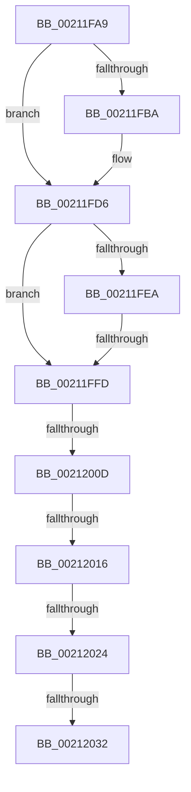

# sub_00211FA9

- RVA: `0x00211FA9`–`0x00212037` (길이 `142` bytes)
- VA: `0x0000000140211FA9`
- 실행 섹션: `.text`
- PDB 이름 있음: `아니요`; PDB Function 태그: `아니요`
- unwind 정보 RVA: `0x0005DF40`
- 디코드: `30`개 명령, `142/142` bytes 표시
- 미해석 바이트: `0` (있으면 어셈블리에 `.byte`로 보존)

> 이 문서는 커널 이미지의 기계어와 PDB 기호를 분석해 생성했습니다. 4번과 5번은 함수 원형과 자료형을 바이너리 사용 방식에서 추정한 C 해석이며 원본 소스 복구 결과는 아닙니다.

## 1. Dependencies

- 직접 호출 지점: **1**; 고유 호출 대상: **1**
- 직접 호출자로 확인된 함수: **0**
- RIP 상대 이미지 참조: **0**

### Outgoing calls
- `0x00211FD0` → [KeBugCheckEx](../4F/KeBugCheckEx_function_004FD660.md) (function, `0x004FD660`)

### Direct callers
- 이 함수 시작 RVA로 연결되는 직접 call은 확인되지 않았습니다. 간접 호출은 완전히 역산할 수 없습니다.

### Static image references
- 디코드된 RIP-relative 메모리 참조가 없습니다.

## 2. Other-region calls and transfers

- 다른 실행 섹션으로 향하는 call: **0**
- call이 아닌 외부 분기/꼬리 이동: **6**
  - `0x00211FF7` → [sub_00211D20 + 0x123](Unknown_function_00211D20.md) (`tail-transfer`)
  - `0x00212007` → [sub_00211D20 + 0xC7](Unknown_function_00211D20.md) (`tail-transfer`)
  - `0x00212010` → [sub_00211D20](Unknown_function_00211D20.md) (`tail-transfer`)
  - `0x0021201E` → [sub_00211D20](Unknown_function_00211D20.md) (`tail-transfer`)
  - `0x0021202C` → [sub_00211D20 + 0xF9](Unknown_function_00211D20.md) (`tail-transfer`)
  - `0x00212032` → [sub_00211D20](Unknown_function_00211D20.md) (`tail-transfer`)

## 3. Assembly (complete function range)

```asm
00211FA9  44 0F 20 C1                     mov rcx, cr8
00211FAD  65 4C 8B 04 25 88 01 00 00      mov r8, qword ptr gs:[0x188]
00211FB6  3A CA                           cmp cl, dl
00211FB8  76 1C                           jbe 0x140211fd6
00211FBA  44 0F B6 CA                     movzx r9d, dl
00211FBE  33 FF                           xor edi, edi
00211FC0  44 0F B6 C1                     movzx r8d, cl
00211FC4  33 D2                           xor edx, edx
00211FC6  B9 C6 01 00 00                  mov ecx, 0x1c6
00211FCB  48 89 7C 24 20                  mov qword ptr [rsp + 0x20], rdi
00211FD0  E8 8B B6 2E 00                  call 0x1404fd660
00211FD5  CC                              int3
00211FD6  48 89 74 24 50                  mov qword ptr [rsp + 0x50], rsi
00211FDB  4C 89 6C 24 40                  mov qword ptr [rsp + 0x40], r13
00211FE0  4C 89 7C 24 30                  mov qword ptr [rsp + 0x30], r15
00211FE5  80 F9 02                        cmp cl, 2
00211FE8  72 13                           jb 0x140211ffd
00211FEA  65 8B 04 25 3C 3A 00 00         mov eax, dword ptr gs:[0x3a3c]
00211FF2  A9 01 00 01 00                  test eax, 0x10001
00211FF7  0F 85 46 FE FF FF               jne 0x140211e43
00211FFD  41 0F B6 80 C0 00 00 00         movzx eax, byte ptr [r8 + 0xc0]
00212005  A8 02                           test al, 2
00212007  0F 85 DA FD FF FF               jne 0x140211de7
0021200D  80 F9 01                        cmp cl, 1
00212010  0F 83 0A FD FF FF               jae 0x140211d20
00212016  41 F7 40 74 00 04 00 00         test dword ptr [r8 + 0x74], 0x400
0021201E  0F 85 FC FC FF FF               jne 0x140211d20
00212024  41 83 B8 E4 01 00 00 00         cmp dword ptr [r8 + 0x1e4], 0
0021202C  0F 84 E7 FD FF FF               je 0x140211e19
00212032  E9 E9 FC FF FF                  jmp 0x140211d20
```

## 4. C-style interpretation (structured pseudocode)

```c
__int64 __fastcall sub_00211FA9(__int64 a1, int a2)
{
    __int64 result;
    __int64 v_rdi;
    unsigned __int64 v_stack_p20;
    unsigned __int64 v_stack_p30;
    unsigned __int64 v_stack_p40;
    unsigned __int64 v_stack_p50;

    if (((unsigned __int8)(v_cr8)) >= = ((unsigned __int8)(a2))) {
        a4 = (unsigned __int8)(a2);
        v_rdi = 0;
        a3 = (unsigned __int8)(v_cr8);
        a2 = 0;
        a1 = 454;
        v_stack_p20 = 0;
        result = KeBugCheckEx(a1, a2, a3, a4);
    }
    v_stack_p50 = v_rsi;
    v_stack_p40 = v_r13;
    v_stack_p30 = v_r15;
    if (((unsigned __int8)(a1)) < 2) goto loc_00211FFD;
loc_00211FFD:
}
```

## 5. (Beta) C Style

```c
int64_t sub_00211FA9(int64_t Arg1, int32_t Arg2)
{
    int64_t result;
    int64_t local_rdi;
    uint64_t v_stack_p20;
    uint64_t v_stack_p30;
    uint64_t v_stack_p40;
    uint64_t v_stack_p50;

    if (((uint8_t)(v_cr8)) >= = ((uint8_t)(Arg2))) {
        a4 = (uint8_t)(Arg2);
        local_rdi = 0;
        a3 = (uint8_t)(v_cr8);
        Arg2 = 0;
        Arg1 = 454;
        v_stack_p20 = 0;
        result = KeBugCheckEx(Arg1, Arg2, a3, a4);
    }
    v_stack_p50 = local_rsi;
    v_stack_p40 = local_r13;
    v_stack_p30 = local_r15;
    if (((uint8_t)(Arg1)) < 2) goto loc_00211FFD;
loc_00211FFD:
}
```

## 6. Execution-region graph

[열기: 2D/3D 그래프와 함수 탐색 컨트롤 패널](../../../control-panel.html?section=text&rva=0x00211FA9&view=graph)

- 2D 그래프는 위에서 아래로 흐르고, 3D 그래프는 빈 공간을 드래그해 회전합니다. Shift+드래그는 이동, 휠은 확대·축소, 함수 노드 선택은 대상 보고서 이동입니다.

### Static fallback


